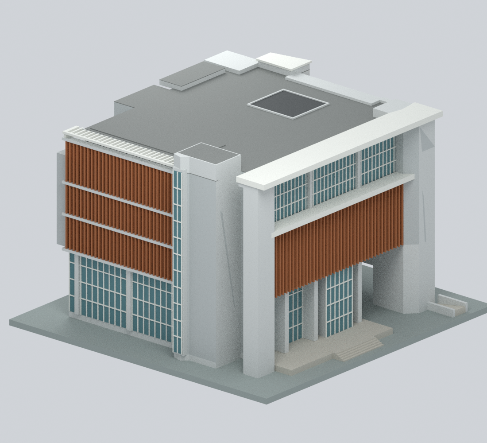
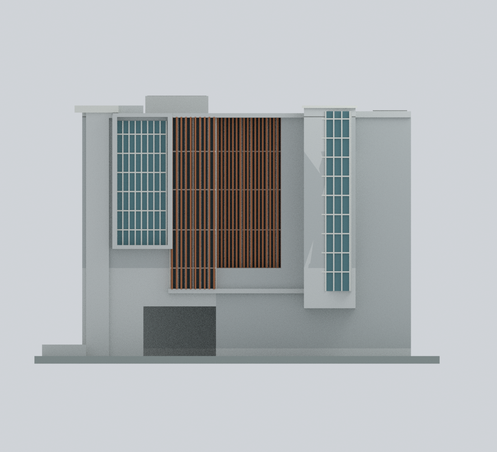
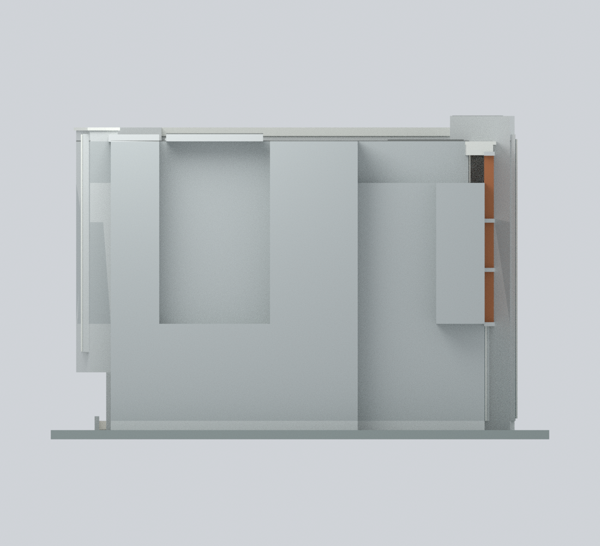
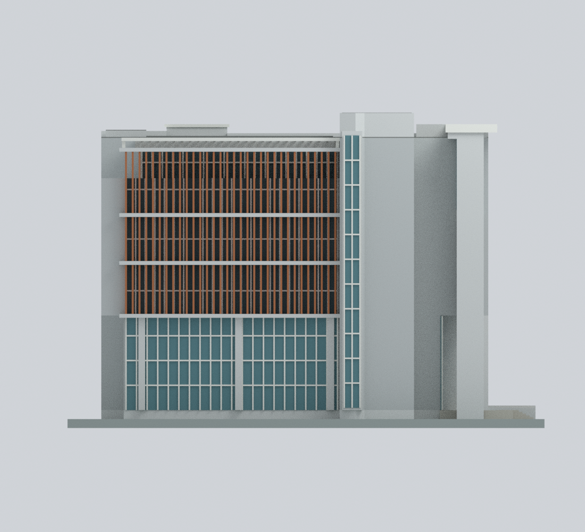
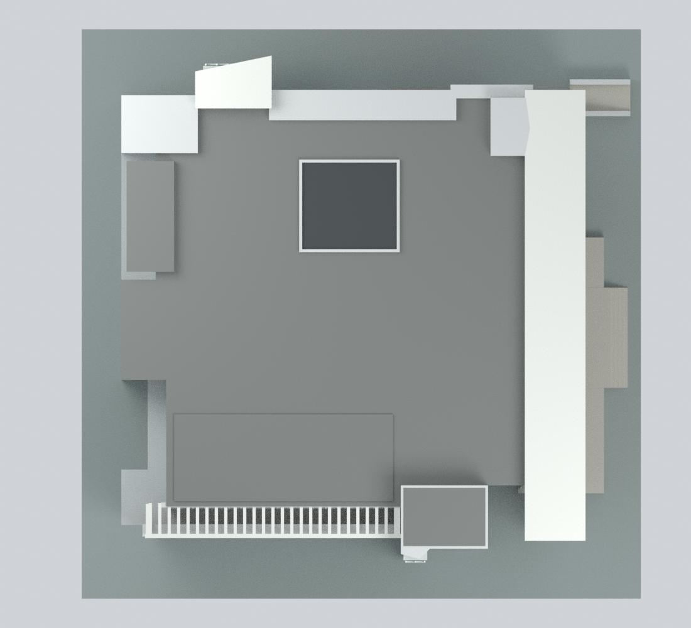
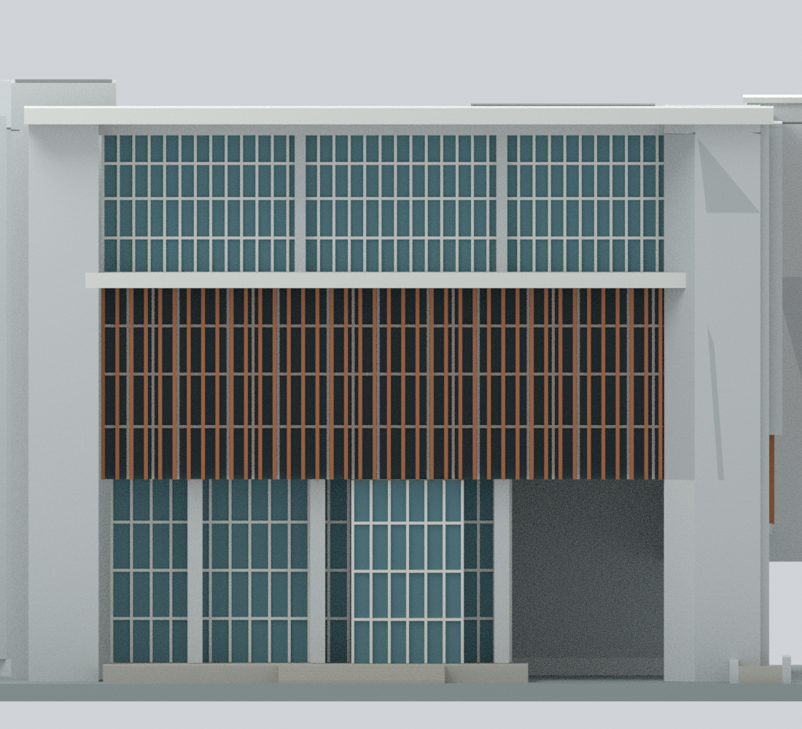
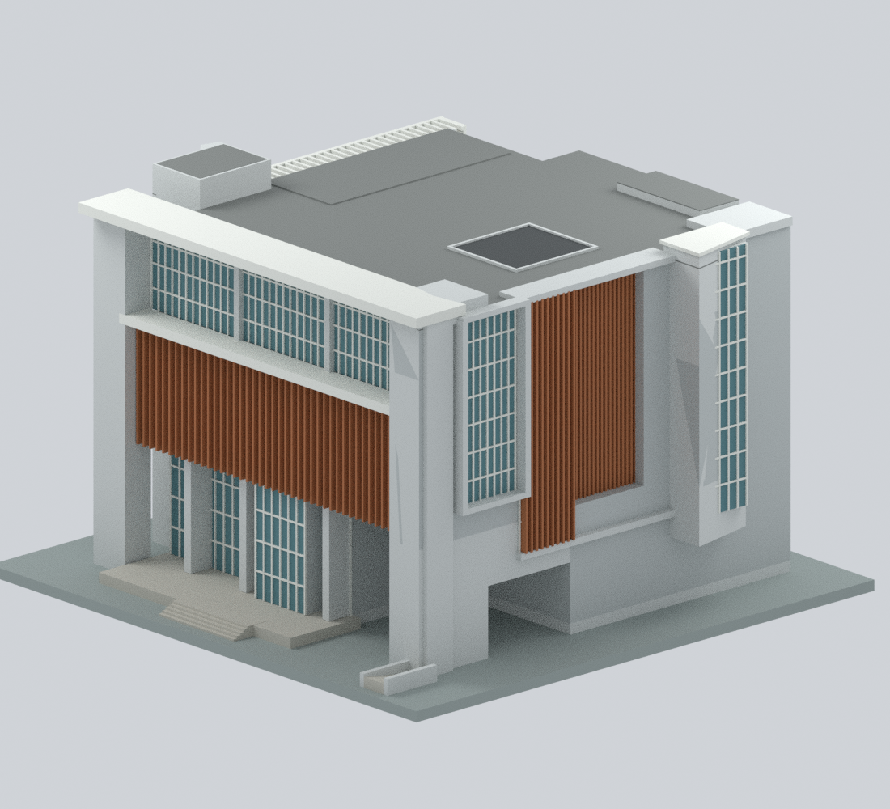
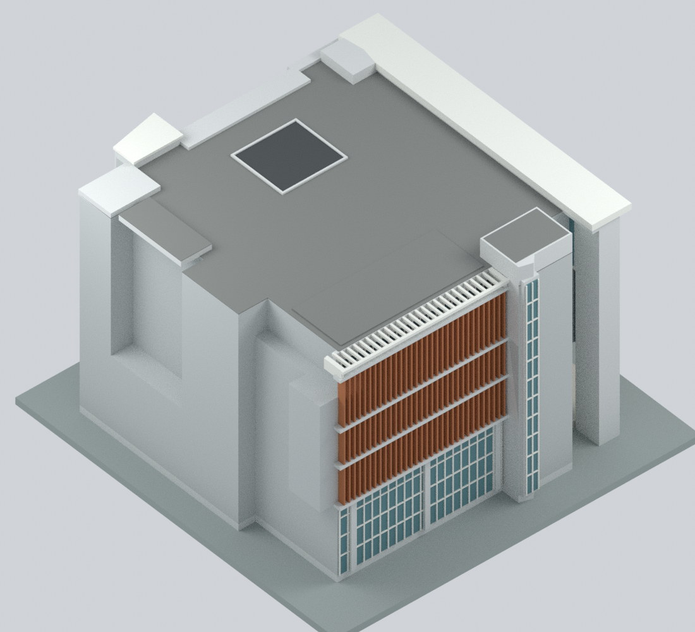

# 臺北市立大學博愛校區新圖書館

**2020 竣工／2021 啟用的新館：整棟地上外觀、有限細節與比例精度的彩色近似模型。**
混合參考官方樓層導覽、實景與屋頂正射；不是精確 2021 年復原、已核實的 2026 年現況、測繪成果或全校模型。

## 模型預覽

以下九張全部為本模型的實際渲染，不是來源照片或示意佔位圖。

| 東入口正面 | 東南斜視 | 北面 |
|---|---|---|
|  |  |  |
| 西面：未知細節中性化 | 南面 | 俯視 |
|  |  |  |
| 東入口細節 | 東北斜視 | 西南屋頂斜視 |
|  |  |  |

## 檔案與可編輯性

- `utaipei-boai-library-2021.blend`：原生可編輯網格、10 種程序材質、攝影機與燈光。另含隱藏的 470 個建構元件；其聯集前互相重疊，不應直接當成可列印成品。
- `utaipei-boai-library-2021.3mf`：每三角形基礎材質色彩；不是指定印表機的擠出機／耗材設定檔。
- `utaipei-boai-library-2021.stl`：單色幾何；STL 本身不含材質色。
- `build_model.py`、`parameters.json`：可重建的數值外形、樓層高度區段、百葉數量和厚度；`mesh-data.npz`、`construction-parts.json` 保留幾何陣列與元件。
- `sources.json`、`evidence-map.json`：來源、各部分依據、估計與未知；`qa/` 提供實際執行的檢查結果。

本模型含六個地上樓層對應的高度區段，但入口挑高、中段柵面、上段玻璃不是六條等高窗帶。模型為可列印實體外殼，不模擬室內可用空間；地下三層未建模。

## 比例與已知限制

- 外包展示尺寸約 **212 × 216 × 140.15 mm**，包括自製底板；尺寸是正規化代表比例，**沒有已驗證的實際公尺高度或精確縮尺比**。局部 +X 約為東入口、+Y 約為北面，非測量方位。
- 保留不對稱外緣、低層東北退縮、上層西南退縮、東大簷、北面凹入棕柵與玻璃塊、南面開放格柵及東南核心。西面沒有直接完整立面照片，僅保留平面與空照支持的量體，刻意不猜窗列、門或百葉。
- 屋頂主要核心與帽蓋同時受東、南、北照片剪影和空照位置約束；小型設備省略。未另加完整屋頂樓層。官方 **155.81 m²「屋突物一層」是樓地板面積，不是屋頂投影或高度**。
- 4F 有「挑空閱讀區」，5F／6F 有對應灰區；屋頂是否露天、玻璃覆蓋及深度仍未知。本模型只表達中央暗色頂面與淺邊框，不宣稱開放天井、透明天窗、屋架或室內樓板。
- 淺灰、棕橘、青藍灰取自白天照片的材質色系，未校色；窗格、柵根數與厚度均簡化。玻璃用不透明色面，沒有貼入來源影像。文字、標誌、樹木、街道、細部圍牆與完整採光井不重建。
- 入口平台、階梯與坡道口是有限外觀近似；底板不是地形或地下樓層。請勿用此模型做工程、結構、無障礙動線或避難判讀。

## 重建

建議 Python 3.11+、`requirements-model.txt` 及 Blender 4.3.2。Blender 是另裝的應用程式。

```bash
python -m pip install -r requirements-model.txt
python reproduce.py --out ./rebuilt --blender blender
```

若 3MF 套件放在不同 Python 環境，可加 `--export-python /path/to/python`。重建只需要公開的 Python、JSON 數值和依賴，不需要照片、網路、外部貼圖或 Blender 附加元件。`parameters.json` 的外緣、核心頂高與柵數可調；`levels`、`mullion_width`、`south_pergola_top` 同時記錄對照數值，對應細節座標仍在 `build_model.py` 明訂，調高度時需同步修改，並非全連動 BIM。任何尺寸／根數修改後都必須重新檢查厚度、支撐及渲染。

## 幾何與列印限制

成品為單一封閉聯集。已檢查 STL 邊／頂點流形性、退化與重複三角形、繞序、正體積、0.2 mm 水平切片、指定開放間隙射線，以及含正反例的三角形自交檢測。3MF 經嚴格讀回及色彩驗證；Blend 已實際更改頂點與材質、儲存並重新開啟測試副本。乾淨輸入重建另核對陣列、STL 與九張 PNG。

**這些不是免支撐或實體列印成功保證。** 東簷、東北懸挑、南格柵及北突出部需要支撐／橋接評估。獨立棕柵寬約 0.85 mm，格柵梁寬 1.2 mm，附著式窗框浮雕寬約 0.65 mm；薄材質皮層與主體相交，不是獨立薄牆。底板接近 220 mm 平台尺寸，請保留邊距，勿未檢查就縮小。幾何體積不是實際耗材量；尚未實體試印。

## 身分、來源與權利

地址：臺北市中正區愛國西路 1 號，臺北市立大學博愛校區。不是天母體育館、1972 舊圖書館、2008 KSA 未建競圖或其他同名大學。

- [臺北市新工處完工資料](https://nco.gov.taipei/News_Content.aspx?n=528B8D8F449CEE76&s=DF467AB439AB1BA9&sms=47D2B47B3DA0736F)：2020-04-15 竣工，地上六層／地下三層。
- [館方沿革與落成誌](https://lib.utaipei.edu.tw/UTWeb/wSite/np?ctNode=461&mp=1)：2021-05-31 遷入啟用；[啟用典禮報導](https://lib.utaipei.edu.tw/UTWeb/wSite/Epaper/cp.jsp?epubId=98&ictunit=333&icuitem=415595)記 2021-07-20 典禮，不能取代竣工日。
- [王正源事務所專案及實景](https://cywang.com.tw/works/65/)：網站專案期間不是竣工標高或圖面年代證明；城市欄誤列「新北市」不採用。
- [館方樓層導覽](https://lib.utaipei.edu.tw/UTWeb/wSite/ct?ctNode=312&idPath=308_312&mp=1&xItem=447314)：1F–6F、B1 是無尺寸導覽，不是施工圖。
- 屋頂參考國土測繪中心 PHOTO2；精確服務 URL 見 `sources.json`。取用日 2026-10-25 不代表影像拍攝日；照片與空照拍攝時間未確定。

新工處記設計監造為王正源建築師事務所、承攬為遠碩營造；館方落成誌另列蔡明穎建築師事務所參與設計監造，保留此差異，不擅分責任。

來源照片、平面、PDF 與空照的權利仍屬各原權利人；本套件不包含或再散布其像素。公開內容僅為原創幾何、程序材質、自有模型渲染、來源連結及獨立摘要，不表示校方、建築師、攝影者或政府機關認可本模型。
