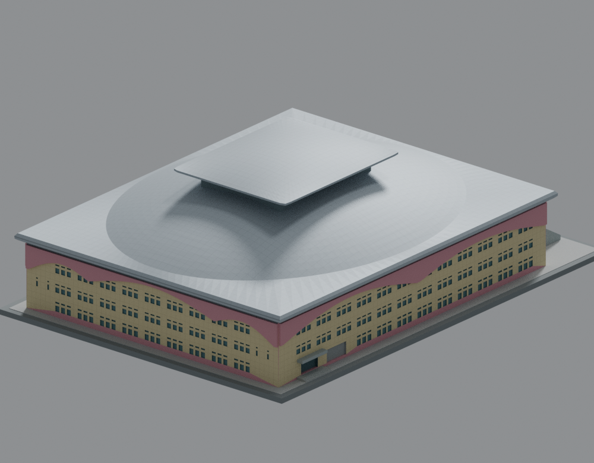
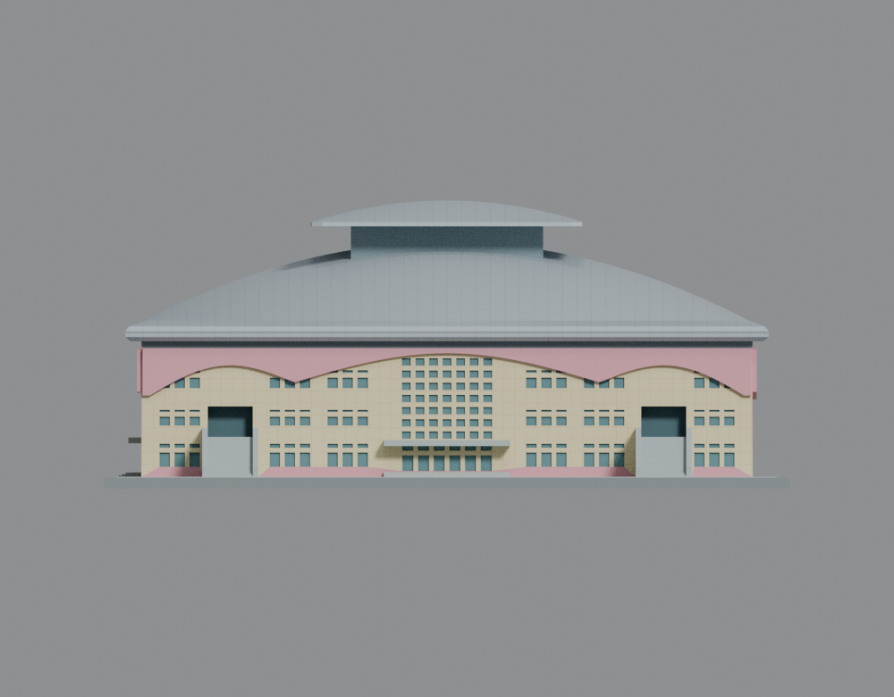
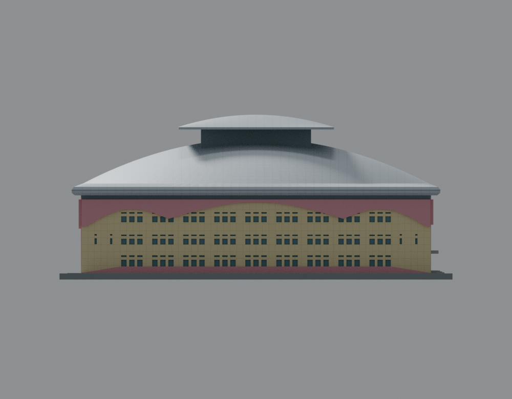
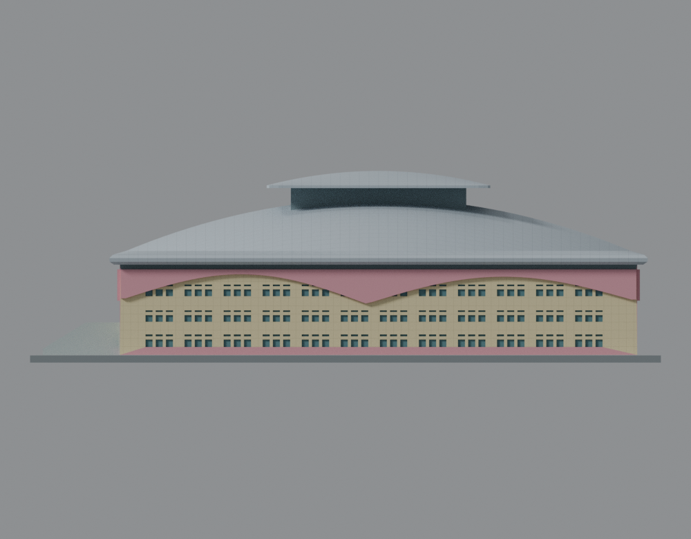
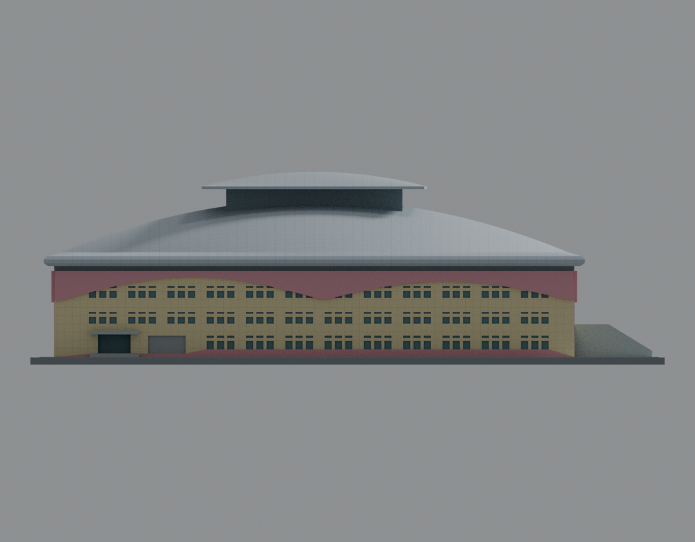
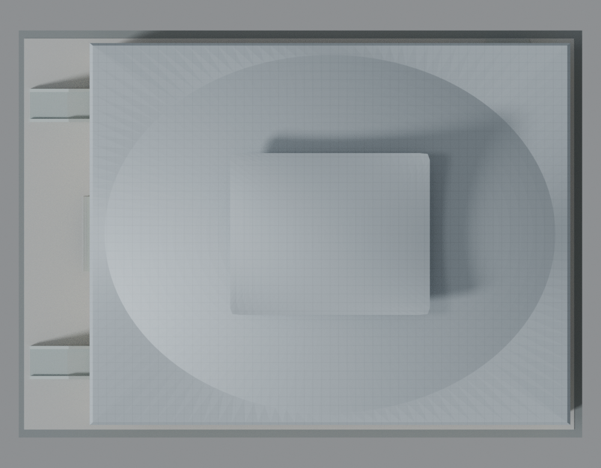
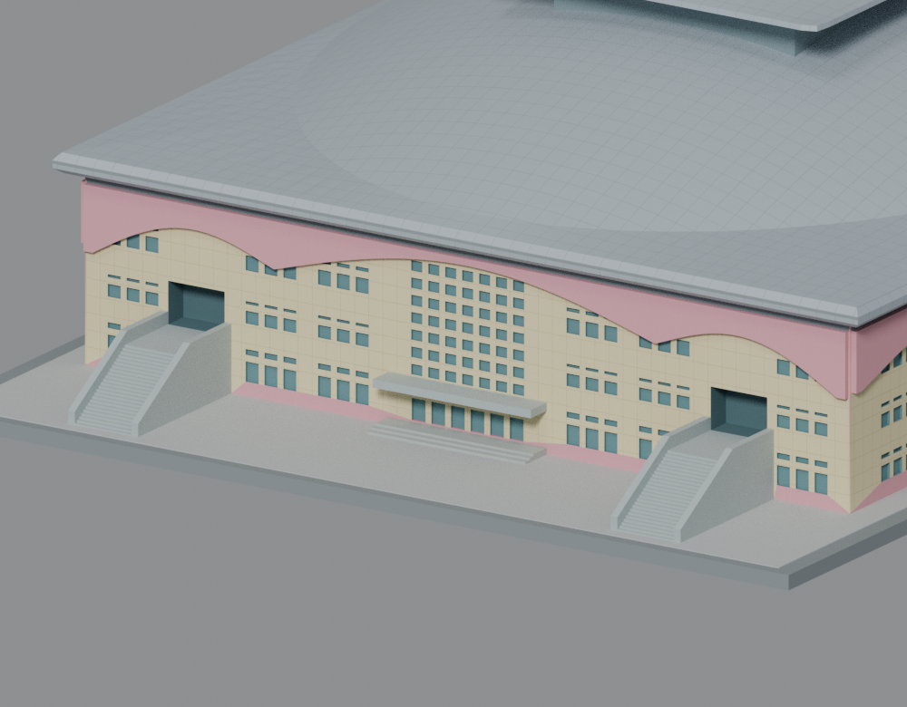
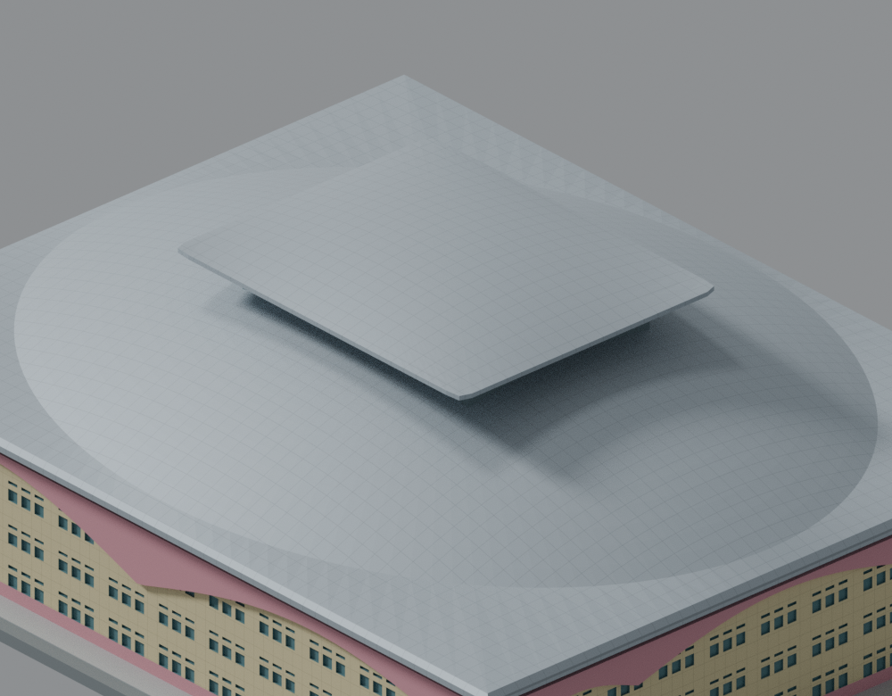

# 臺北市立大學｜天母校區體育館 A 棟（2012）

原創外觀模型一套，以銀色雙向曲面主屋頂、低矩形裙邊、抬高採光帽、米黃牆、粉色波形飾板及西側雙外梯為辨識重點。只包含 A 棟，不含 B／C 館；前身臺北體育學院不另算一所學校。

**原始網格完整計算 QA 通過；未實際試印。** 獨立重播與最終總判定見 [QA 說明](qa/README.md)，計算檢查不等於免支撐或列印保證。

## 正反並排

| 模型預覽 | 模型預覽 | 模型預覽 |
| :---: | :---: | :---: |
| 西南入口側<br> | 東北背側<br> |  |

其餘主視圖：[西](renders/west.png)、[東](renders/east.png)、[南](renders/south.png)、[北](renders/north.png)、[俯視](renders/top.png)。
局部：[入口雙梯](renders/entry-detail.png)、[雙向屋頂與採光帽](renders/roof-detail.png)。以上共七張主視圖、兩張局部圖。

| 模型預覽 | 模型預覽 | 模型預覽 |
| :---: | :---: | :---: |
| 西<br> | 東<br> | 南<br> |
| 北<br> | 俯視<br> | 入口雙梯<br> |
| 雙向屋頂與採光帽<br> |  |  |

## 模型與比例

- [原始 STL](models/v6/model.stl)：單一連通外表面，毫米單位，無內部房間。STL 本身沒有單位欄，匯入時請選 mm。
- [Blender 場景](models/v6/scene.blend)：與 STL 相同的有方向三角形，原創程序材質，不含來源照片或隱藏替代幾何。
- [生成程式](source/build_model.py)、[渲染程式](source/render_preview.py)、[參數](parameters.json)。
- 名目約 1:500，2 mm 代表推估的 1 m。整體含底座約 **210 × 152 × 63.8 mm**，底座厚 2.4 mm。
- 1FL 為標高原點；戶外地坪 −0.50 m。剖面樓層間距 400／400／582 按 cm 解讀，得 2FL 4.00、3FL 8.00、RFL 13.82 m。
- 主屋頂約 89.6 × 71.3 m、主曲面最高約 25.6 m；採光帽約 37.2 × 30.2 m、最高約 30.2 m。這些是圖面比例推估，沒有測量精度保證。

## 來源與未知

以[校方原始營運簡報](https://pe.utaipei.edu.tw/p/405-1020-29708,c4359.php?Lang=zh-tw)中的三層平面、兩剖面及外觀照為主，交叉對照[市府工程資料](https://nco.gov.taipei/News_Content.aspx?n=528B8D8F449CEE76&s=996D01EB6491A8AC&sms=47D2B47B3DA0736F)、[屋頂廠商照片](https://gomore.com.tw/2015/project_TUTMA.html)、[承包商相簿](https://www.hcgc.com.tw/project/display/114)及國土測繪中心正射影像。完整來源 URL、原始檔雜湊與用途見 [sources.json](sources.json)。

校方簡報不是已驗證有竣工章的圖說。兩官方文字的啟用月份不同，因此本件只採共同支持的 **2012 年**，不合併成單一交屋月份。早期四層加二層地下室舊方案已排除。

粉色波形是牆頂飾板的下緣：東西短面三段、南長面兩段。北側只實證近 B 梯入口、捲門、相鄰窗及局部下緣起伏；遠端窗列和整面波形仍屬圖面約束的保守推定，沒有把南面鏡像當成證據。方位亦由圖照與正射相關推定，原圖沒有已確認的北箭頭。

[獨立來源外觀審核](qa/source-audit/SOURCE-APPEARANCE-AUDIT.md)已逐張檢視九圖，綁定同一 STL 及乾淨 PNG 雜湊。

原 PPT、照片、圖面及地圖不隨公開包重散布，也沒有作為貼圖。模型及程序材質為原創近似。[詳細估計與簡化](ESTIMATES-AND-SIMPLIFICATIONS.md)列出所有主要限制。

## 製造加厚、支撐與未試印限制

- 小窗框／橫梃約 1.04 mm；雙梯細欄杆改為約 1.2 mm 實心側板，並完整連到地坪。平台、樓梯與底座實體相連，主要二樓入口凹口保留。
- 粉檐端部設 1.6 mm 寬平端，短面中央波峰略降約 0.44 mm，留下約 1.08 mm 厚的帶狀材料。
- 未量測的採光帽角部作列印修形：外頂角局部抬約 1.2 mm、外伸底面最低約 27.35 m；中央帽底 28.2 m、最高 30.2 m、投影範圍及內縮灰帶保持。這會略改角部輪廓，不是已驗構造。沒有添加來源中看不到的角柱或大斜撐。
- 曲面屋緣保留實體厚度。採光帽外伸約 8–9 mm，主屋檐及入口雨遮亦需檢查支撐。模型不含可拆式支撐；請在切片器中逐層檢查並配置。
- 建議先用 0.4 mm 噴嘴、0.2 mm 層高作切片檢視，這不是已試印的機器設定。縮小尺寸、空心化、排液孔或重網格化均屬新幾何，須重新 QA。

[完整列印與支撐限制](PRINTING-LIMITS.md)。有限射線與切層檢查不能保證全方向最小厚度、力學強度、免支撐、建築測量精度或特定列印機成功率。

## QA 與重現

本件原網格完整 normal／-O 兩模式均 strict pass，兩模式科學證據一致。每模式 24,112 個原面、241,120 條原射線，零短弦／零 flags，最小首段實心弦 0.901098 mm；957 個原切層 Polygon 全過，最大 opening loss 0.085328%；297,696 個閉 AABB 候選對全部精確完成，零不允許相交。[作者實跑報告](qa/AUTHOR-MODEL-QA.md)及[原始完整摘要](qa/final-v6/full-qa-summary.json)保留本件數據，不沿用其他建築的數值、結果或豁免。檢查包括原始拓樸／法線／單表面、閉合 AABB 候選的精確相交（含鄰面與共面）、每面十條原法線射線、每一切層 Polygon 的窄根與侵蝕，以及正／負控制。原射線 CSV 保留原 run 的十六進位描述；任何旗標先保留 strict=false，不移動樣本或替換理想射線。

請在新解包副本中重建，保留原交付包作比對。重建環境：Python 3.12.14、NumPy 2.3.5、Manifold3D 3.5.4、Shapely 2.2.0；Blender 4.3.2。環境細節見 [toolchain.json](toolchain.json) 及 [requirements.txt](requirements.txt)。

```sh
# 從解包後的專案根目錄，以已有上述依賴的 Python 執行
OMP_NUM_THREADS=1 OPENBLAS_NUM_THREADS=1 python source/build_model.py --output-dir models/v6
blender -b -t 1 -P source/render_preview.py -- v6
```

正式渲染為 Cycles CPU、1 執行緒、64 samples、seed 0、停用 denoise；未啟用此環境不支援的 OIDN。九張圖皆使用正交相機。重播後的 PNG 僅允許移除 File／時間 metadata，全部像素、IDAT 及其他 chunks 必須保持。

完整檢查重播（輸出資料夾必須尚不存在）：

```sh
OMP_NUM_THREADS=1 OPENBLAS_NUM_THREADS=1 python -B qa/tools/run_full_qa.py \
  --stl models/v6/model.stl \
  --expected-sha256 f93ed0ab95e13707d390f480174f63e31086b48041fc7a7a873975cad8892a8c \
  --expected-longest-mm 210 --out qa/replay-v6
```

通用工具及正負控制重現說明見 [QA 說明](qa/README.md)；synthetic fixtures 收在單一可驗證 archive，不散放在主目錄。原始數值旗標不會因正確外觀而獲豁免。

公開圖使用 [衍生重播 manifest](renders/replay-manifest.json)，保留原場景／來源程式／渲染政策／相機，逐圖雜湊綁定 clean PNG，並另存原 raw PNG 與原 manifest 雜湊。用它重播時，新報告中的 original 是「公開乾淨基準圖」，不可把新報告的 raw 欄位當成歷史 raw 圖證明；原清理證據沒有被改寫。

```sh
blender -b -t 1 -P qa/render-tools/inspect_and_rerender_blend.py -- \
  --blend models/v6/scene.blend --stl models/v6/model.stl \
  --manifest renders/replay-manifest.json \
  --expected-sha256 f93ed0ab95e13707d390f480174f63e31086b48041fc7a7a873975cad8892a8c \
  --out qa/replay-nine-views
```
