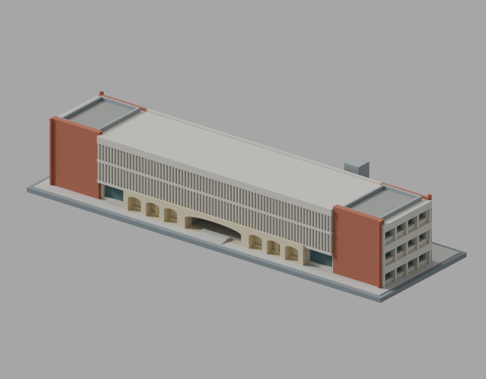

# 臺北醫學大學建築模型圖鑑

目前收錄1套：信義校區教學大樓2021–2022修復後主體，以2023–2024公開照片為依據，未含廣場鐘樓。本校為教育部115學年度正式大學，代碼1028；前身臺北醫學院不另計學校。其他建物、雙和校區及全校逐棟清單仍未完成。

## 建築圖鑑

| 建築模型 | 建築模型 | 建築模型 |
| :---: | :---: | :---: |
|  **[教學大樓｜修復後外觀](信義校區/buildings/tmu-teaching-building-restored/README.md)** 中段格柵、紅磚端區、開通廊與側凸電梯 220 × 70 × 約38.65 mm |  |  |

[完整模型、正反並排預覽與下載](信義校區/buildings/tmu-teaching-building-restored/README.md) · [來源摘要](inventory/sources/tmu-teaching-building-restored-source-summary.md) · [QA摘要](inventory/qa/tmu-teaching-building-restored-review.md)

原作吳明修（1963年），修復設計曾泊銘建築師事務所。這是教學大樓，非教研大樓、醫檢大樓、附設醫院或雙和教學研究大樓。長條三層的NE長面只有中段密集格柵，兩端為寬紅磚實牆；SW長面為開放水平通廊，靠NW的一側凸電梯以短橋相連。1F中央穿堂由上層教室與屋頂覆蓋，並非露天天井。1F石貼面拱廊只保留來源支持的中段，兩側直線窗柱仍有區別。

名義約1:400。校方82m總長未定義量測端點，歷史4.5m層高不等於修復後實測標高；進深、電梯及屋頂欄杆配置為比例／構造推估。SE短端缺乏完整來源，保留低細節實面，不代表已證實無窗；NW方位依場地關係推定。模型77道格柵、七拱、增厚接根、圓角及樓梯坡段屬製造簡化。未納入歷史巨大裸雨庇或未定年屋頂光電。

原數值檢查各1個flag與strict false完整保留；同一原run唯一事件的精確分類與獨立驗證範圍見QA，不能改稱原strict pass。未實體試印，開通廊、穿堂、遮陽與短橋有懸空／跨距，可能需要大量支撐，不是免支撐或列印成功保證。

公開內容只含自行建立的幾何、程序材質、渲染、來源連結與檢查證據；不含原照片、圖面、PDF、正射或私人比較板，不宣稱原建築師、修復設計者或攝影師授權、認可。
