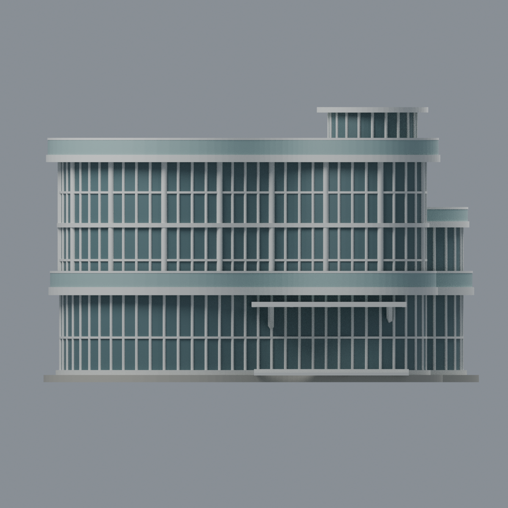
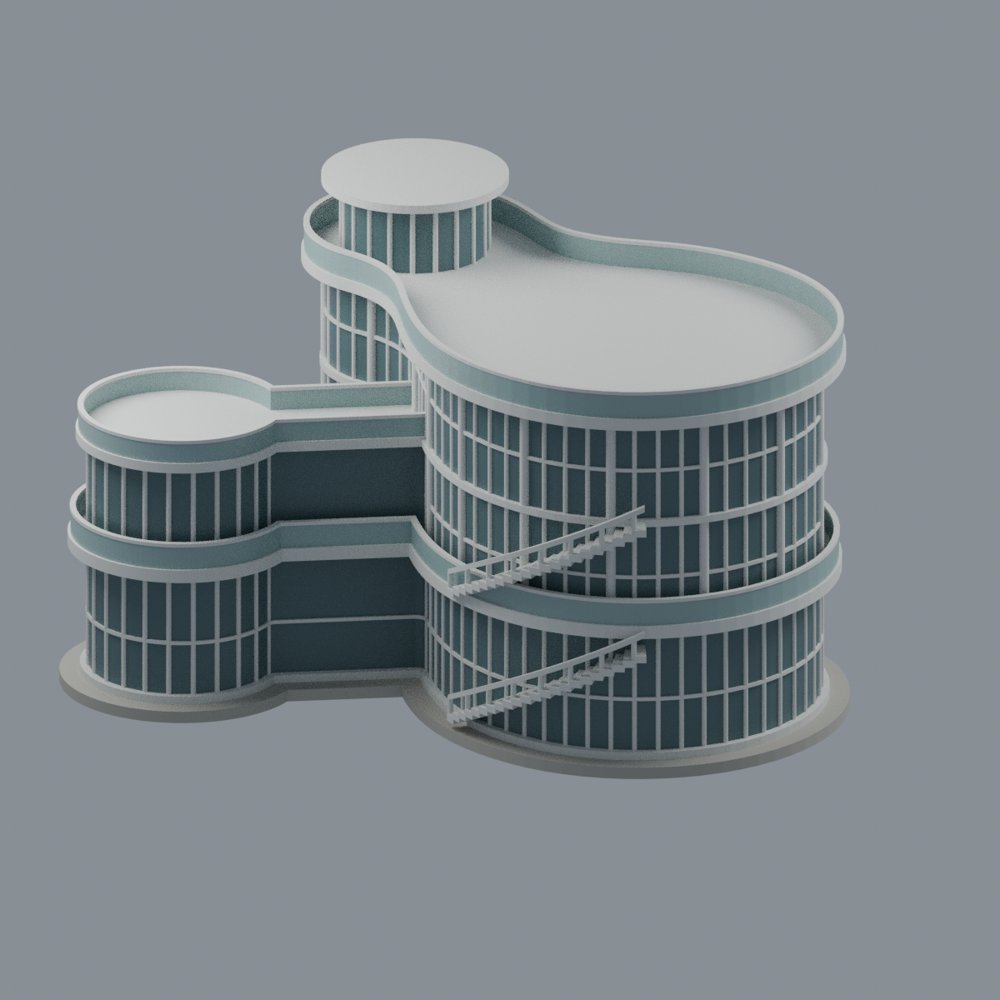
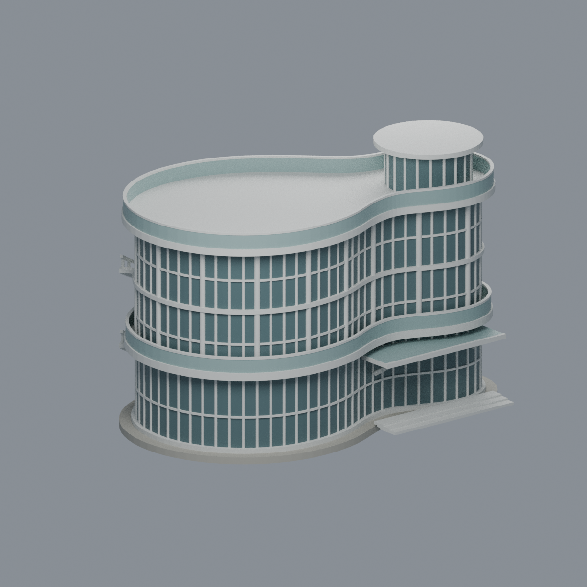

# 臺北醫學大學信義校區｜君蔚樓 Dream-Way Building

| 模型預覽 | 模型預覽 | 模型預覽 |
| :---: | :---: | :---: |
|  |  |  |

完整建築的**有限細節、近似外觀模型**：三層大圓主體、前方較小圓端的高圓筒與寬簷帽、後側兩層小圓翼及短頸（頂部位於三樓樓面，形成露臺）、正面矩形入口雨棚、後側弧形外梯。不是僅正面片段，也不是簡單兩圓花生形。

## 下載與編輯
- [彩色可編輯 Blender 場景](scene.blend)：材質、相機、燈光可改；單一閉合表面網格，非參數化BIM。
- [通用彩色 3MF](model.3mf)：每三角面材色，不代表指定切片器/機台的擠出機配置。
- [單色 STL](model.stl)、[生成器](build_model.py)、[原網格資料](mesh.json)、[材質表](palette.json)。
- [正面](previews/front.png)｜[正立面](previews/elevation.png)｜[背面](previews/rear.png)｜[俯視](previews/top.png)｜[左斜視](previews/left_oblique.png)

| 模型預覽 | 模型預覽 | 模型預覽 |
| :---: | :---: | :---: |
| 正立面<br> | 背面<br> | 俯視<br> |
| 左斜視<br> |  |  |

## 依據及不確定性
官方校史館三張照片與官方公開樓層圖的**外輪廓**支援三圓比例、連接及不同高度；沒有複製室內房間、逃生路線、保全或設備配置。原始照片、PDF未收入本模型包。[完整來源與限制](SOURCES.md)。

- 官方校史館記載 **2018-06-01 啟用**；另官方防災表單將建造年代列為民國108年（2019）。這是不同來源欄位，存在年份差異，未擅自解釋成同一日期。照片檔案路徑中的2015/08不是拍攝或竣工日期。
- 無尺寸、立面施工圖或2026現場調查，比例由圖像估讀；約180 × 143 × 113.7 mm是本模型包尺寸，不代表已知比例尺或真實公尺尺寸。
- 玻璃改用不透明灰綠色封閉面，建築為填實外觀；後方窗格數、外梯逐級形狀、屋頂和背側設備未知，窗格規律化、外梯簡化，設備不臆造。沒有室內樓梯/電梯或家具。
- 主體2/3樓間只留細樓板帶，並非每層都有寬露臺；欄杆、窗條為可輸出而加厚。細節均有幾何面界，非貼照片。
- 沒有複製館名字樣、書法、校徽、相鄰高樓、人物或植栽。底座為人工展示底座，不是實測鋪面。

## 驗證與列印限制
[QA](QA.md)記錄原始輸出STL拓樸、全層與局部切片、3MF SDK及Blender編輯重開、五張實際網格渲染和隔離重建。生成器布林後在輸出前採0.002 mm幾何簡化；QA只對交付原始STL作精確座標焊接記帳，不補洞、不刪面或容差修復。

**未實際列印，非免支撐或可直接列印保證。** 屋簷、寬帽、雨棚、弧梯、窗條及欄杆仍須切片器確認支撐、壁厚、方向與材料；縮小會加劇細部風險。局部薄處警告不以整棟連通或較粗底座掩蓋。

## 重建
安裝 `requirements.txt`（Blender獨立安裝），執行：
```sh
python build_model.py
python qa_model.py
python check_features.py
blender --background --python-exit-code 1 --python render_model.py
python verify_exchange.py
blender --background --python-exit-code 1 --python verify_scene.py
blender --background --python-exit-code 1 --python verify_render.py
```
`verify_exchange.py`另需lib3mf SDK可載入；機台/套件版本差異可能影響PNG位元組。實際確認的重建結果見qa資料，不把未執行項目宣稱通過。自製幾何依[LICENSE](LICENSE)，引用資料之權利屬各原作者。
