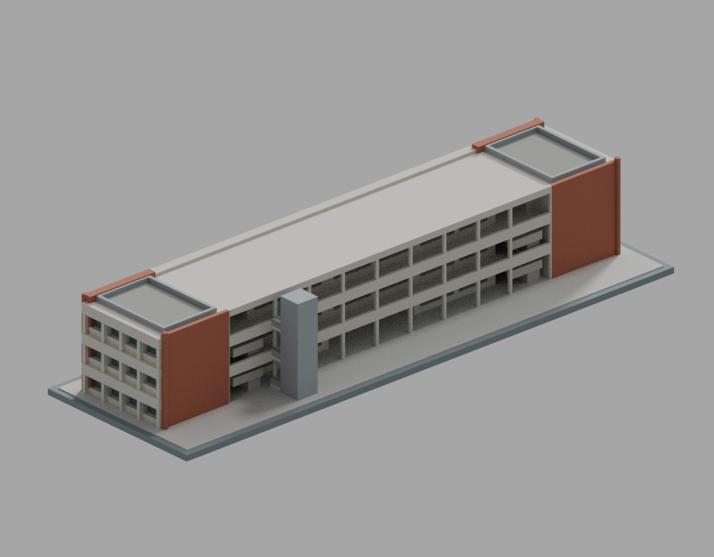
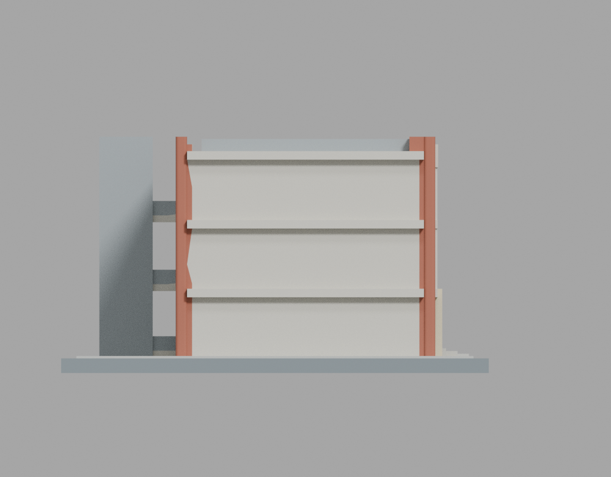
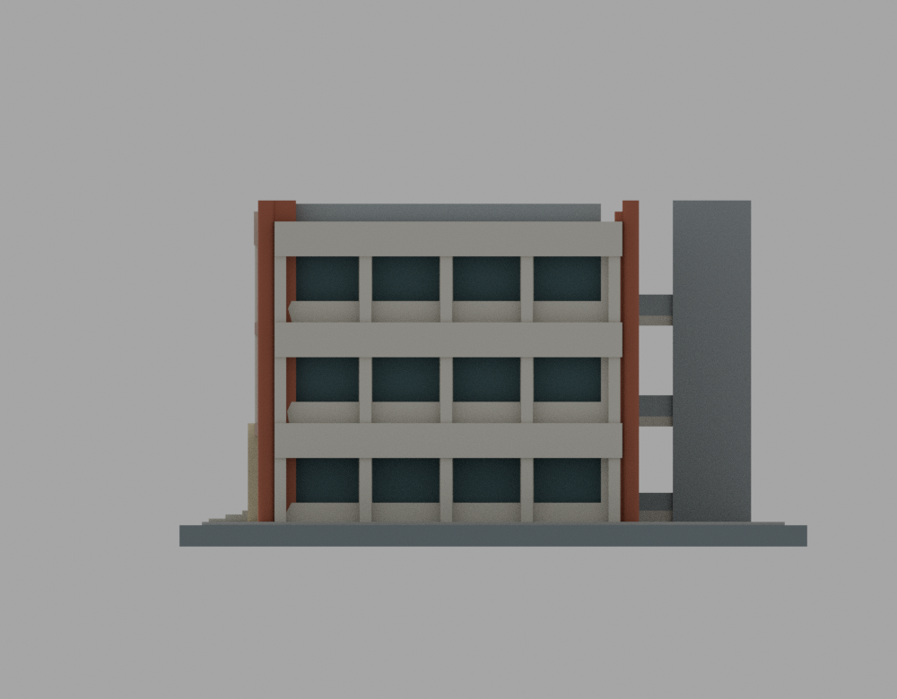
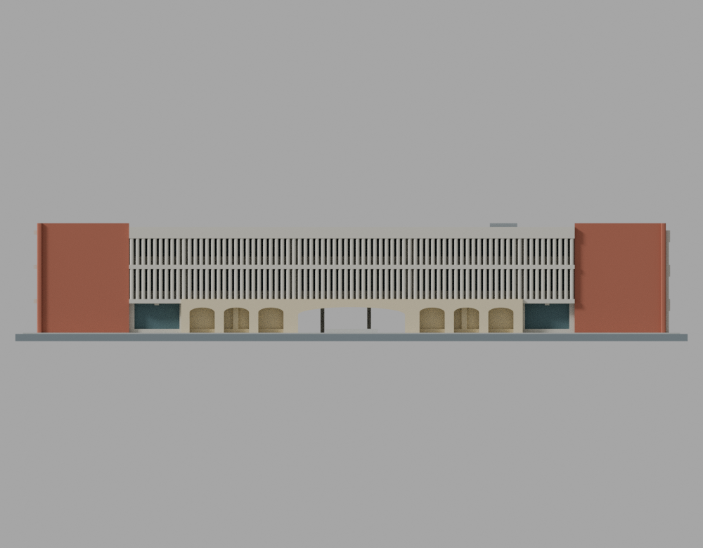
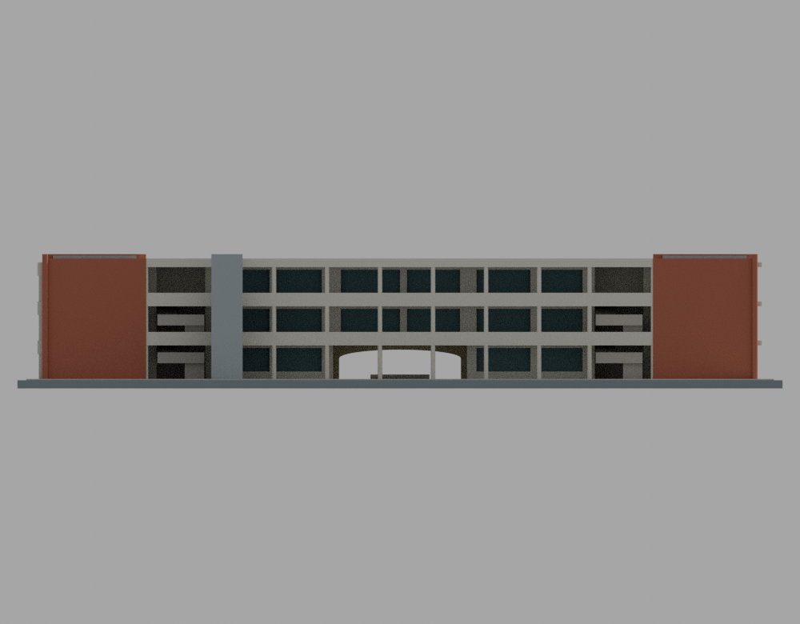
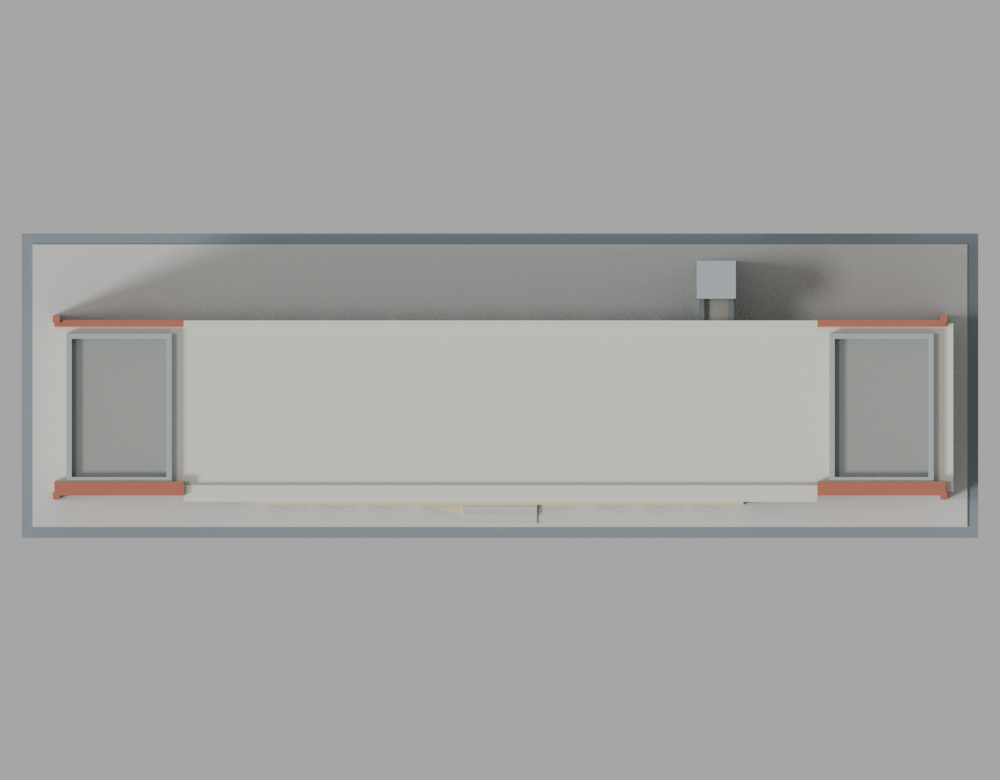
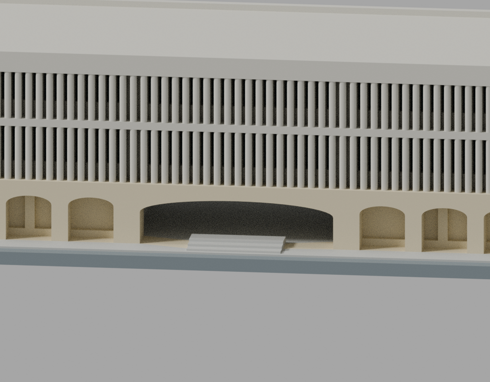
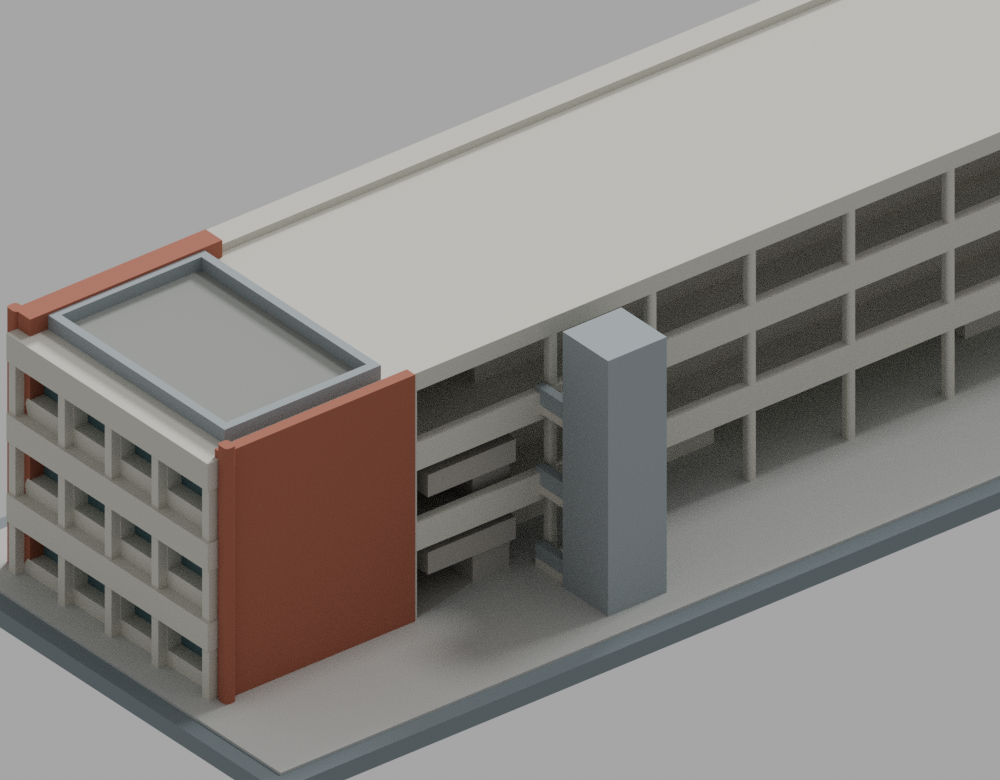

# 臺北醫學大學信義校區教學大樓

## 模型預覽

| 模型預覽 | 模型預覽 | 模型預覽 |
| :---: | :---: | :---: |
| NE 格柵／廣場側  | SW 通廊／球場側  |  |

2021–2022 修復後的有限細節外觀模型，以 2023–2024 公開完成照片為依據。校名：臺北醫學大學；MOE115 代碼：1028。原作：吳明修，1963 年；修復設計：曾泊銘建築師事務所。本件只含教學大樓主體與側凸電梯，未含廣場鐘樓。

這不是教研大樓、醫檢大樓、形態學大樓、雙和教學研究大樓或附設醫院，也不是實測、竣工或施工模型。

## 正反面

其餘主圖： [SE 端](previews/v3/west.png) · [NW 端](previews/v3/east.png) · [NE 正立面](previews/v3/south.png) · [SW 正立面](previews/v3/north.png) · [頂視](previews/v3/top.png)。局部：[中央穿堂](previews/v3/entry-detail.png) · [NW 電梯與屋頂](previews/v3/roof-detail.png)。檔名中的 west/east/south/north 是模型局部座標相機名，並非真地理方位。

| 模型預覽 | 模型預覽 | 模型預覽 |
| :---: | :---: | :---: |
| SE 端  | NW 端  | NE 正立面  |
| SW 正立面  | 頂視  | 中央穿堂  |
| NW 電梯與屋頂  |  |  |

## 檔案與重建

原 STL：`models/v3/model.stl`；Blender：`models/v3/scene.blend`。模型使用原 STL 有向三角面與程序色材質，沒有修補替身或照片貼圖。原碼在 `source/`，參數為 `parameters.json`；模型資料夾另保存當時源碼與參數快照。

正式圖為 CPU Cycles、64 samples、固定 seed 0、單執行緒、1000 × 780。現有 Blender 不支援 OpenImageDenoise，未使用去噪。公開 PNG 只去除 File 與時間／性能文字 metadata；IDAT、解碼 RGBA、色彩資訊與所有保留 chunk 不變。清理綁定與原／公開 hash 見本件 render manifest 及 metadata-cleanup-binding；原始 PNG 的時間 metadata 不保證跨次整檔相同。

從套件根目錄使用全新輸出目錄（Python 套件與 Blender 版本見 requirements.txt、toolchain.json）：

    OMP_NUM_THREADS=1 OPENBLAS_NUM_THREADS=1 python source/build_model.py --output-dir models/rebuilt
    OMP_NUM_THREADS=1 OPENBLAS_NUM_THREADS=1 blender -b -t 1 --python source/render_preview.py -- rebuilt

此流程產生原始 PNG。公開清理與科學證據重現見 qa/README.md。位元級重現只限實際驗證工具鏈，不保證不同軟硬體相同。

## 建築辨識與範圍

- 長條三層；原圖為 1F 四間、2F 五間、3F 五間，合 14 間階梯教室。模型教室內部以實心體簡化，沒有宣稱室內逐間重建。
- 中央穿堂只在 1F，2F／3F 中央教室及屋面連續覆蓋，沒有露天天井。
- 兩座 U 形樓梯在端教室內側；本模型以厚實坡段和平台表達，不雕刻微小踏步，也不推定樓梯可通屋頂。
- 單一灰色側凸電梯位在 SW 通廊側、靠 NW 約四分之一處，有短接橋；電梯外皮與最高點為有限細節估值。
- NE 為中央密集豎格柵，兩端有寬紅磚實牆；SW 為水平開通廊；NW 短端保留深遮陽與退縮窗帶。SE 未核實端部採低細節實面，不編造詳細窗列。
- 1F 石貼面拱廊只做有照片支持的中段，格柵下兩端保留直線窗柱段。七個模型拱口是合併簡化節奏，不是實測拱洞清單。
- 不含鐘樓、歷史巨大裸雨庇、未定年正射太陽能板、未查明的屋頂機電或相鄰建物。

## 直接值、估計與未知

| 分級 | 採用方式與限制 |
|---|---|
| 文獻直接值 | 校方記載總長 82 m、3 層、14 間教室。82 m 未定義最外皮或軸線端點，不冒稱測量端點。 |
| 歷史直接值 | 校史館每層高 4.5 m、格柵厚約 10 cm。這是歷史描述，不是修復後逐層標高與構件實測。 |
| 計算／比例估值 | 主屋面約 13.5 m = 3 × 4.5 m；主進深選約 16 m，依原嵌圖比例與歷史面積口徑保留約 16–18 m 量級，不宣稱厘米精度。 |
| 照片比例估值 | 梁柱節距、遮陽深度與高約 1.5 m 的端面／NE頂框、電梯與橋、拱口、女兒牆、紅磚越頂和窗深均為估值。 |
| 屋頂推估 | 兩端活動區輪廓與對稱欄杆配置是依平屋頂局部照片／正射拓樸的簡化推估；來源未核實此對稱欄杆配置。未添加未確認設備。 |
| 未知 | 完整標高剖面、施工軸網、精確原格柵總數、另一短端窗格、電梯機房屋頂、全屋面設備與 2024 之後完整現況。 |

本地 +X 約朝 NW、+Y 約朝 SW、+Z 向上。這是官方校園圖、北上正射、原嵌平面和實照交叉配準，並非有測量控制的真北角。NW 端的命名亦依場地關係推定。

## 製造簡化與列印限制

- 名義比例 1:400，主長條長約 205 mm（外挑遮陽另計）；底座 220 × 70 × 2.4 mm，總模型高約 38.65 mm，後者依估計最高點計算。
- 原格柵約 10 cm 在該比例只有約 0.25 mm。模型合併成 77 道、每道 1.2 mm 寬；保留垂直密集節奏，刻意增厚，不是原格柵精確數量與厚度。
- 樓板、立柱、遮陽、欄杆和樓梯均作可製造增厚／合併。窗為有限深度凹槽與程序材質；沒有貼來源照片。
- 格柵後根延伸接入後牆，露出立柱／短翼牆加平面圓角，樓梯平台包覆薄坡端；這些是真實納入原 STL 的製造幾何，不是對建築實況的主張。
- 開放通廊、覆蓋穿堂、遮陽板與短橋有大懸空／跨距，依列印方向、FDM／樹脂設備及材料可能需要大量支撐。不得理解成免支撐模型；支撐拆除也須留意狹窄空隙。
- 本件未實體試印、未以指定機型切片、未作材料強度試驗。有限射線與截面檢查不等於所有方向的全域最小壁厚保證。

## 來源

1. [北醫總務處各棟各樓消防逃生動線圖](https://ga.tmu.edu.tw/front/Sustainable_campus/archive.php?ID=2cce10d8d89f1a7fffdb8158fca9a1b36de2f452ee4080dd7a08f8aa225c9f6e)：三樓層營運平面。從 PDF 直接抽取原嵌圖核拓樸；投影片非等比排版，沒有照整頁長寬描模。不是 1963 施工圖或 2022 竣工圖。
2. [今日北醫 2024-01-22：教學大樓整建獲獎](https://tmubt.tmu.edu.tw/2024/01/22/本校教學大樓整建，獲都發局頒發「2023台北老屋新/)：82 m、3 層、14 間與修復後廣場面。
3. [北醫校史館：教學大樓](https://history.tmu.edu.tw/portfolio-item/教學大樓/)：吳明修原作、1963 年與歷史 4.5 m 層高；歷史照片只核構件關係，不以舊入口雨庇覆蓋修復版。
4. [校史館北醫清水模建築展](https://history.tmu.edu.tw/北醫清水模建築展/)：格柵約 10 cm 等歷史語義。
5. [蘭陽博物館：2022 實構築展（四）](https://www.lym.gov.tw/ch/collection/epaper/epaper-detail/9c56f0a1-be5e-11ed-96a7-2760f1289ae7/)：曾泊銘修復歸屬、格柵／水平通廊／短端遮陽、灰色電梯及屋面修復策略。
6. [臺北市政府 2023 老屋新生大獎出版物](https://www-ws.gov.taipei/001/Upload/459/relfile/22613/8253451/9fa6db5a-ec31-4a07-9de2-11d8da0de995.pdf)：PDF 41–42 頁（印刷頁 78–81），修復後短端、格柵、梁頭、紅磚關係。
7. [東盟營造項目](https://www.done-man.com.tw/product/6/82)：球場側通廊、屋頂與局部修復。原圖片檔名南面／西面不直接當羅盤方位。
8. [北醫校園圖](https://oge.tmu.edu.tw/life-at-tmu/)及 NLSC／EMAP 公開正射：只核身份、場地拓樸與側別；未定年太陽能不加入本版，正射不充當同層精確尺寸表。

來源照片／PDF／正射僅作私人研究，沒有再散布、嵌入 Blender 或當模型材質。sources.json 保留公開原來源索引，模型本體及圖均為程序生成。

## 檢查狀態

最終候選 v3 原 STL 為 15,734 個三角面，SHA256：`057835e4338de2033879b701b40c9554c904a95b72efd16e253b284b56867c91`。作者已完成 fresh normal／-O：原 STL 拓樸、法線、單表面通過；465,075 對閉 AABB 原面候選（含鄰面與共面）無不合格相交；580 層、4,737 個原 Polygon 的有限狹根／截面檢查通過。

每原面十射線，共 157,340 筆，沒有低於 0.8 mm 的測試弦長，有限樣本最短約 1.18509 mm。原數值檢查仍留下 1 個 flag（face 11297 / sample 0），因此原始 `strict_passed=false` 和失敗報告均保留，沒有改成全面 strict 通過。另以同一次原 C++ run 的完整 hexfloat 起點、法向與方向逐欄配對完整 CSV，對該唯一 flag 作精確有理數事件分類，兩模式均完整分類，保守首段實體弦長約 31.95000 mm。沒有挪動樣本或以理想重建射線取代原射線。

這是有限範圍的數學檢查，不是全域任意方向最小壁厚、材料強度或實印成功保證。最終獨立驗證結論與適用邊界以交付套件 `qa/independent/QA-RESULT.json` 為準；不存在該檔時不得推定獨立驗證已完成。工具與科學證據重現說明在 `qa/README.md`。早期 v2 的真失敗及兩次 pre-export 退件均私人保留，不混入正式模型。
