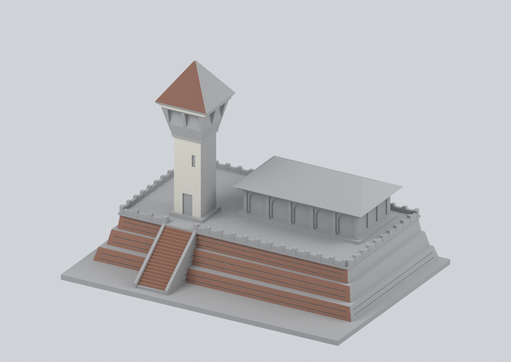
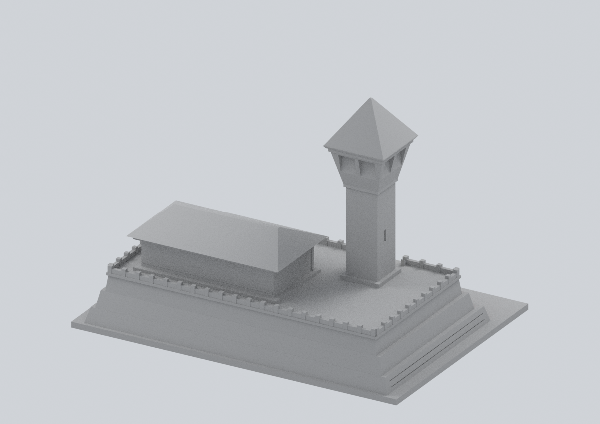
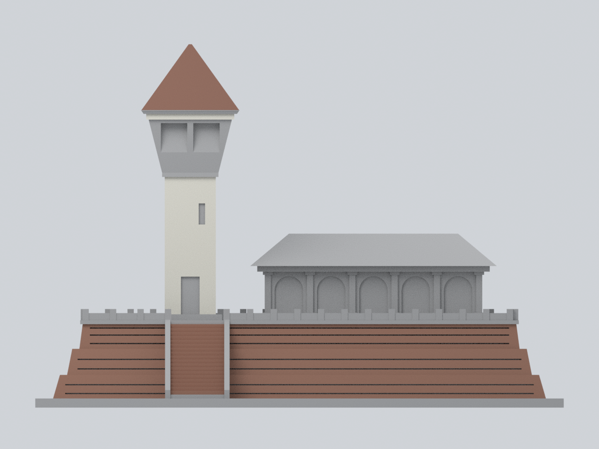
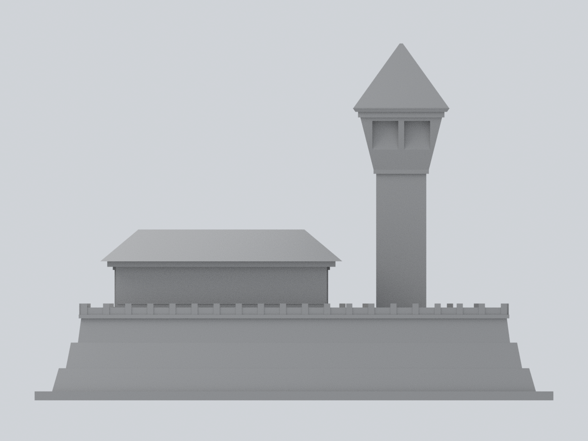
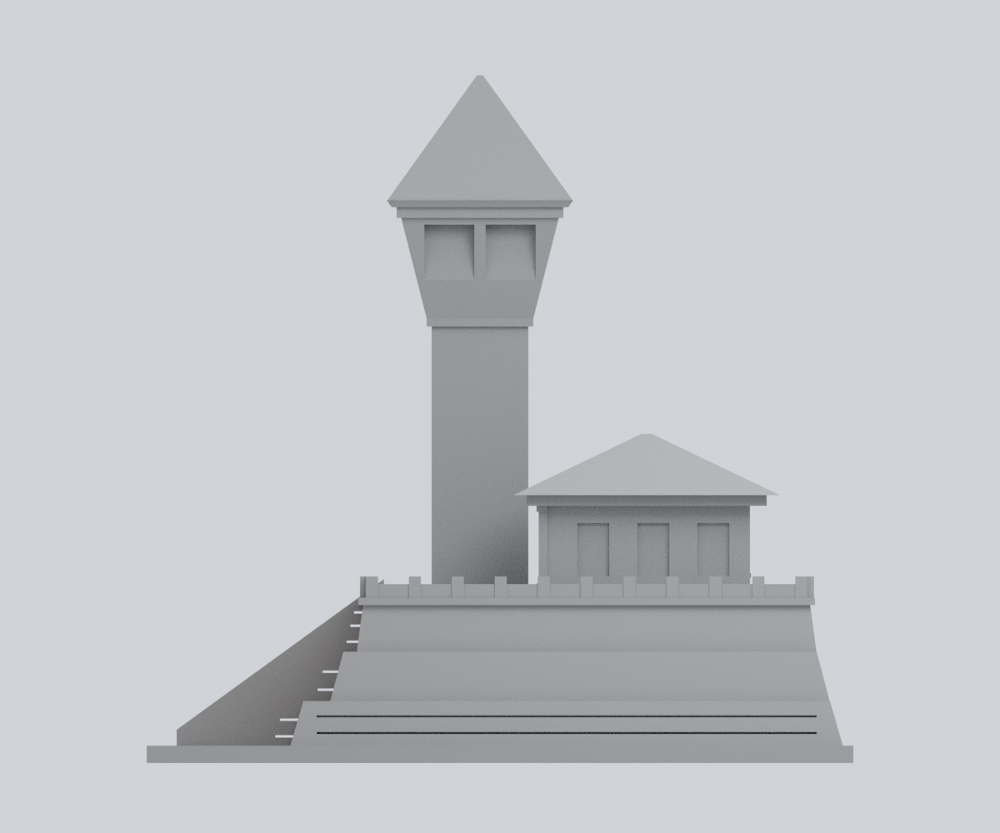
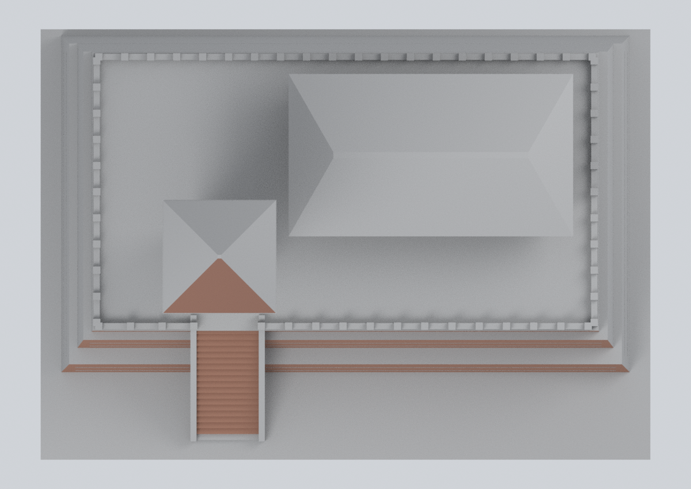

# 安平古堡｜既有縮景正面歷史色系補色

## 模型預覽

| 正面斜視 | 背面斜視 | 正面立面 |
| :---: | :---: | :---: |
|  |  |  |
| 背面立面 | 右側立面 | 俯視 |
|  |  |  |

**既有模型材質升級：新增建築 0、幾何變更 0。** 原版 `model.stl` 的 3,618 三角面與全部位元保持不變；150 × 106 × 約 103.2 mm。本次僅為 158 面加入約 2004 年照片支持的材料色系，其餘 3,460 面標為未知中性灰，**不是完整復色或 2026 現況復原**。


六張均渲染完整的實際交付網格，沒有照片貼圖、遮蓋不利角度或另加的美化模型。此目錄在建築總覽仍是原本安平古堡的**一張建築卡片**，不是六個新項目。

## 158 面的嚴格界線

| 原始 STL 面組 | 面數 | 代表色（sRGB） |
| --- | ---: | --- |
| 正面塔身外牆 | 12 | 暖白灰泥 `#D4D1C5` |
| 正面屋簷立緣 | 2 | 暖白灰泥 `#D4D1C5` |
| 正面屋頂坡 | 2 | 紅褐瓦色系 `#805A4B` |
| 三層磚臺正面外平面 | 68 | 紅褐磚色系 `#966D5B` |
| 准許的實際階梯踏面與立面 | 74 | 紅褐磚色系 `#966D5B` |
| 瞭望室下裙板、玻璃與框 | **0** | 未知，不補色 |
| 所有未列面 | **3,460** | 未知顯示約定 `#A3A3A3`，不是現場灰色材料 |

- 最終獨立審核 158 面取代舊 186 面、修訂 178 面提案。`face-material-map.json` 是完整零起算原 STL 面表及座標鍵；不以 Blender 匯入面序、面中心或僅法向猜測。
- **20 個上層平台／階梯交界面保留未知**：213、215、216、217、218、221、223、224、225、226、227、231、921、922、923、924、925、927、928、929。照片不能可靠決定上平台與末階的材質界線；不切割三角面繞過限制。
- **8 個背面內凹磚槽面排除**：812、813、822、823、832、833、842、843。
- 塔身凹窗、門洞、整個瞭望室、其他屋坡、屋簷底、側背面、展示館、護欄、上平臺和底座皆未知。最底未列入的階梯也不補色；不為了連續好看擴大範圍。
- 正面是模型的 −Y、背面 +Y，不是測得的地理方位。

## 這些色彩能與不能證明什麼

A01 官方原照片 EXIF 記錄 **2004-12-28 10:02:47**；此時間只是檔案記錄，未獨立認證。照片可支持可見塔身暖白灰泥、紅褐屋瓦與正面磚臺／階梯等材料家族。RGB 和粗糙度是獨立視覺近似，**不是取樣值、色卡校正、反射率或修復塗料規格**。Blender 著色器正確將 sRGB 轉為線性值；不重複轉換。

**遮蔽材料連續性屬推定**：塔身下方被樹叢遮住；部分磚面被前景樹木遮住；屋頂最高處被裁切。允許的完整舊三角面只沿同一平面／屋坡延伸，故部分不是逐像素證實。這不授權側背面、瞭望室或上平台推色，也不證實隱藏處的實際保存狀態。灰色代表未驗證，不應被讀成同一材料或完整復原結果。

既有模型是現存景觀的近似局部縮景，**不是十七世紀熱蘭遮城復原，也不是測繪／考古成果**。塔窗位置、塔／梯／館相對位置、三層臺比例、20 級階梯的模型化數量、磚縫排列、展示館側背形體均未量測，仍保留原作推定；補色不改善這些幾何限制。A02 是範圍外古牆；A03 是另一座熱蘭遮城博物館，都不作本次補色證據。

## 交付與編輯

- `scene.blend`：可編輯的單一原始網格、四個材質槽、逐面材質與 `original_stl_triangle_index` 屬性。沒有隱藏建築、來源照片、外連素材或嵌入程式。
- `model.3mf`：毫米、單一物件、逐三角面基礎材質；已嚴格讀回、往返及獨立 XML 核對。切片器的材質／多色耗材支援仍各異。
- `model.stl`：原版逐位元不變，不帶色彩。
- `parameters.json`、`face-material-map.json`、`build_materials.py`：可公開、離線重現的補色參數、證據界線與程式。材質槽 0 未知、1 灰泥、2 屋瓦、3 磚。
- `build_model.py`：原版幾何程式逐位元保留，僅供歷史和另案幾何編輯。本補色流程**不執行它**，避免布林引擎版本改變三角面。改幾何後不能套用這份面序表。
- `legacy-render_preview.py`、`legacy-sources.md`：原公開版本保留的歷史檔案，不是本次預覽產生器或新來源審核。
- `qa/`：實際執行的驗證記錄；`manifest.json` 與 `SHA256SUMS` 綁定交付檔。

## 離線重現

Python 3.12、`requirements.txt` 固定套件版本與 Blender 4.3.2：

```sh
python -m pip install -r requirements.txt
python reproduce.py --out ./rebuild-output
```

可指定 `--blender`、`--export-python`、`--mesh-python`。所有必要輸入已在此目錄，**不需網路、來源照片或私人儲存**；渲染限兩執行緒。`verify_reproducibility.py` 在新目錄只複製公開輸入，驗證 STL／3MF 位元、網格陣列與六張 PNG 位元及像素完全相同。原生 BLEND 因工作階段資料不要求檔案位元相同，但必須通過實際幾何、材質、編輯存回、重新渲染及完整 SDNA 固定字元緩衝區檢查。

原 STL SHA-256：`19dd8d6d17606fe0674245fca57230e7d9cae6b5b800dac93746b6ff2d11b524`。

## 驗證與列印限制

原始網格為一個閉合定向流形，1,797 頂點、5,427 邊、3,618 面，Euler = **−12**；沿用原有開孔拓撲，不把它錯當無孔球面。各邊二面共享、頂點連結單環、正體積、無重複／退化面。全域相交預檢使用明列數值容差及正負控制案例，不是精確謂詞的數學證明。**沒有修復原網格、實體試印或列印成功認證。** 請另檢查支撐、薄特徵與多色切片。

來源、肯定授權依據及例外見 [sources.md](sources.md) 與 [RIGHTS-AND-RESPONSIBILITY.md](RIGHTS-AND-RESPONSIBILITY.md)。沒有主管機關背書或全面第三方權利清理保證。
