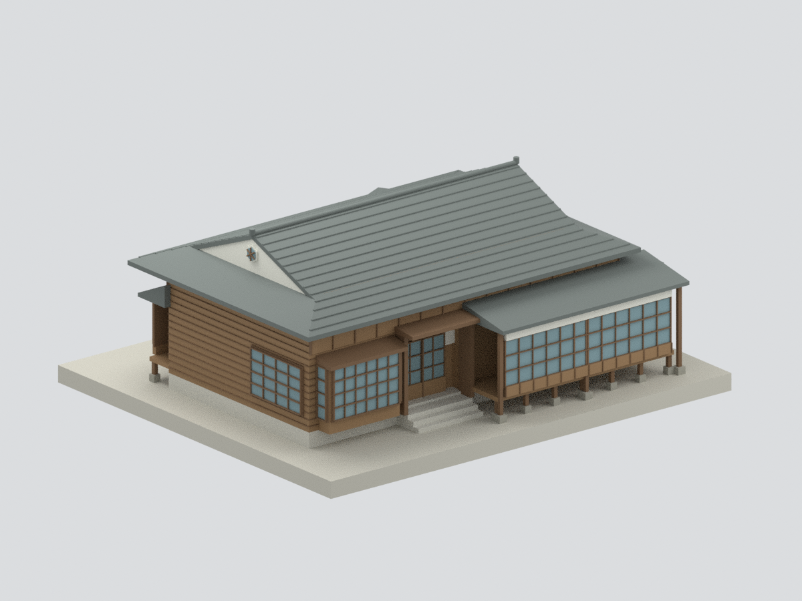
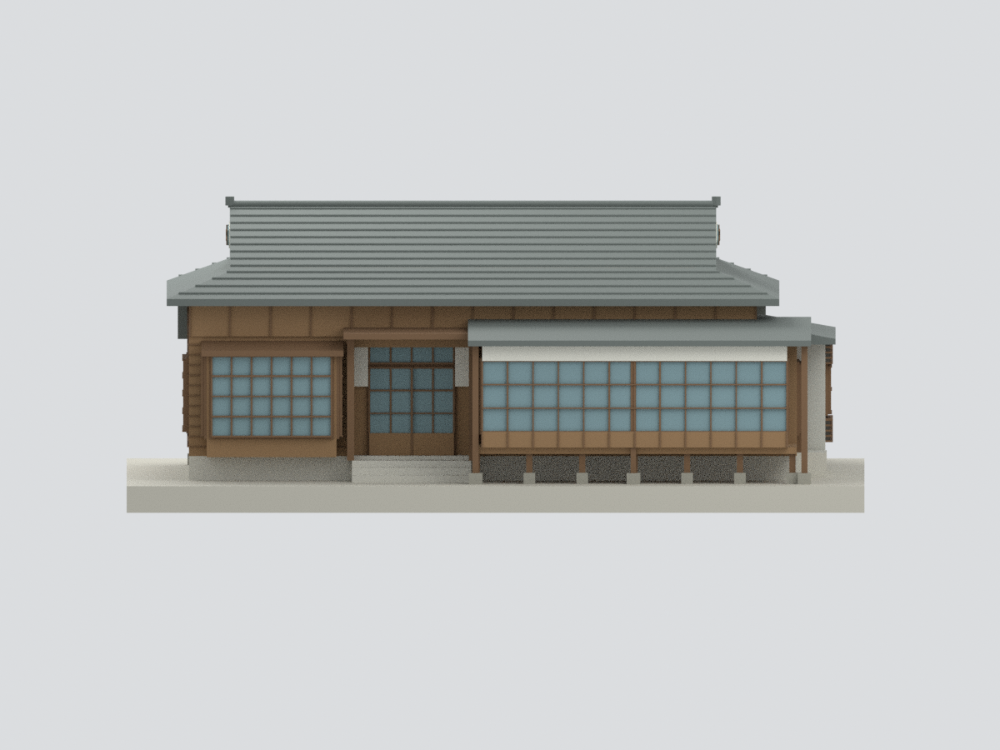
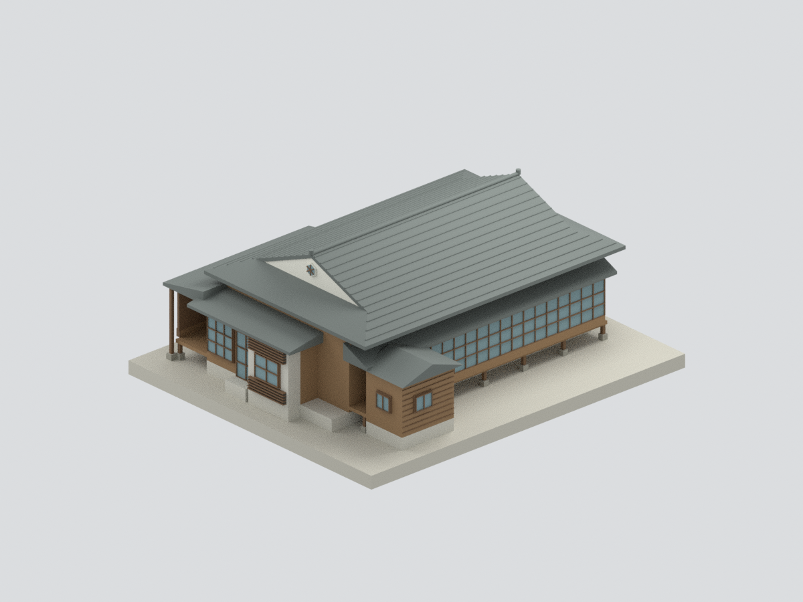
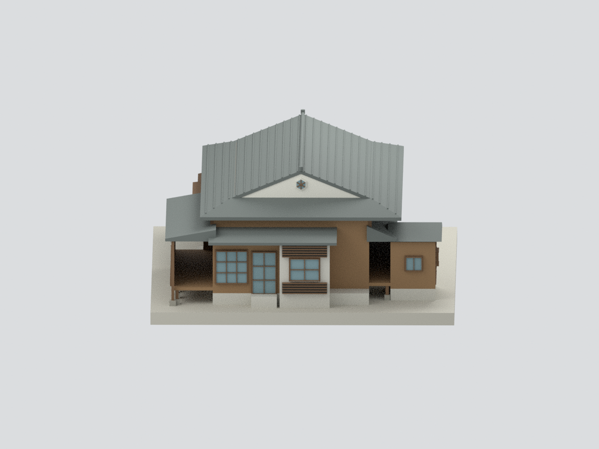
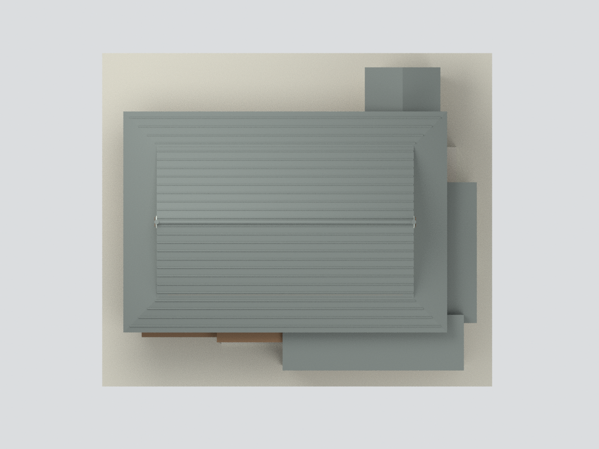
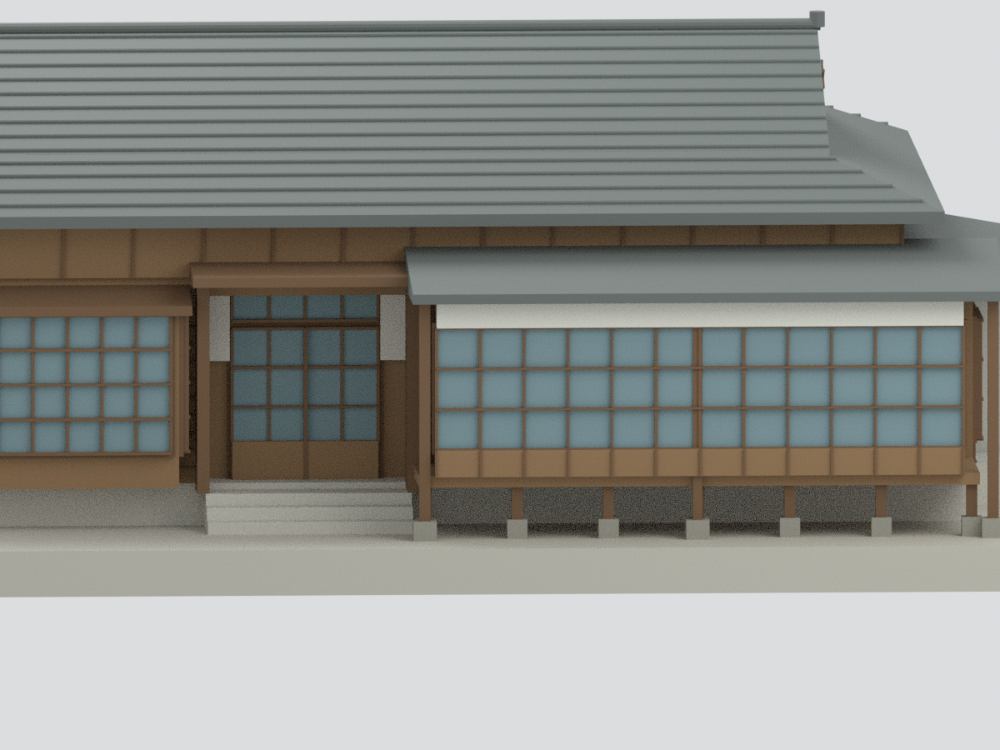

# 北斗郡守官舍｜修復報告主體外觀研究

## 模型預覽

| 修復主體研究 | 主體正面 | 主體背面（圖面推定） |
|---|---|---|
|  |  |  |
| 主體東側 | 主體屋頂研究 | 主入口與廊道局部 |
|  |  |  |

## 2. 範圍與時期

本包是**北斗郡守官舍修復報告主體外觀近似研究**，包含主屋、原前後廊、東側廚房突出部與北側衛浴翼；不含獨立紅磚附屋23-1、庭園、圍牆、景觀及室內。不是整個館區完整模型，也不是現況精確測繪。

採官方473頁修復工作報告的附錄竣工圖說：平面與屋頂使用修復版，四立面採每頁**下半修復圖**，不混用上半修復前現況。官方修後入口照片交叉雙扇門、上亮、凸窗、低雨遮及架空木廊。完整後/側與屋頂現況照片尚未逐面核實，這些面依官方修復圖推定；資產頁的約2011代表照不當修後照片。

## 3. 尺度與簡化限制

- 名義比例1:100；圖面控制軸線1–17為1368cm、主D–J為729.5cm，前右廊182cm、後廊100cm；控制線不是含檐口總外包。
- 屋脊標高GL+601.5cm、主正面檐口約411.5cm依圖；後/西圖檐口另標406.5/403.5cm，本模型統一主要檐口為近似，不是逐面標高完全還原；各房地坪不同，不將整棟一律平地。廊道保留架空支撐與下板，但不是完整結構模型。
- 入母屋上下坡面轉折、次屋頂坡度、前廊棚高/玻璃與白上壁帶/門廊棚高、牆厚、隱蔽接合、石腳個別位置、部分窗扇分格採近似；不可量測成精確竣工尺寸。
- 玻璃使用不透明背板，內部房間/家具不建。屋內額外隱藏連接塊是作者列印支撐，不是真實木屋架。屋脊端飾只保留粗輪廓，山牆採下半修復圖白色抹面而非修前木板；精細雕花、瓦片凹凸、雨樋、五金、風化與色彩差異未逐一重建。
- 底板是展示支撐，不代表真實地形。**未試印**；水密與單連通不代表薄格、懸挑等實體強度已測試。

## 4. 重建與交付

提供STL、材質3MF、Blender可編輯來源構件、六視圖、建模與渲染腳本、來源及QA。參考原照片/PDF不公開隨包附送。幾何檢查與來源外觀審核分開進行。

## 下載與導覽

[STL](model.stl) · [3MF](model.3mf) · [Blender](scene.blend) · [重建](REBUILD.md) · [返回臺灣地標](../README.md)
