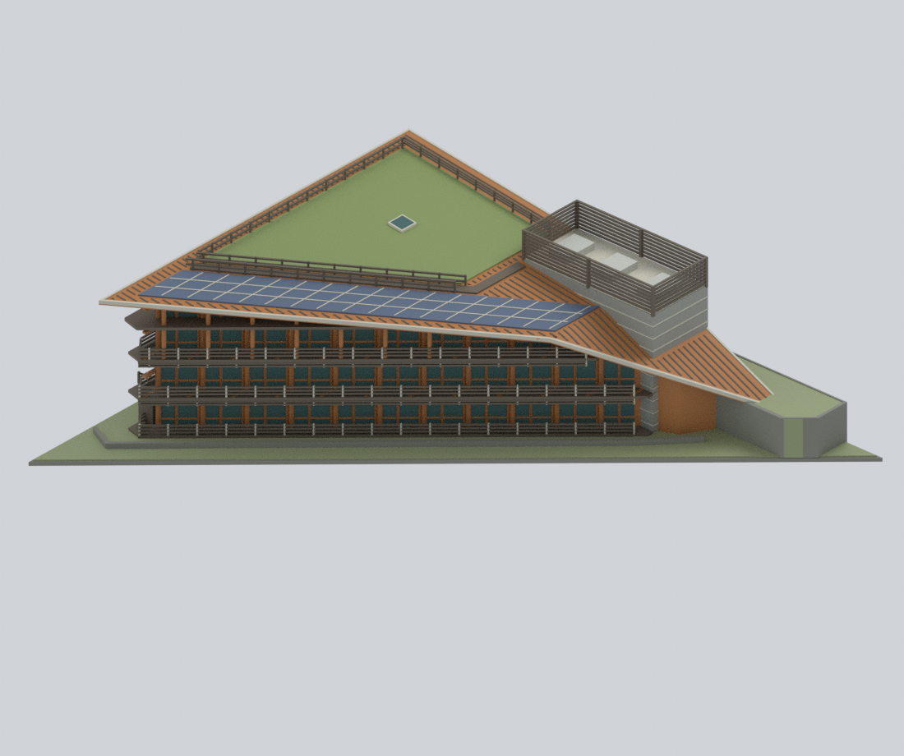
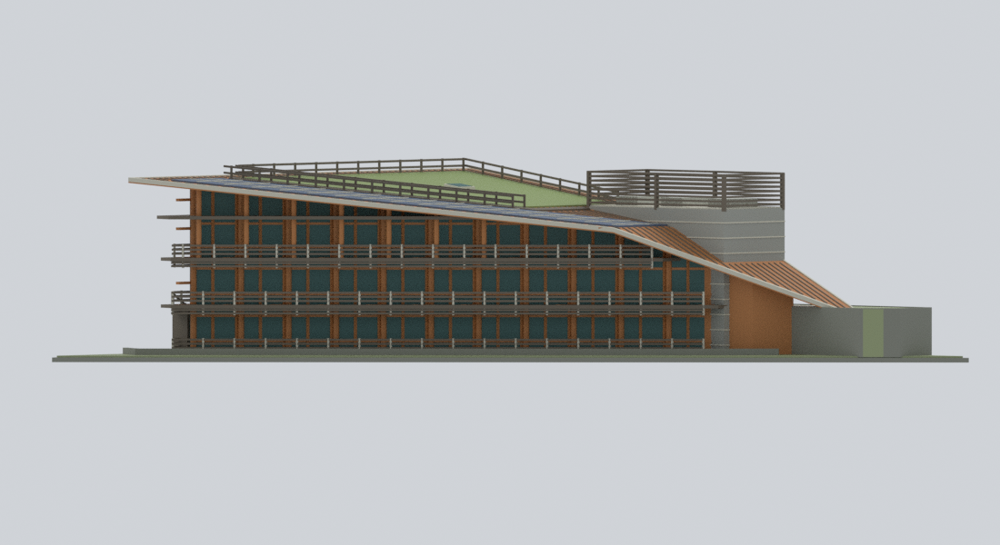
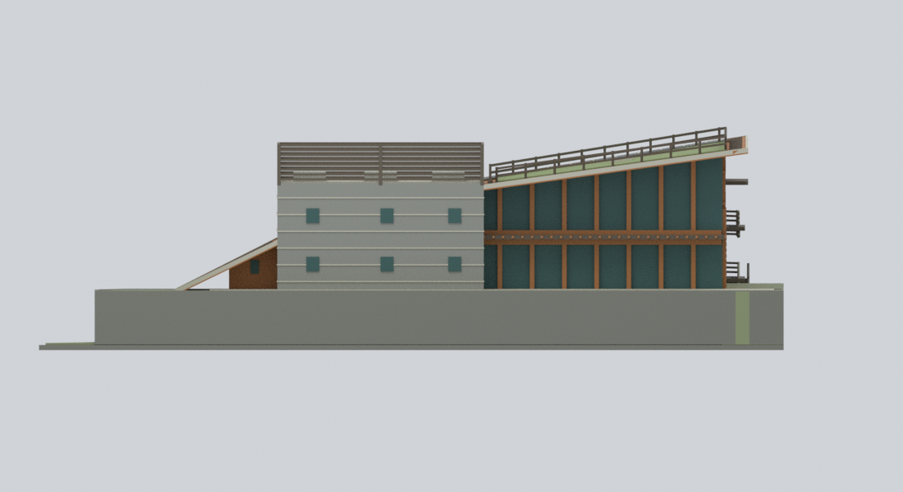
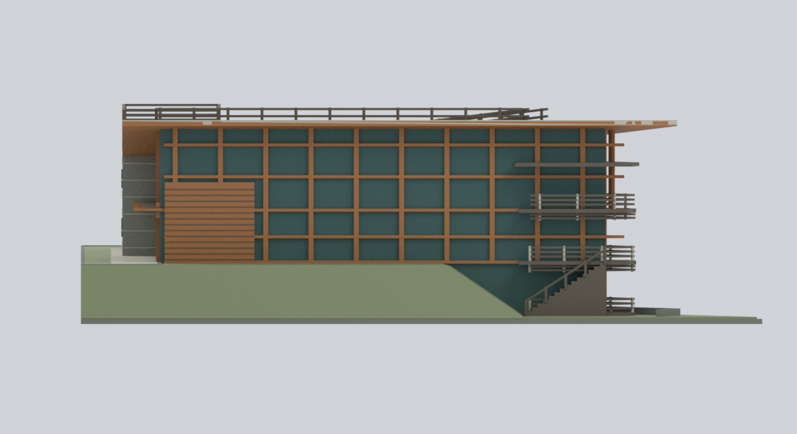
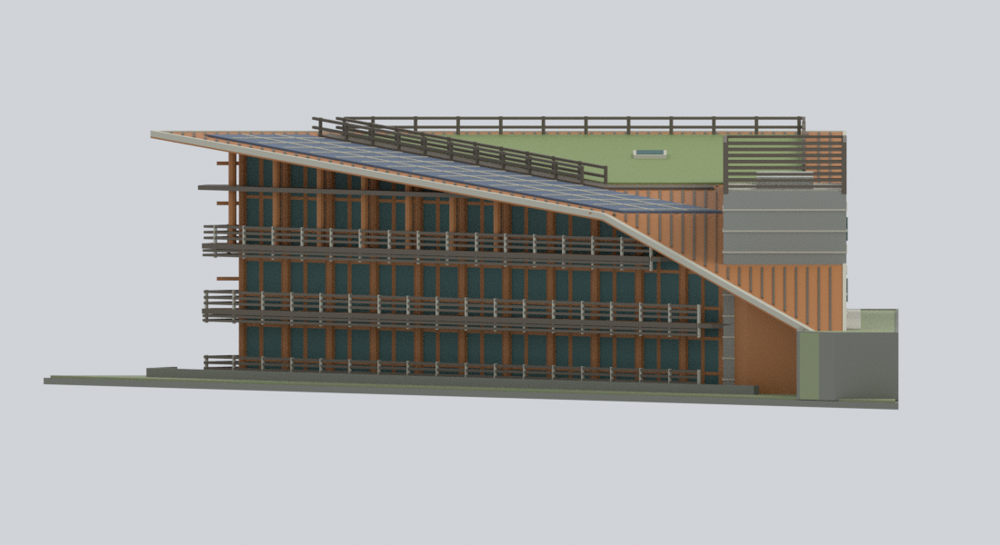
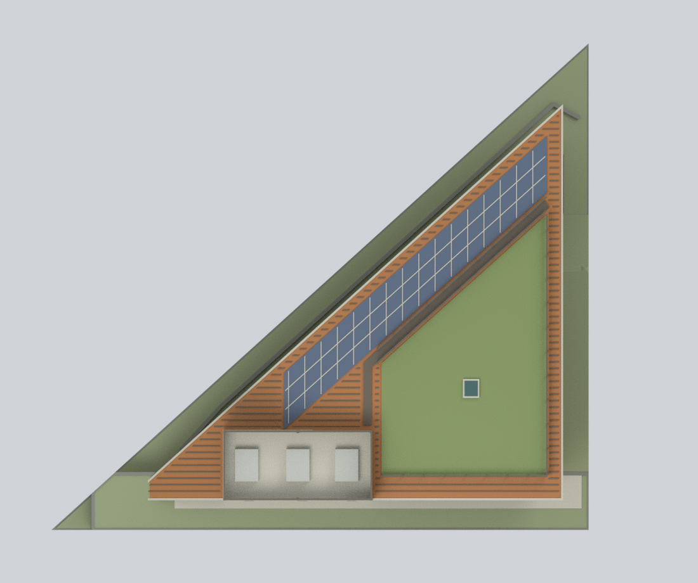
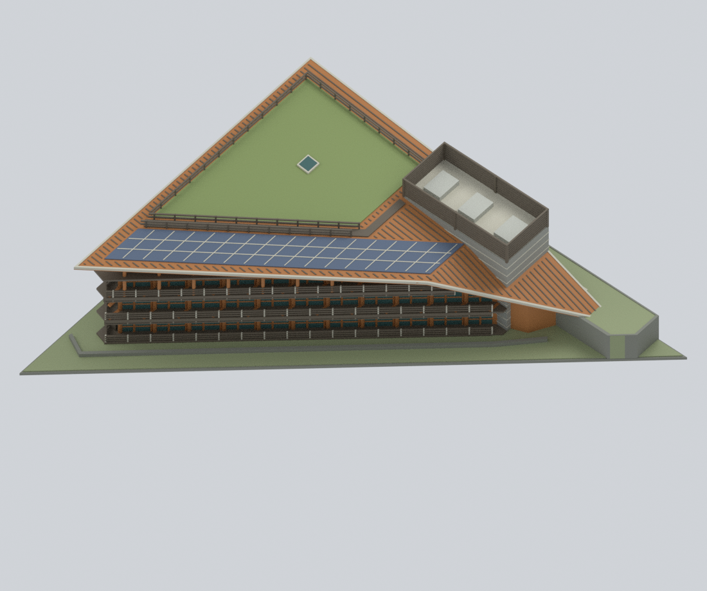
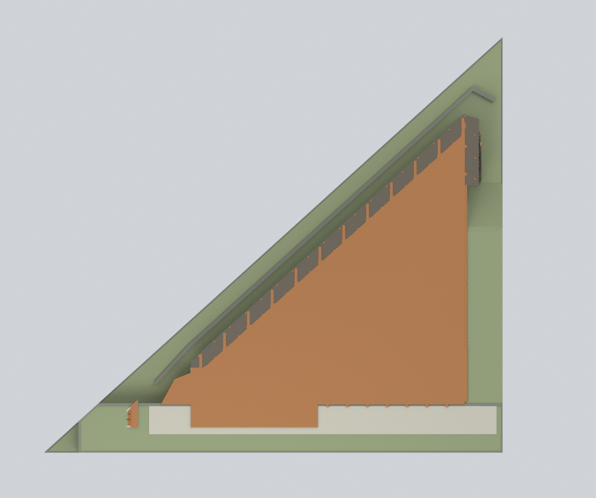

# 北投圖書館｜整棟原設計外觀模型

## 模型預覽

| 模型視圖 | 模型視圖 | 模型視圖 |
| :---: | :---: | :---: |
| [](previews/front.png)<br>**公園／東端斜視** | [](previews/oblique.png)<br>**溪側斜視** | [](previews/north.png)<br>**溪側長面** |
| [](previews/south.png)<br>**公園服務面** | [](previews/east.png)<br>**高玻璃端** | [](previews/west.png)<br>**低端** |
| [](previews/top.png)<br>**整體屋頂** | [](previews/roof-detail.png)<br>**屋頂分區** | [](previews/ground-plan.png)<br>**同一完整網格高度18mm布林切面** |

臺北市立圖書館北投分館的**完整歷史原設計外觀近似模型**：以 2006 年完成設計、2008 年出版資料及建築師未註拍攝日期的完成照片互相核對。**不是 2026 年整修後現況、不是測量或施工圖。**

## 模型預覽

以下九張均由本包實際模型渲染，不是來源照片；點選圖片可看原尺寸。


## 包含什麼

- 完整不等邊楔形主體與附連服務塔；三個溪側可見樓層（地上二層加外露地下一層）。
- 西端較陡、東端較緩的折變屋頂；分開的綠屋頂、光電板、屋頂步道、開放欄杆及一座可確認的小天窗。
- 有真實凹入空間的長陽臺、東端回折、端部外梯、深出簷、木柱與橫向格柵；沒有把陽臺封成實心牆。
- 不同的公園側灰色服務牆、木／玻璃立面與東端高玻璃面；塔頂是**開口設備屏**而非實心加蓋樓層。
- 直接影響地下層外露的高低地形及窄擋土接續。底部薄封閉片是展示閉合，不是實際大型基座。

內部、樹木、人車、家具、藝術品、招牌、節慶飾物、遠處建築和完整溪流不在範圍內。小窗、設備、欄杆數量及細木板接縫依桌面尺度簡化；局部被樹遮住的細節不宣稱精確。沒有來源照片貼圖或來源像素。

## 檔案

| 檔案 | 用途 |
|---|---|
| `beitou-library-whole-pre2026.stl` | 單一連通、封閉的單色幾何，單位 mm |
| `beitou-library-whole-pre2026.3mf` | 相同幾何、逐三角形真實基礎材料顏色，嚴格讀取與往返核對 |
| `beitou-library-whole-pre2026.blend` | 可編輯原生模型、材料、攝影機與隱藏構件集合 |
| `build_model.py`、`parameters.json` | 可重建的原創參數化幾何 |
| `construction-parts.json`、`editable-parts.json` | 各獨立構件幾何、材料與來源對應；布林合併前重疊是刻意設計 |
| `previews/` | 九張實際模型算圖；非 AI 示意圖 |
| `qa/` | 實際幾何、色彩、原生編輯、隱私及全重建驗證 |
| `sources.json`、`evidence-map.json` | 來源網址、權利及建築特徵對應；不包含原圖或 PDF |

在 Blender 顯示 `EDITABLE authored components (hidden; overlaps pre-union)` 集合即可個別修改；正常顯示的是完整合併後模型。測試實際修改了原生網格、單一建築構件位置、材料及 shader，另存後重新開啟確認；沒有修改交付原件。

## 重建

需要 Python 3.11+、`requirements-model.txt` 的套件及 Blender 4.3.2。`lib3mf` 可使用另一個 Python 環境。

```bash
python -m pip install -r requirements-model.txt
python reproduce.py --out rebuilt --blender blender
# 若 lib3mf 位於另一個環境：
python reproduce.py --out rebuilt --blender blender --export-python /path/to/python
```

完整流程不需要網路、原始照片、受保護 PDF 或外掛。重新生成 STL、彩色 3MF、Blend 與九張 PNG，並執行 QA。`--skip-slow-checks` 只供開發，**不等於完整通過**。

## 驗證範圍與限制

檢查重新載入的 STL 邊、頂點連結、重複／退化三角形、完整三角形交叉掃描、逐高度剖面、明確空隙／實心射線及注入阻擋物負對照；同時檢查彩色 3MF 嚴格往返、原生可編輯性與實際重新開啟算圖。乾淨目錄只靠公開輸入重新生成，九張 PNG 同時比對位元組與像素。原生檔固定長度路徑緩衝區以實際 factory-startup 基準和負對照檢查。

**未做實體列印、未執行切片工具路徑，也不保證免支撐列印。** 懸挑陽臺、深出簷、外梯及 0.65 mm 起的細欄杆需要自行確認縮放、支撐、噴嘴與材料。剖面侵蝕篩查不是全域最小壁厚證明。顏色是照片支持的材料類別近似，不是校色 RGB／RAL 或「真色」保證。

視圖：`front` 公園／東端斜視、`oblique` 溪側斜視、`north` 溪側長面、`south` 公園服務面、`east` 高玻璃端、`west` 低端、`top` 整體 RF、`roof-detail` 屋頂分區、`ground-plan` 在模型高度 18 mm 對**同一完整網格**作布林切面。最後一張不是重畫的來源平面。

設計與照片權利、出處及不背書聲明見 [RIGHTS-AND-RESPONSIBILITY.md](RIGHTS-AND-RESPONSIBILITY.md)。
