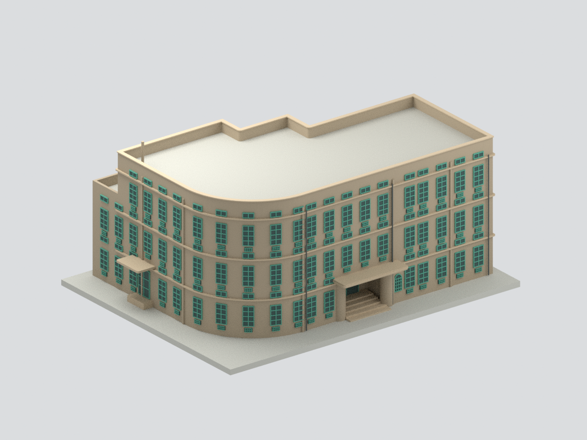
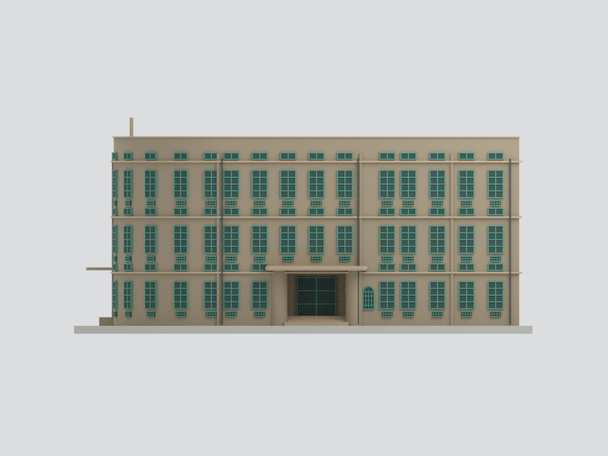
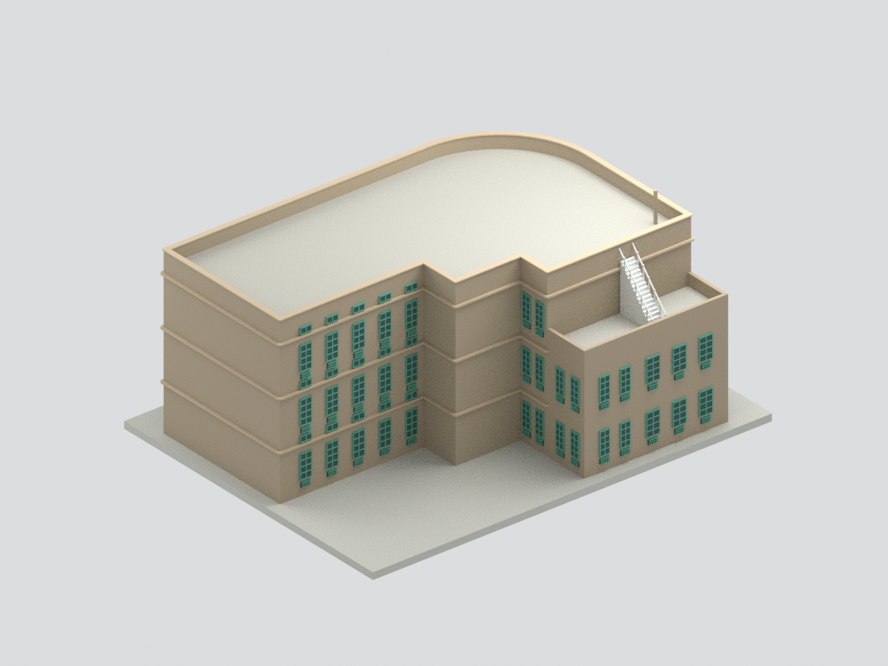
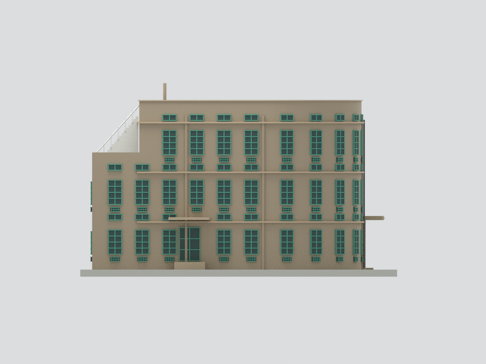
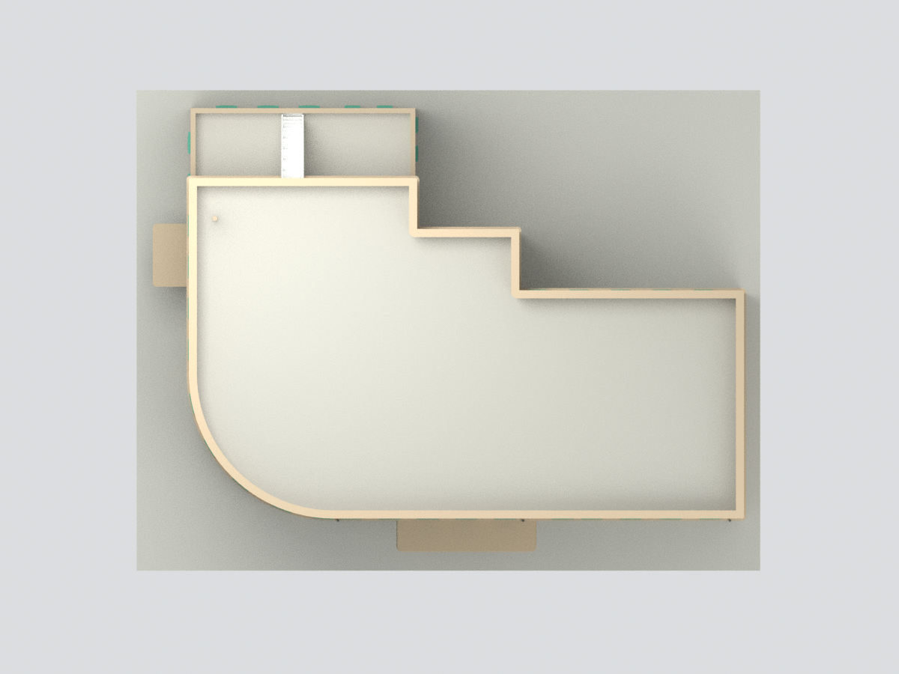
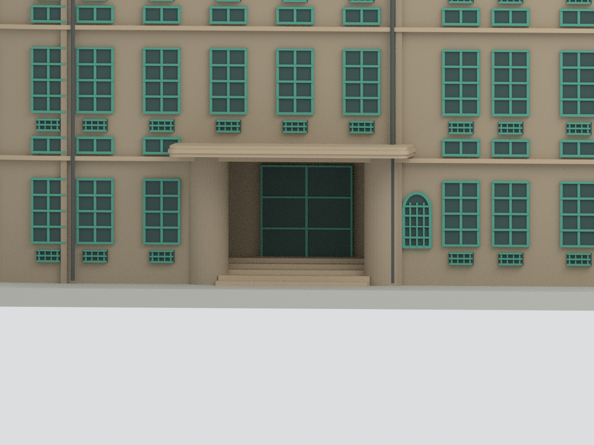

# 嘉義市立美術館 A 棟古蹟辦公室｜限定外觀研究模型

## 模型預覽

| 圓角與街側 | 長街面 | 內院與露台 |
|---|---|---|
|  |  |  |
| 短街面 | 屋頂俯視 | 主入口細節 |
|  |  |  |

## 範圍

本包只表現 A 棟原菸酒公賣局嘉義分局辦公廳舍的來源可見外觀，不是全座美術館。B 棟新館、C 棟倉庫、內部房間及基地景觀不包含在內。與 B 棟銜接且被遮蔽的界面以研究模型截止面處理，不代表實際獨立牆面或無開口。

依國土署 2021 建築師獎專輯一層比例尺平面、A 棟屋頂空拍，與設計團隊刊載的三層／屋頂層圖面，分層描繪 L 形圓弧外角、階梯狀內院、短翼低露台；不將一樓輪廓等厚拉至全高。圖面中的四層平面在 A 棟位置是屋頂，不是第四層室內。

市府 2021 實照補充街面、主入口退入門廊、懸挑圓角雨遮、綠色直窗及上下通風小窗、水平飾帶、壁柱與屋頂白色外梯。原始圖片與 PDF 只作私人參考，不公開附入模型。

## 尺度與檔案

平面外包約 30.7 × 22.7m，以圖面約 44px 對應 5m 的圖例估讀並對照官方 0–10m 圖例；不是測繪尺寸。圓角半徑、樓高、窗距、柱距、露台及門廊深度均為圖面／照片比例近似。

模型比例約 1:200（5mm 對應估計 1m）。主要屋面暫採 13.05m、女兒牆約 14.30m、低露台約 8.8m，均非原圖標示的 A 棟實測高度。自訂底座及屋頂管體包含於整體尺寸。STL 為無色一體網格，3MF 保留材質，Blend 保留合併網格與隱藏可編輯構件。

## 歷史資料界線

文化部文化資產資料記載 1936 年 9 月開工、1937 年 4 月完工，1938 年舉行落成式；這些不是同一日期。本模型參照 2021 年出版及市府照片，不宣稱精確重現原建成時期或今日現況。

## 明確簡化與未知

本包是有限來源外觀研究，不是修復測繪模型。未建立室內動線、柱梁樓板、精確窗扇開啟角度及 B 棟銜接構造。受樹木與透視遮蔽的開口節奏按可見照片概括，不能用於計數測量。屋頂平台、排水、白外梯踏階與欄杆均為粗化；階梯下方加實心支撐，不等同原實體構造。**屋頂外梯路徑以單跑直梯代理，未還原照片可見的折返／轉折平台；此為明確的路徑簡化。**

Scratch 磚細紋、逐塊磚縫、洗石子顆粒、牆面修補風化、綠色通風格菱形細網、窗框五金、燈具、招牌文字及完整屋面鋪磚均省略或粗化。玻璃為實心不透明代理，顏色非現場校色。後側僅建立可見實照的概括窗型；遮蔽區不補造看不見的細節。

## QA 與列印

六視圖由交付的實際網格渲染。檢查見 QA.json、BLEND-QA.json 與 rebuild-test.json。水密、單連通、格式可重開不等於已試印；細框、欄杆、雨遮懸挑仍需依材料與設備調整支撐／加粗。**未進行實際試印。**

## 下載與導覽

[STL](model.stl) · [3MF](model.3mf) · [Blender](scene.blend) · [重建](REBUILD.md) · [返回臺灣地標](../README.md)

`scene.blend` 採 Blender 可直接開啟的無損 gzip 壓縮以符合傳輸限制；解壓後與審核原場景逐 byte 相同，已重新開檔核對網格及可編輯元件。
