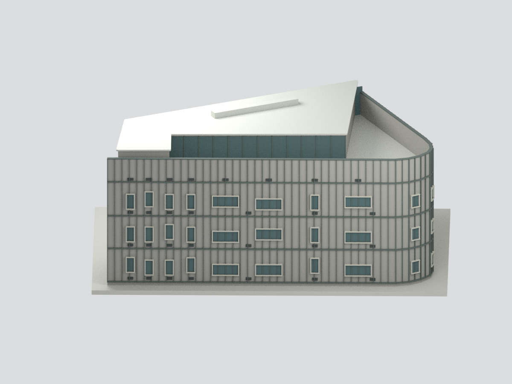
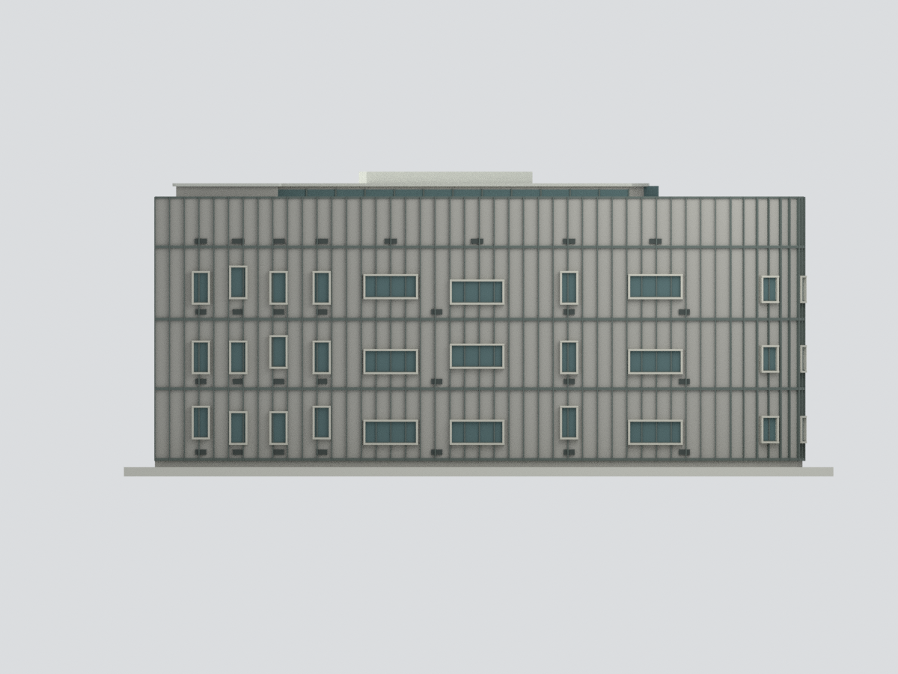
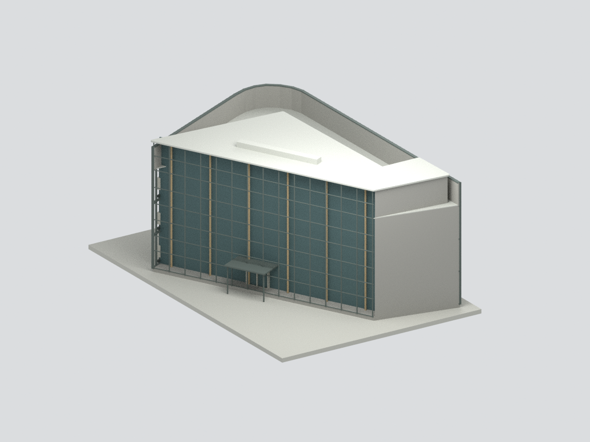
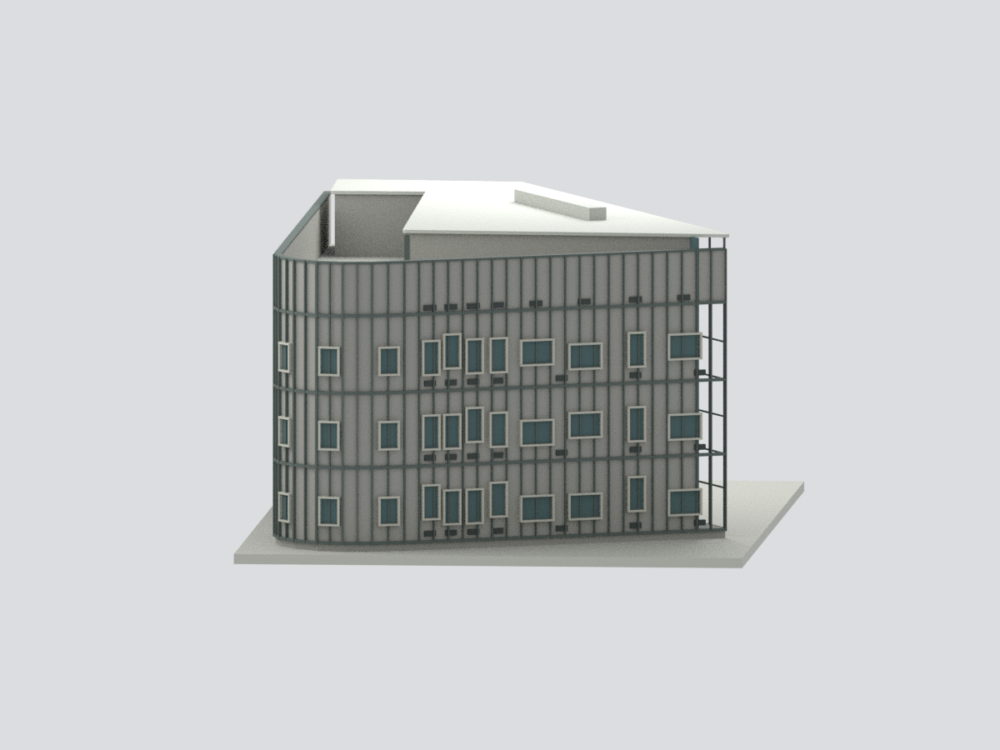
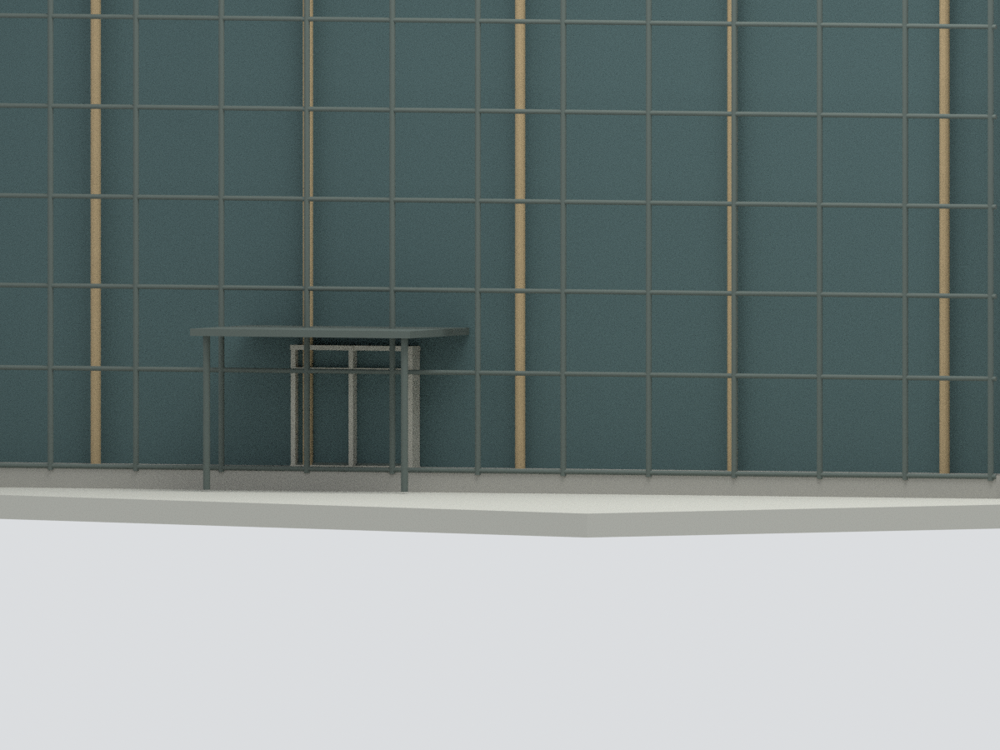

# 嘉義市立美術館 B 棟新館｜限定外觀研究模型

## 模型預覽

| 街側與退縮屋頂 | 長街面 | 中庭側 |
|---|---|---|
|  |  |  |
| 圓街角與短街面 | 屋頂俯視 | 中庭入口細節 |
|  |  |  |

## 範圍與來源

本包只研究 B 棟新館來源可見外觀，不是全座美術館。A 棟古蹟辦公室、C 棟倉庫、景觀與完整室內均不包含。與 A／C 接合的遮蔽界面使用模型截止面，不代表現場獨立牆面或無門窗。

依官方 2021 建築師獎專輯的比例尺平面與竣工照片，交叉比對建築師刊載四層平面及剖面，描繪不規則楔形平面、圓街角、沿街退縮露台與較高內側屋蓋。不將一樓輪廓等厚拉滿全高。建築師拆解示意只佐證構架關係，不當作完工照片或精確尺寸。

## 尺度與檔案

約 1:200（5mm 對應估讀 1m）；平面依約 44px 對應 5m 圖例估讀，旋轉後外包約 41.8 × 26.6m，非現場測繪尺寸。

剖面以 GL±0 為基準，原標記 +50／+506／+955／+1422／+1817 依公分解讀，分別採首層 +0.50m、二層 +5.06m、三層 +9.55m、四層 +14.22m、RF +18.17m；不是從首層再加 18.17m。沿街外層頂屏依竣工照片比例暫估約 17.4m（不將剖面較低的露台內牆誤當整層外屏），屋頂長條構件暫估高 0.9m，均非圖面標註測量。

STL 是無色一體網格；3MF 保留材質；scene.blend 保留實際合併網格與隱藏可編輯構件。自訂底座不是現地路面或基地範圍。原始照片與圖面只作私人參考，不公開附入。

## 明確簡化與未知

**院側玻璃中庭採約 1.7m 淺凹空間、粗框架與退入不透明底面的展示代理，不是原建築完整通高中庭。** 原玻璃的透明反射、可見內部樓梯、連橋、完整木構與深層房間未建出；不能據此判斷實際室內構造、深度或使用動線。內院平面的細階梯狀退進亦作粗化，不宣稱逐段精描。

沿街窗以照片可見窄直窗、寬橫窗、低位小口混排及凸窗盒概括；窗距、個數、開啟角度、斜口厚度與深度不是測量。凸窗斜口以厚矩形框粗化。金屬網孔省略，使用實心背板加粗立框／層帶，不宣稱有真實穿孔。屋面機具只表現可見長條輪廓，不斷言用途；排水、文字、五金、風化、細木紋及玻璃接縫均未完整重建。

庭院雨遮採實心薄板並加粗支撐，柱位與框架為展示／列印簡化，非施工圖。A/B、B/C 遮蔽銜接不補造未知開口。顏色未現場校色。本模型參照已出版圖面與完工照片，不宣稱今日現況或完整測繪模型。

## QA 與列印

六圖由同一交付網格渲染；幾何、STL／3MF、Blender 重開與可重建檢查分列 QA.json、BLEND-QA.json、rebuild-test.json。水密及單連通不等於試印成功。中庭細框、薄屋蓋、雨遮與凸窗須依設備和材料檢查支撐、厚度及方向。**未進行實際試印。**

## 下載與導覽

[STL](model.stl) · [3MF](model.3mf) · [Blender](scene.blend) · [重建](REBUILD.md) · [返回臺灣地標](../README.md)
