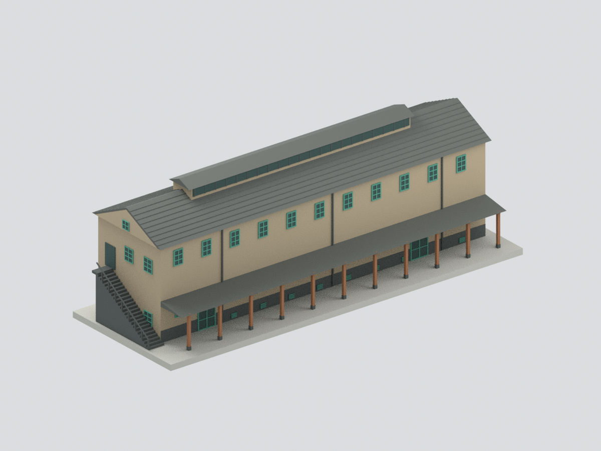
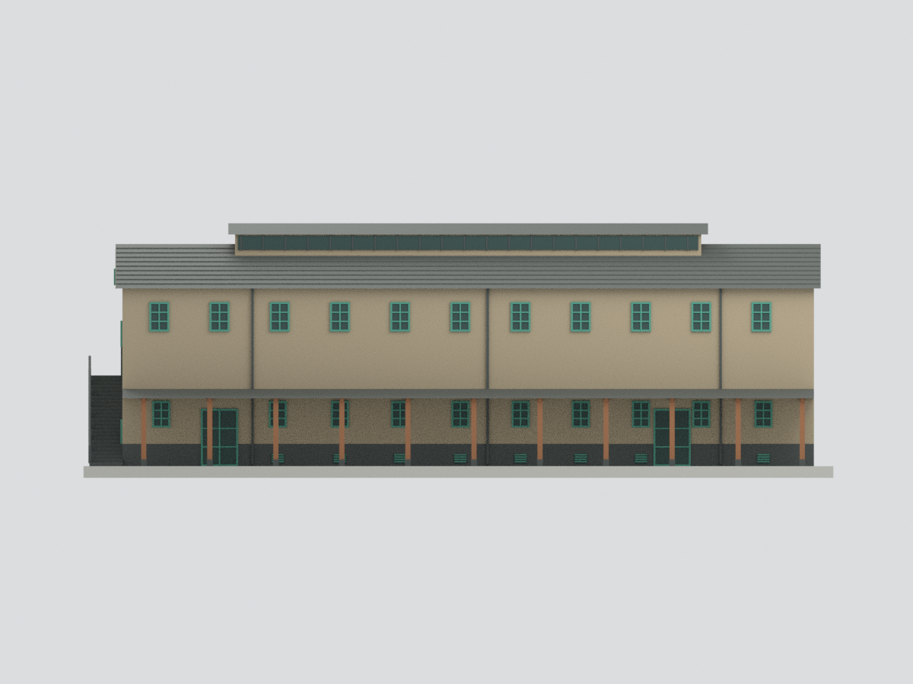
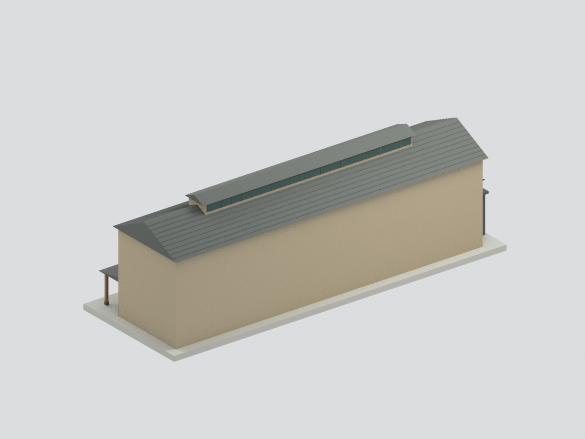
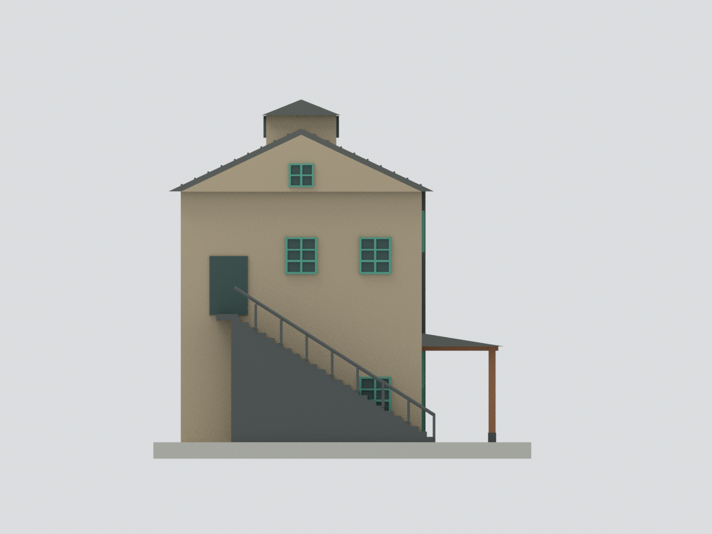
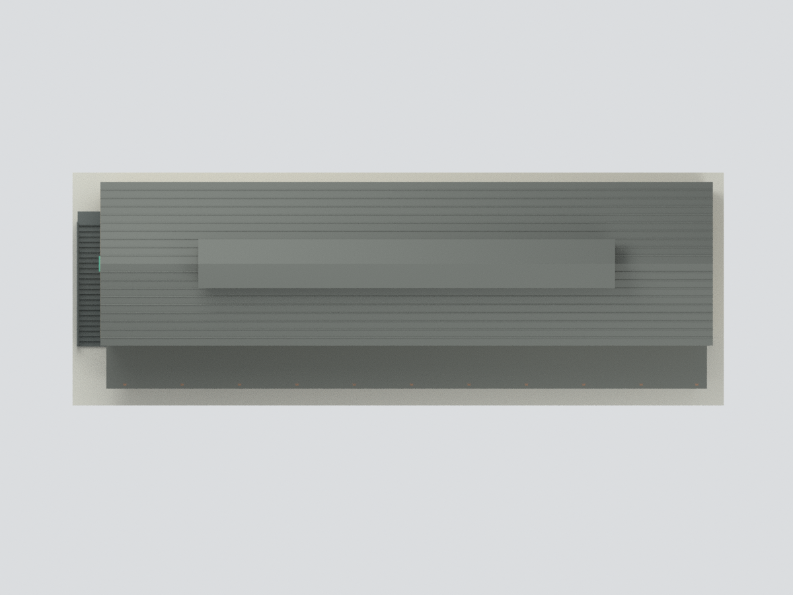
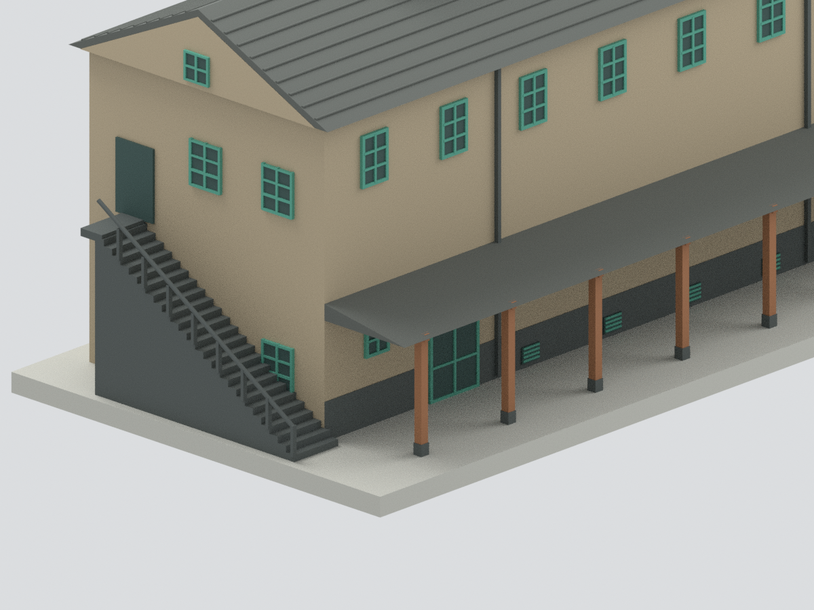

# 嘉義市立美術館 C 棟倉庫側棟｜限定外觀研究模型

## 模型預覽

| 庭院與山牆 | 庭院正面 | 後側示意 |
|---|---|---|
|  |  |  |
| 自由端山牆 | 屋頂俯視 | 入口及樓梯細節 |
|  |  |  |

## 範圍與證據

只表現 C 棟倉庫側棟的來源可見外觀，不是整座美術館，也不是獨立存在於基地中的完整測繪建築。A 棟古蹟辦公室、B 棟玻璃主館、連接構造及庭院配置均未建立。與 B 棟相接的一端以研究模型截止面處理。

國土署 2021 建築師獎專輯 PDF 第 33 頁提供一層平面與 0–10m 比例尺；第 31、33、34 頁提供完工屋頂、庭院立面及廊柱實照。另以建築師網站及設計團隊刊載圖面交叉核對。引用連結見 SOURCES.md，參考原圖與 PDF 不隨公開模型上傳。

## 模型與尺度

- 納入雙坡瓦頂、中央屋頂採光帶、庭院綠色窗框與兩處入口、木柱坡廊、牆腳粗通風百葉、自由端山牆與外梯。
- 平面長約 35.6m、寬約 8.8m 是比例尺圖上估讀；屋簷 9.2m、主脊 11.45m、採光帶最高 12.52m 是剖面／照片比例估計，**不是原圖標註的 C 棟測量尺寸**。
- 模型採約 1:200（5mm 對應估計 1m），含自訂底座 193 × 69 × 65.6mm。不得作工程或修復測繪。
- STL 為無色一體網格；3MF 保留七種材質分區；Blend 保留可見合併網格及隱藏的可編輯構件。

## 明確限制

後側被周邊建築遮蔽且缺少可驗證立面圖，因此後側窗洞、附屬設備均未臆造；預覽後面的大面是**未重建面**，不代表實際無窗。相接 B 棟界面也不是獨立完整立面。

窗距、窗格、柱距、牆腳通風孔位置、樓梯踏階數與欄杆為實照概括比例，不是逐項測量；部分低層開口受廊頂及樹木遮擋，位置與形式有不確定性。屋瓦僅用粗橫向紋路表示，未建立每片瓦、細密搭接、完整屋脊收邊。牆面風化斑駁、磚石接縫、窗五金、管線細節及招牌文字未逐一重建。窗玻璃採實心印製代理，樓梯下方採實心支撐，非原構造。顏色不是校色測量。

資料對 B／C 棟原建年有互換記載，本包不判定 C 棟精確建年。模型參照 2021 完工出版照片，不能視為今日現況認證。

## 檔案與 QA

`model.stl`、`model.3mf`、`scene.blend`；六視圖均由實際網格渲染。幾何／格式檢查見 QA.json，來源限制與製造檢討另列。水密不等於已可直接列印：細窗框／欄杆需依列印機、材料、噴嘴另行評估支撐與加粗；**沒有實際試印**。

## 下載與導覽

[STL](model.stl) · [3MF](model.3mf) · [Blender](scene.blend) · [重建](REBUILD.md) · [返回臺灣地標](../README.md)
