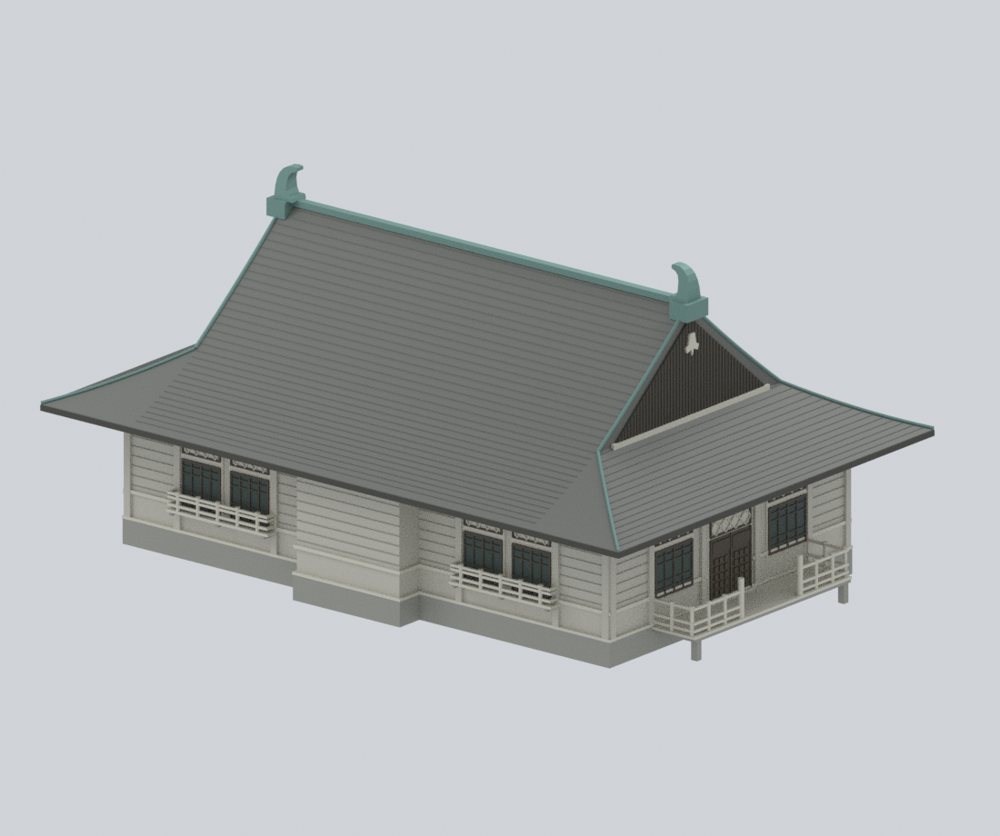
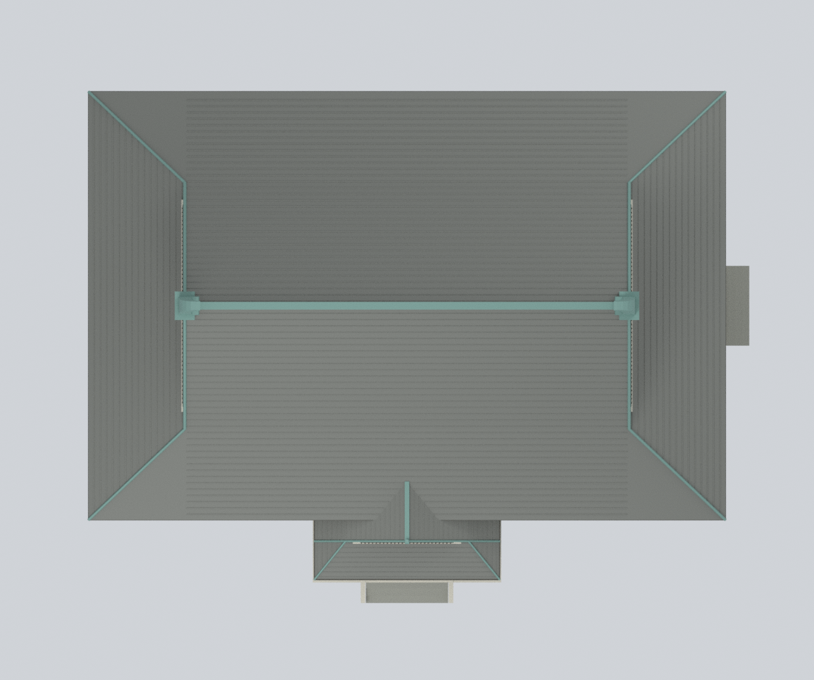
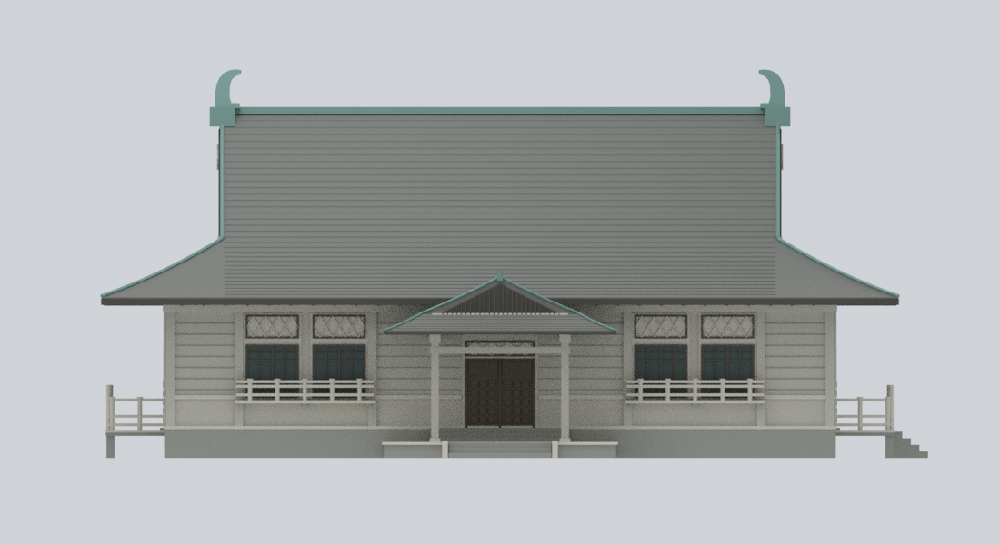
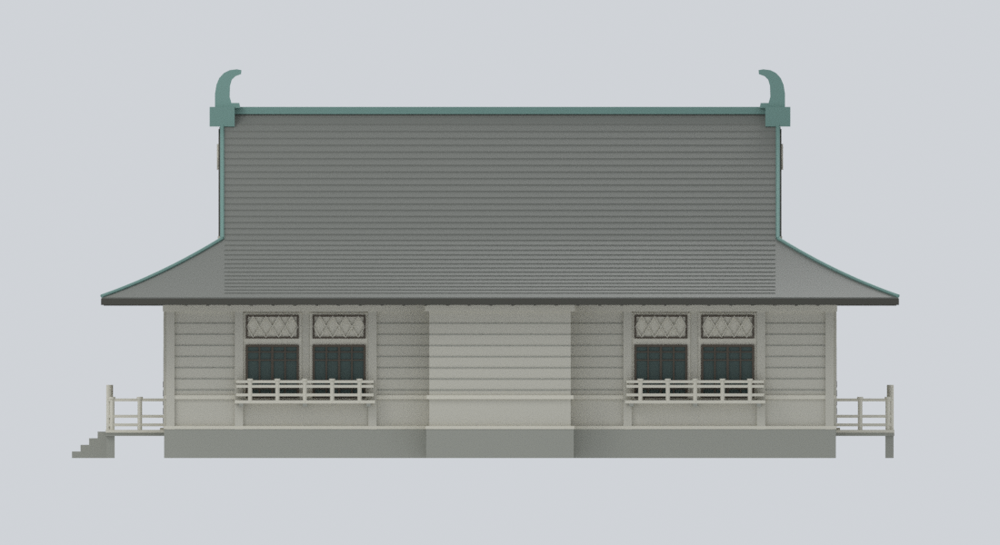
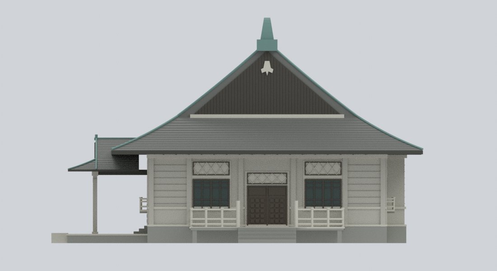
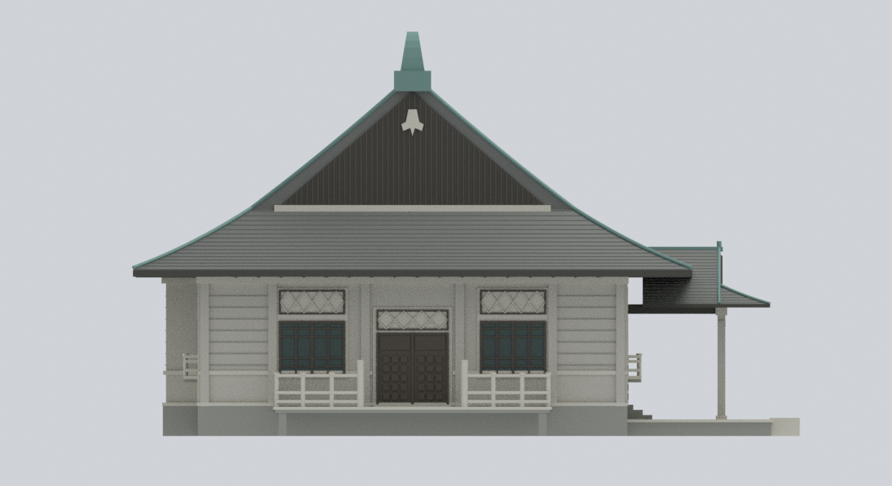
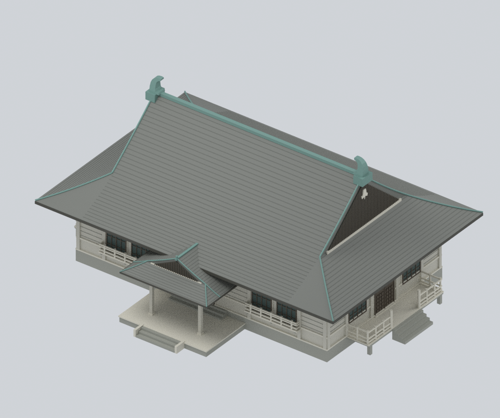
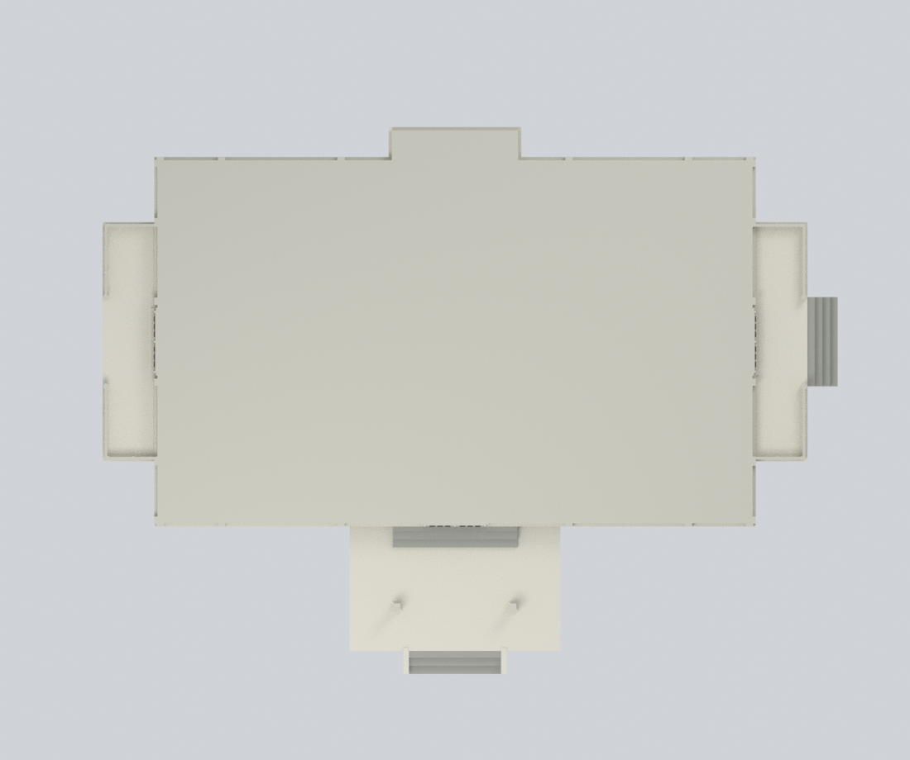

# 大溪武德殿主殿｜2014 年調查狀態

## 模型預覽

| 前右斜視 | 後左斜視 | 整體屋頂 |
|---|---|---|
|  |  |  |
| 正立面 | 背立面 | 右立面 |
|  |  |  |
| 左立面 | 屋頂與入口 | 同一網格的水平切面 |
|  |  |  |

**一棟完整主殿外觀的近似研究模型**。以 2014 年調查報告的照片、平面、屋頂、四向立面與剖面交叉核對，表達 2000–2001 年修復後、2016 年廊道重建前的主殿；**不是現今整個博物館園區，也不是未改動的 1935 年原貌。**

## 九張實際模型算圖

下圖均由交付網格及材料實際算出，不是 AI 概念圖或來源照片。前／後／左／右採報告的建築相對方向，不能逕當作東西南北。


`ground-plan` 是完整交付網格在模型高度 12 mm 的實際布林切面；中央實心區是封閉外觀展示代理，**不是來源平面重繪或室內重建**。

## 保留的建築特徵

- 完整曲線入母屋屋頂：上部山牆、下部四坡簷裙、連接主坡的較低門廊屋頂；簡化屋面分縫、銅覆屋脊、鴟吻與山牆懸魚。
- 墊高主殿、前方入口臺階與柱廊、後方中央淺凸出實牆；沒有後門或後門廊。
- 左右**分離的側門平臺**，保留臺下與欄杆的真實空隙；只有圖面顯示的右側外梯，沒有鏡射一座左梯。
- 前後各兩組淺窗臺與欄杆；中間保留牆／基座段，**不是連續環繞的外廊**。
- 前後窗組、側門、格子門扇、菱形氣窗；區分淺暖灰洗石子仿木牆、深色木框／山牆、灰色屋面與局部低彩度銅綠。

A03 的 **1780 × 1055 是內牆面間距**，不是外包絡；模型另外加入按圖比例判讀的牆厚與外部構件。A07 的 **2231.22 × 1502.11** 屋頂及 **209.65** 前伸尺寸獨立約束屋頂。模型以 mm、約 1:100 解讀，不把圖面小數當作實測精度；立面 439 + 545 與剖面另一組 484.6 + 499.4 水平基準沒有混用。

## 檔案與編輯

| 檔案 | 內容 |
|---|---|
| `daxi-butokuden-main-hall-2014.stl` | 單一連通、封閉的單色幾何，單位 mm |
| `daxi-butokuden-main-hall-2014.3mf` | 相同幾何與逐三角形八種實際基礎材料顏色 |
| `daxi-butokuden-main-hall-2014.blend` | 原生可編輯模型、材料、燈光、攝影機及個別構件集合 |
| `build_model.py`、`parameters.json` | 原創參數化建模原始碼及尺寸／比例設定 |
| `construction-parts.json`、`editable-parts.json` | 合併前各構件幾何、材料及證據對應；原始構件間的重疊是布林合併設計 |
| `sources.json`、`evidence-map.json` | 出處網址、時間邊界、特徵依據與不確定處；不含原圖 |
| `qa/`、`previews/` | 實際檢查結果與九張模型算圖 |

Blender 預設顯示合併後模型。顯示 `EDITABLE authored components (hidden; overlaps pre-union)` 集合即可修改單一構件；測試已實際修改網格頂點、單一構件位置、材料與 shader，另存並重新開啟確認，未改動交付原件。

## 從公開輸入重建

需要 Python 3.11+、`requirements-model.txt` 的版本及 Blender 4.3.2。`lib3mf` 可在另一個 Python 環境。

```bash
python -m pip install -r requirements-model.txt
python reproduce.py --out rebuilt --blender blender
# lib3mf 在另一個環境時：
python reproduce.py --out rebuilt --blender blender --export-python /path/to/python
```

重建不需要網路、來源照片、PDF 或外掛，會重新建立 STL、彩色 3MF、Blend、九張 PNG 並執行檢查。`--skip-slow-checks` 僅供開發，不能當作完整通過。

## 實際 QA 與限制

檢查重新載入 STL 的邊、頂點連結、重複／退化三角形、完整三角形交叉掃描、逐高度剖面、14 組空隙／實心射線與注入阻擋物負對照，以及屋頂、前階、右梯的高度剖面。另檢查 3MF 嚴格讀取／往返、每面材料、原生構件可編輯性、重新開啟原生場景的算圖、所有固定長度 SDNA 字元緩衝區及實際 factory-startup／負對照。乾淨目錄只用公開程式與參數重建，九張 PNG 同時核對位元組和像素。

來源 RF 與四向立面的實際網格投影另經逐一視覺核對；私有來源像素及疊圖不隨套件散布。主要外包絡、曲線屋面、側梯不對稱與後方淺凸出保留；細部構件並非逐一測繪。

**未做實體列印或切片工具路徑，不保證免支撐。** 深出簷、門廊、平臺、0.8 mm 主欄杆及更細的裝飾縫／菱形格需要自行檢查縮放、支撐、噴嘴和材料。剖面侵蝕篩查不是全域最小壁厚證明。顏色僅是報告照片支持的材料類別近似，不是校色 RGB／RAL 或「真色」保證。

室內、隱藏基礎、鄰房、廊道、園區地形、植物、人車、招牌與雕刻微細節均未重建；主殿內部與屋頂體積採封閉展示代理。屋瓦／欄杆數量、窗格小接頭和鴟吻輪廓依桌面尺度簡化；不同立面圖的鴟吻高度略有出入，不宣稱精確雕刻尺寸。

完整出處與權利說明見 [RIGHTS-AND-RESPONSIBILITY.md](RIGHTS-AND-RESPONSIBILITY.md)。
