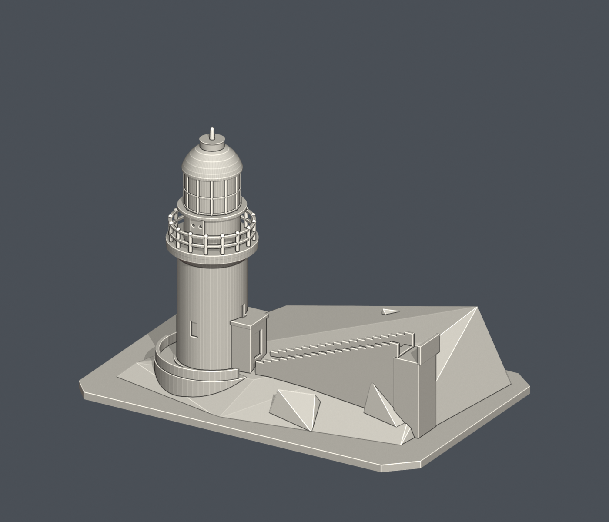
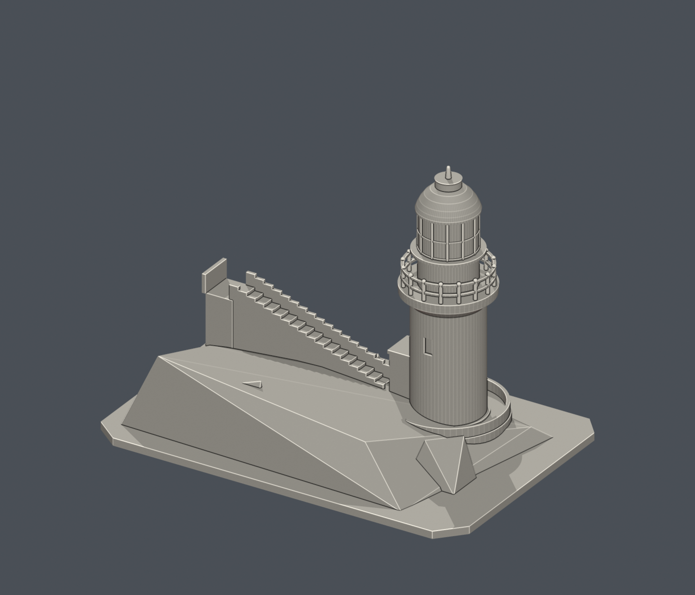

# 馬祖東湧燈塔（東引島燈塔）｜150 mm 可列印外觀縮景

研究與建模日期：2026-10-11。

成品外廓（含底座）：150 × 100 × 108.3 mm。STL 單位為毫米。

## 模型預覽

| 模型預覽 | 模型預覽 | 模型預覽 |
| :---: | :---: | :---: |
| 正面  | 背面  |  |

## 建模範圍與辨識特徵
製作圓柱塔、下段燈室、上段玻璃燈室、外廊欄杆、外張罩頂、附屬小門房，並以裁切的階地、石坡與一段上坡石階作支承。已檢視馬祖風景區 2025 官方相簿中的燈室近照、俯視及遠景。未加入未核實的遠處屋舍平面，也不含軍事設施。

細風向標用單一加粗尖飾替代；玻璃燈室以實心圓筒加窗框浮雕表示。欄杆採 16 根加粗柱及兩圈扶手，保留向外開放的間隙。底部圍牆、階梯、岩坡為適合整件列印的縮景，沒有重建室內設備。

## 尺寸依據與推估
以 150 mm 底座長邊設計，無精確量測比例尺。官方公開資料的塔高說法不一，本件沒有把其中一個數字當作精密測繪基準。塔徑、塔身與燈室高度比例依 2025 實景照片推估；階梯長度、坡度、地形與裁切範圍為展示性配置，不是實測地形或地籍資料。模型正背視角不宣稱精確地理方位。

## FDM 列印建議
底座平放，建議 0.4 mm 噴嘴、0.12–0.16 mm 層高、3–4 道外牆及 12–18% 填充起試。外廊柱直徑約 1.44 mm，環形扶手截面約 1.0 × 1.1 mm，窗框凸紋直徑約 1.06 mm，尖飾頂端約 1.4 mm。欄杆間有短橋接，燈室雨簷及外廊底部有懸挑：必須在切片預覽逐層檢查，按機器橋接能力加局部支撐。可用樹狀支撐避開細欄杆；不要用欄杆提起模型。若改用較大噴嘴或縮小尺寸，請先加粗欄杆與尖飾。此版本刻意保留通孔，所以 Euler 數不為 2；單一連通水密邊界及每頂點環檢查仍全部通過。

## 公開來源

- https://www.matsu-nsa.gov.tw/zh-TW/attractions/lookMore/1433
  - 馬祖國家風景區景點身份與公開外觀範圍。
- https://www.matsu-nsa.gov.tw/zh-TW/album/1052
  - 2025 官方相簿；檢視49號燈室近照，41、43–48號俯視及12、25、32號塔景、入口，核對兩段燈室、外廊、黑罩頂及階地。
- https://spotlightaward.taiwan.net.tw/tourpage.php?id=5fffa721-bbb2-48a7-a058-e76e938b9db9&tag=4
  - 觀光署公開介紹供交叉核对；沒有據高度敘述設定精密比例。

## 檔案內容
- model.stl：毫米單位的單一可列印外觀模型，底面 Z=0。
- build_model.py：原創參數化 Python 建模程式，可修改數字重建模型。
- editable.blend：由最終 STL 匯入的可編輯網格，已設定毫米單位。可列印物件名稱為「Print-ready exterior (mm)」。相機不是列印物件。
- previews/front.png、previews/rear.png：直接渲染最終 STL 的完整正面／背面斜視圖，沒有另外加上無法列印的裝飾。
- source_review.json：公開參考來源、採用特徵與推估範圍。
- validate_model.py、validation.json：非修改式幾何、原始法線與原始程式重建檢查。
- check_blend.py、blend_validation.json：檢查 Blender 網格與最終 STL 的幾何一致性。
- requirements.txt、SHA256SUMS.txt：套件版本及檔案摘要。

## 重建與編輯
需要 Python 3.12，先執行：

    python -m pip install -r requirements.txt
    python build_model.py
    python validate_model.py

需要重新製作 Blender 檔與預覽時，使用 Blender 4.3 或相容版本：

    blender -b -t 4 -P render_preview.py
    blender -b editable.blend -P check_blend.py

可用 --output 指定另存 STL，例如 python build_model.py --output revised.stl。修改後請重跑驗證。Blender 檔是可編輯網格；建築尺寸與程序性修改以 build_model.py 為主。

## 驗證與限制
數位驗證確認：單一連通外邊界、水密、面繞向一致、原始 STL 法線與頂點順序一致、每條邊恰有兩個相鄰面、各頂點的鄰接面形成單一環、無退化三角面、正體積、平整接地、最長邊 150 mm。原程式重新輸出的標準化三角形摘要相符；.blend 的可列印網格也與 STL 一致。模型沒有封閉的空腔內殼。外廊或裝飾下方若有對外通孔，不是破面或封閉空腔。

尚未實際切片或試印。數位檢查不等於實體列印保證；未另以獨立三角面交叉演算法證明所有自交情況，主體採 manifold3d 實體布林建立。請先用自己的切片軟體檢查支撐、薄壁、橋接、耗材量及列印時間。不要未檢查就縮小模型；細節會一起變薄。

此為公開外觀的桌上型建築縮景，不是測繪圖、修復工程模型或精密等比例複製品。參考照片僅供觀察，未隨包附送，也沒有使用他人 STL／3D 資產。預覽為單色材質，不代表實際建築配色。正面／背面是模型視角標示，未宣稱精確地理方位。
