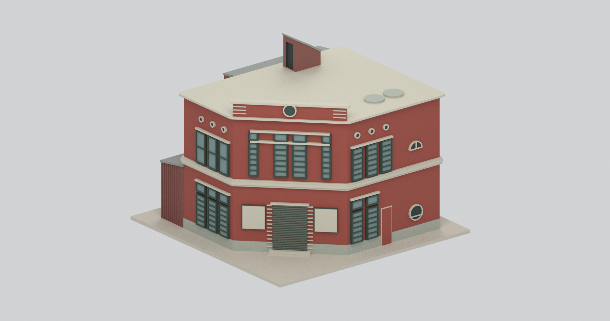
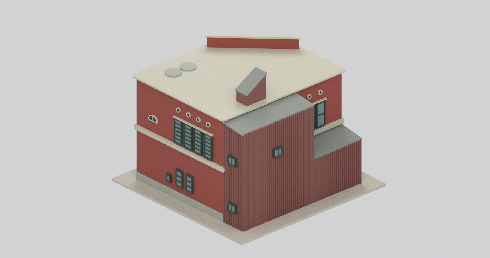
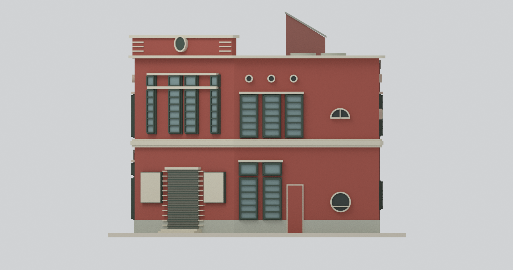
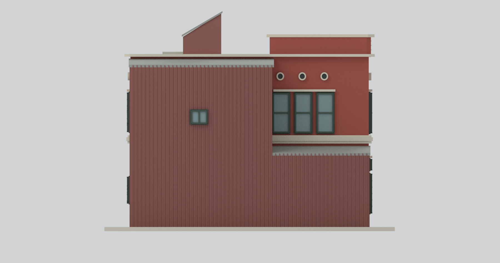
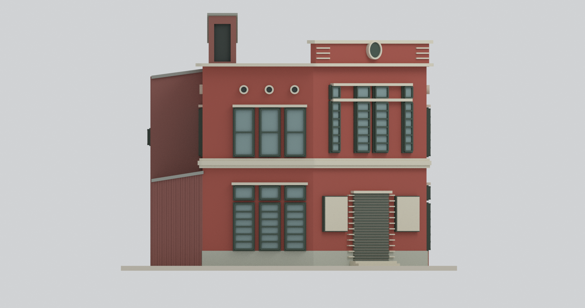
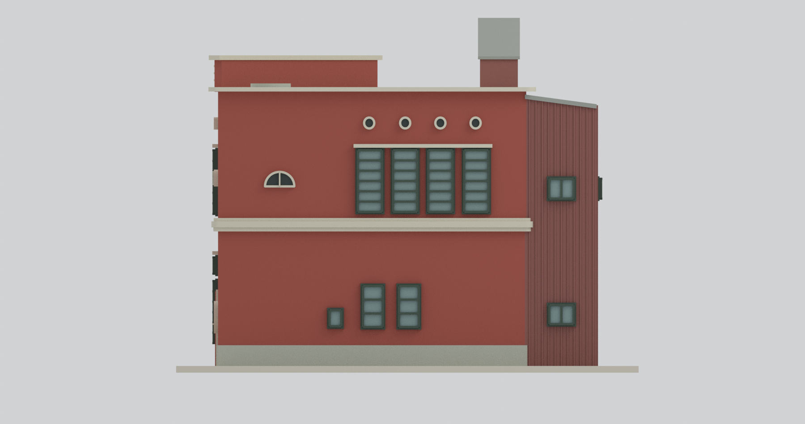
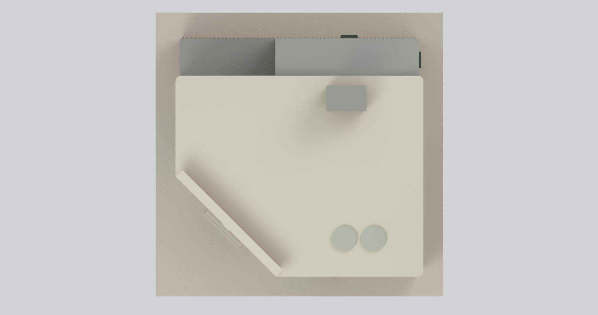
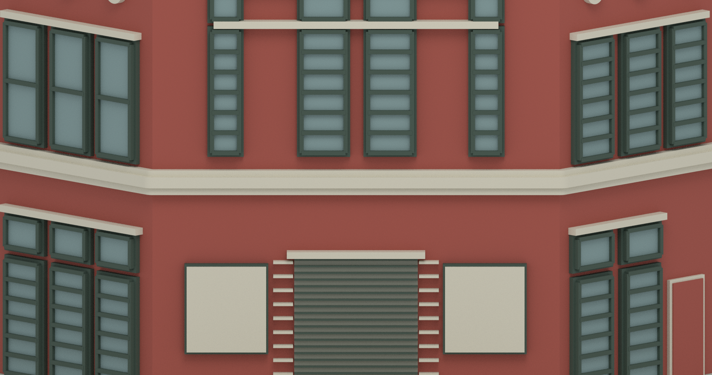
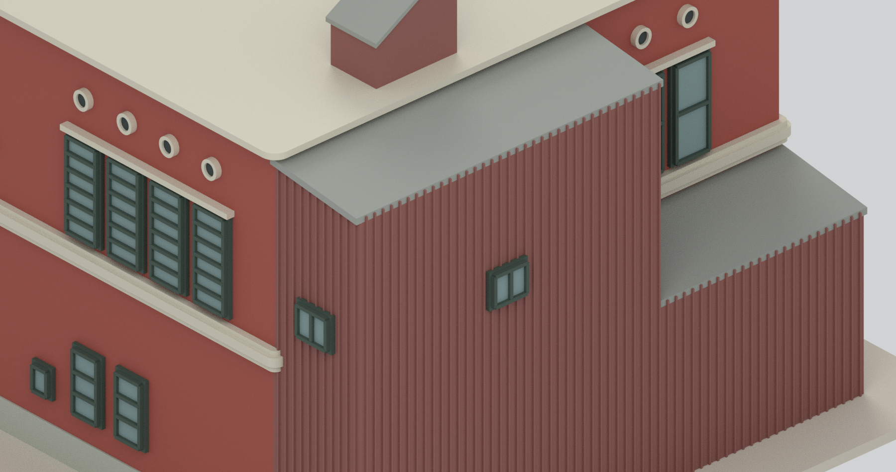

# 豐原頂街派出所｜2013年調查外觀研究

## 模型預覽

| 西北街角整體 | 東南附建整體 | 西向立面 |
|---|---|---|
|  |  |  |
| 東向立面 | 北向立面 | 南向立面 |
|  |  |  |
| 全屋頂俯視 | 斜入口局部（刻意裁切） | 東附建／梯間局部（刻意裁切） |
|  |  |  |

## 時期與範圍

依臺中市官方《臺中市歷史建築「豐原頂街派出所」調查研究》**2013年5月、A系列圖框2013-05-30現況**製作。報告記載1936年興建；本包不是1936年完好復原，也不是B系列復原提案或今日整修狀態。

包括二層五邊形主體、西北斜入口、東側後期鐵皮附建（北段一層、南段二層）、單斜頂屋梯間及兩個低RC圓基座代理。入口不是矩形正面中央凸樓；203入口立面兩旁還包含鄰接面投影，沒有全部壓成同一平牆。

**保留調查時改變**：入口是閉合鐵捲門，兩側告示牌遮住原W1菱形窗；西側舊門為封堵狀態；東側原牆多被鐵皮附建遮蔽，不把室內索引窗穿到附建外皮。封面復原配色及B提案沒有用來替換A現況。

## 尺度與圖面估讀

- 主體約11.44×9.19m；西北切角兩邊約4.65m，東附建深約2.10m，二層附建位於南段約6.81m。
- 中間立面帶中心約4.23m，**不是已證實的室內完成樓板高程**；主平屋頂約8.33m、入口高牌面約9.25m。
- 東附建南段斜頂內／外約8.08／7.79m，北段約3.88／3.54m，不一律拉成二層。
- 屋梯間平面183.5×113cm為圖上標註；最高北端10.40m、低南端9.25m為圖尺估高。斜帽厚度向下配置，不額外把最高點抬高。
- 其餘尺寸由各頁自己的圖尺估讀，約±3%、局部邊線約±0.10m；203為250cm圖尺，204／205為750cm圖尺，沒有共用錯誤像素比例。各頁估高差約0.03–0.05m仍保留誤差。
- 兩圓基座半徑約0.60m，位置依201屋頂圖；高度未知，採0.13m低代理，**不是水箱**。其他矩形基座及鬆散設備省略。

名義**1:100**，作者2mm底座；外框見[幾何摘要](build-summary.json)，約139.4×137.9×106mm。實心外觀模型不是薄殼施工圖；細框、屋簷、欄飾需另做製程和支撐檢查。**未物理試印，不保證可直接列印或結構安全。**

## 開口與細部限制

- 北面上層三個替換鋁窗保留兩格形式；西面上層三個六格窗，南面四個六格窗；各面小圓氣孔分別配置，不靠鏡像。
- 西面半圓窗／低圓窗、南面半圓窗及不等高小窗分開處理；東面僅露出北段上層三窗，其餘原窗遮蔽。
- 斜入口上層為窄／寬／寬／窄四窗及各自上氣窗；兩塊告示牌使用無字不透明代理，沒有捏造可讀標語或把菱窗露出。
- 頂部損壞警徽以中性圓盤代理，**不是鐘面**，未創造可辨識徽章細節。窗面／圓孔／門為不透明或盲背代理；屋梯間北面門狀位置用盲凹槽表達，不宣稱已有真實門扇或室內樓梯，未重建完整室內。
- 紅牆依調查照片支持，但色彩未校色，並非原1936年精確漆色。窗框、鐵皮波紋、捲門條片、踏階及線腳有加粗／簡化；病害、植物、管線、雜物、風球及完整屋頂設備省略。
- 原始PDF、原照片、裁圖及私人資料未放入公開包；只有作者幾何、渲染、控制文字及來源連結。

## 檔案與驗證

[STL](model.stl) · [彩色3MF](model.3mf) · [Blender](scene.blend) · [可重建腳本](build_model.py) · [重建說明](REBUILD.md) · [來源](SOURCES.md)

[網格QA](QA.json) · [場景QA](BLEND-QA.json) · [獨立審查](review/) · [乾淨重建](REBUILD-QA.json)。數位封閉／連通／格式等值不等於史實全復原、物理試印或結構安全認證。
