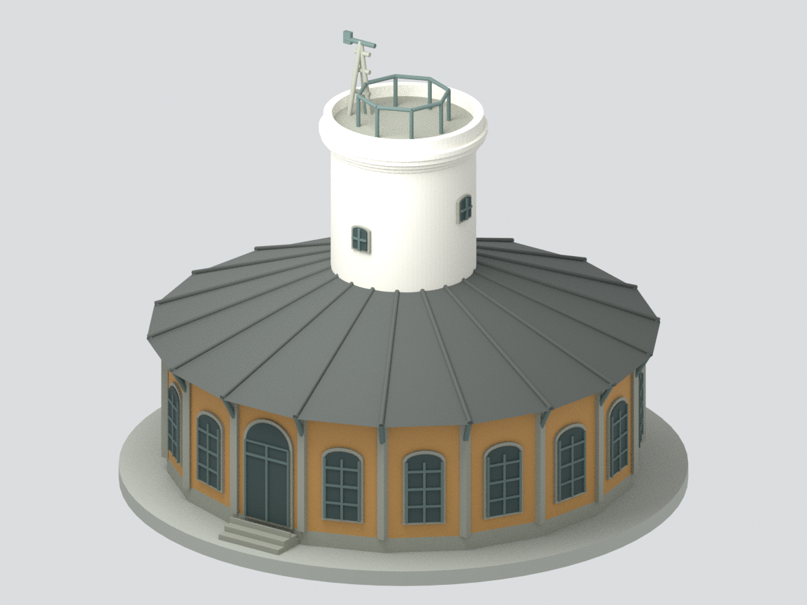
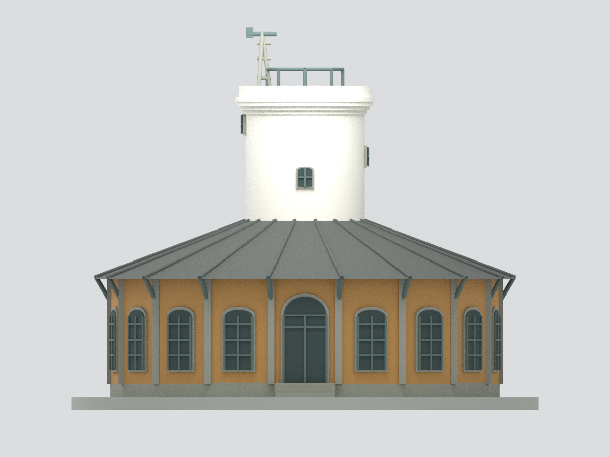
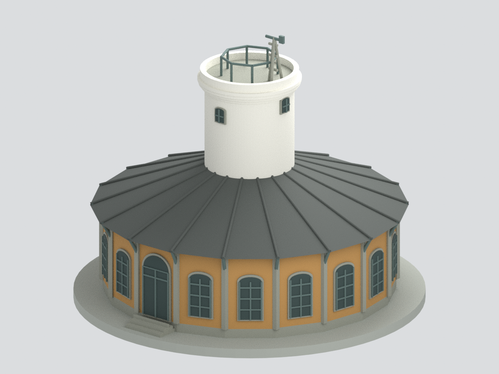
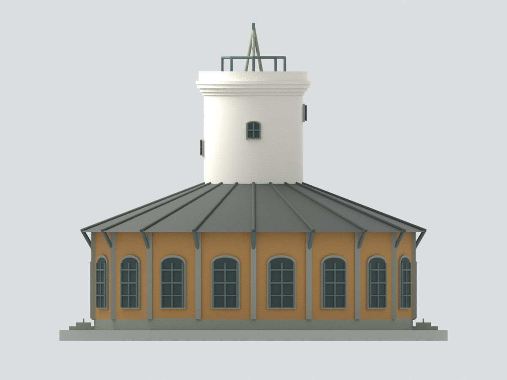
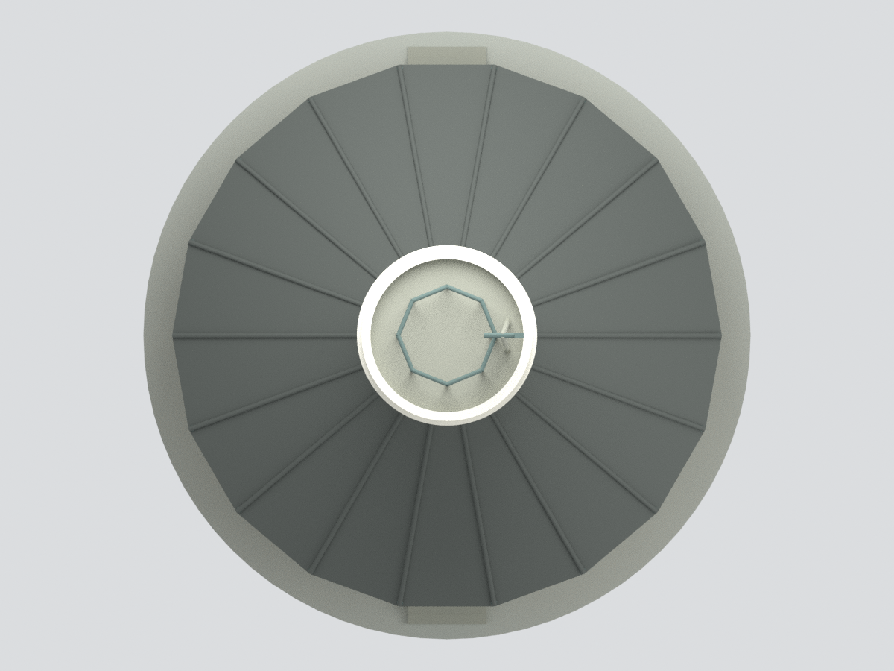
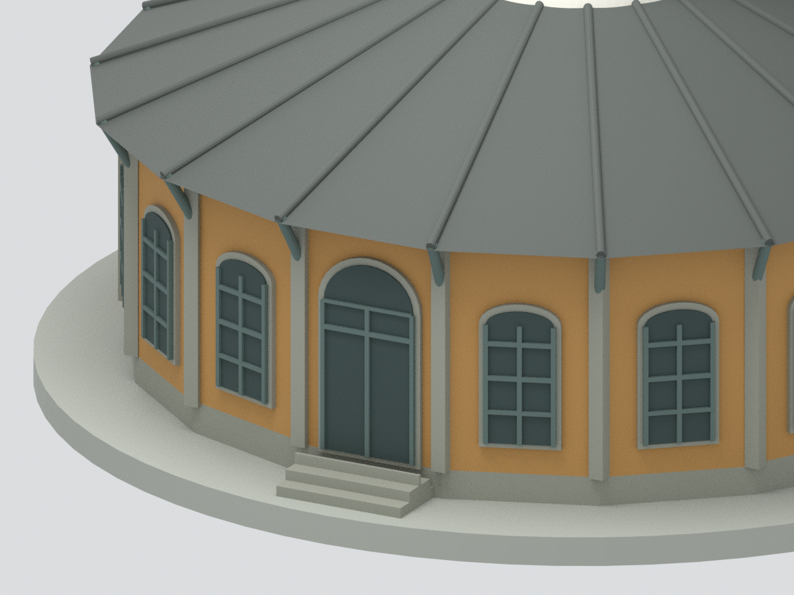

# 原臺南測候所｜來源支持的簡化外觀研究模型

## 模型預覽

| 斜前方 | 正面 | 斜後方 |
|---|---|---|
|  |  |  |
| 側面 | 俯視 | 入口細節 |
|  |  |  |

以上為本包實際網格渲染，非建築實照。入口細節為局部取景，其餘為完整模型。

## 範圍與可靠度

模型對象為臺南市中西區公園路21號的原臺南測候所（1898年完工的歷史建築），**不是鄰側現代南區氣象中心**，也不是大學校區建築。以氣象署官方平面示意、官方外觀影像、文化部古蹟說明及南科官方刊物照片交叉核對。

- 已有依據：十八邊環形單層量體、中央圓風塔、東西向對向入口、十八放射屋頂、四個塔窗、黃磚與石色線腳、外檐木斜撐、層疊塔簷和觀測支架。
- 約數校準：刊物外圈約15m、內圈4.6m；氣象署塔高約12m。模型採10mm對應約1m（約1:100），**不是測繪定尺模型**。
- 對向入口外，其餘16面以照片支持的重複窗型表現；各面窗寬、框格、塔窗旋轉角度/標高、屋頂坡度/檐高、木架截面均為估尺，沒有逐立面測量。不可把複製窗型當作每一面現況證明。
- 以修復後歷史照片為基準；所參照的航空照含2009日期，其他照片時間不同，不聲稱完全代表2026現況。
- 瓦片細壟、屋脊端飾、黃磚縫與柱身交錯石帶未逐一建出；屋頂用光滑分面表現，僅保留十八放射分區與粗屋脊，不是完整細部復原。
- 儀器架、欄杆為加粗簡化輪廓，非精確或可運作的氣象儀器複製；未建內部六房、螺旋樓梯、室內展品、鄰棟、真實基地地形。

## 檔案

- `model.stl`：單一連通實體，毫米。
- `model.3mf`：同一網格及7種基礎色材料，毫米；顏色不等於實際多色列印設定。
- `scene.blend`：可見合併網格＋隱藏的可編輯作者元件，無外部照片材質。
- `build_model.py` / `render_model.py` / `validate_model.py`：重建、渲染與驗證。
- `SOURCES.md` / `sources.json`：可追溯來源與限制，未重發第三方參考原圖。

## 列印與驗證限制

含作者展示底座約180×180×147.5mm。玻璃為不透明實體色塊；細木架、窗格及平台欄杆已加粗。屋檐、斜撐及儀器頂部可能需要支撐，**未做實體試印或完整切片器驗證**。通過水密/連通/格式驗證，不代表真實建築尺寸、所有細節或列印成功獲得認證。

完整檢查見 `QA.json`、`BLEND-QA.json`、`visual-review.json`、`rebuild-test.json`；數位幾何檢查與外觀史料可靠度分開標示。

## 下載與導覽

[STL](model.stl) · [3MF](model.3mf) · [Blender](scene.blend) · [重建](REBUILD.md) · [返回臺灣地標](../README.md)
