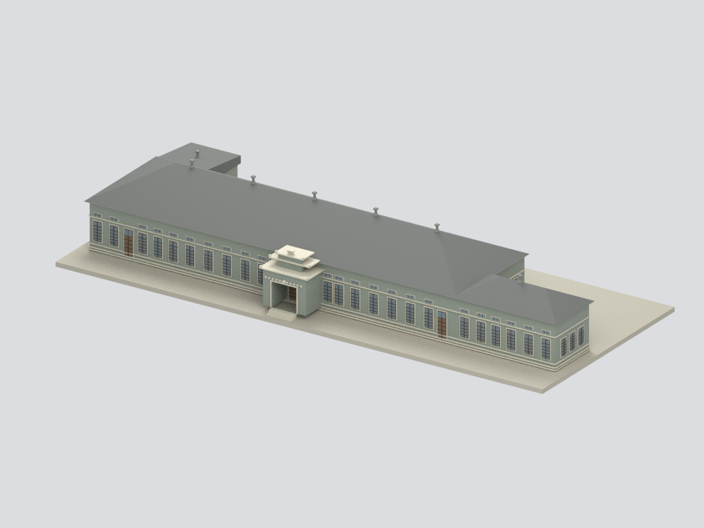
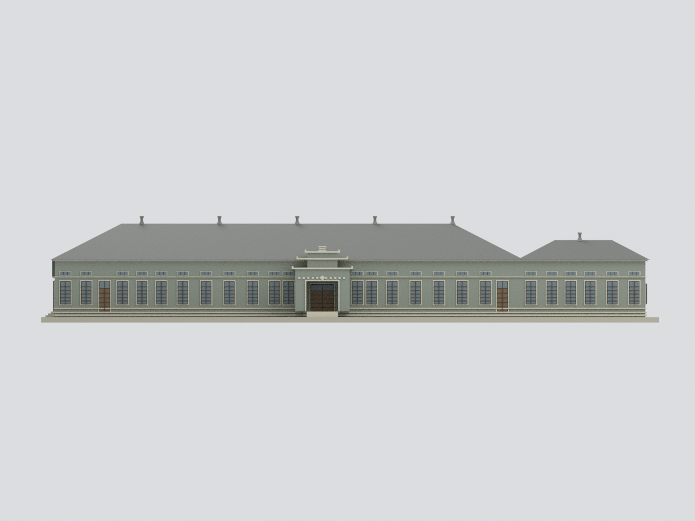
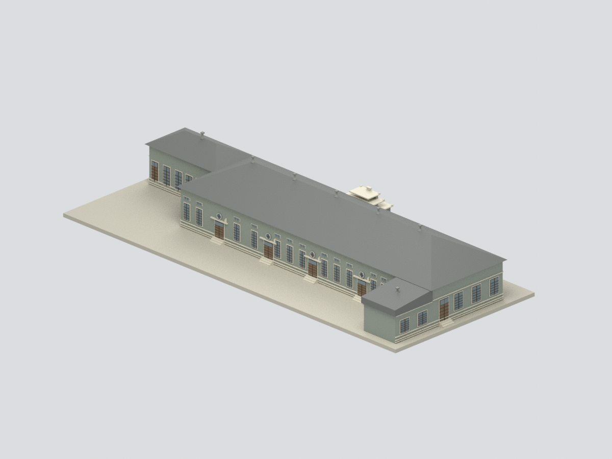
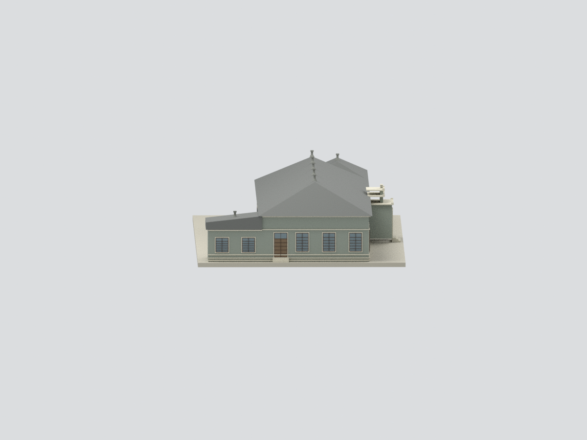
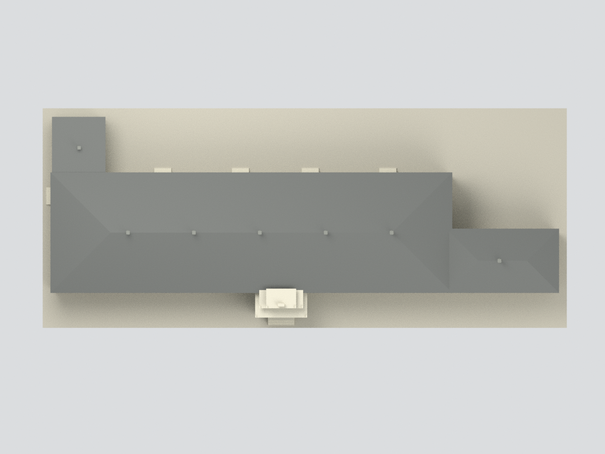
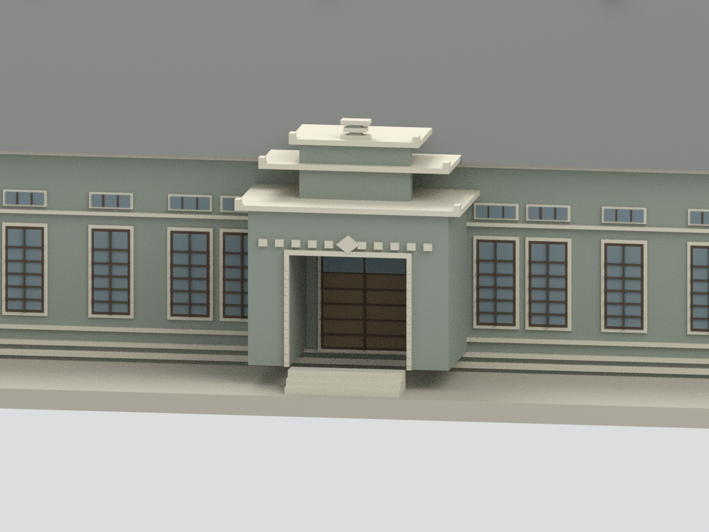

# 帝國製糖臺中營業所｜歷史主體外觀研究模型

## 模型預覽

| 正面主體 | 正立面 | 背面主體 |
|---|---|---|
|  |  |  |
| 西端主體 | 屋頂與範圍 | 入口局部 |
|  |  |  |

## 2. 範圍與證據

這是依官方修復設計圖與修後實照交叉整理的歷史主體外觀研究模型，**不是整個園區、現況完整建築群或精確竣工測繪**。保留長條主體、高低四坡瓦頂、東側低翼、西側回翼、主入口、四面門窗及北照可見六座屋脊通風器，以及依西立面圖配置的回翼通風器。

2016 年設計圖由官方修復文件公開；2019 年修後照片核對北面、西端、入口與部分南側。隱蔽／未完整拍攝的面依設計圖推定，不能聲稱所有修復均原樣落實。

**排除已存在的南側黑鋼玻璃／木板條景觀棚、圖面標示增建餐廳／廁所之範圍（不據此斷定增建年代）、園區景觀、室內、其他糖廠建物。** 留白的增建接合處是本模型範圍邊界，不表示現場空無一物。

## 3. 尺度與簡化

- 名義比例 1:400；主長 64.58 m、主深 14.545 m、主屋頂 10.23 m、東側低屋頂 8.43 m，依官方圖標註。外檐、門窗框厚與入口深度以讀圖估算。
- 部分逐跨尺寸相加與總尺寸差約 1 cm，依總長取值，非毫米級測繪。
- 窗位／開口尺寸為圖面估讀，窗扇格線、入口方飾、柱頭與階梯托架粗化，不逐件復原。
- 瓦片細壟、屋脊端飾、牆面磚縫及落水細管未逐一建出；屋頂以光滑分面呈現。
- 窗玻璃／門為不透明封閉代理、室內實心；不含透視室內、結構與施工用途。
- 只作數位幾何檢查，**未試印**；細框與小通風器可能不適合直接量產列印。

## 4. 檔案

`model.stl` 單色網格、`model.3mf` 色材分區、`scene.blend` 實際模型與隱藏的可編輯原始構件、`build_model.py` 可重建來源；來源、QA 與限制見附檔。

## 下載與導覽

[STL](model.stl) · [3MF](model.3mf) · [Blender](scene.blend) · [重建](REBUILD.md) · [返回臺灣地標](../README.md)
