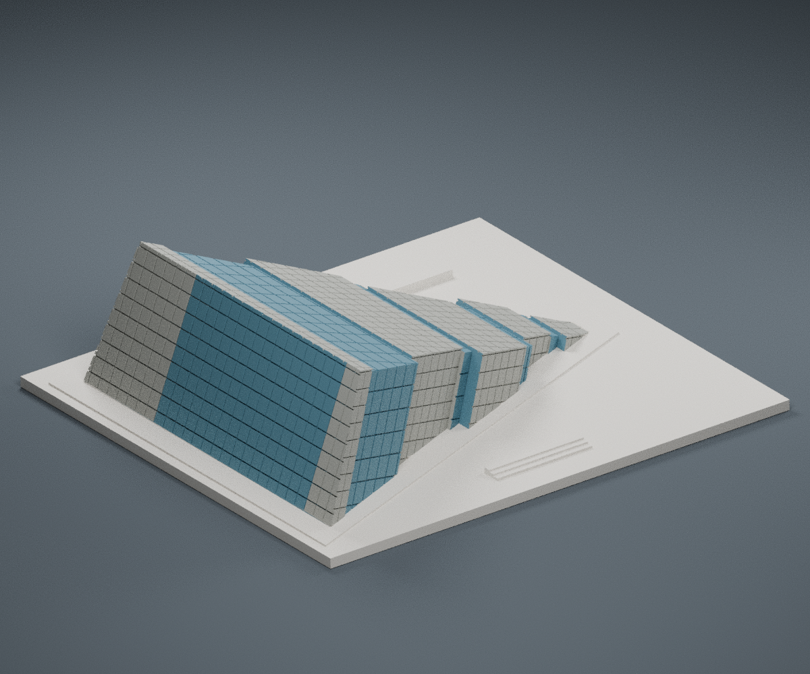
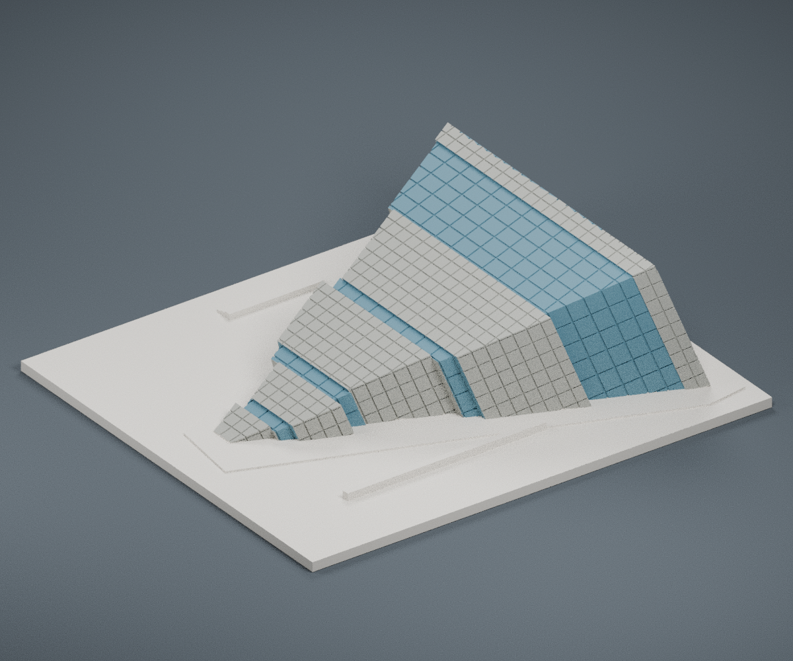
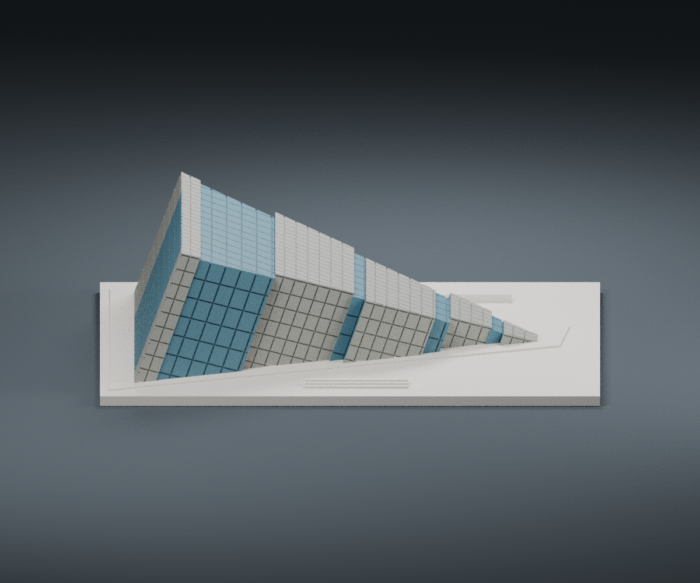

# 蘭陽博物館｜150 mm FDM 外觀模型

依公開外觀與空拍照片重新建構的原創外觀模型。尺寸 **150 × 132 × 42.47 mm**，含 3 mm 厚底座。此為照片判讀的建築小模型，不是精密測繪或館方授權複製品。

## 模型預覽

| 模型預覽 | 模型預覽 | 模型預覽 |
| :---: | :---: | :---: |
| 正面  | 背面  | 正立面  |

## 造型重點

保留單面山意象、約 20° 斜屋頂、約 70° 高端立面、向後逐漸縮小的三角形平面、前後錯位的石材／玻璃分帶，以及側邊與屋面板材接縫。各分帶聯成單一實體，玻璃以表面凹槽與預覽色彩表示，沒有實際透明玻璃或封閉室內空間。

本版將複雜分割收斂成十個連續分帶；分帶寬度、錯位、立面玻璃位置及入口位置依照片概括，不應視作原館十個量體的逐一精確對應。側面與高端的刻線可在單色列印時保留識別度。

## 檔案

- `model.stl`：列印用二進位 STL，毫米單位
- `build_model.py`：原創參數化幾何來源，可編輯角度、分帶、紋理及尺寸
- `scene.blend`：同一 STL 匯入的可編輯 Blender 場景；地板與燈光只供預覽
- `previews/front.png`、`rear.png`、`elevation.png`：實際交付 STL 渲染
- `validate_model.py`、`validation.json`：驗證程式與結果
- `requirements.txt`：重建依賴版本

預覽藍色／灰色只表示玻璃和石材分區；STL 不帶顏色，亦未加上 STL 以外的假立面細節。

## 來源

檢視日期：2026-10-11。

1. [宜蘭縣政府，蘭陽博物館景點頁](https://travel.yilan.gov.tw/zh-tw/attraction/321/)。已實際檢視兩張外觀照片：濕地遠景與近側面，確認側邊斜率、玻璃區和錯位立面。
2. [宜蘭縣政府外觀遠景圖](https://travel.yilan.gov.tw/_api/content/images/attractions/23922/640x480_attractions-image-hkovag-b4uu2w6ejmwbqvq.jpg)。
3. [宜蘭縣政府近側面圖](https://travel.yilan.gov.tw/_api/Image/23920/?r=1762309995751)。
4. [蘭陽博物館，常見問答](https://www.lym.gov.tw/en/audience-service/faq/)。檢索擷取內容說明屋頂與地面 20°、尖端牆面與地面 70°；這兩個角度用於模型幾何。
5. [蘭陽博物館，建築景觀](https://papago.lym.gov.tw/ch/about/architectural/)。檢索擷取說明單面山、三角錐體與量體錯位。館方頁面／PDF 直接連線遇到憑證或存取問題，未繞過警告，不能將未取得的 PDF 稱為已核對圖說。
6. [KRIS YAO | ARTECH 專案圖輯，Archilovers](https://www.archilovers.com/projects/103607/lanyang-museum.html)。另實際檢視公開空拍圖，補查三角形屋面、橫向分帶、錯位輪廓。照片未隨交付包再散布。

全部來源影像著作權屬原權利人。本模型為重新建立的幾何，沒有擷取或散布第三方現成 3D 模型。

## 比例與範圍限制

屋頂和高端主斜率有館方文字依據，其餘尺度均為照片推估。沒有完整 as-built 平立剖面，沒有精確比例尺。背面與被遮蔽表面、屋面板材數量、細部玻璃格線、分帶深度與相互錯位採簡化。外牆四季樂譜板材排列沒有逐片重現。底座、木棧道意象及低矮入口階梯為列印穩定性和視覺辨識而概括；不含整座濕地、樹木、旗桿或室內展場。

## FDM 建議

底座平放，PLA、0.4 mm 噴嘴、0.16–0.20 mm 層高、3 道外牆、15–20% 填充可作起點。板縫約 0.36–0.50 mm 寬，深度約 0.35–0.50 mm；小於此寬度的打印線設定可能讓細線消失。斜面自地面連續生長，通常比薄殼更容易列印；仍需檢查切片器的小階梯、細凹槽與高端邊緣。未進行實體試印。

STL 沒有封閉室內空腔，實際稀疏填充由切片器設定。

## 重建與驗證

Python 3.12 安裝 `requirements.txt` 後執行 `python build_model.py`；再執行 `python validate_model.py model.stl --output validation.json`。預覽重建：`blender -b -t 4 -P render_preview.py`。Blender 場景設毫米，列印時只匯出 `Printable building`。

檢查包含 watertight、單一連通邊界、每邊恰兩面、各頂點連結為單一環、法向繞序、無退化面、正體積、平底、150 mm 最長尺寸、Manifold 核心重讀、無內部封閉邊界殼，以及 STL SHA-256。表面刻槽可形成與外界相通的局部孔隙；數位驗證仍不等於實體列印測試。
