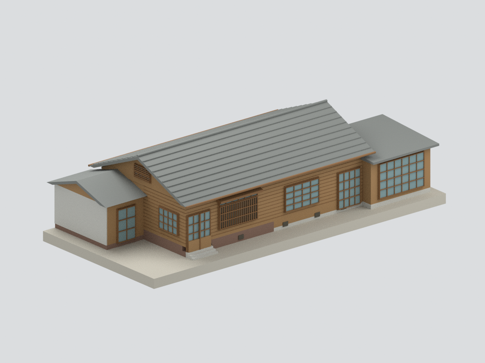
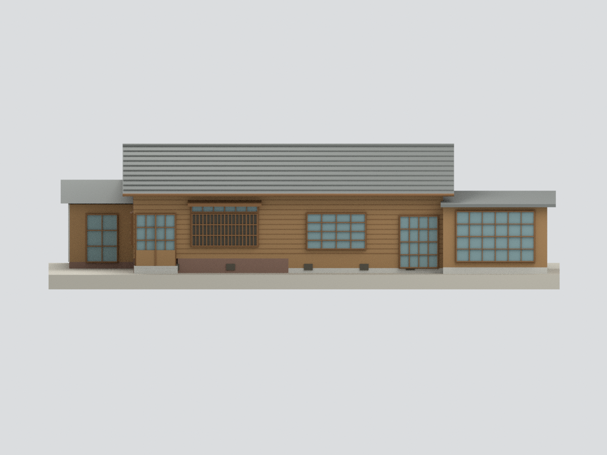
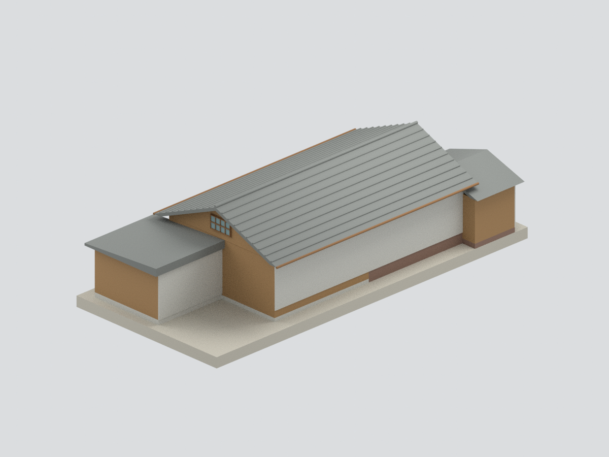
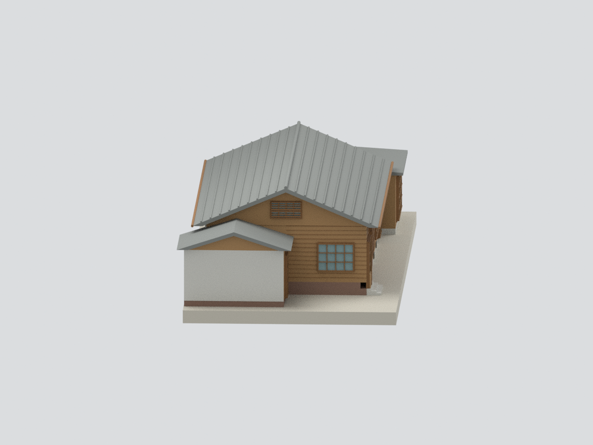
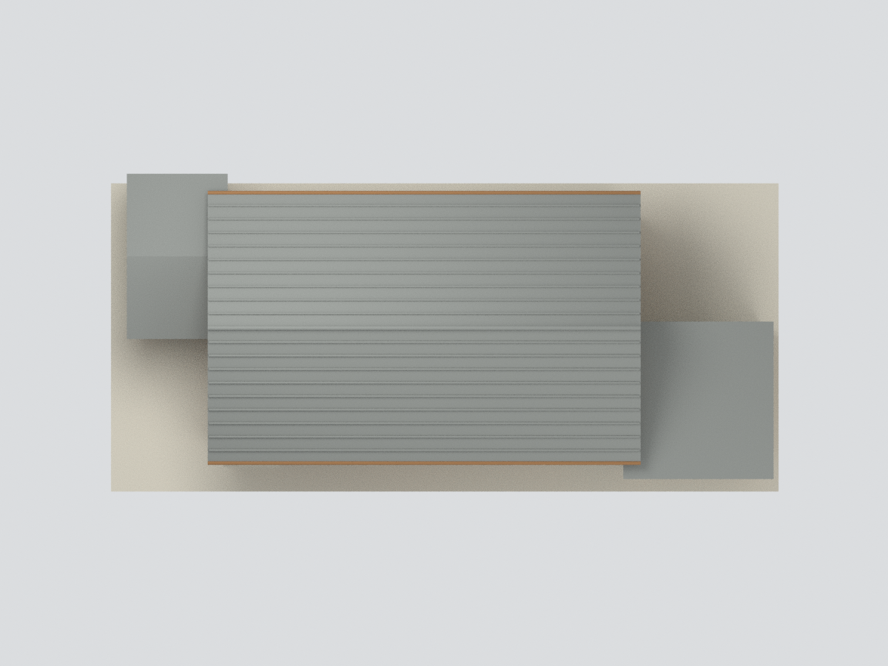
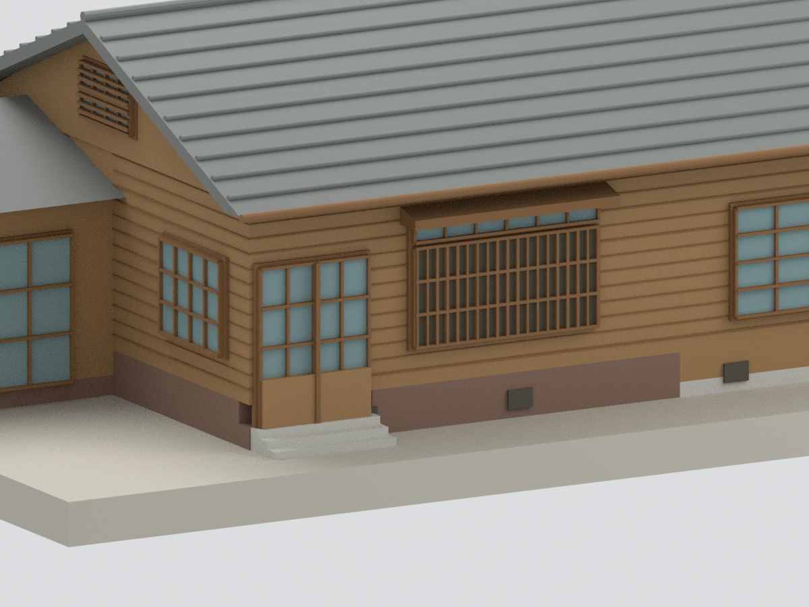

# 林之助畫室｜調查報告主體截取外觀研究

## 模型預覽

| 調查主體截取 | 南側主體截取 | 北研究截界（非既有後牆） |
|---|---|---|
|  |  |  |
| 西端與服務翼截取 | 主體屋頂研究 | 西玄關與窗局部 |
|  |  |  |

## 2. 範圍與時相

這是**調查報告主體截取外觀研究，不是修後全棟現況復原**。依臺中市文化資產處調查第三、四章，選取雙併歷史核心、西側服務翼及藝術家使用的東南突出畫室。東半保留其改造差異，不鏡射成兩間一樣的原型宿舍。室內創作場景與藝術作品不重建。

**北側及外側後期附屋排除是人工研究邊界，並非判定那些建物已拆除。** 模型北面及西服務翼外側接合面以中性灰封口穩固支撐，不能視為真實後立面或據以判讀開窗。屋頂與牆高有近似，不是竣工測繪；不含整個園區、圍牆、樹木、路面、未確認附屋。

調查圖3.2.15紅線表示舊制牆/建具，不是修後竣工邊界。模型不移植未定位的現代坡道，不恢復圖上標已拆的原緣側，不混拼調查期與修後新配置。官方修後照片僅交叉可辨木牆、屋瓦和窗型，不能作所有端面已核實的證據。館方2022平面請求403未讀到，沒有拿它補幾何。

## 3. 尺度與簡化限制

- 名義比例1:100。正文田舍間6尺約181.8cm、3尺約910mm，按清晰平面12尺房格約3.636m作像素比例估讀；主體外包、牆厚及附屬翼仍為近似。表3.2.1部分加總文字不一致，不照抄其錯誤合計。
- 主屋架跨度715cm、升高180cm是結構端點，不等於含檐口總外包。屋面支承位置、檐口、牆高、次屋頂斜率與遮蔽接合部分按圖/照片估配，不宣稱實測。
- 東南畫室及西服務翼保留體塊和可辨開口，個別窗扇格數、局部門窗高度及端面不可見細部是簡化推定。北研究封面不造出無證據的後窗。
- 玻璃採不透明背板，門窗格柵、雨淋板及瓦列粗化；東南畫室東牆無已確認開窗，沒有任意補造大窗。沒有完整室內、透視玻璃、逐片瓦、精細接合、風化、文字、五金及雨樋。屋瓦/木色未現場校色。
- 底板為作者展示支撐，不是真實地形。**未試印**；水密不代表實體列印強度與細格已測試。

## 4. 重建與檔案

提供STL、材質3MF、Blender可編輯來源構件、建模/渲染腳本、六視圖與來源/QA。參考原照片/PDF不隨公開包附送。幾何與來源外觀分開審核。

## 下載與導覽

[STL](model.stl) · [3MF](model.3mf) · [Blender](scene.blend) · [重建](REBUILD.md) · [返回臺灣地標](../README.md)
