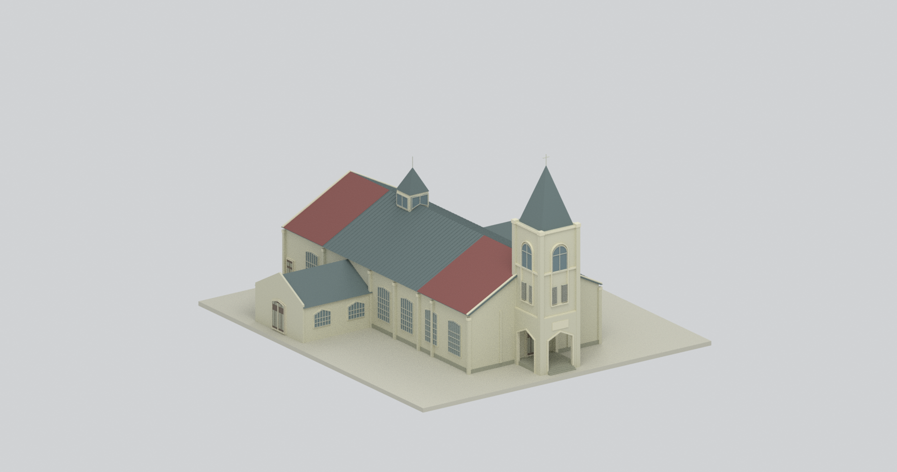
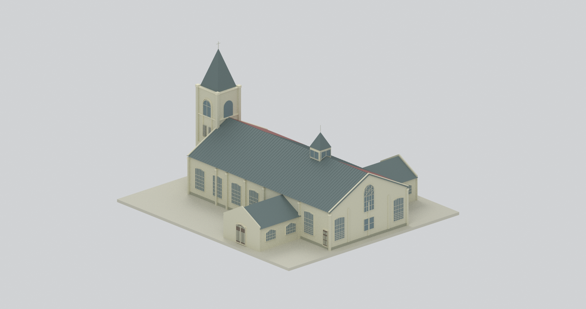
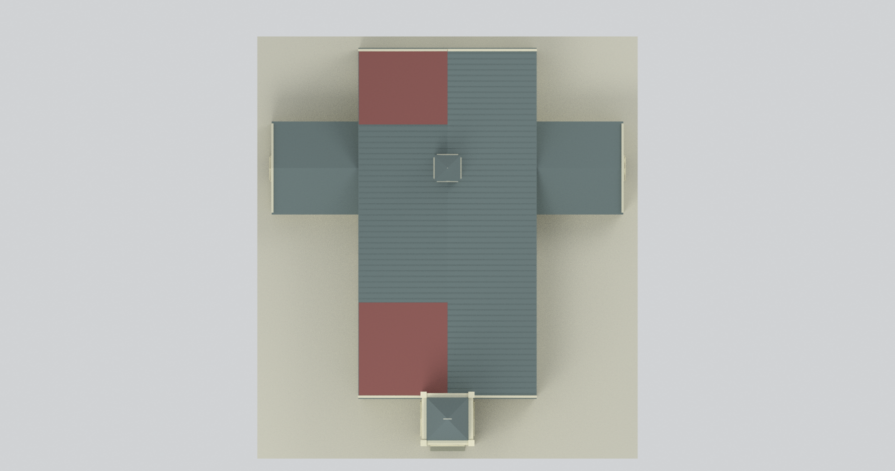
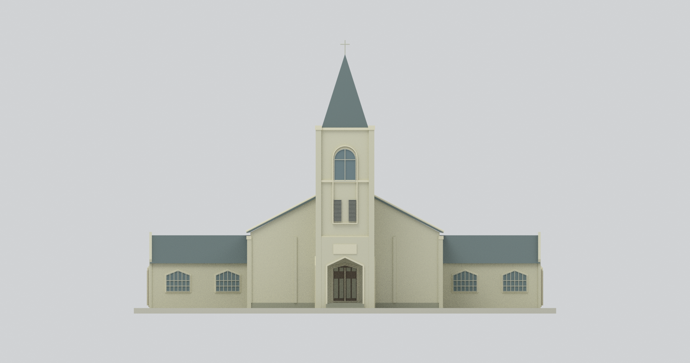
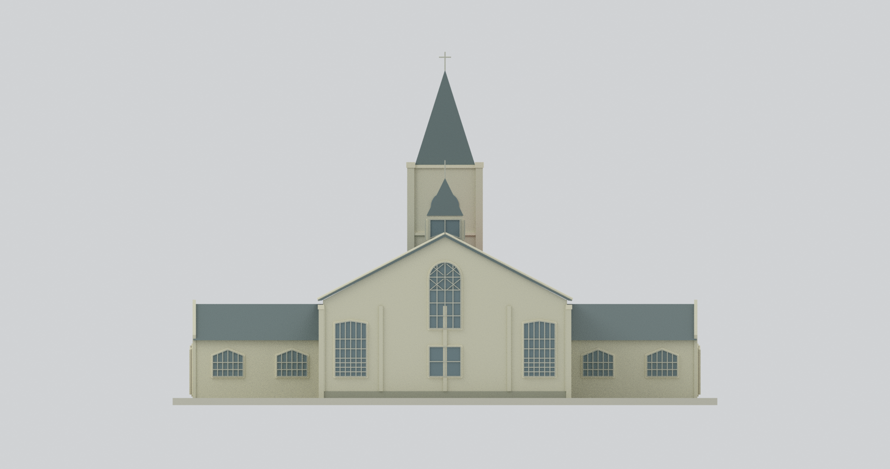
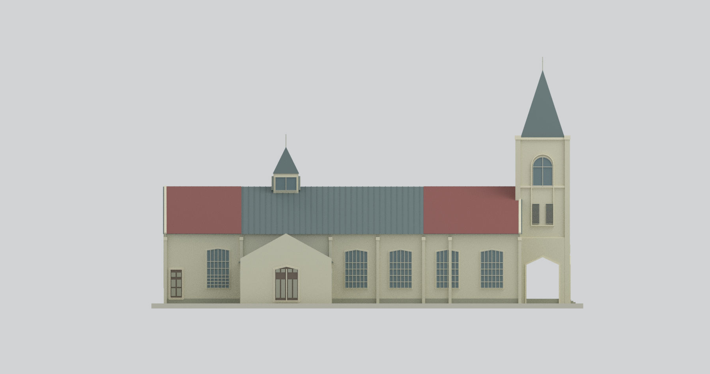
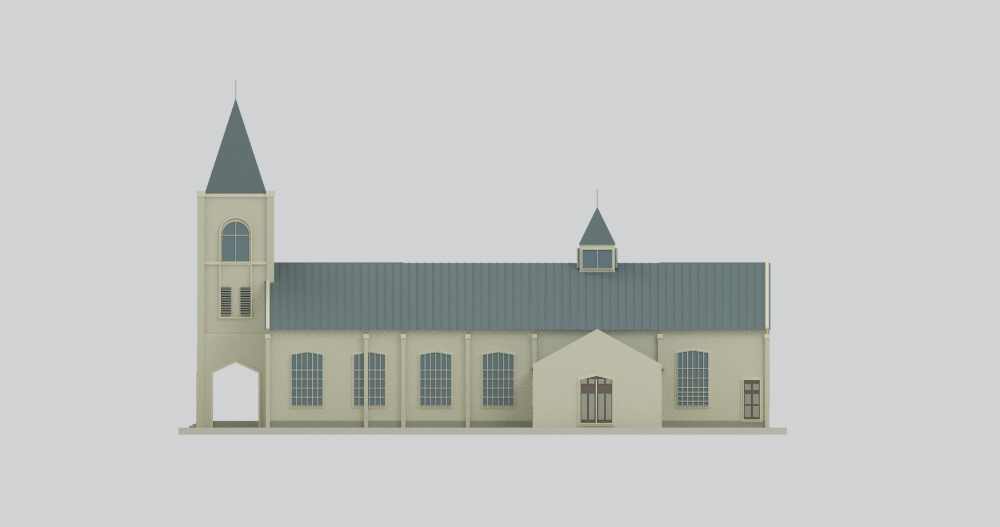
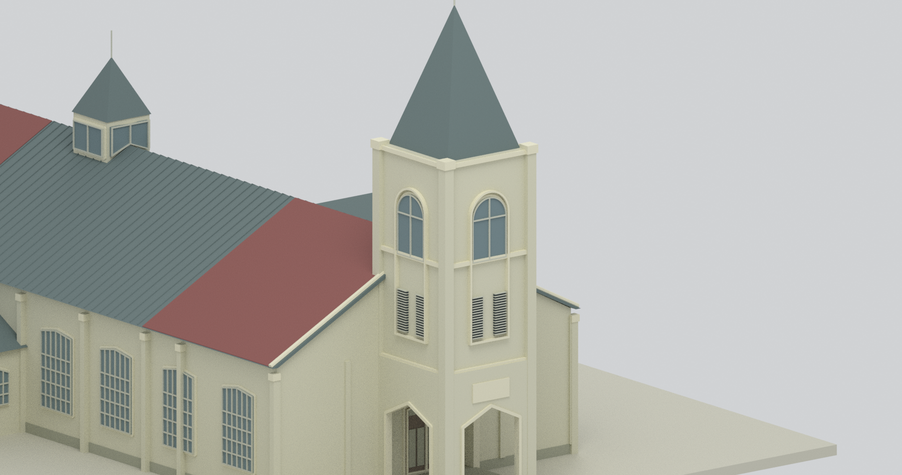
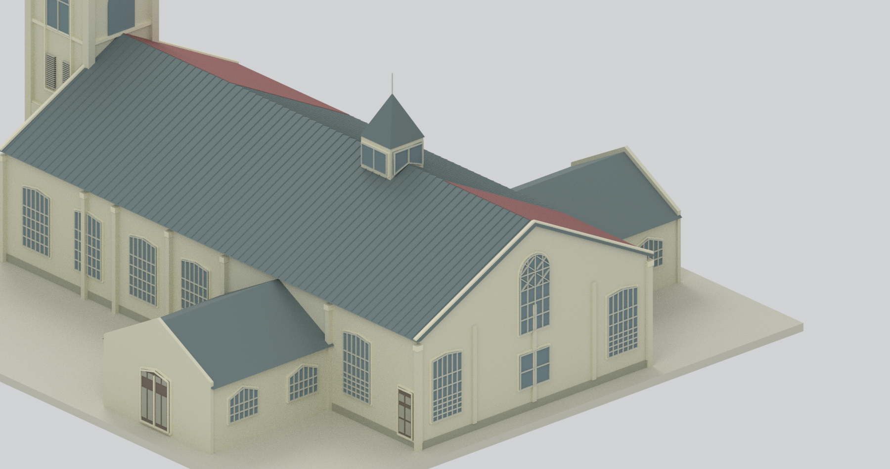

# 梨山耶穌堂｜2016 年調查外觀模型

## 模型預覽

| 前方透視 | 後方透視 | 俯視 |
|---|---|---|
|  |  |  |
| 正面立面 | 背面立面 | 左側立面 |
|  |  |  |
| 右側立面 | 鐘塔細節 | 後部細節 |
|  |  |  |

## 建築與時期

1969 年建的梨山耶穌堂；本模型依臺中市文化資產處 **2016 年 12 月調查研究**附錄九測繪呈現當時主教堂、兩側低翼、前方開放門廊鐘塔與屋頂小塔。不是竣工原貌、修復提案，也不宣稱今日現況。配色僅調查照片的未校色代理；保留左屋坡前、後段紅色修補板，不把全屋頂改成嶄新銅瓦。

## 尺度與檔案

名義 **1:200**；輸出單位毫米，含作者展示底板約 **153 × 170.3 × 99.4 mm**。STL、3MF 為單一聯集外觀實體；BLEND 包含可見最終網格與隱藏的可編輯構件。`build_model.py` 與 `render_model.py` 可離線重建，詳見 [REBUILD.md](REBUILD.md)。九視圖中七張整體、兩張刻意裁切的細節圖。

## 有據控制與明示推估

- 主體名義寬 13.71 m、主前牆至後牆 27.96 m；調查平面總軸長 31.56 m、側立面 31.57 m，各中間分跨不相同，沒有強行當成同一量測。橫向其他軸鏈為 13.57 m；本模型牆外皮與軸線不完全等同。
- 主脊 9.23 m、簷高 5.53 m；低翼牆高 3.34 m、屋面峰值 5.29 m，端山牆約 5.53 m。局部低翼高度保留約 ±0.25 m 代理不確定性。
- 鐘塔分層累計至尖頂 18.47 m，加頂部十字架至 19.48 m；塔身外皮 3.85 × 3.90 m 是配合軸線 3.57 × 3.60／3.63 m 的外觀代理。
- 小塔金字塔頂 12.38 m **不含**其上細桿；桿高約 1 m 未標尺寸。小塔窗 171／173 cm 不能當塔身外寬。側立面 367 cm 起算線非主脊，未誤加成 12.90 m。
- 塔背只保留背立面可見的上拱輪廓中性代理，不憑前塔投影虛構背面百葉及精細窗格。窗門類型寬高取細部圖；位置按獨立立面約讀到 0.1 m，非精密放樣。小塔 W9 保留 1.10 m 高及 0.33 m V 底高差，整體工程上移 0.06 m（底緣 8.96、中心 9.29、上緣 10.06 m），避免浮點輸出與屋脊重合；**不是原圖標高**。
- 屋面厚度、牆皮、窗框、接縫、門板與裝飾簡化為可辨識代理。D1／D2 每門葉兩列主板、D5 兩列三高度區保留，但上板斜角、雕刻與把手未精確重建。門窗多採不透明表面，不代表完整可穿透室內；唯鐘塔地面三面門廊保留實際幾何開口。

## 範圍與限制

不含附錄八歷史方案、附錄九 C1 再利用提案、獨立宿舍、噴水池、地景、完整室內、家具、細小裂損及精密文字雕刻。未做物理試印；細桿、十字架、窗框及門廊需自行依製程檢查、縮放和安排支撐。幾何封閉不等於保證任何設備可直接列印，也不是結構安全鑑定。

公開包僅作者模型、圖表化控制與模型渲染，**不附官方 PDF、照片或圖面裁圖**。[來源與頁碼](SOURCES.md)；[幾何範圍](geometry-scope.json)。
