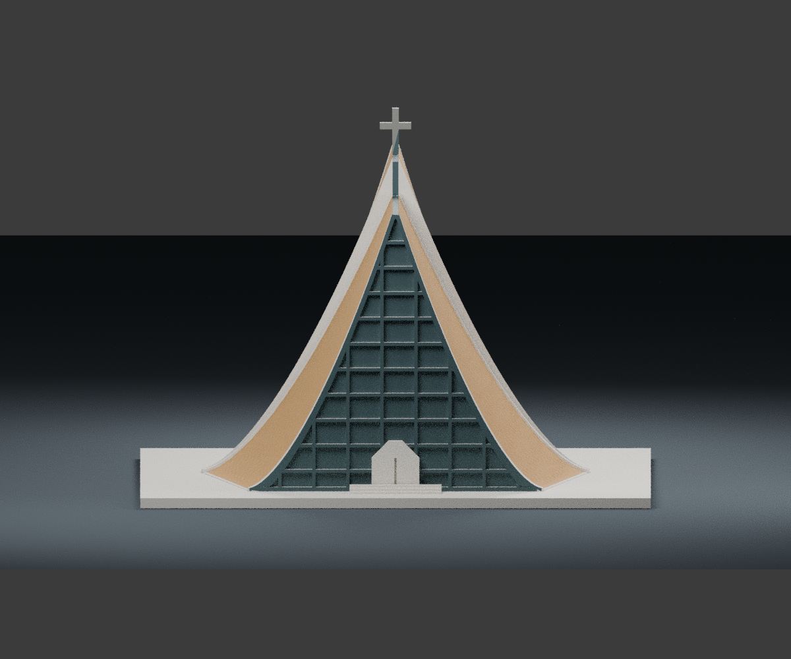

# 路思義教堂｜150 mm FDM 外觀模型

依東海大學及臺中市政府公開照片、建築說明重新建立的原創外觀模型。毫米單位，含一體平底。此為辨識特徵優先的照片判讀版本，沒有取得可量測的全套竣工圖；不是測繪複製品。

## 模型預覽

| 模型預覽 | 模型預覽 | 模型預覽 |
| :---: | :---: | :---: |
| 正面  | 背面  | 正立面  |

## 主要特徵

- 四片向上收束、向地面張開的雙向曲面意象
- 後方兩曲面高於前方，保留中央交會高差
- 1.8 mm 寬的屋脊採光淺槽
- 正、背面曲邊玻璃立面、約 1 mm 的窗框
- 加粗的混凝土邊肋、淺菱形磚縫、較高後屋脊的十字架

為了單件 FDM 列印，曲面下方填實；沒有教堂室內或封閉空腔。採光縫為淺槽，玻璃面以實體淺凹表示。這不是四片獨立懸空薄殼或可拆裝結構模型。

## 尺寸及檔案

完成尺寸 **150 × 150 × 108.2 mm**，含 3 mm 底座。曲面、屋脊高差及輪廓依照片近似；無精確比例尺。

- `model.stl`：單件列印網格
- `build_model.py`：原創參數化幾何程式
- `scene.blend`：匯入同一 STL 的可編輯 Blender 場景
- `previews/front.png`、`rear.png`、`elevation.png`：由交付 STL 本體渲染
- `validate_model.py`、`validation.json`：獨立網格驗證與 SHA-256
- `requirements.txt`：重建套件版本

預覽材質是便於辨識的黃褐磚面、深色玻璃及淡色邊肋提示；STL 沒有顏色，預覽沒有額外不列印的假建築細節。場景地板、相機與燈光不屬於列印模型。

## 實際檢視來源

檢視日期：2026-10-11。

1. [東海大學校牧室，路思義教堂](https://chaplain.thu.edu.tw/web/page/page.php?scid=8&sid=29)。確認四片曲面與中央一線天的建築說明，實際檢視頁面屋面、門口及室內拼圖中的外觀部分。
2. [臺中市政府，路思義教堂照片集錦](https://travel.taichung.gov.tw/zh-tw/multimedia/album/7646)。實際下載並檢視完整正面、草地斜側面及鳳凰樹下的側面照片。
3. [官方正面照片](https://travel.taichung.gov.tw/image/154)。用於曲邊玻璃面、窗格及入口輪廓。
4. [官方斜側面照片](https://travel.taichung.gov.tw/content/images/attractions/148/640x480_Filedata635170967669082031.jpg)。用於屋面曲率與主體比例。
5. [官方側面照片](https://travel.taichung.gov.tw/content/images/attractions/23770/640x480_Filedata636338303104410735.jpg)。用於前後曲面高差、邊肋與十字架位置判讀。
6. [東海大學，路思義教堂建築介紹](https://www.thu.edu.tw/web/about/detail.php?scid=89&sid=189)。搜尋擷取文字明述後部兩曲面高於前部、分離屋脊以玻璃作天窗。頁面當日直接連線為錯誤頁，未將原頁列出的線條圖當作已取得測繪圖。
7. [內政部臺灣宗教文化地圖，路思義教堂](https://taiwangods.moi.gov.tw/html/landscape/1_0011.aspx?i=37)。用於四曲面、前後玻璃及菱形琉璃面磚的文字說明。其圖片端點回傳「未取得授權」佔位圖，沒有把該佔位圖當作參考照片，也沒有繞過限制。

來源照片的著作權屬原權利人；本交付包不重新散布參考照片。

## 簡化及不確定

曲面用可調的取樣曲線與縱向漸變建立，呈現四曲面的外觀關係，**沒有聲稱是實際結構雙曲拋物面的精確數學復原**。沒有實測長寬高；外擴、曲率、前後高差、十字架位置與深度以照片推估。背面玻璃格線參考正面並簡化，沒有逐格測量；內部木格結構、排水、銅字、五金與外部機電設施省略。菱形磚縫僅為粗略淺紋理，不是實際磁磚數量。鐘樓與樹木不納入。

## FDM 建議

底座平放，建議 PLA、0.4 mm 噴嘴、0.16 mm 層高、3 道外牆、15–20% 填充。十字架桿件最細約 1.9 mm，中央淺槽 1.8 mm，窗格約 1 mm。不要大幅縮小，以免窗框、屋脊槽和十字架失真。

曲面下方為實體，避免真正薄殼內側的大片懸空。高處十字架橫臂、入口小突出和後部高差邊緣仍須在切片器檢查；必要時局部支撐。菱形表面淺紋約 0.24 mm，粗層高或過度補償可能使其消失。未進行實體試印，無免支撐保證。細十字架在運送與拆支撐時容易折斷。

## 重建

Python 3.12 安裝 `requirements.txt` 後執行 `python build_model.py`，再執行 `python validate_model.py model.stl --output validation.json`。預覽：`blender -b -t 4 -P render_preview.py`。Blender 場景為毫米，若另行匯出 STL，只選取 `Printable building`。

驗證包含 watertight、單一連通邊界、每邊恰兩面、頂點連結單一環、法向繞序、無退化三角形、正體積、平底、最長 150 mm、Manifold 核心重讀、無內部封閉邊界殼與 STL SHA-256。數位驗證不等於實際切片與試印結果。
