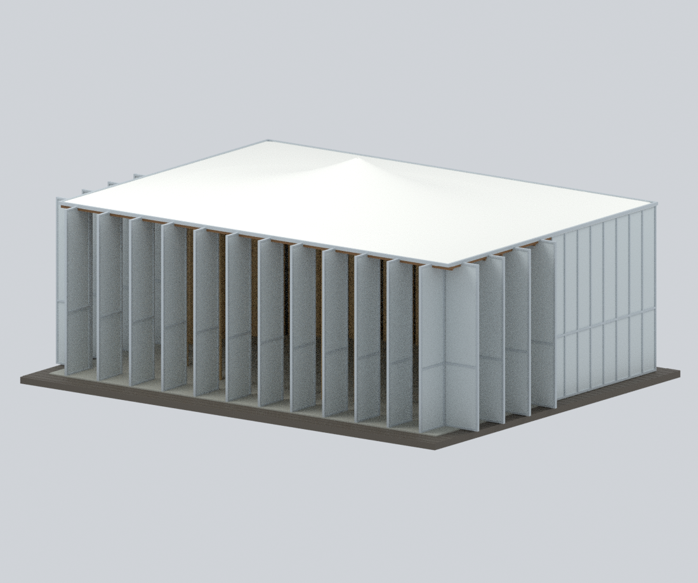
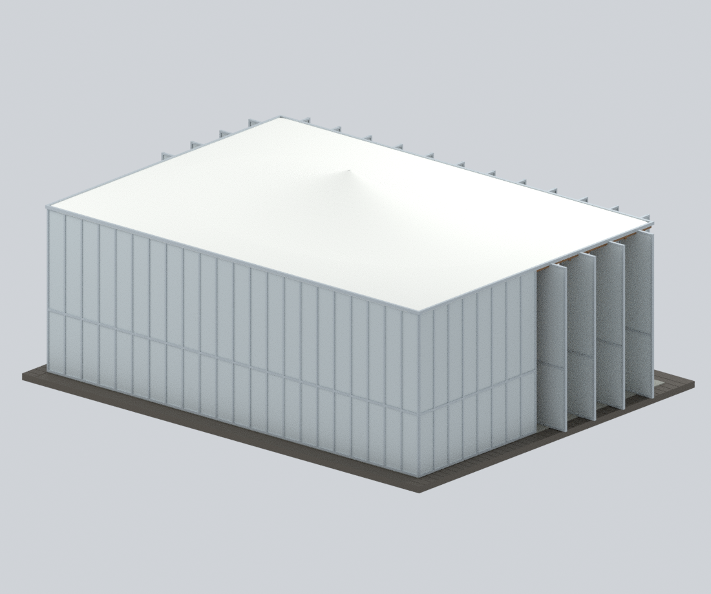
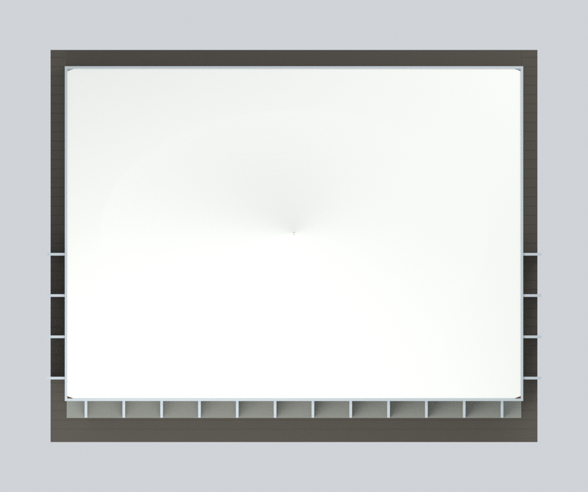
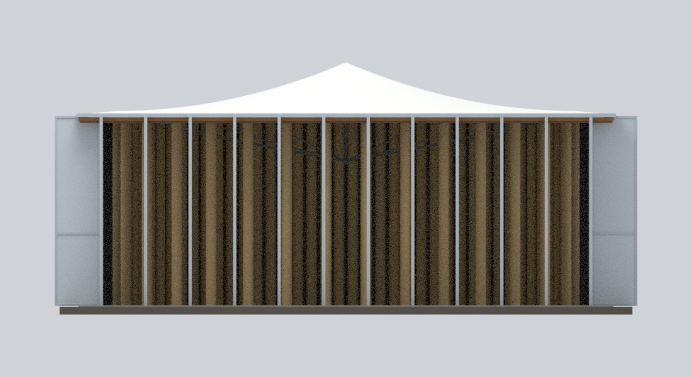
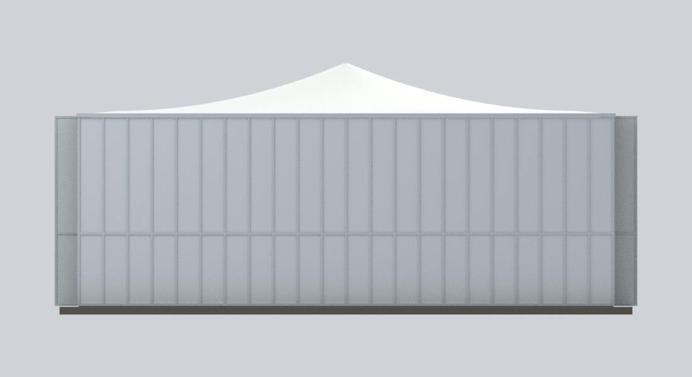
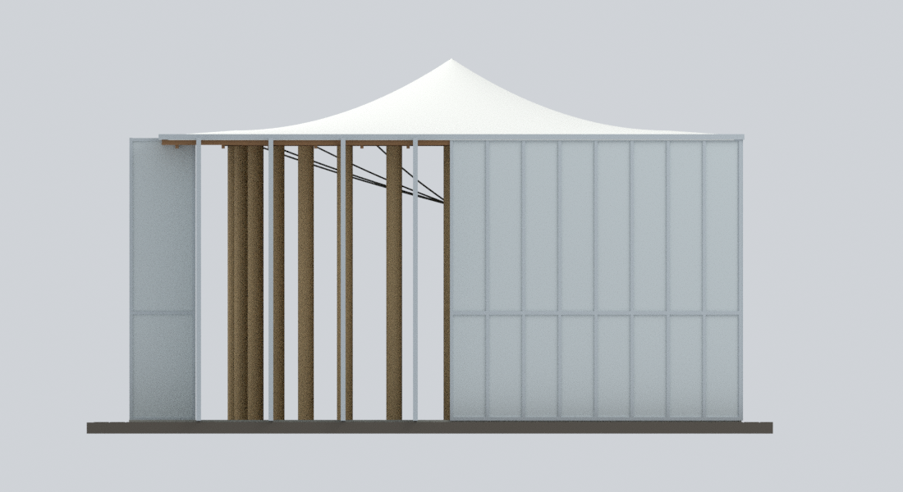
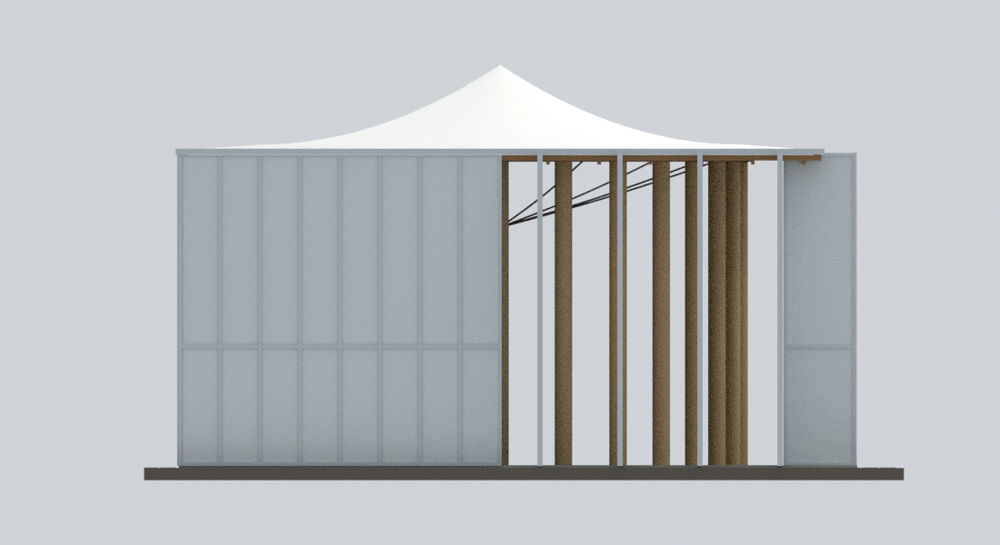
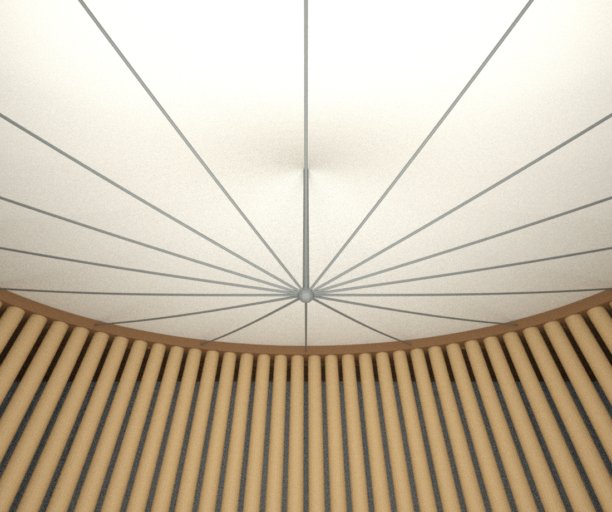
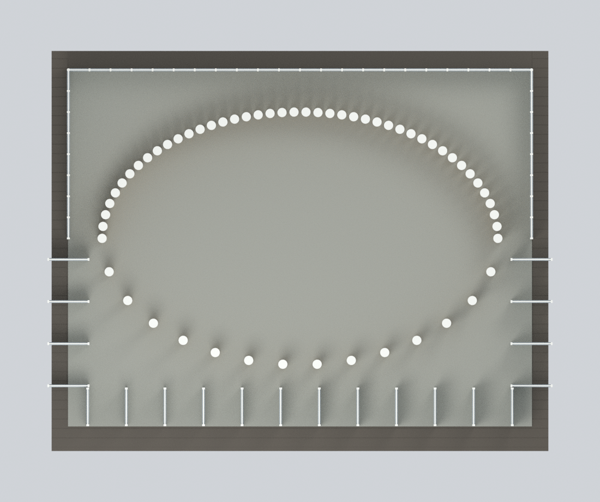

# 埔里紙教堂｜2008–2009 年完整單棟近似模型

## 模型預覽

| 正面斜視 | 後方與池側斜視 | 完整屋頂俯視 |
|---|---|---|
|  |  |  |
| 正立面 | 完整背立面 | 非池側短立面 |
|  |  |  |
| 池側短立面 | 內部向上檢視 | 58 柱與開口剖切 |
|  |  |  |

**2008 年重組完成、2009 年照片佐證的歷史近似模型，不是臺灣竣工實測或 2026 現況。** 建築設計：**Shigeru Ban Architects（坂茂建築設計）**。本包是一棟完整獨立紙教堂，不含整個新故鄉園區。

## 九張實際模型預覽

以下均由本包幾何與材質實際渲染，**不是建築原照**。平面剖切為合併網格在模型高度 20 mm 的實際截切；切面封口採顯示材質，不代表紙柱實心的真實構造。


## 檔案與編輯

- [`paper-dome-taiwan-whole-2008-2009.stl`](paper-dome-taiwan-whole-2008-2009.stl)：單一連通封閉網格，**STL 不含色彩**。
- [`paper-dome-taiwan-whole-2008-2009.3mf`](paper-dome-taiwan-whole-2008-2009.3mf)：相同幾何、逐三角面基礎材質；不是列印機或多料擠出機設定檔。
- [`paper-dome-taiwan-whole-2008-2009.blend`](paper-dome-taiwan-whole-2008-2009.blend)：原生 Blender 場景及 234 個可分別編輯的原創元件。`EDITABLE authored components (hidden; overlaps pre-union)` 集合預設隱藏；它們仍有布林前重疊，**不能直接替代完成合併的列印網格**。
- [`parameters.json`](parameters.json)、[`build_model.py`](build_model.py)：可修改數值、獨立重建。`construction-parts.json` 保存各元件；`mesh-data.npz` 保存合併網格及材質索引。

## 保留的建築關係

長方形外殼內有 **58 根褐黃色紙管柱，構成後密前疏的橢圓**，不是等距圓柱圈。正面與兩個短側前段採打開的轉軸面板；後長牆與短側後段保持固定半透明板的整體分區。模型以不透明淡灰色表達板材的色彩家族，**不模擬真實透光率**。

白色單峰薄膜覆蓋中央橢圓，外圈延伸至完整矩形屋頂；中央**不是露天洞口**。棕色木構環及周邊頂棚在下方；中央細桿懸吊於屋頂系統，**沒有新增落地中心柱**。線纜的微小下垂與接頭僅為示意，沒有精確結構量測。薄線纜、板框與紙柱為微縮辨識而適度加厚；封閉隱藏的屋頂顯示層間隙在合併網格中填實，不聲稱復原看不見的屋頂構造。

整體約 **240 × 190 × 104 mm**，教堂主外殼平面約 220 × 160 mm；這是歸一化桌面模型，**不是實測比例尺**。外部深褐木平台及內部灰色地面依臺灣照片近似，不照搬神戶地板。周邊水池、完整坡道／高程、獨立綠色建築與園區其他設施不在單棟範圍。

## 證據與重要限制

- [建築師臺灣專案](https://shigerubanarchitects.com/works/cultural/paper-dome-taiwan/)：完成重組後的外觀、開啟正面、池側及內部。照片拍攝日期未確認，網址中的 2022 是上傳資訊，不能當拍攝年。
- [建築師神戶專案](https://shigerubanarchitects.com/works/cultural/paper-church-kobe/)：1995 年完整平面、剖面與屋頂軸測，**只是歷史比較資料，不是臺灣竣工圖**。
- [園方遷移記錄](https://paperdome.org.tw/moved-from-japan-to-taiwan/)與[柱體重組記錄](https://paperdome.org.tw/column/)：編號移轉的框架元件、未移轉的地板及纖維板，和 2008-01-25 豎立 58 柱的歷史資訊。
- [speedbug／小蟲記事簿 2009 年遊記](https://speedbug.cc/paperdome/)：完整背面及池側短面；文章後來修訂，不能據此確認相機曝光日期。

**沒有獨立、完整的非池側短立面照片。** 該面依歷史保留框架平面、正面照片邊緣及穿過正面的內部視線共同約束；沒有宣稱第四張獨立立面照，也沒有把同一池側的 A04／C01 算成相反兩面。隱藏鉸鏈、細部分格、替換板材、精確曲率與接頭尺寸均屬近似。來源對應詳見 [`sources.json`](sources.json) 與 [`evidence-map.json`](evidence-map.json)。

所有色彩均為可見材質家族的近似，無實測 RGB／RAL；沒有將夜間暖光固化成橙色外牆，也沒有原照貼圖。來源圖像、文字及建築設計各自保留權利；**原創程式不等於照片開放授權，也不自動構成模型公開／商用許可**。詳見 [`RIGHTS-AND-RESPONSIBILITY.md`](RIGHTS-AND-RESPONSIBILITY.md)。

## 離線重建

Python 3.12、[`requirements-model.txt`](requirements-model.txt) 指定套件，另需 Blender 4.3.2。`lib3mf` 可放在另一個 Python 環境。

```bash
python reproduce.py --out rebuilt --blender blender --export-python python
python verify_reproducibility.py --out . --blender blender --export-python python
```

只需本包數值及程式，不需要網路、來源照片、HTML、PDF、外部材質或 Blender 外掛。固定種子及 CPU 設定在已驗證環境可重現；不同版本或硬體不保證位元組相同。

## 驗證及列印限制

`qa/` 包含重載 STL 的邊／頂點拓樸、全三角面自交／非法接觸掃描及負例、材質 3MF 嚴格讀回、0.3 mm 水平幾何截面、14 條開口／阻擋射線及塞住入口的負例、膜面高度趨勢、58 柱分佈及拆除膜面的負例。原生檔另經修改頂點、獨立元件位移與改色後重開，以及全部 SDNA 固定字元緩衝、外部媒體與 PNG 中繼資料檢查；乾淨重建比對九張 PNG 位元組與像素。

**這些不是實際列印、切片器、結構或安全認證。** 約 0.48 mm 線纜、0.55 mm 板片與細框可能小於特定 FFF 噴嘴的可靠尺寸；大面積膜頂、內側懸吊件和開啟板片需要支撐評估，密柱間支撐可能難以移除。請先檢查平台、縮放、材料、支撐與試片。不可為了易印而任意填掉教堂的開放內部。
