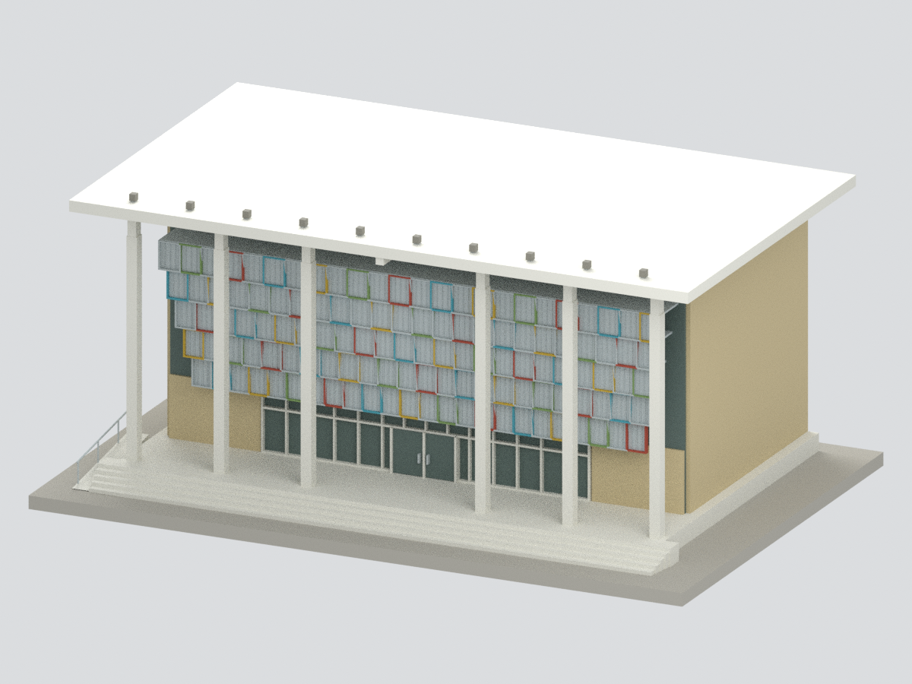
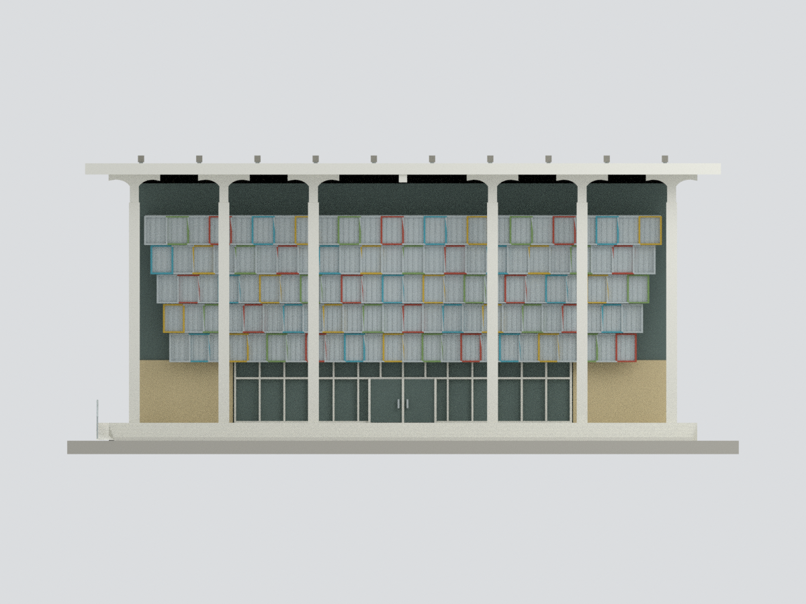
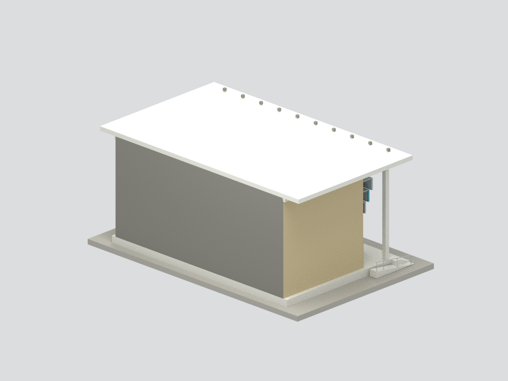
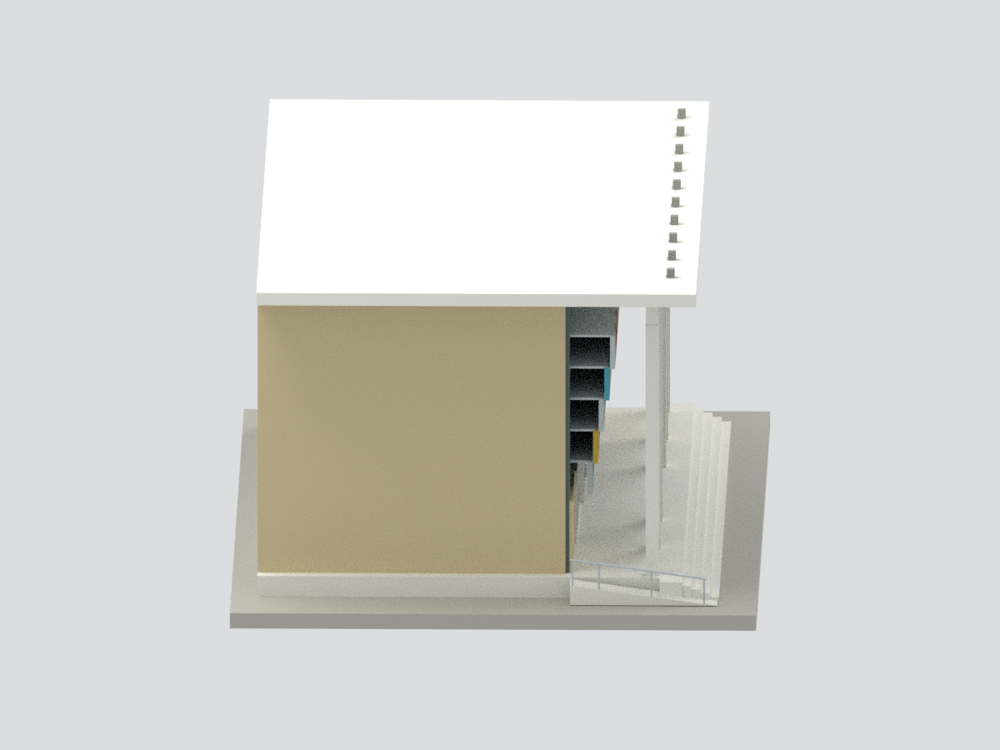
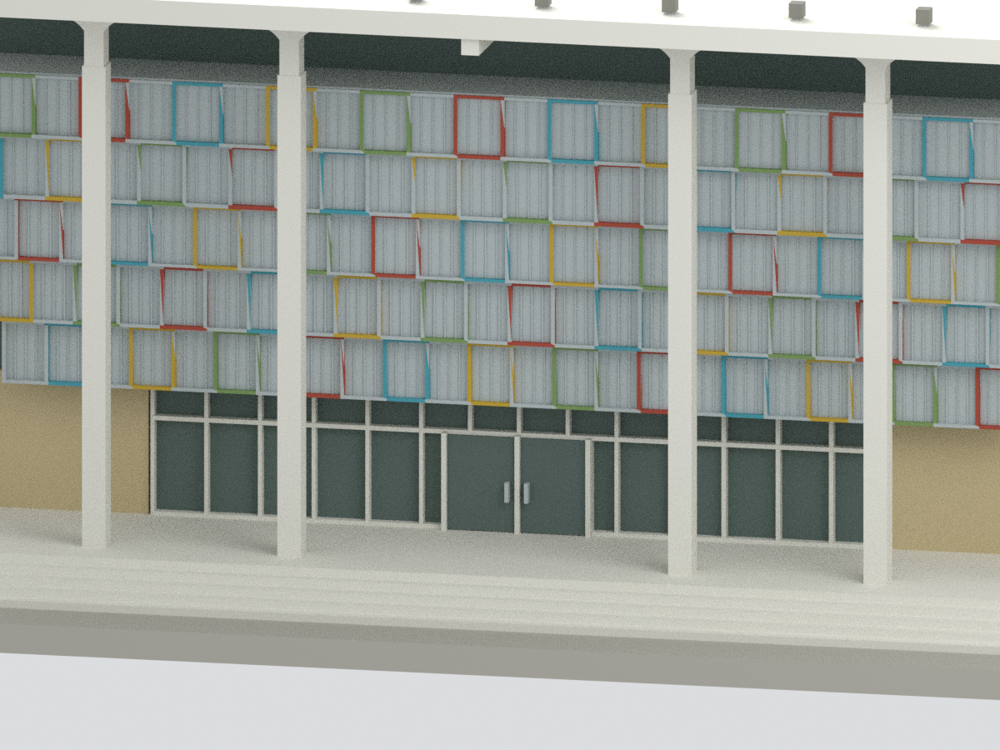

# 屏東藝術館｜前入口正面局部研究模型包

## 模型預覽

**以下全部圖像僅呈現前入口局部，不是整棟屏東藝術館。**

| 前入口局部正側 | 前入口局部正立面 | 前入口局部人工截界 |
|---|---|---|
|  |  |  |
| 前入口局部側端 | 前入口局部屋面 | 前入口局部門與彩框細節 |
|  |  |  |

## 前入口局部範圍

**本包只有屏東藝術館前入口門廳、前柱廊、五層彩色金屬網框及前階的局部外觀研究；不是全館或整棟模型。** 依官方平面一樓標9門廳範圍取段，後端到劇場分隔位置停止。灰色後端為作者製作的模型封口／截界，**不代表現場既有後立面**。觀眾廳、舞台、幕塔、後台、整個地下層與基地都未重建，不能當作完整建築套數宣稱。也不是另一處「屏東演藝廳」。

## 依據與尺度

官方獎項專輯提供前面竣工實照與附比例尺的一、二層平面；建築師網站提供彩框立面詳圖及剖面，建築師雜誌文字列屋頂12.4m、幕塔19.4m。本模型僅採前入口屋面12.4m作高度參考，不建立幕塔。沒有把整建前後側照片當今日背面。

以官方一層圖的10m圖尺（本次1400px頁面約84px）估讀，入口主寬約24m、屋簷寬約28.4m、所取局部深約15m；六柱節奏以照片粗估4+4+8+4+4m。這些是圖面／照片比例近似，不是施工尺寸。出版建築面積2166㎡與此縮印平面估讀未完全對應，未以面積強制校正或宣稱精確全館輪廓。前地坪抬高0.8m、網框位置、柱寬、門高、階數與坡道均估算。

模型約1:200（估讀1m→5mm），含作者展示底座150×100mm，含粗燈具總高約66.75mm。底座非現場地形；STL／3MF／Blender同一交付幾何。照片和PDF不公開附入。

## 明確簡化及未知

前方金屬擴張網改成**實心薄背板加粗直肋／彩色矩框**，沒有真實微孔，也不模擬穿透率。保留五排逐層外推與左右階梯輪廓，但網格數量、五色分配、框材斷面、折邊和支架不是逐件施工復刻。柱頂彎曲過渡以分段近似，未還原混凝土細部。

玻璃為不透明退底代理；看不到真實門廳通高空間、樓梯、二層欄杆和屋頂內桁架。門扇有粗分格但不是可開啟實門。兩側牆是封閉支承代理：照片可見的側窗、側門與轉角延伸彩網框均未重建，不能把兩面素牆當作真實立面。側牆和屋面只支撐所取門廳局部，截界後不存在任何推測的全劇場體量。屋上燈具僅留十個粗方塊、未還原傾角／線路；細排水、標誌文字、植栽、招牌、全部室內與既有後方外牆省略。前階／左坡道及扶手為照片可見輪廓近似，不作無障礙法規或結構判斷。

## QA 與列印限制

六視圖均從同一實際交付網格渲染；幾何／格式檢查、Blender重開、隔離重建與獨立審核分別記錄。水密單連通不等於可成功列印。彩框細邊、粗網肋、彎柱和前廊懸空須以實際材料與設備檢查支撐、壁厚和方向。**未實際試印。**

## 下載與導覽

[STL](model.stl) · [3MF](model.3mf) · [Blender](scene.blend) · [重建](REBUILD.md) · [返回臺灣地標](../README.md)
