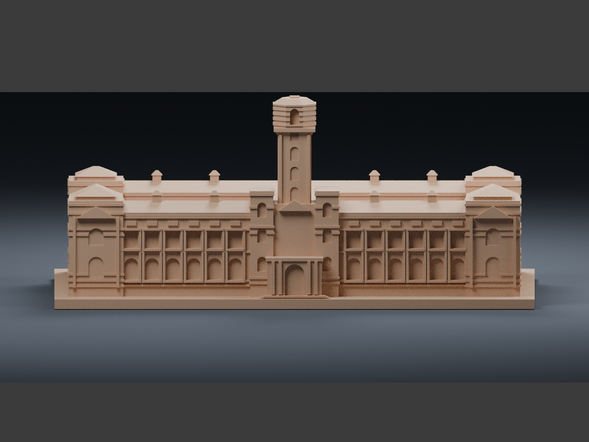

# 總統府｜150 mm 桌上外觀模型

本件是依總統府公開照片與建築介紹重新建立的可列印外觀模型。保留中央方塔、八角塔頂、左右衛塔、四角塔、兩翼拱窗、橫向飾帶，以及兩座露天庭院形成的「日」字量體。不是測繪成果，也不是精密等比例建築圖。

## 模型預覽

| 模型預覽 | 模型預覽 | 模型預覽 |
| :---: | :---: | :---: |
| 正面  | 背面  | 正立面  |

## 檔案

- `model.stl`：毫米單位，單一封閉、連通實體，可直接匯入切片軟體。
- `editable.blend`：由最終 STL 匯入的可編輯網格；已選取可列印物件。STUDIO ONLY 集合僅供預覽，不可與模型一同匯出。
- `build_model.py`：原始參數化建模程式，可調整比例、窗列與簡化細節。
- `previews/front.png`、`rear.png`、`elevation.png`：直接渲染最終 STL，無另加裝飾網格。
- `validate_model.py`、`validation.json`：拓樸、法線、尺寸及從原始程式重建的一致性檢查。
- `SHA256SUMS.txt`：交付檔案雜湊。

## 尺寸與外觀依據

- 完整模型最長邊 150 mm，含平坦底座。精確包圍尺寸見 `validation.json`。
- 官方介紹列明建築正面約 140 公尺、側面約 85 公尺；中央塔約 60 公尺。模型主體採約 140 × 85 mm 的視覺比例，再加底座及簡化塔頂。
- 正面對應模型 −Y；背面為 +Y。預覽為單色黏土材質，STL 本身沒有顏色。紅白橫帶轉成淺浮雕，並非彩色列印檔。

## 為 150 mm FDM 尺寸作的取捨

- 窗戶、門洞與拱廊做成淺凹，沒有通往建築內部的洞穴。
- 兩庭院保留為上方完全開放的凹域，底部與底座連通為實體；沒有密閉內部空腔。
- 山牆雕像、細欄杆、細窗櫺、柱頭雕花合併成較粗輪廓。旗面與極細旗桿省略；塔頂保留穩固鈍頂。
- 西側門廊依官方近照用弧形實體與附壁柱表現。側、背立面窗列採可列印節奏簡化，並非逐窗測繪。屋脊燈籠窗縮減數量。
- 中庭植栽、周邊交通與附屬建築不納入；不包含任何室內、設施或保安細節。

## 列印建議與尚未驗證的事項

- 建議 0.4 mm 噴嘴、0.16–0.20 mm 層高，以底座平面朝下，PLA 試印；牆數 3，填充率可由切片器自行設定 12–20%。
- STL 為幾何實體，不表示切片必須 100% 填充。薄飾帶最小尺度約 0.55–0.75 mm；可能需要較細層高或切片器薄壁偵測。
- 拱洞為淺凹且簷口較短，但塔頂與檐口仍需在切片器檢視懸空區；是否支撐由實際機器、材料與方向決定。底座面積大，可依附著情況加 brim。
- 未實際切片或試印。數位檢查通過不等於已驗證所有印表機可無支撐成功。
- 沒有完整測量圖說；屋頂、背面與庭院比例為外觀照片的近似判讀。不可用於工程、保存修復、空間規劃或安全用途。

## 公開來源（2026-10-11 檢視）

1. 中華民國總統府〈建築之美〉：https://www.president.gov.tw/Page/91
2. 中華民國總統府〈總統府的誕生－建築形式與空間介紹〉：https://www.president.gov.tw/qrcode/06c
3. 正面公開照片：https://www.president.gov.tw/images/aboutus/about07.jpg
4. 正面建築標示圖：https://www.president.gov.tw/images/aboutus/about06.jpg
5. 角塔照片：https://www.president.gov.tw/images/aboutus/4-2-3-05.jpg
6. 中央塔照片：https://www.president.gov.tw/images/aboutus/4-2-3-13.jpg
7. 西大門照片：https://www.president.gov.tw/images/aboutus/4-2-3-03.jpg
8. 車廳照片：https://www.president.gov.tw/images/aboutus/4-2-3-04.jpg
9. 屋頂燈籠窗照片：https://www.president.gov.tw/images/aboutus/4-2-3-07.jpg

建模前已實際開啟照片核對可見輪廓。照片版權屬原權利人；套件只附來源網址，不再散布照片。本模型為重新建立的簡化幾何，非官方提供模型，亦未宣稱官方認可。

## 重建與驗證

Python 3.12 搭配 `requirements.txt` 中的版本：

    python build_model.py
    python validate_model.py
    blender -b -t 4 -P render_preview.py

驗證包括：有限座標、非退化三角面、法線與頂點繞向一致、每邊恰接兩面、每頂點鄰域為單一閉環、單一連通邊界、正體積、Euler 特徵數 2、底面 Z=0、150 mm 尺度及從原始程式獨立重建後的三角面一致性。未另作三角形互交檢測；建模使用 manifold3d 實體布林運算。

另附 `check_blend.py` 與 `blend_validation.json`，驗證 .blend 中可列印物件的每一個三角面與最終 STL 一致。重跑方式：

    blender -b editable.blend -P check_blend.py
