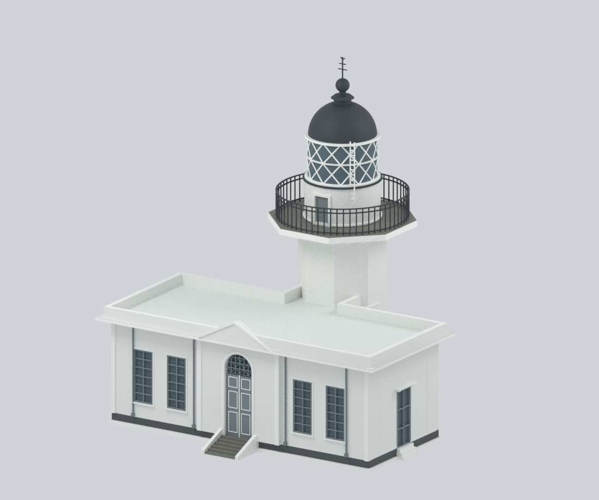
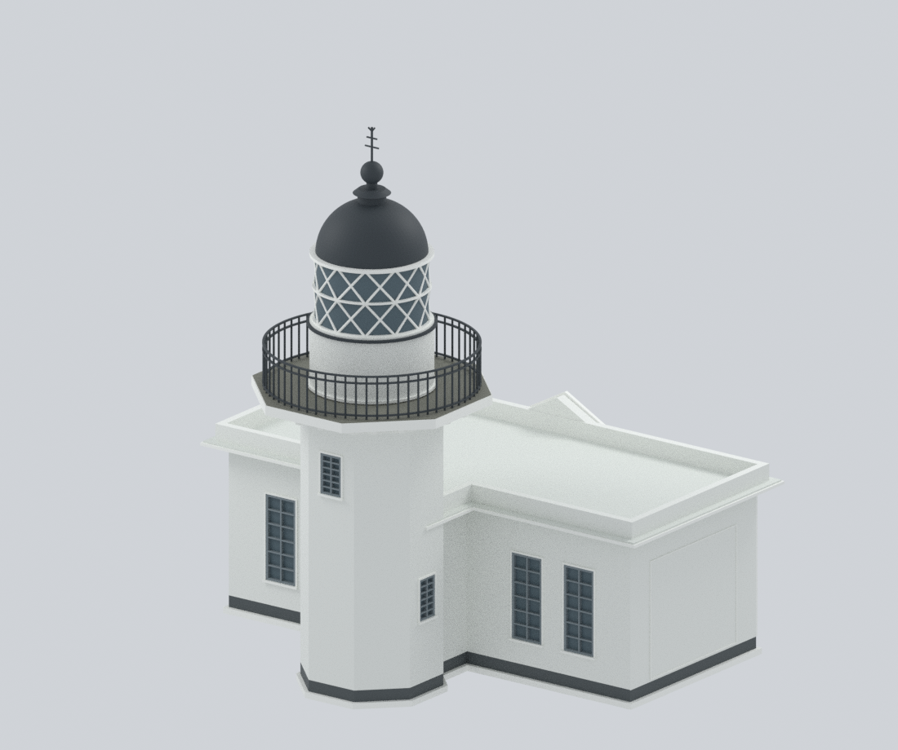
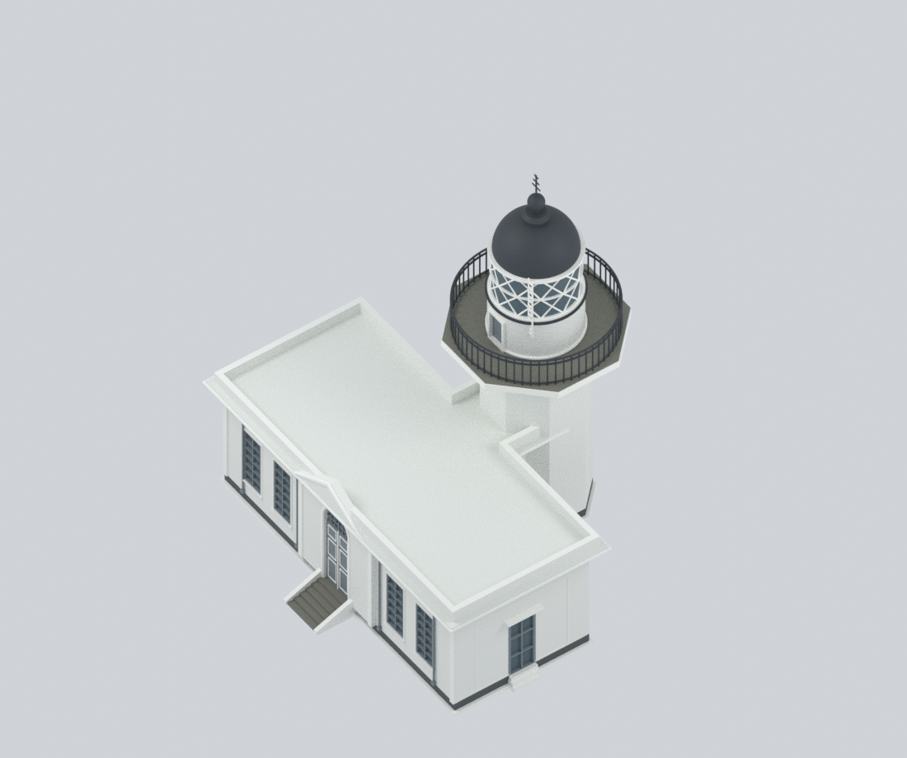
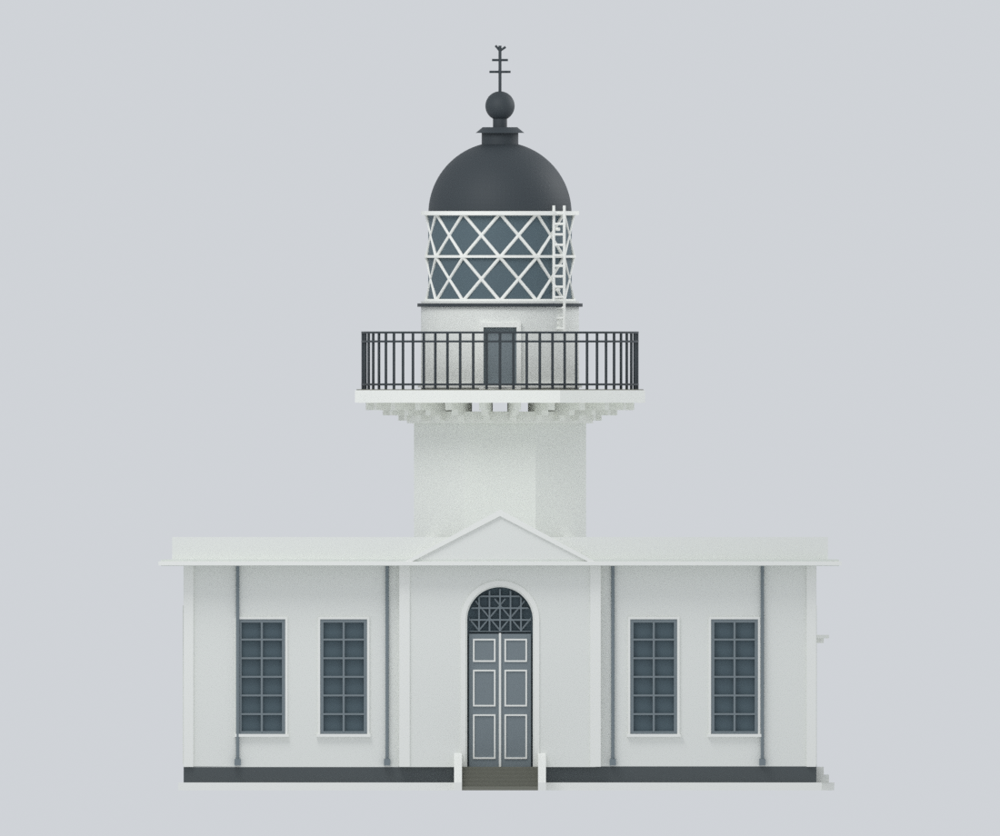
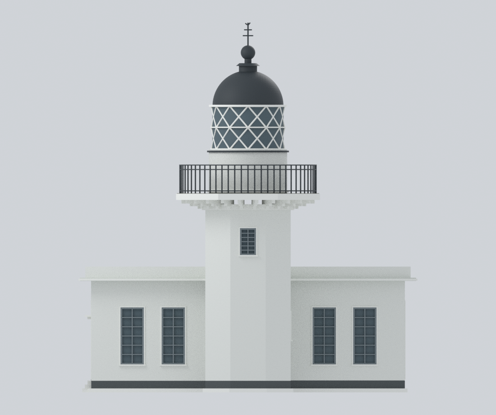
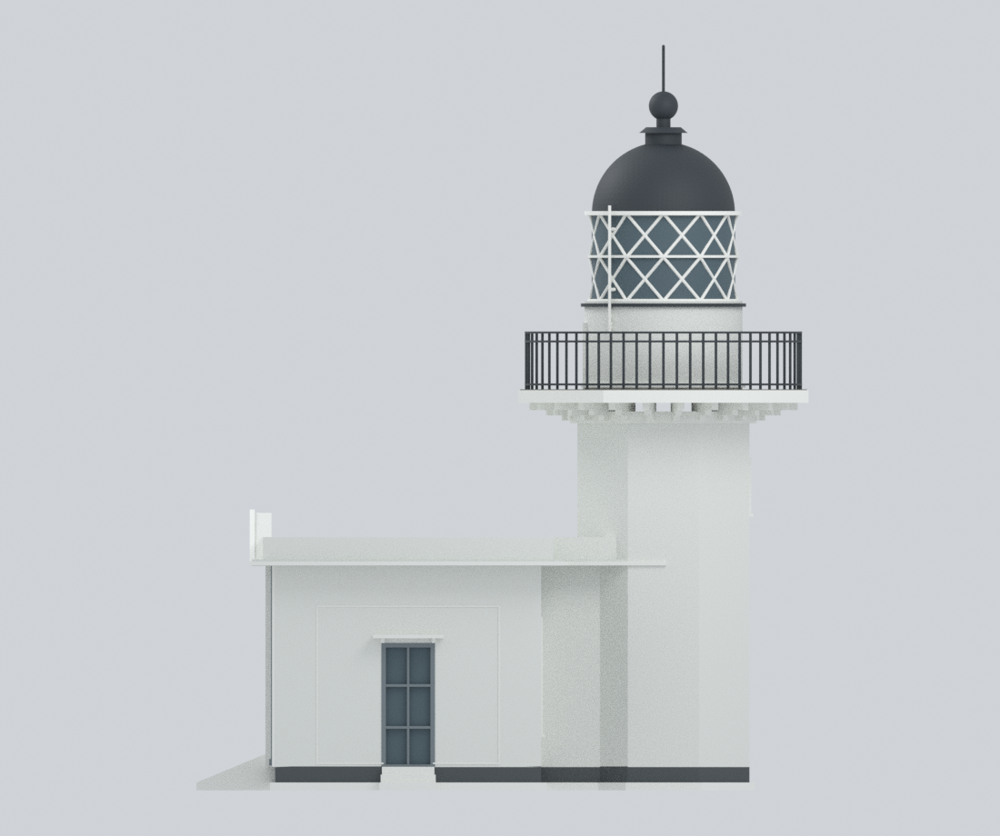
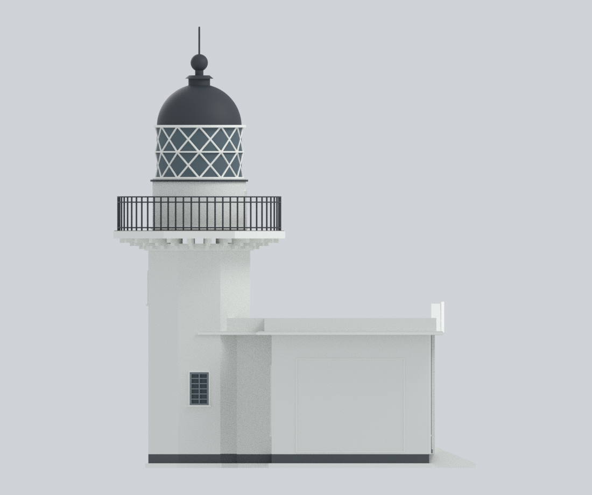
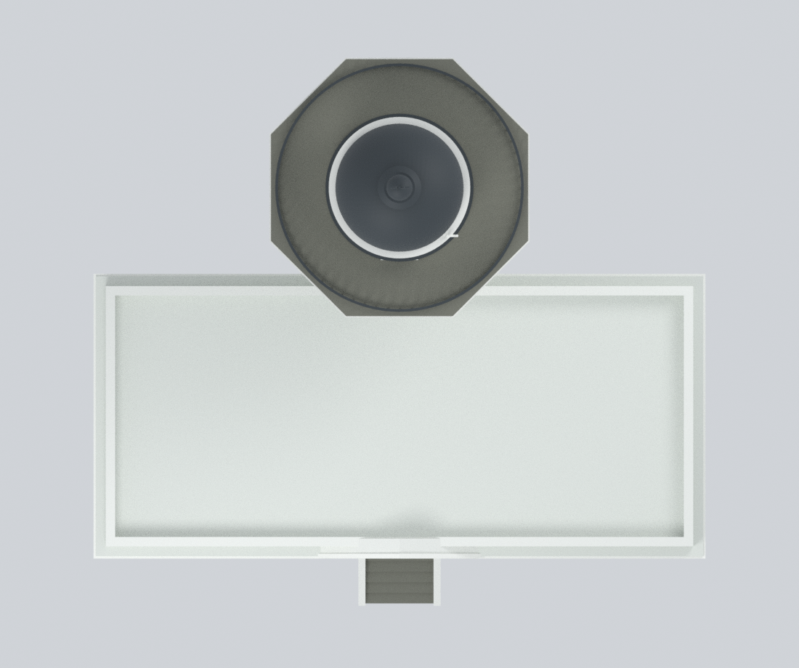
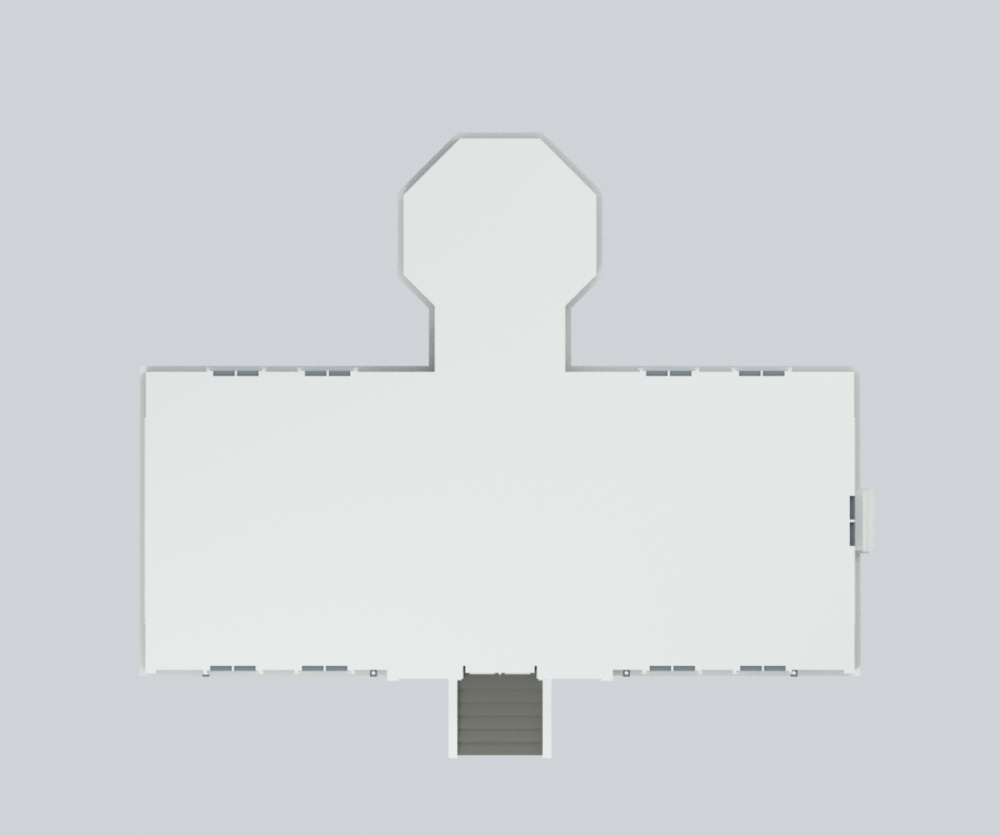

# 旗後燈塔完整連接主建築 / Qihou Lighthouse, circa 2020

Original, source-bounded exterior approximation of **one complete connected building**: the octagonal lighthouse tower, short linking neck, and entire one-storey office/exhibition wing. It is **not a tower-only fragment, full precinct, current-2026 survey, complete interior or physically print-certified object**.

## 模型預覽 / Model gallery

以下九張均為本模型的渲染圖，並非原始來源照片。水平剖面取自實際模型網格的 z = 30 mm 切面。

| 視角 1 | 視角 2 | 視角 3 |
| --- | --- | --- |
| <br>入口斜視 / Entrance oblique | <br>背面斜視 / Rear oblique | <br>屋頂斜視 / Roof oblique |
| <br>東南正立面 / SE front | <br>西北背立面 / NW rear | <br>西南側立面 / SW side |
| <br>東北側立面 / NE side | <br>俯視 / Top | <br>30 mm水平剖面 / Horizontal cut |

## Deliverables

- `qihou-lighthouse-main-2020.blend`: native editable Blender scene, actual per-face materials, final connected mesh, plus 79 individually editable authored construction components in a hidden collection.
- `qihou-lighthouse-main-2020.stl`: one material-free connected closed exterior mesh.
- `qihou-lighthouse-main-2020.3mf`: same mesh with actual per-triangle base-material assignments, not a renamed STL.
- `parameters.json`, `build_model.py`, supporting scripts and `requirements-model.txt`: public-only deterministic rebuilding; no photographs, source PDF, network, texture assets or private inputs are needed.
- `previews/`: nine actual Blender renders, including four facade elevations, top/roof views, and a final-mesh horizontal section.
- `qa/`: actual mesh, export, editability, privacy, projection, section/ray, negative-control and clean-rebuild checks. QA is evidence of the stated checks, not physical fabrication or legal certification.

## Completed-photo material correction

This successor corrects a source-fidelity error found during independent review of the earlier, unissued private freeze. The lower completed photograph on PDF page 3, dated **2020-08-03**, shows **pale/white lantern diagonal lattice, upper/mid thin rings and the projecting rim immediately below the dark dome**, with a **dark band below the glazing above the white pedestal**. The earlier model incorrectly used dark lattice/rim and a pale lower band.

Only three exact authored component material assignments change: `Two tier diagonal lantern frame` and `Dome lower projecting rim` to existing `white_trim #F2F3EE`; `Lantern base cornice 184.4` to existing `dark_metal #333B40`. The dome, railing and all other colors are retained. This is not a blanket repaint of metalwork or a claim to calibrated color/exact band width. The correction validator deliberately locks this release to the predecessor geometry; intentional future geometry edits need a new review/baseline rather than silently retaining this release's geometry-fixed PASS. `parameters.json` carries the overrides; `material-correction-baseline.json` and its validator prove identical STL bytes, vertex/face arrays, all 79 component geometries and unchanged unrelated triangle materials. No source pixels are included.

## Historical scope and important geometry

The source phase-1 as-built drawings A08–A13 carry completion date **2020-07-11**; completed photographs dated **2020-08-03** complement them. A07 is an older framed site plan. The 2025 open-data release and 2021 PDF metadata are not the modeled construction epoch.

The model retains a slightly different front/rear wing width, four front and four rear windows, central arched entry with a small pediment, a SW side door with canopy, and a **blind NE wing wall**. High NW and low NE tower windows are not mirrored. The wing roof is low and flat/draining behind the pediment, not a full pitched roof or occupied second storey. The tower and balcony are octagonal, while the pedestal, lantern, dome and railing are circular. Both tower-side reentrant exterior spaces stay open; there is **no invented enclosed courtyard**. Obsolete rooftop lamp bases/floodlights, scaffold, adjacent blocks, precinct walls and the long hill approach stair are excluded.

Reference drawing units are mapped by an authored factor of 0.2 model mm per reference cm for convenient size, but the drawings themselves require field checking. This is not a verified architectural scale. The A12/A13 principal height chain is reconciled as 45 + 393 + 325 + 170 + 487 = 1420 cm, including the base. The 325 cm segment already includes the 45 cm parapet and 24 cm balcony slab. The detailed upper subchain differs by 1 cm; the reduced finial absorbs that discrepancy. No precise sea-level or surveyed ground coordinate is claimed.

## Materials, simplifications and fabrication limits

White masonry/trim, a light waterproof wing roof, dark dome/railing/lower lantern band, pale lantern lattice/upper rim, gray wing frames and muted balcony deck are source-backed **uncalibrated approximations**. Colors are numeric procedural assignments, not photo textures. Frame colors on concealed faces are not uniformly resolved.

Window, door and lantern glazing is modeled as opaque attached recessed geometry, not transparent optics or reconstructed interiors. Fine fanlight ornament, crown/vane, pipe routing, exact metal sections, corbel/picket counts, hidden roof drainage and small molding profiles are simplified and disclosed. The roof has a low flat envelope; precise drainage falls are not reproduced.

Thin railing/lattice/ladder/vane and roof/canopy/balcony overhangs require printer-specific scale, support and process assessment. Horizontal section erosion and upward-growth checks are diagnostics, **not a global minimum-wall proof or slicer toolpath**. No physical print has been performed. Do not use for engineering, navigation, conservation intervention or structural safety.

## Rebuild

Use Python 3.12 with the pinned packages and Blender 4.3.2. A separate Python containing lib3mf may be provided with `--export-python`.

```bash
python reproduce.py --out rebuilt --blender blender --export-python python
python verify_reproducibility.py --out . --blender blender --export-python python
```

The clean-rebuild check requires identical numeric arrays, STL bytes, component data and all nine PNG bytes/pixels. Native Blender and 3MF are checked for geometry/material equivalence and successful editing/strict readback; their container bytes are not claimed byte-identical.

Run only one memory-intensive chain at a time in a constrained environment. The renderer uses two threads. To edit native components, unhide the `EDITABLE authored components (hidden; overlaps pre-union)` collection; its components deliberately overlap before union. Editing them does not automatically update the final STL/3MF—change numeric parameters/code and rebuild for consistent exports.

## Source credit

交通部航港局，2025 年上架，《高雄市市定古蹟旗後燈塔（高雄燈塔）修復及再利用工程（第1期）工作報告書》，政府資料開放授權條款第1版。報告受託／設計監造單位：楊仁江建築師事務所；工程施工單位：合易茂營造有限公司。

[Specific dataset 174433](https://data.gov.tw/dataset/174433) · [OGDL Taiwan v1 terms](https://data.gov.tw/license).

Independent approximate exterior reconstruction; not an official model, certified survey or endorsement by the source institutions. Raw source pages, photos, logos, personnel material and private workflow records are excluded. See `sources.json`, `evidence-map.json` and `RIGHTS-AND-RESPONSIBILITY.md`.
