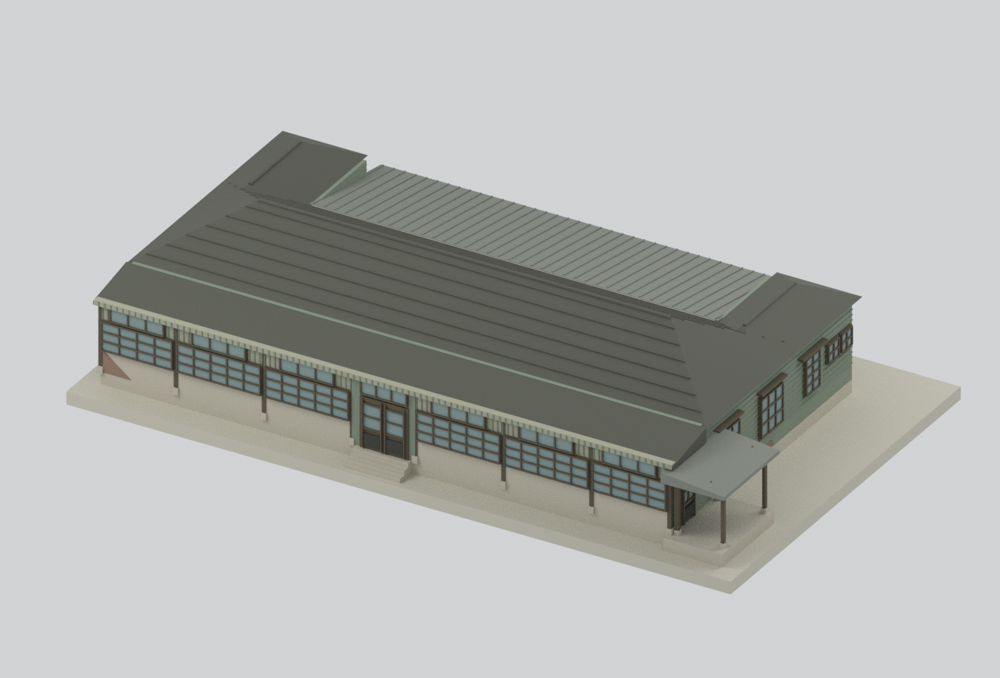
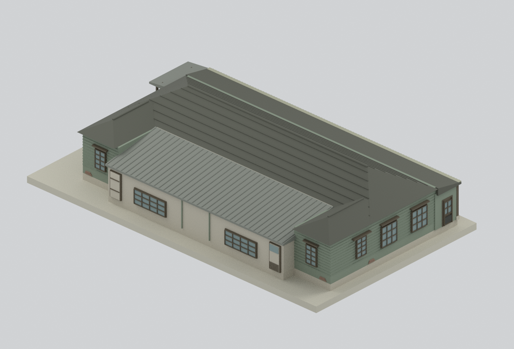
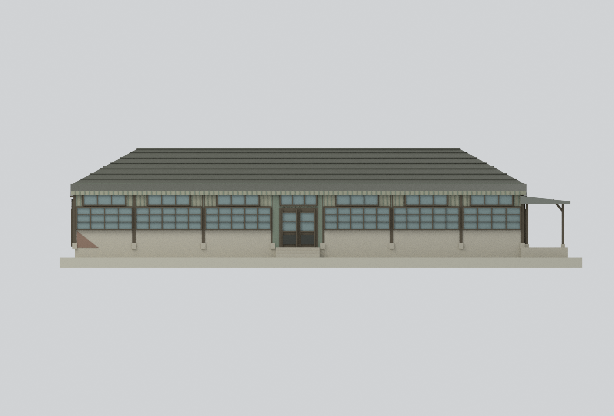
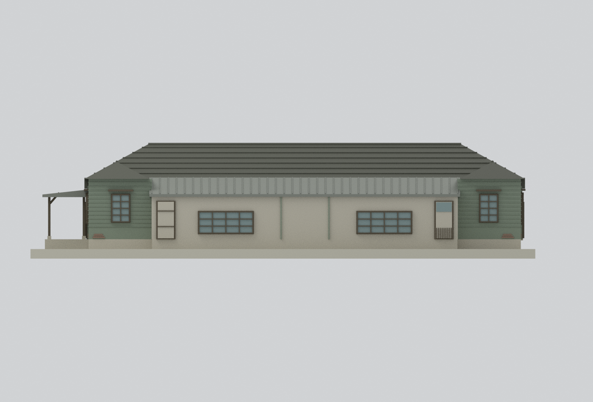
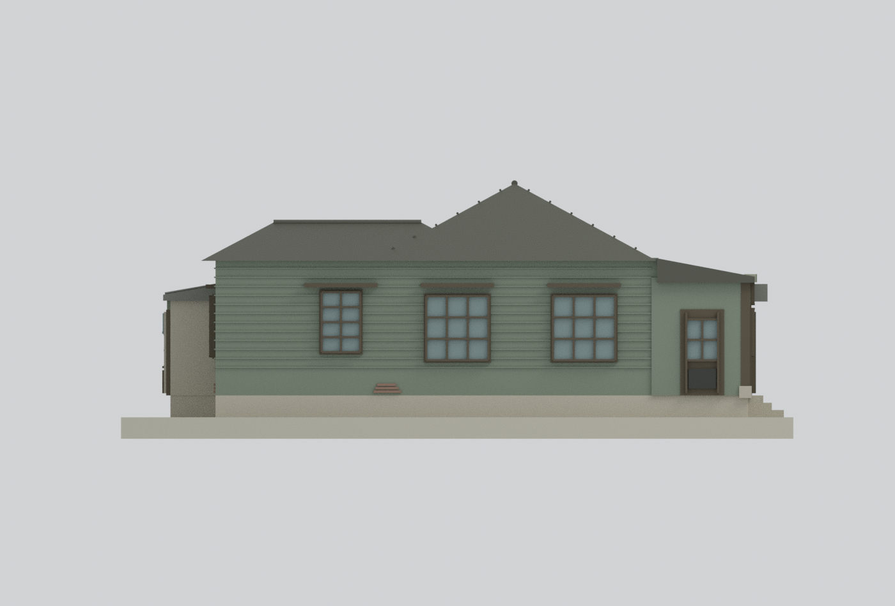
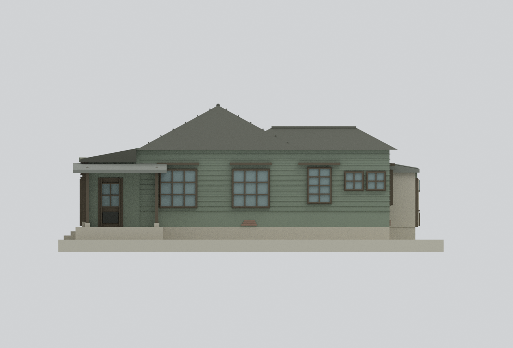
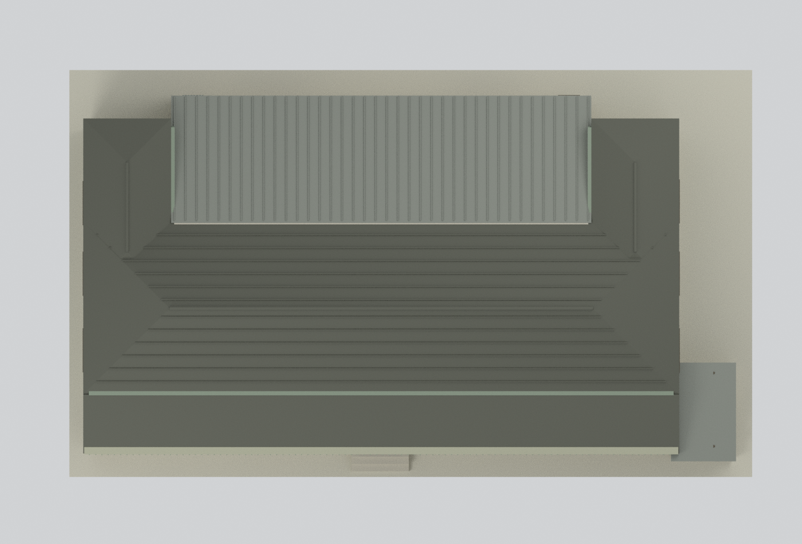

# 松山菸廠育嬰室主體｜2004年1月報告現況測繪外觀研究

## 模型預覽

| 北向／西側小棚斜視 | 南向／東側斜視 | 北向立面（原圖5-66） |
|---|---|---|
|  |  |  |
| 南向立面（原圖5-67） | 原圖5-68對應側（基地東側） | 原圖5-69對應側（基地西側） |
|  |  |  |
| 屋頂拓撲附加俯視 | | |
|  | | |

本包依臺北市文化局委託淡江大學建築系《市定古蹟松山菸廠調查研究計畫》（封面**2004年1月**）研究**育嬰室主體、北向長廊、南側改造單坡屋頂與基地西側小棚**。PDF121明載本棟於**1954年增建**；日治原育嬰室在另一位置，**不可把本模型稱為1937原棟**。不是1954完好原狀、2011以後修復景觀或今日咖啡館，也不包含全松菸園區。原始PDF／照片僅私人研究，不在公開包中。

## 時相、圖面與方位勘誤

尺寸及外形來自PDF284–289（附106–111）的現況平面、屋架、屋頂、剖面、四向立面，門窗索引及狀況表為PDF340–341，照片與病害脈絡為PDF121–122。報告封面日期不是每張照片或測量的精確日期；資料集年度92與封面出版日期不同。[來源矩陣](SOURCES.md)

PDF252基地圖的北箭頭與育嬰室平面對位顯示：**長廊在北，小棚在西**。PDF289的圖5-68／5-69東西標題與基地圖對應相反，因此模型以**原圖號保留可核對的面**，不鏡像開口以遷就矛盾標題。局部x軸依北向立面由左至右（基地東至西），y軸由北廊至南端；這不是GIS定位。

## 尺寸與不同端點

名義1:166.67，建築1m＝模型6mm。長向採2248cm與298＋348＋348＋250＋348＋348＋298cm柱跨；屋頂採**2291.5cm**，不是把牆長與屋頂長平均。北側地坪高51cm，屋脊高為502＋51＝553cm；南面標563.5cm使用較低的當地地面基準，未硬改同一屋脊。展示底座為平面，不重建場址地形。

平面**1385cm是圖上測量包絡**，其端點超出牆線；它不是每條外牆深度。模型按原圖估配側牆約12.40m、南中央牆約13.45m，保留南側凸出。屋頂在自己的基準採**1377cm＝227＋1062＋88cm**，與牆線約作15cm定位差；不把1385、短立面1284.3或屋頂1377強行等同。次要位置、交接、牆厚、簷高仍是掃描估讀，並非新增測量。[參數證據](parameters-evidence.json)

## 保留與簡化

- 保留U形瓦屋頂、較低的兩側南返屋脊、南中央既有單坡板屋頂、北廊蓋與西側小棚。PDF123–124的拆除或更換木料是**修繕建議**，沒有當成已執行狀態。
- 北廊為有深度的獨立廊空間，外側素面矮牆、柱腳與窗帶後方，主體牆退後約2.25m。玻璃、門和窗均為**不透明／實心背板的列印代理**，不是光學玻璃或可進入室內；小棚柱與懸檐需切片評估。
- 東西兩端不鏡像：圖5-68側三個主要窗群；圖5-69側另保留兩小窗與小棚。表341的25/26缺失、40/43封死、44損壞均是內隔牆開口，內部省略，沒有錯移成外牆封窗。47/49表格沒有尺寸，僅按立面估讀；兩端較窄的北廊窗與表列3300mm存在不一致，模型依柱跨及可見外形縮配，沒有假稱逐窗精密測量。
- 報告記錄蟲蝕、粉刷剝落、裂縫、屋瓦與屋架損傷及室內天花坍塌。本模型是**測繪外殼研究，不是完好as-is或病害逐片復刻**；細部破損、植物、排水管、電線、家具、屋架內部及周邊另建物未逐項還原。少量粗化露磚與板縫不是精確病害分布。
- 黑白報告無校色資料；灰綠、褐色及灰瓦均是**未校色示意材質**，不是用今日照片反推2004原色。屋瓦列、窗格、板縫、柱腳與門框為可讀性加粗；沒有來源照片貼圖。
- 三個**非史實的底部檢查／製造孔**從展示底座底面穿過北廊地板，連通三段廊腔；模型孔口各約4.8×4.56mm，局部source中心(x,y)為(5.0,1.1)、(11.24,1.1)、(17.5,1.1)m。它們不在立面，但確實改動了廊地板；僅為單一邊界殼和可檢查內腔的作者設計，不冒稱原建築開口。封閉多內腔本身不等於壞網格；本模型選擇底孔以符合此包的單邊界驗證。
- **未試印**。幾何及格式PASS不保證任何印表機能直接成形；0.3mm級細格、懸簷和棚柱必須先切片並考慮放大、方向與支撐。

## 檔案與驗證

`model.stl`、`model.3mf`和七張預覽同出一個融合網格。`scene.blend`另保留隱藏的可編輯原構件，每件帶來源說明；`build_model.py`可獨立重建，不依賴私有PDF或圖片。數位完整性見`QA.json`、`BLEND-QA.json`；[重建方法](REBUILD.md)。**已通過獨立限定範圍審核：七圖來源比對、實際場景逐件幾何／材質／運算、三個非史實底孔連通及隔離乾淨重建均通過。此模型包未試印。** 詳見 [獨立審核](independent-review.json) 與 [實際檢查證據](review/final-independent-review.json)。
