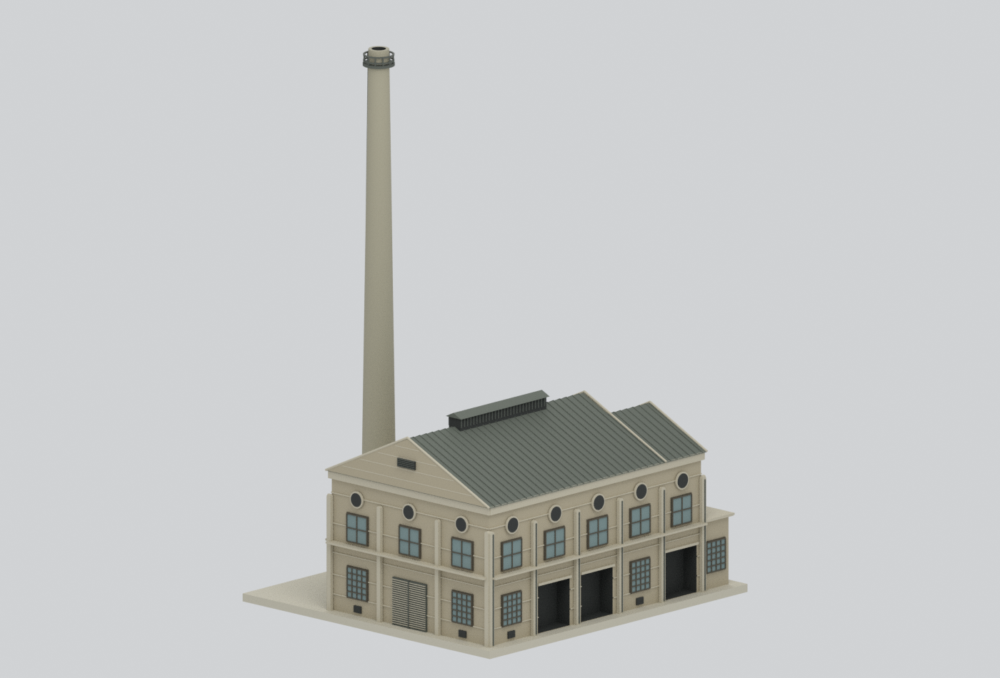
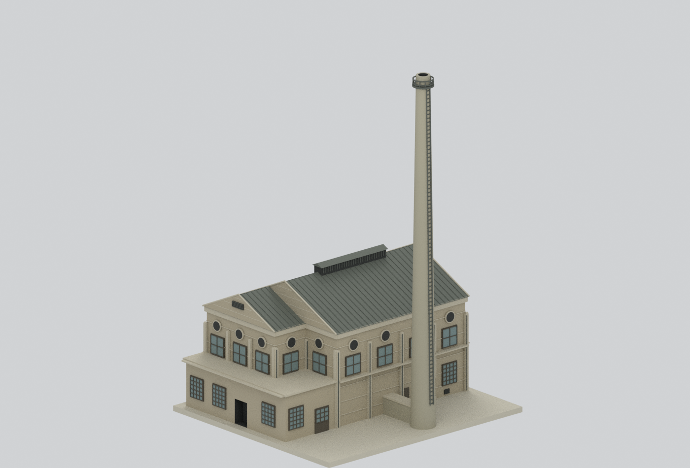
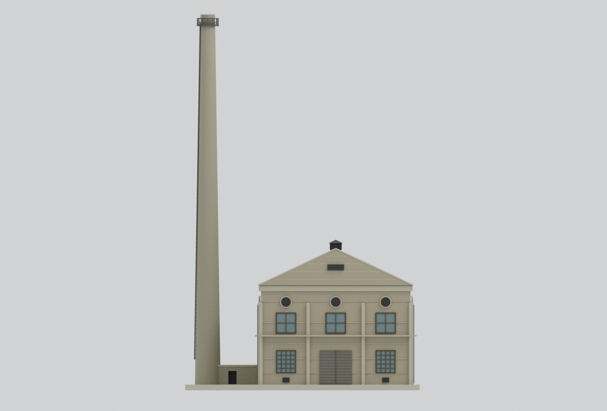
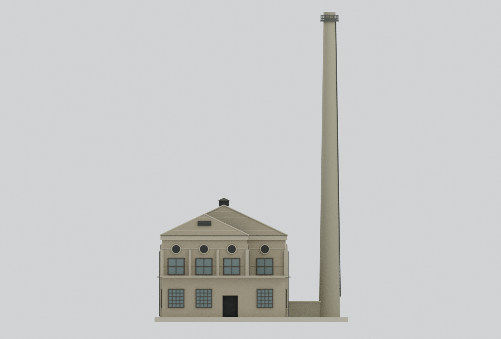
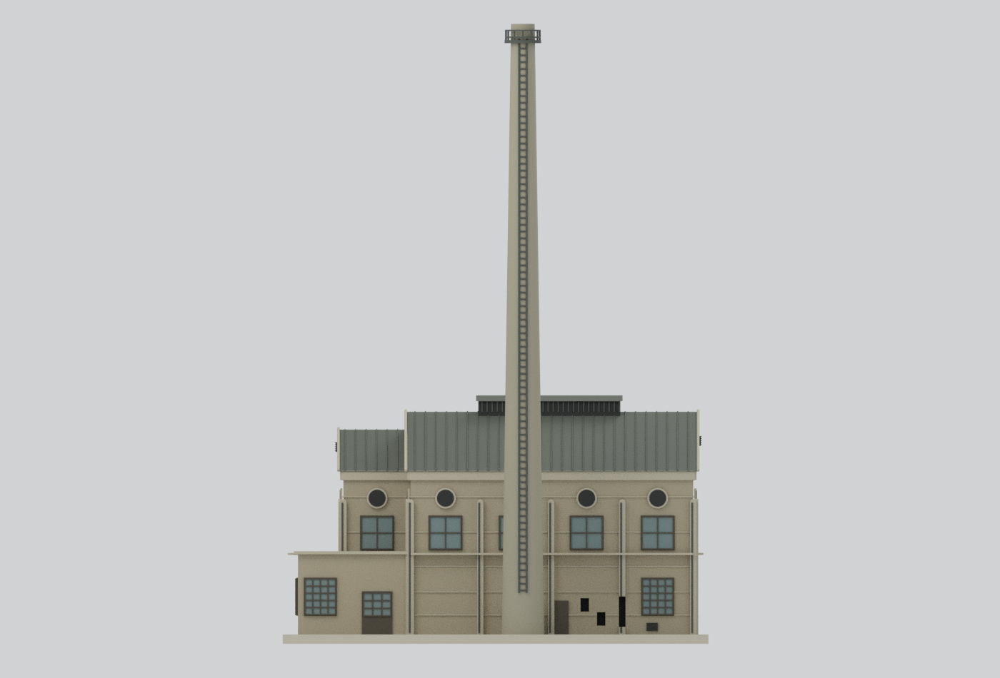
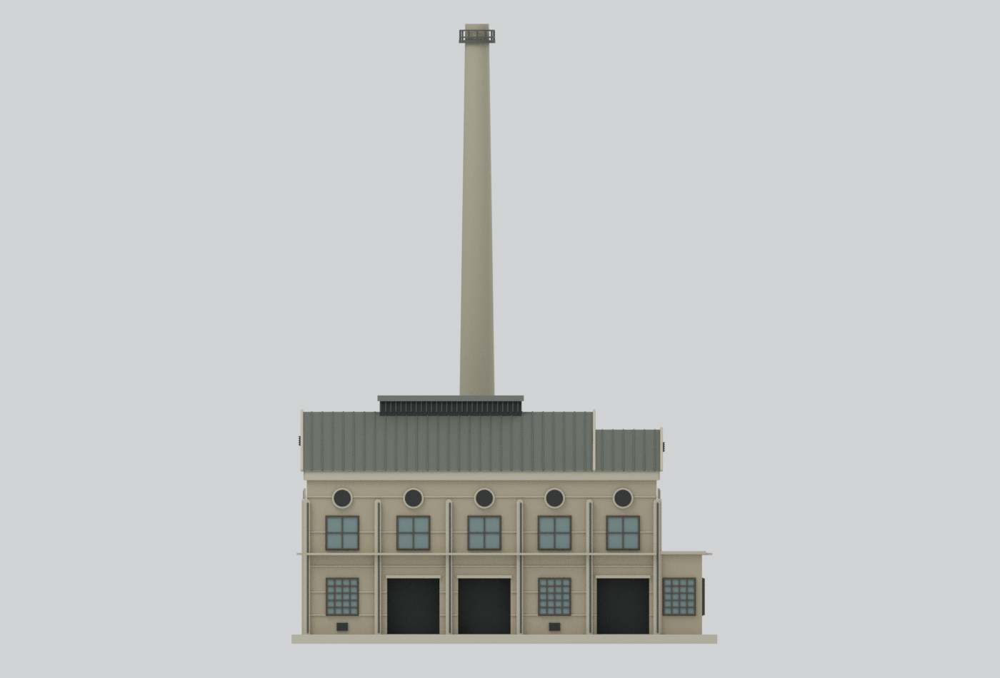
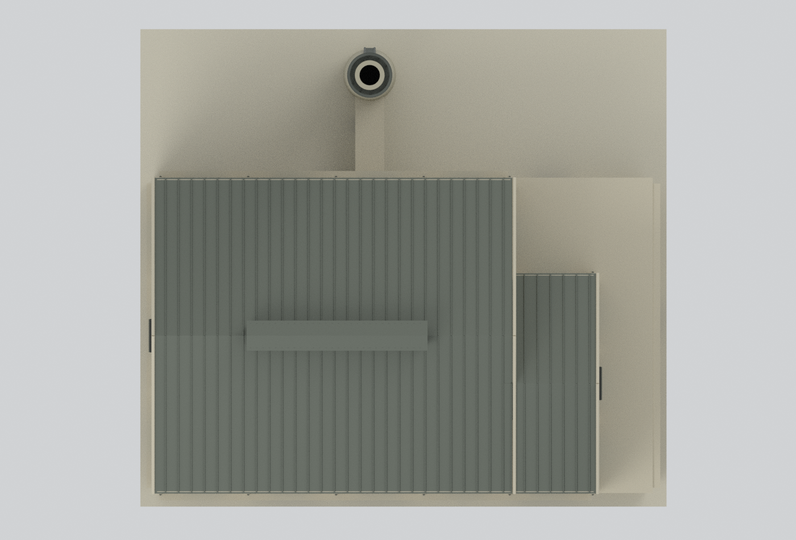
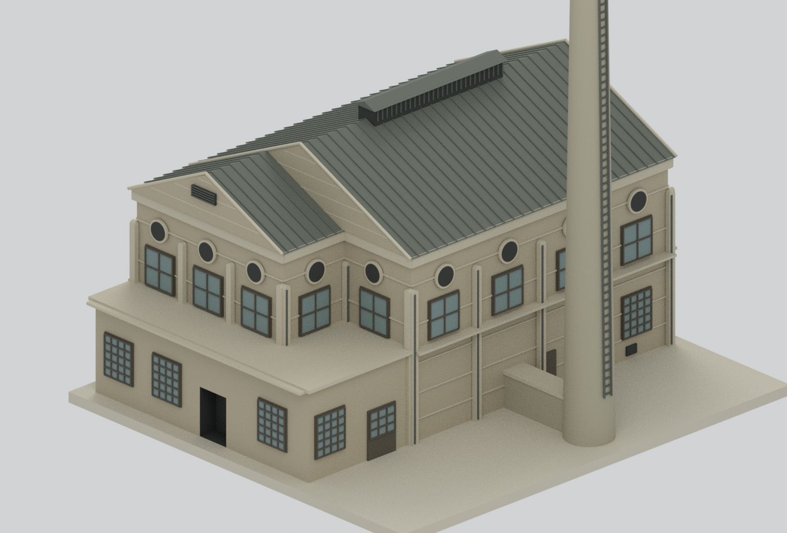

# 松山菸廠鍋爐房與煙囪｜2004年調查外觀研究

## 模型預覽

| 北西斜視（完整煙囪） | 南東斜視（完整煙囪） | 北立面 |
|---|---|---|
|  |  |  |
| 南立面 | 東立面 | 西立面 |
|  |  |  |
| 屋頂俯視 | 主體補充細節（此圖刻意不含煙囪頂） | 範圍示意 |
|  |  | [幾何範圍](geometry-scope.json) |

## 時間與範圍

本棟1939興建，模型依**2004年1月報告的調查外形**製作。包括高層L形主體、錯位南側山牆、低L形附室、屋脊通風塔、東側低煙道及漸縮煙囪；不是1939完好原貌、目前修復狀態或松菸全園區。模型以外殼為主，內部設備與精密病害不重建。

西21–23和南11缺門採真正凹入形狀，不補造完整門葉；東17–19保留為孔洞而非窗。凹洞深處有明列的非史實封底，並非完整室內。北20鐵門保留，十處底層木窗依索引配置。

## 下載與重建

- [彩色3MF](model.3mf)、[STL](model.stl)、[可編輯Blender場景](scene.blend)。
- [原創建模腳本](build_model.py)、[渲染腳本](render_model.py)、[重建說明](REBUILD.md)。
- [構件與來源](construction-parts.json)、[參數證據](parameters-evidence.json)、[官方來源及判讀](SOURCES.md)。
- [格式與網格檢查](QA.json)、[場景讀回](BLEND-QA.json)、[列印限制](manufacturing-review.json)。

模型以毫米為單位，原建物1m轉5mm，名義比例1:200。整體約125.6×114.0×183.05mm，其中含2.75mm作者底座。唯一可見融合物件對應STL/3MF；Blender隱藏的可編輯原構件有預期重疊，減法刀模明確標示，不能全部相加當最終列印體。

## 尺寸與不確定性

2332cm長、1453cm寬為平面控制，南立面1450cm不擅自平均。總高1412/1411cm、煙囪3606/3596cm存在圖異；模型採1412、3606，煙囪高度至管口而非護欄。東牆到煙囪中心517.5cm有標注，直徑約2.5m為圖量估計；旁邊243cm是剖切線偏距，不能當直徑。

L形高層的東側第五窗位於退縮牆面。來源長向立面對連續屋脊的畫法與南側雙山牆投影尚不能完全消歧；此處採分段交接的研究性重建，不主張精確屋脊線。屋面交接、次山牆高度、上窗與圓孔位置、煙囪直徑及金屬構件尺寸經多圖推定，並非逐點實測。黑白報告不能證明實際色彩，展示色為示意代理；窗玻璃為不透明面。

## 製造與安全限制

**尚未實體試印。** 數位封閉網格不代表一定可印或建物結構安全。煙囪細長、梯欄約0.45–0.55mm、部分立面線條約0.28–0.35mm，需依列印機調整尺度、支撐與方向。原報告記載煙囪嚴重裂損，本模型未按裂縫深寬重建，不能用作安全判斷。

底座、內部實心填充、凹洞封底、管口盲孔、加粗簡化梯欄皆為作者模型代理，已列於範圍與構件證據。原始來源照片/PDF及私人研究檔不隨模型發布。

## 獨立審核

[獨立來源／八視圖審核](review/public-safe-review.json) 通過，但附上述重建限制；[構件重新融合與格式核對](review/model-v3-independent-check.json) 通過。乾淨重建結果見 [REBUILD-QA.json](REBUILD-QA.json)。
