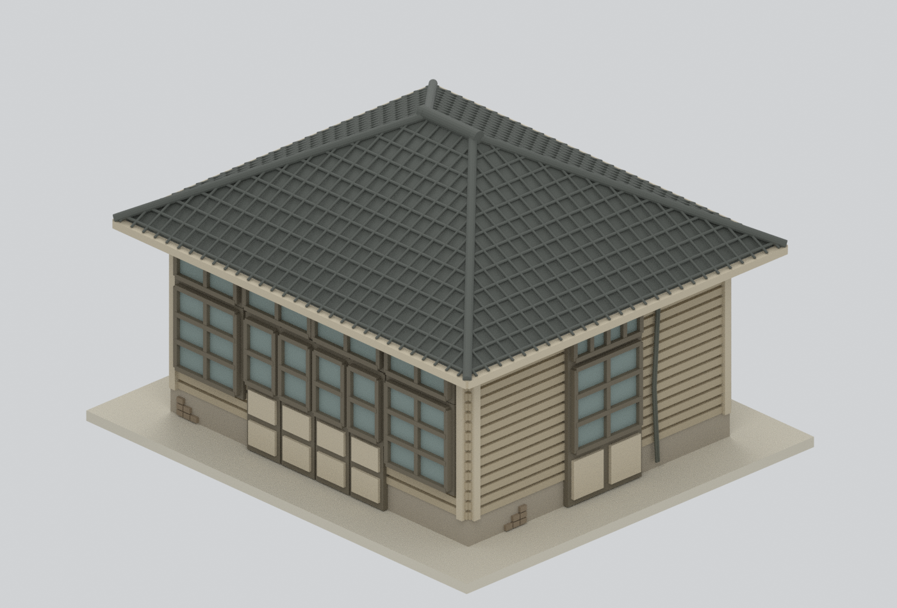
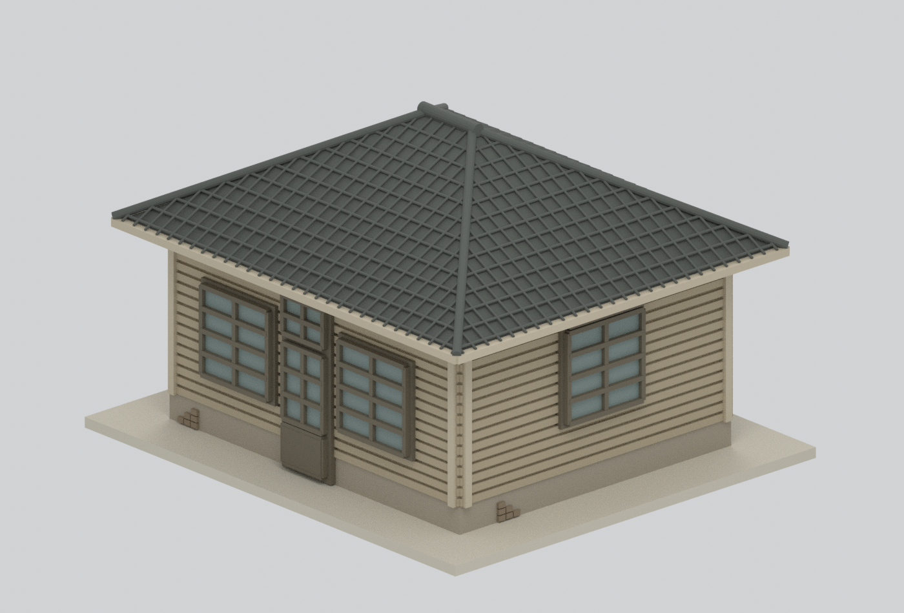
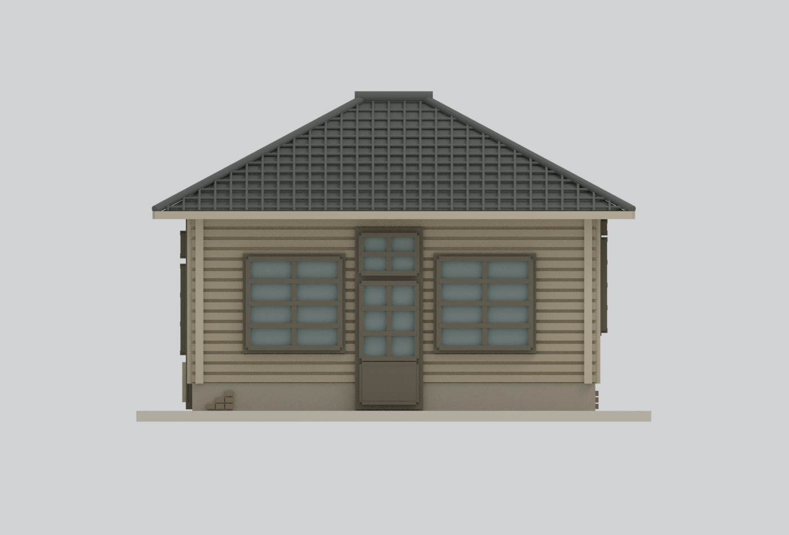
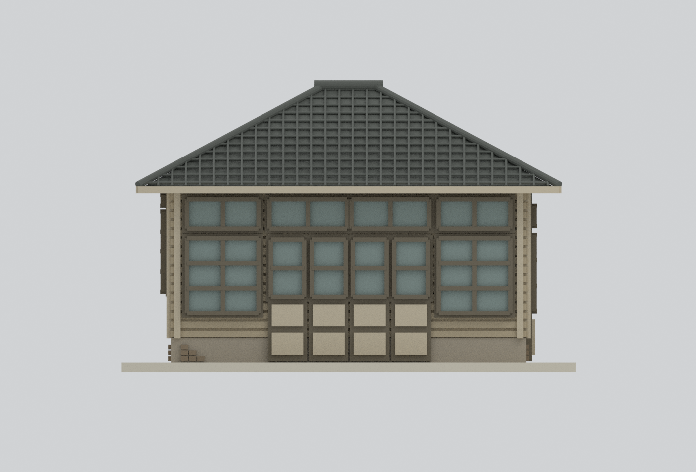
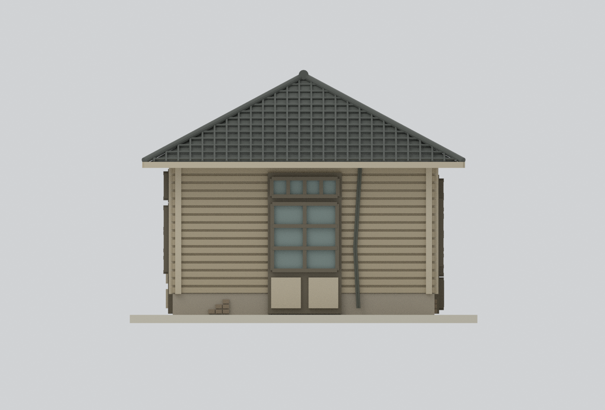
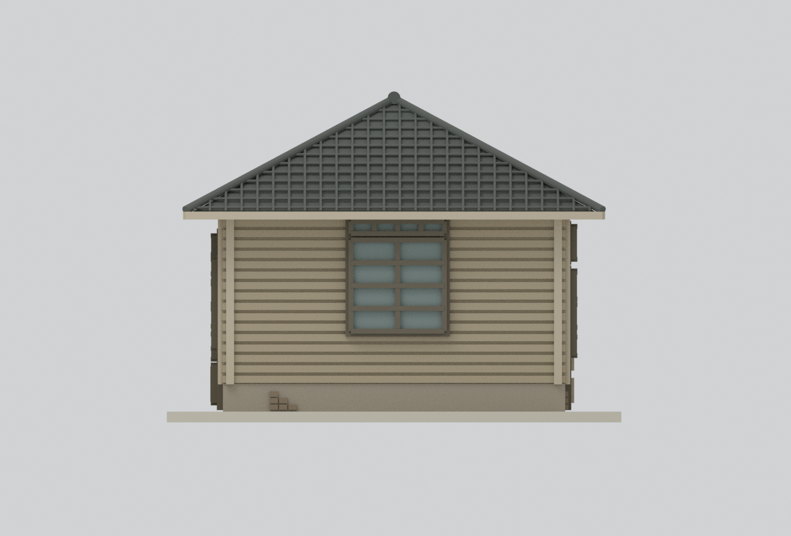
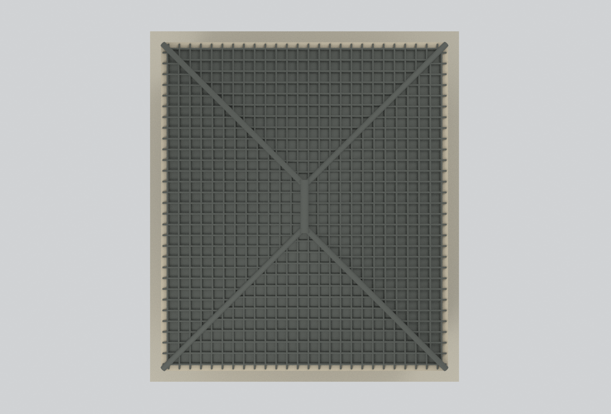
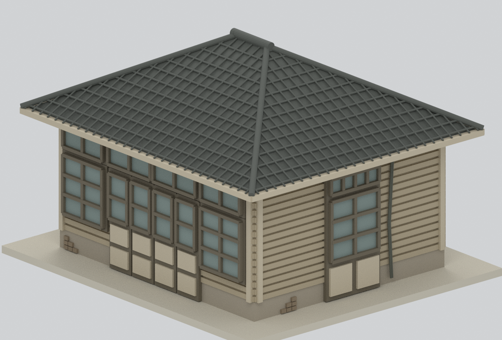

# 松山菸廠檢查站｜2004年調查外觀研究

## 模型預覽

| 南東斜視 | 北西斜視 | 北立面 |
|---|---|---|
|  |  |  |
| 南立面 | 東立面 | 西立面 |
|  |  |  |
| 屋頂俯視 | 門窗細節 | 範圍 |
|  |  | [重建範圍](geometry-scope.json) |

## 時期與範圍

官方報告PDF114明載檢查站（檢查室）於**1940年興建**，為日式木造。此包依**2004年1月調查報告**作主體外觀研究，含四坡瓦屋頂、短東西向屋脊、橫向魚鱗板外牆與不對稱門窗；不是1940完好原貌、今日修復狀態或全松菸園區。

報告中的後加排隊雨棚與欄杆不在本包量測主體範圍；倒塌天花、內部、地下基礎與細微損壞不重建。四坡屋面不是四面垂直山牆，短屋脊不是通風塔。

## 尺寸可信度

**小字尺寸標註無法可靠二讀，因此採圖中清楚的4m比例尺，不假稱精確實測值。** 外牆約5.62×4.76m、脊瓦頂約4.46m、簷口約2.77m、挑簷約0.52m；整體約±3%，小細節不確定度更高。圖面像素與計算見[參數證據](parameters-evidence.json)。等坡四坡交接、瓦片節奏、窗框厚度均為研究性推估。

名義比例1:50（來源1m→模型20mm）；另加3mm非史實平底座；整體含底座約126.4×143.6×92.2mm。單一實心外殼，玻璃為不透明展示面，未作室內透視。

## 檔案與重建

[STL](model.stl) · [彩色3MF](model.3mf) · [Blender場景](scene.blend) · [建模腳本](build_model.py) · [重建方法](REBUILD.md) · [來源](SOURCES.md)

[網格QA](QA.json)與[場景QA](BLEND-QA.json)核對格式及證據，不等同史實完整或製造合格。**尚未物理試印，也不保證結構安全。** 印前需在切片器確認挑簷支撐、細瓦紋及門窗線條；詳[製造限制](manufacturing-review.json)。

## 史料限制

PDF114–117記錄魚鱗板破損、門窗變形、天花全塌與多次瓦頂修補。模型保留圖面門窗分格及少量示意磚露，不主張逐片受損吻合；不能把完整代理外殼理解為當時完好狀況。黑白照片不能證明實際色彩，本包配色僅展示代理。

PDF341是育嬰室門窗表，未套用；PDF116平面病害圖標題誤列倉庫，模型身分及幾何以290–291檢查站圖題、114文字與115照片交叉核對。所有官方原PDF／照片只作私人研究，**未收入公開包或貼圖**。

## 獨立檢查

[來源預審](review/source-preflight.json) · [構件／格式獨立驗證](review/model-independent-check.json)。範圍仍受圖尺約數及病害簡化限制。

[最終八圖與來源獨立審核](review/public-safe-review.json)通過；[乾淨重建比對](REBUILD-QA.json)記錄五個幾何／構件檔及八張PNG逐位元相同，場景重開通過。
