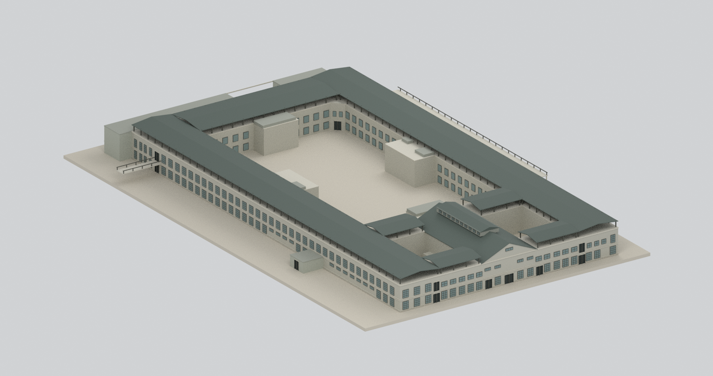
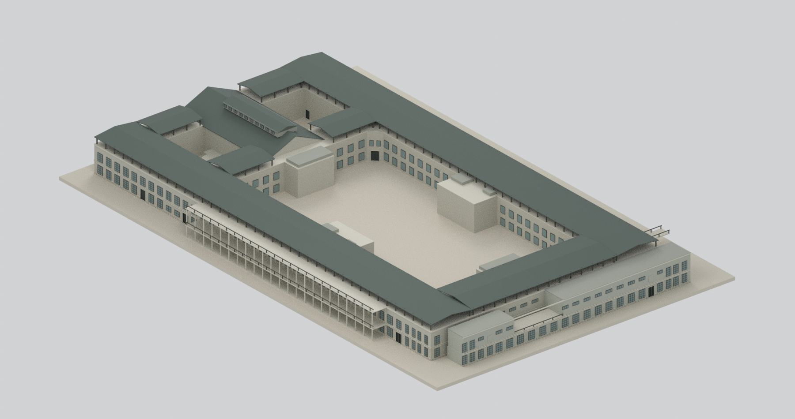
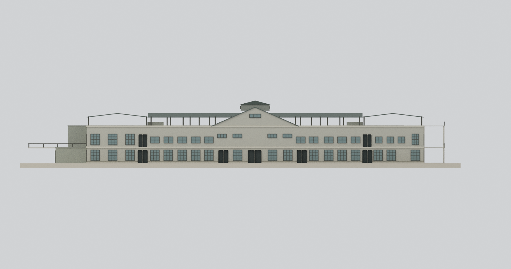
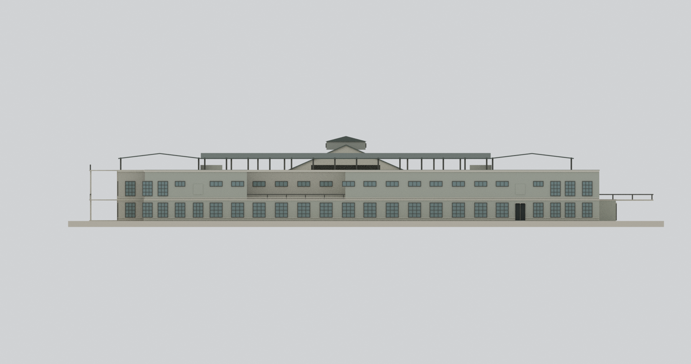
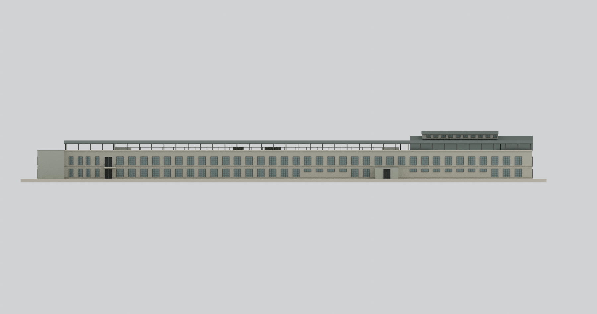
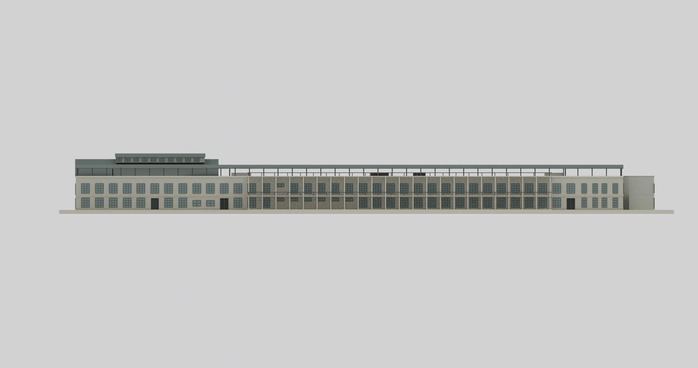
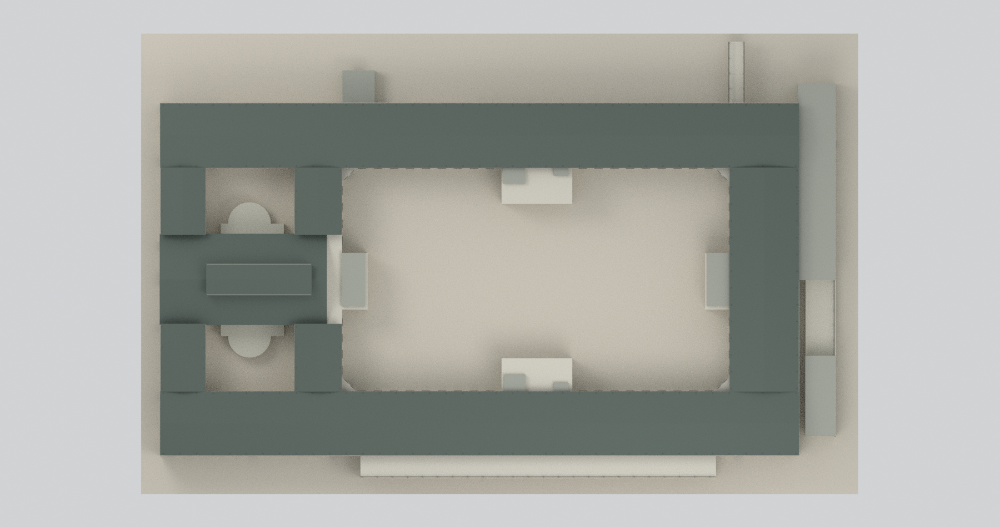
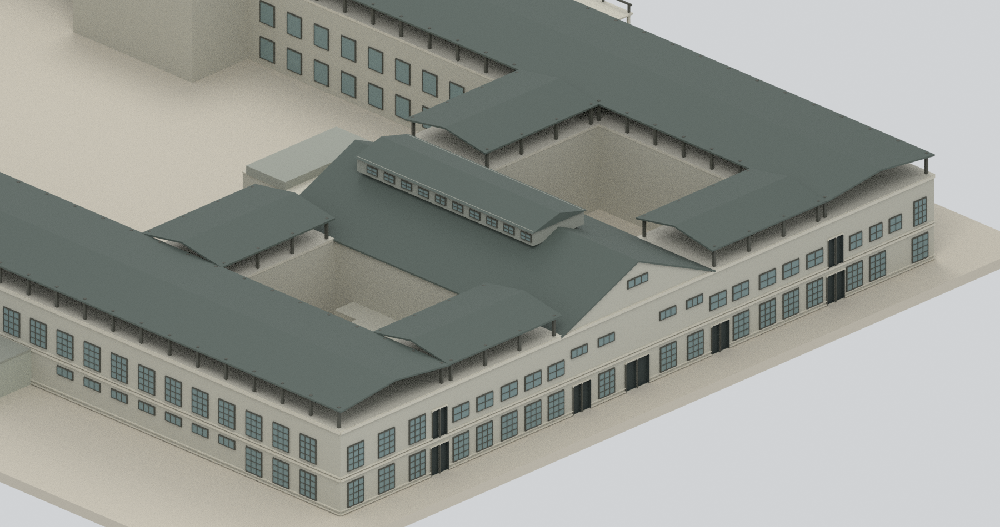
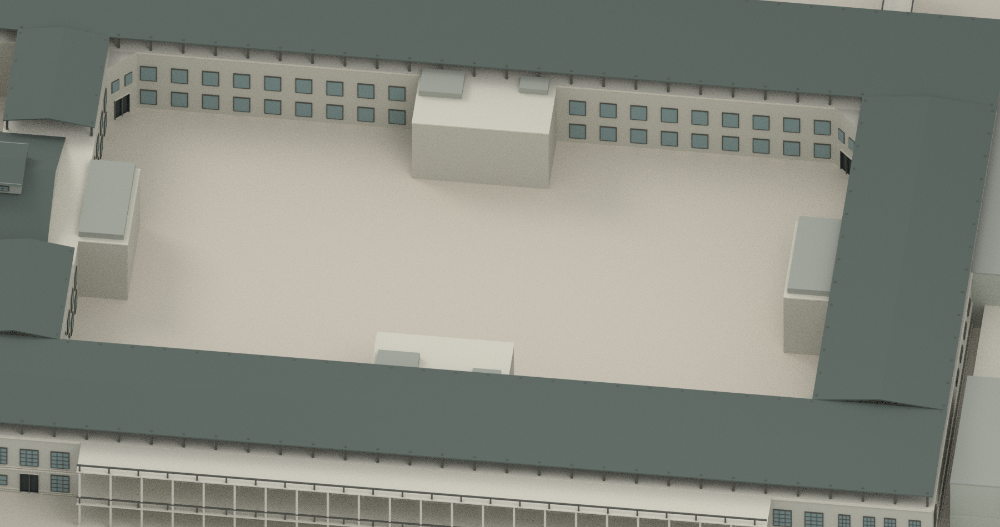

# 松山菸廠製菸工場｜2004年調查外觀研究

## 模型預覽

| 北西整體 | 南東整體 | 西立面 |
|---|---|---|
|  |  |  |
| 東立面 | 推定北立面 | 推定南立面 |
|  |  |  |
| 屋頂與三庭院 | 西中央禮堂局部（刻意裁切） | 大庭院局部（刻意裁切） |
|  |  |  |

## 對象與時期

本包是**1939年興建的松山菸廠製菸工場，以2004年1月官方調查所記錄外觀為基礎**；不是工作作業場、不是今日修復外觀，也不宣稱完整重建1939原貌。主體為二層鋼筋混凝土，東半大庭院、西半兩小庭院及中央原食堂／後改禮堂，另有後期附建。

報告95頁明載屋頂後加鐵皮。本模型保留**原屋面上方架高的薄雙坡棚與柱間空隙**，沒有把它做成第三層實心房屋，也不是全館平頂。中央禮堂較高的雙坡屋頂和通風帽另行表現；屋面交會、細柱斷面及接合屬簡化代理。

## 原圖矛盾與尺度

- 圖263、264的長立面近乎重複，均標「北」；圖265另一長立面同樣標北。依260／261北側兩處突出廊體、東端上層門框及西側高屋頂位置，**推定265下圖為北面，264下圖為南面**。這是平面交叉定位的推定，不是無聲改寫原圖名。西面採263上、東面採265上，各面未互相鏡像套窗。
- 歷史文字約東西163m、南北90m；262圖尺估讀主框約**164.68×90.99m**，相差約1%，採圖尺且保留誤差，不能當精密測繪。總樓地板約17600㎡，沒有拿來當基地面積。
- 主要尺寸圖尺誤差約±3%或更高；原RC屋面約10.2m、後加棚簷12.6／脊13.6m、禮堂主脊15.2m、通風帽最高約17m。
- 共用二樓顯示基準4.3m（估值範圍4.0–4.8m），並非所有真實樓地板精確齊平。浴室低屋蓋3.5m、樓梯屋頂小帽1m等明列代理，不是已查得精確高度。

## 範圍與未知部分

- 包括主館、三庭院、四處院落樓梯凸體、兩小院半圓浴室輪廓及分層後附建。**半圓浴室不是另外兩座戶外噴泉**。
- 南側長附帶以兩層開放外廊板／柱／中性護欄代理，不用整片實牆遮住主窗。東北附屋約兩層；東南只南段封閉上層，中段階梯／空段保留開放。附建屋蓋材質、護欄、接合及精細開口尚不確定。
- 北西段外凸房約一層；北東上層外連接僅做薄走道及中性護欄，來源範圍外的其他建築／通道不補，不能當成完整終端復原。
- 南北長立面各40主要窗門場，採各自非等距位置與上下層短窗／高窗／門差異；西、東面另讀，細密格柵為1:600可讀性簡化，不聲稱逐窗扇完整。北面底層第10場門對應凸廊端門，因不同頁投影／圖尺偏移而移到凸廊端，不在主牆再造第二道門。
- 大院每層長側18、短側8組位置按平面符號；四斜角底層門、上層兩小開口。院窗**高度、窗臺及1×1單片形式為中性顯示代理，非原窗型確證**。兩西小院未確認的周壁窗細節不捏造密窗列，僅保留可辨階梯凹口通行位置。
- 原大庭院三層噴泉、植物景觀、詳細病害、管線、機具、地下基礎、室內與隱藏結構均未復原。報告記錄剝落、鋼筋外露、漏水等；本模型不做安全判斷。
- 所有玻璃為不透明面、門為盲凹口、房體為實心外殼代理；配色非黑白照片校色。

## 交付與製造限制

名義**1:600**，含2mm作者底座，外框約**198.3×308.3×30.3mm**；長度可能超過一般桌上列印床。細窗框、架高薄棚、護欄與懸挑走道需要實際切片與支撐設計。**未物理試印，不保證可印或結構安全。**

[STL](model.stl) · [彩色3MF](model.3mf) · [BLEND](scene.blend) · [腳本](build_model.py) · [重建](REBUILD.md) · [來源](SOURCES.md) · [QA](QA.json) · [場景QA](BLEND-QA.json) · [獨立45項](review/model-independent-check.json) · [九視圖](review/visual-review.json) · [乾淨重建](REBUILD-QA.json)

來源PDF、照片、裁圖與私人材料不在公開包，也沒有當貼圖。數位封閉／格式驗證不等於完整史實復原。
