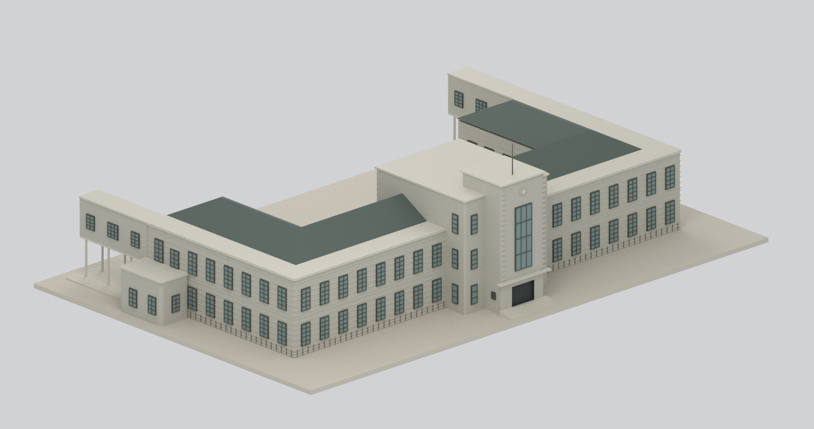
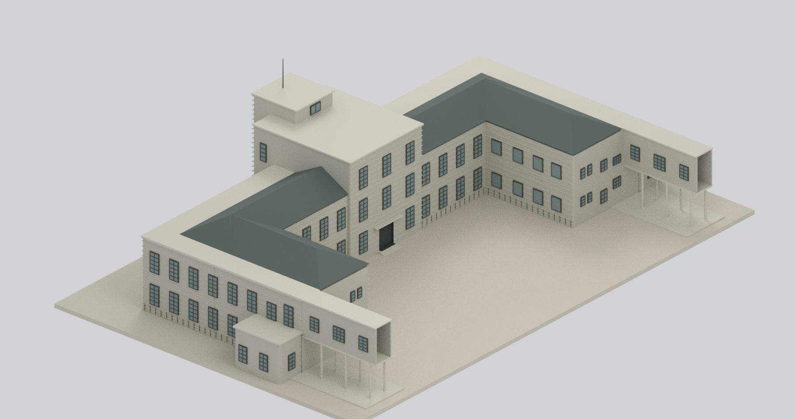
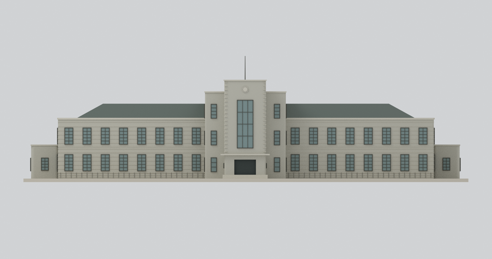
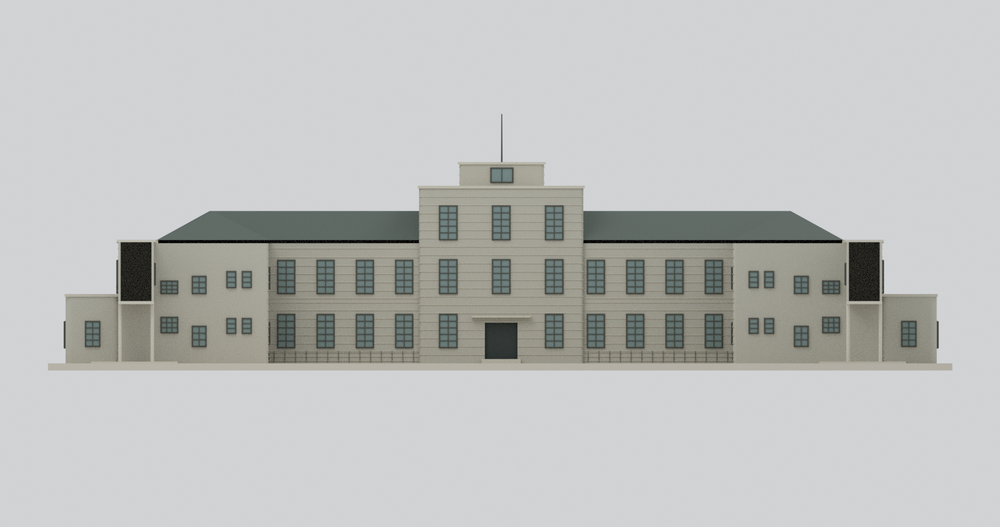
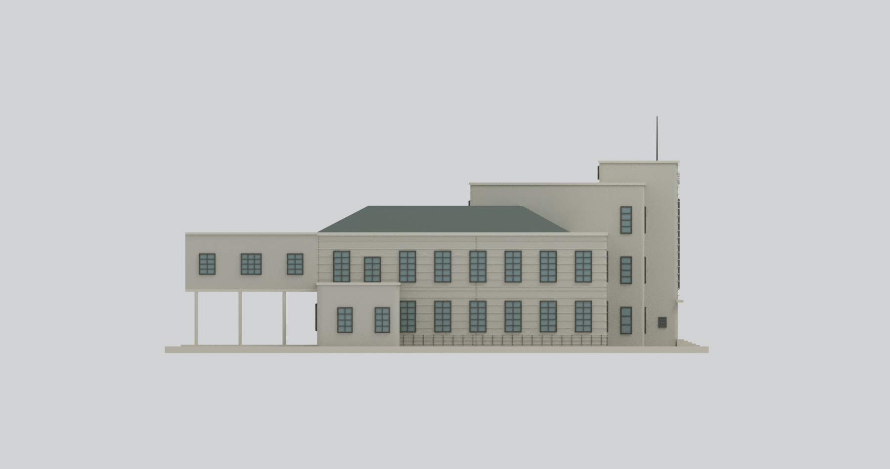
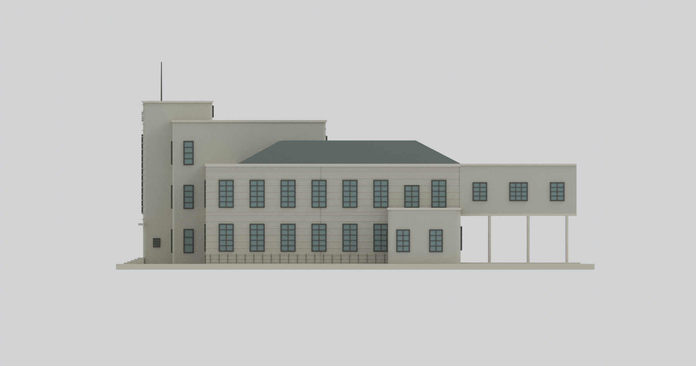
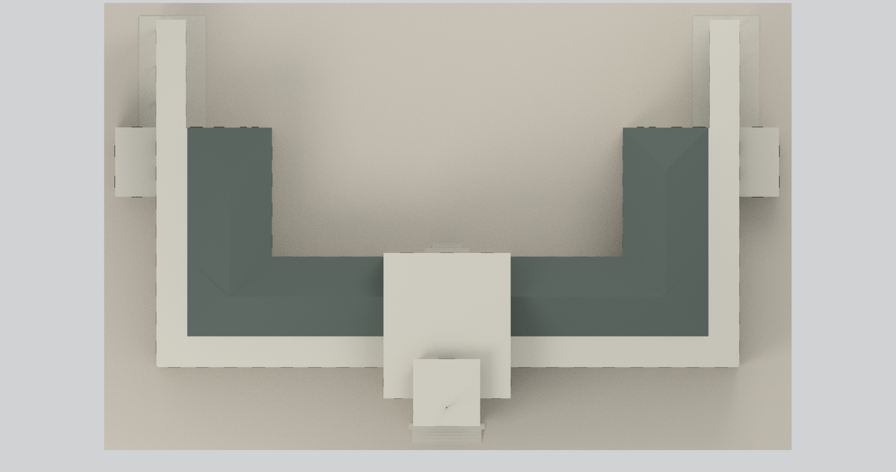
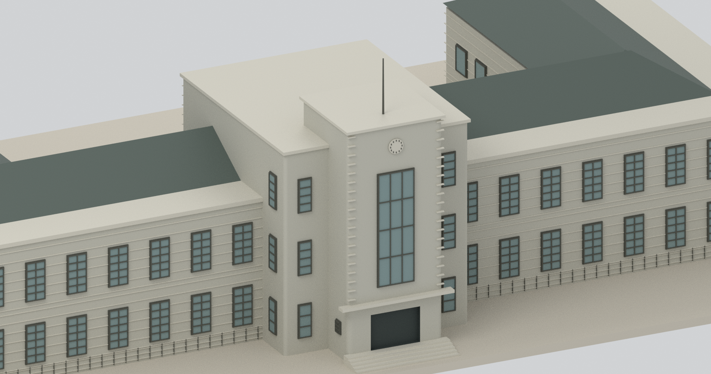
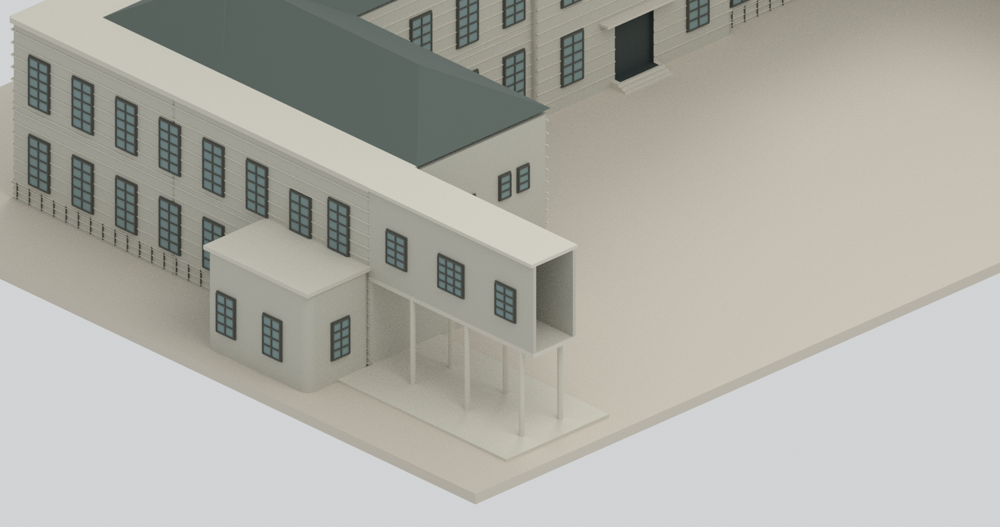

# 松山菸廠辦公廳｜2004年調查外觀研究

## 模型預覽

| 北西整體斜視 | 南東整體／院落 | 西側正立面 |
|---|---|---|
|  |  |  |
| 東側院落立面 | 北側立面 | 南側立面 |
|  |  |  |
| 全屋頂俯視 | 中央鐘塔局部（刻意裁切） | 南接廊局部（刻意裁切） |
|  |  |  |

## 時期與模型範圍

以**2004年1月官方調查報告所記錄的辦公廳外觀**為對象。報告記載1940年興建、鋼筋混凝土造，中央三層、兩翼兩層的ㄇ形（U形）配置。不是今日修復狀態、原建完好復原或整個松菸園區。

包括辦公廳主館、中央階梯式鐘塔、兩側低附房及報告所畫的兩條東向連接廊。連廊文字尺寸約**寬3m、長12m**；下層柱間開放、上層封閉有窗。連廊通往製菸工場，但本包僅到圖面表現範圍，**東端為明示截斷，沒有捏造終端牆／門窗，也未補整座製菸工場**。上層截面可見是模型範圍，不代表歷史建築到此終止。

## 尺寸與圖尺估讀

除文字所載的連廊3×12m外，主要控制由各頁**8m圖尺獨立校正**，約±3%或更高不確定度；不能當精密測繪尺寸。253、255、256頁不同縮放，未混用同一像素比例。

- 主館南北寬約64.17m，西橫館深約11.96m，U形臂深約26.34m、臂寬約12.5m。
- 二樓樓板帶約5.23m、主簷約10.40m、斜屋脊約12.82m。
- 中央肩樓約14.88m、最高塔頂約16.87m、細桿頂約20.98m；屬圖尺估高，樓板帶選線有誤差。
- 中央第三層後室與前廳按255配置，**該頁分離的屋突示圖沒有被當成庭院內數座小房**。
- 兩側斜／歇山屋頂與外圈平簷帶分開；不是把整館做成平屋頂。寬地面平台也沒有被直接當上層連廊寬度。

名義**1:300**，2mm作者展示底座，總外框約**253.2×165.0×71.9mm**，見[幾何摘要](build-summary.json)。多數細線、桿件、欄框與懸挑尚需列印製程評估；**未物理試印**，不能保證可印或結構安全。

## 細部及不確定範圍

- 西正面左右各半每層八窗，東向院底左右各半四窗；中央東側上兩層各三窗。不同深度的翼端服務窗沒有全部搬到院底同一牆面。
- 外翼窗按來源長短序列區分；連廊上層三組不同分格窗，下層兩排合計六柱。
- 中央大玻璃格柵以較粗3列×4段代理，省略菱形細格柵。鐘面只畫示意刻度，**沒有替不可辨識的指針捏造時間**。
- 窗戶為不透明展示面、入口為盲凹口，館體為實心外殼；沒有重建完整室內、樓梯系統、設備及隱藏承重構造。
- 細瓦紋省略；圓角、石紋線、水平帶、窗框與細桿均有簡化或加粗；配色非黑白照片校色。病害、滲漏、裂損及材料剝落未逐處重建。內庭院兩側長翼牆每層四窗的位置、約1.5m寬取自平面圖（位置約±0.5m）；窗高1.8m、窗臺及單片無分格形式是顯示代理，原窗高和格數未知。東端服務窗另依立面，未誤套到內庭院長牆。

## 檔案與驗證

[STL](model.stl) · [彩色3MF](model.3mf) · [Blender場景](scene.blend) · [可重建腳本](build_model.py) · [重建說明](REBUILD.md) · [來源](SOURCES.md)

[網格QA](QA.json) · [場景QA](BLEND-QA.json) · [獨立43項檢查](review/model-independent-check.json) · [九圖審查](review/visual-review.json) · [乾淨重建](REBUILD-QA.json)。封閉、連通與格式一致只驗證數位模型，不是完整史實復原、試印或結構安全認證。來源原PDF、照片、裁圖及私人資料未放入公開包或貼圖。
