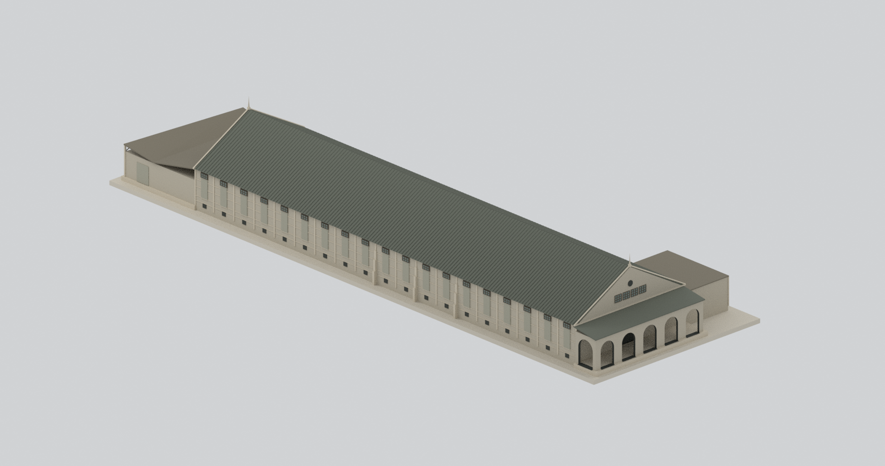
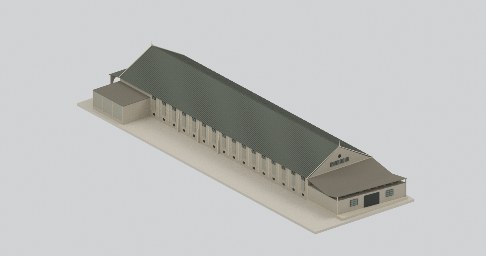
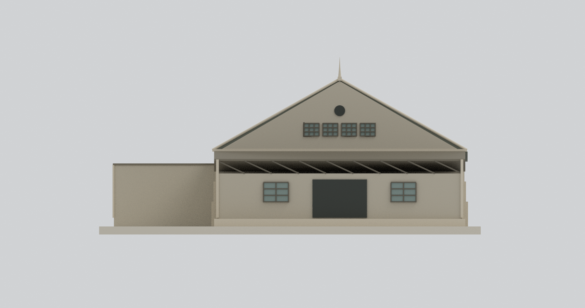
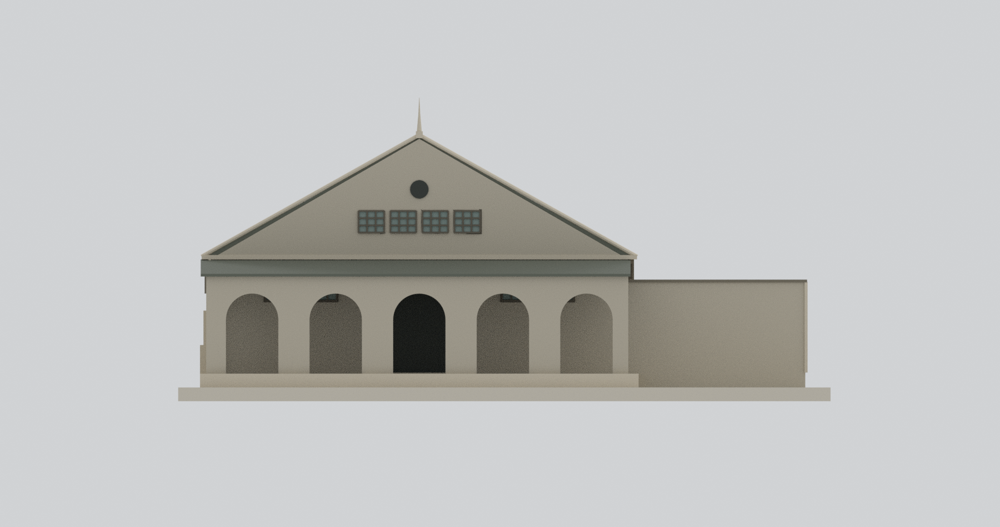
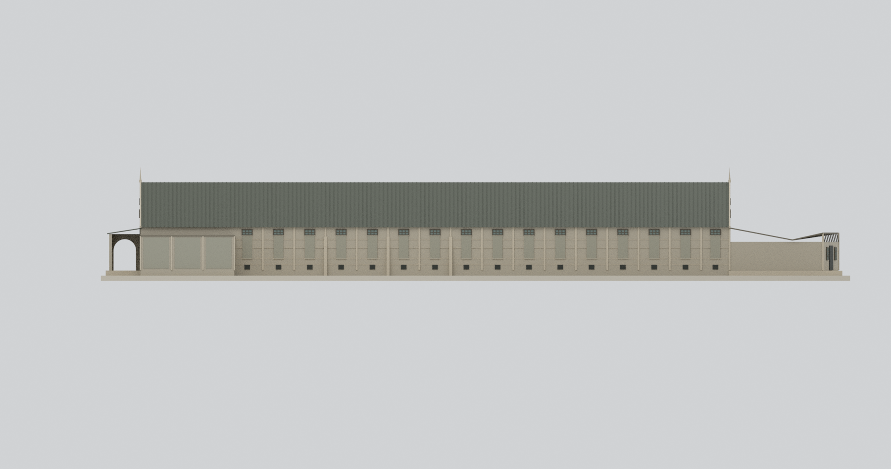
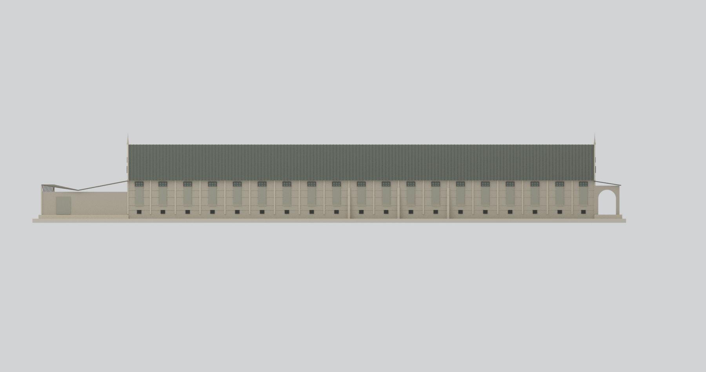
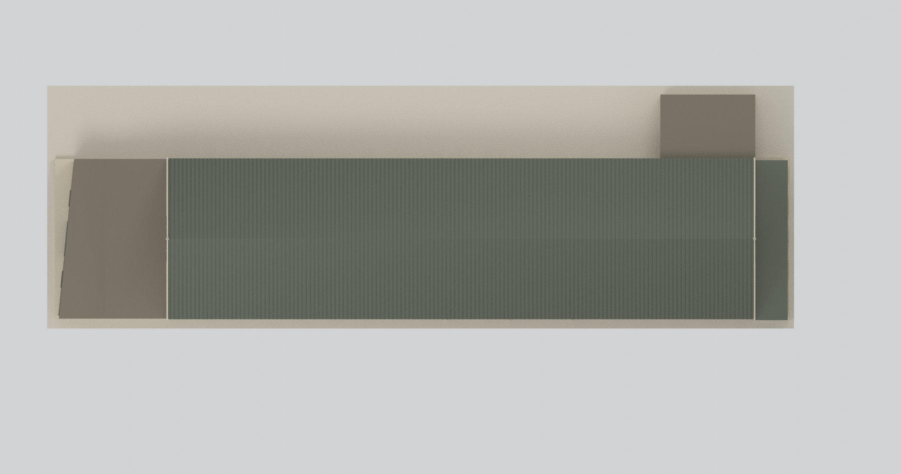
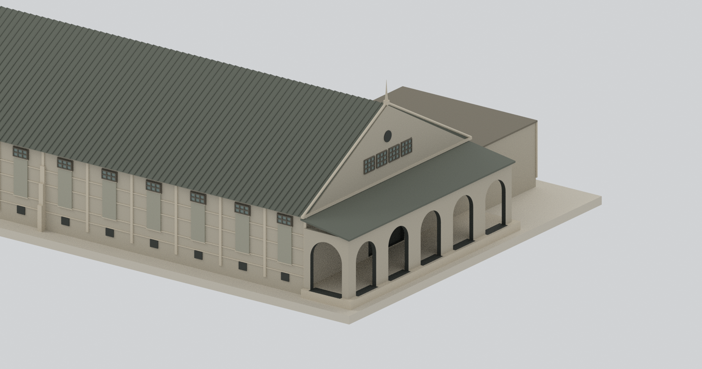
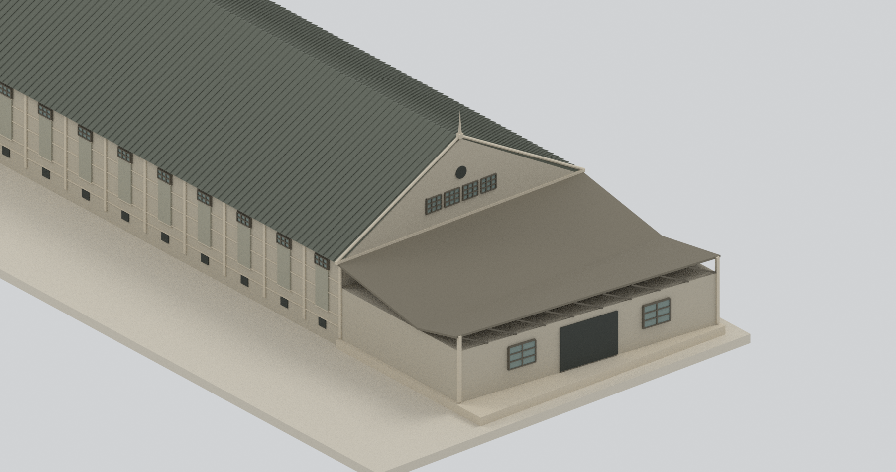

# 松山菸廠一號倉庫｜2004年調查外觀研究

## 模型預覽

| 南西整體斜視 | 北東整體斜視 | 北端立面 |
|---|---|---|
|  |  |  |
| 南端五拱廊 | 東側全立面 | 西側全立面 |
|  |  |  |
| 全屋頂俯視 | 南段局部（刻意裁切） | 北段局部（刻意裁切） |
|  |  |  |

## 範圍及時期

以**2004年1月官方調查報告所記錄的一號倉庫外觀**為對象。報告將倉庫群興建年代記為1939–1940年，未據此指定一號單一年份。不是整個倉庫群、原建完好狀態或今日修復外觀。

一號是獨立長向雙坡館，與二至五號四連排不同；報告描述一號鋼條焊接桁架，二至五號才是木桁架。本包不重建隱藏桁架，更不把他棟木架套入。

包括本棟、限本棟寬內的南側五拱廊、北側不規則低棚，以及東南低附房可見量體；**向東通往二號的連廊在本包範圍處截斷，不假封端，不代表原建築在此結束。** 未包含二至五號、軌道、輸送帶、室內設備或地下基礎。

## 尺寸、地坪及推估

- 立／剖面PDF272、274主長**68.435m**；平面268另記**69.091m**，相差0.656m。採兩張立剖相同值，但保留異文；19跨比例正規化，不稱量測完全一致。
- 主寬18.18m；剖面簷高5.029m＋坡升5.203m＝脊高10.232m，均以**主館室內地坪**為基準，不含尖飾。
- 模型外地低於主地坪約0.65m屬**顯示用近似高差**，不是來源精確高程；剖面基礎底線沒有被當作外完成地坪。2mm展示底座另加。
- 北棚平面斜邊、淺V頂、南廊深度、附房尺度與裝飾尖頂採圖面輪廓近似。東南附房有牆體與低矩形立面依據，但其**薄平蓋是未詳屋頂代理，不能宣稱確為RC平屋頂或已知材料**。
- 小格窗、牆場、低孔及圓孔多用不透明展示面，未聲稱完整原門窗或室內實況；柱／窗框、細尖飾有加粗。

名義**1:300**，含底座約290.1×94.6×44.1mm（精確數位外框見[幾何摘要](build-summary.json)）。模型長度超過許多桌上型列印床，**未物理試印**，不能保證細窗框、尖飾、拱廊、低棚及懸挑可印。見[製造限制](manufacturing-review.json)。

## 開口與外觀邊界

- 西長面19個小高窗／下方牆場；東南三跨被低附房遮蔽，不補造隱藏開口，東側只造16個可見場。
- 南正面五個圓拱穿孔，不將六個303cm尺寸分格誤當六拱；西側回廊亦留實孔。
- 北可見低棚中央矩形門與兩側小窗，上部留窄桁架帶；不套用二至五號多扇門，不把剖面後方主牆全搬到可見前牆。
- 兩端各四組高格窗、圓孔與尖飾；單館人字形屋頂，不添加其他館的連排山牆。
- 東南附房外觀是中性低量體，未補衛生間內部、機械或不可見材質；受損、滲水、粉刷剝落等未精密重建。

## 檔案與驗證

[STL](model.stl) · [彩色3MF](model.3mf) · [Blender場景](scene.blend) · [可重建腳本](build_model.py) · [重建說明](REBUILD.md) · [來源](SOURCES.md)

[網格QA](QA.json) · [場景QA](BLEND-QA.json)。數位封閉、連通與格式一致不是史實完整、物理試印或結構安全認證。實心外殼／不透明玻璃為模型策略，配色未由黑白照片校色。原PDF、照片、裁圖及私人研究資料未放進公開包或貼圖。

[獨立幾何與格式審核](review/model-independent-check.json) · [獨立九視圖審核](review/visual-review.json) · [清潔重建比對](REBUILD-QA.json)
