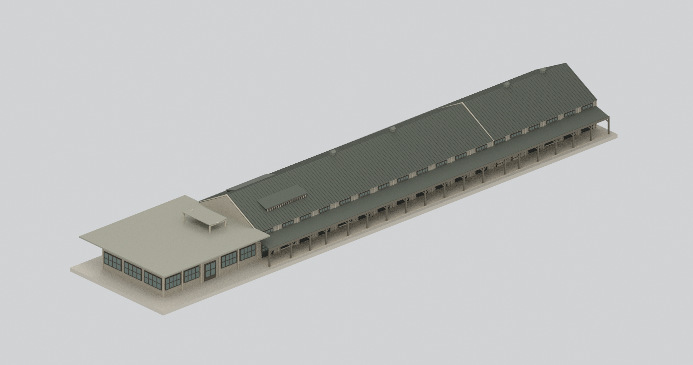
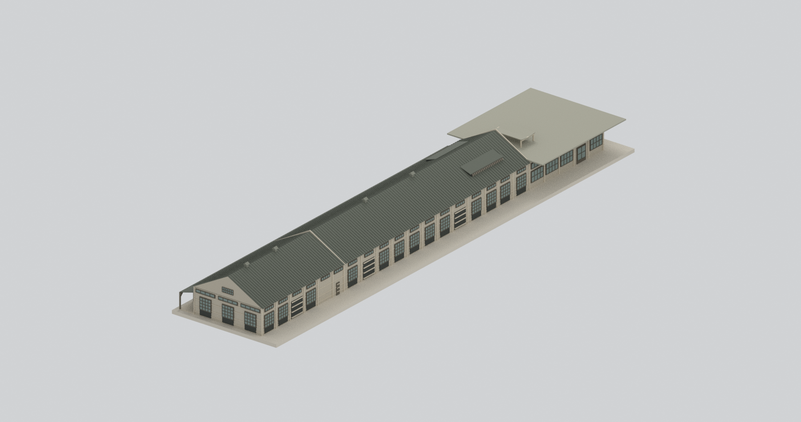
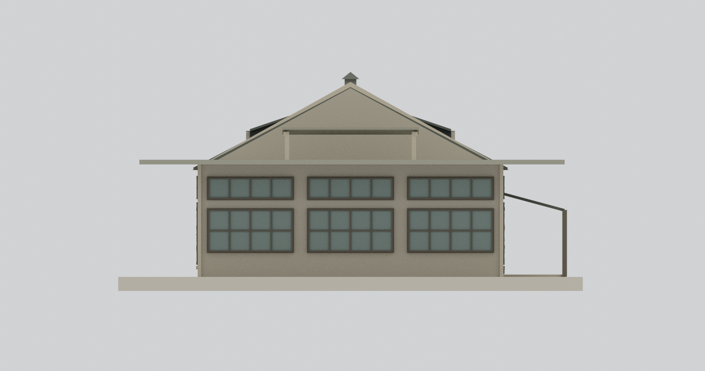
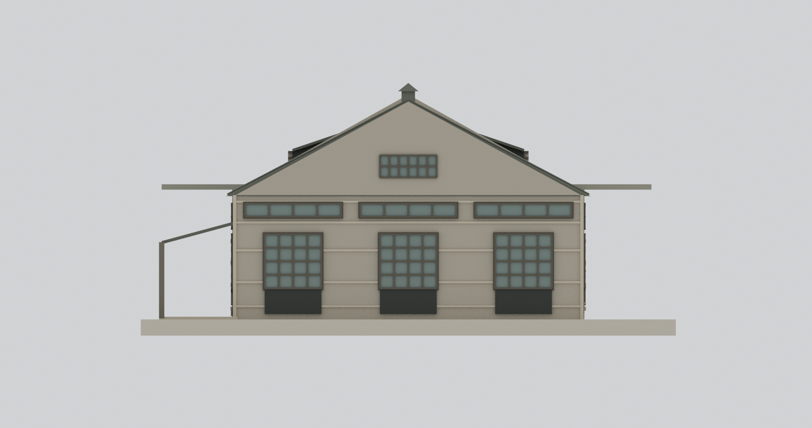
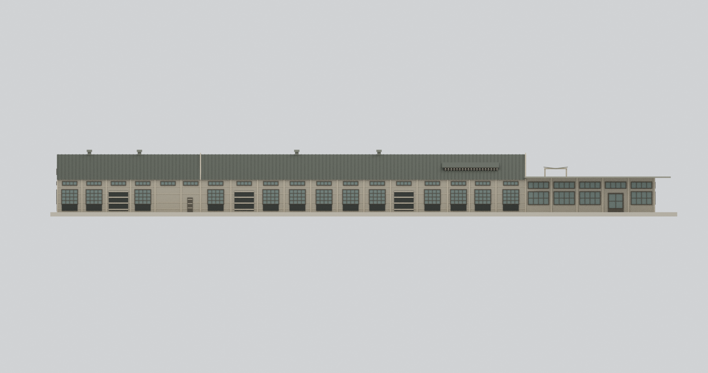
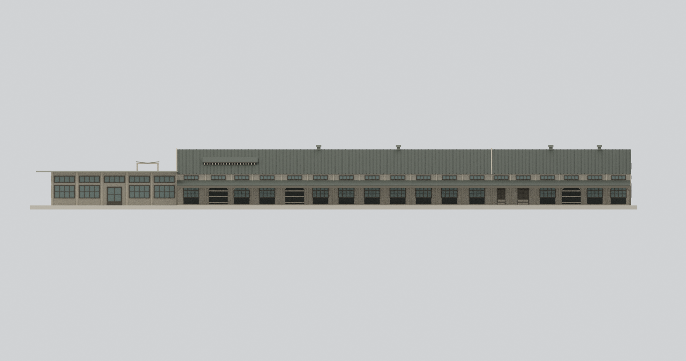
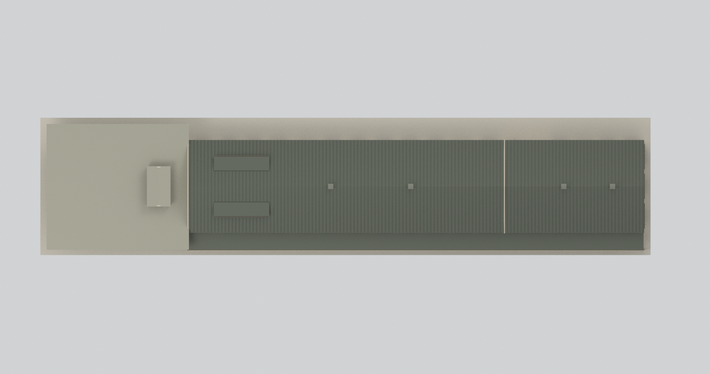
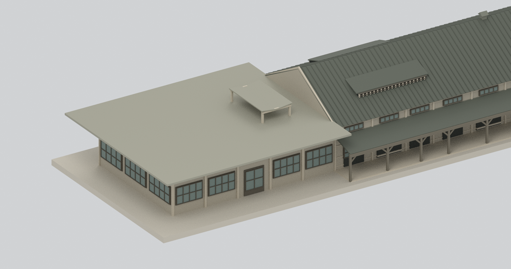
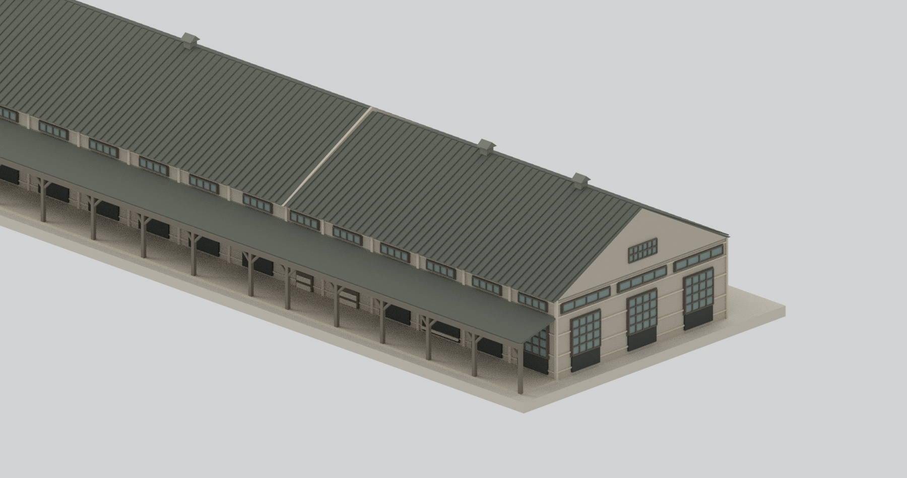

# 松山菸廠工作作業場（機械修理室）｜2004年調查外觀研究

## 模型預覽

| 北西整體斜視 | 南東整體斜視 | 北端立面 |
|---|---|---|
|  |  |  |
| 南端立面 | 東側全立面 | 西側全立面／開放柱廊 |
|  |  |  |
| 全屋頂俯視 | 北段局部（刻意裁切） | 南段局部（刻意裁切） |
|  |  |  |

## 模型時期與史料矛盾

以**2004年1月官方調查報告的外觀**為對象，含長向人字屋頂主館、北側低平屋頂增建、**西側開放木柱廊**、兩條長百葉老虎窗與四個外立面可見有帽輪廓。不是整個松菸園區、原建完好狀態或今日修復狀態。

**同一報告PDF60寫1939年，PDF118寫1940年；PDF71描述木構中柱桁架與木廊，118則概稱鋼筋混凝土。兩處不一致，未擅自統一年代或材料。** 本包僅研究可見外殼，不能用此模型解答隱藏承重構造或結構安全。

## 尺寸及推估

採PDF282–283長向分段18.013＋10.908＋34.542＋6.363＋13.635＝83.461m；281末段另似13.435m，保留異文。主館18跨、北增建5跨；各小跨比例正規化到分段總長，不宣稱原圖加總無誤。

主館寬約12.77m（字樣及三跨和略有差異），西廊約2.727m；屋脊約8.1m、簷約4.6m、西廊內接約3.6m／外簷約2.85m，北增建屋頂約5.0m。高度依20m圖尺校正、約±3%，細部不確定度更高。窗框、瓦面粗紋、帽形、老虎窗蓋板及小型屋頂框均有研究性簡化，見[參數證據](parameters-evidence.json)。

名義1:300，另加2mm非史實底座；全模型約**292.2×65.9×31.2mm**。長度超過許多桌上型列印床，**未做物理試印**，不能保證支撐／精細線條可印。詳[製造限制](manufacturing-review.json)。

## 形體與開口邊界

- 西側廊下留空並有柱、斜撐；不是東側連續實心附樓。
- 北增建西門在中間第3跨，東門在由北數第2跨；非兩側鏡像。
- 主館東西面的後期橫帶改造開口位置不同，保留圖面節奏；一般高長分格部位中性稱「開口」，不一概認定為完整原門扇。
- 兩長老虎窗位於主館北段兩坡，不在北增建平頂；斜蓋向內上升回接主坡，前緣高出主坡約0.45m、後緣約0.08m屬保守近似，並非原圖標註尺寸。
- 只表現283可見的四個小帽形輪廓，不定義為煙囪。281是**屋架圖**，八個小圈方框符號用途不明，不擅自外化為八個設備，也不把密集桁架線畫成外部格網。
- 北平頂上寬低框罩用途不明，僅做輪廓代理。

## 檔案與驗證

[STL](model.stl) · [彩色3MF](model.3mf) · [Blender場景](scene.blend) · [可重建腳本](build_model.py) · [重建說明](REBUILD.md) · [來源](SOURCES.md)

[網格QA](QA.json)與[場景QA](BLEND-QA.json)僅證明數位格式／幾何一致，不證明史實完整、可印或安全。內部機械、桁架、地下基礎及精密病害未重建；玻璃不透明、主體實心、配色非黑白照片校色。原PDF、照片與裁圖**未放入公開包或當貼圖**。

[獨立幾何審核](review/model-independent-check.json) · [獨立九視圖審核](review/visual-review.json) · [清潔重建比對](REBUILD-QA.json)
