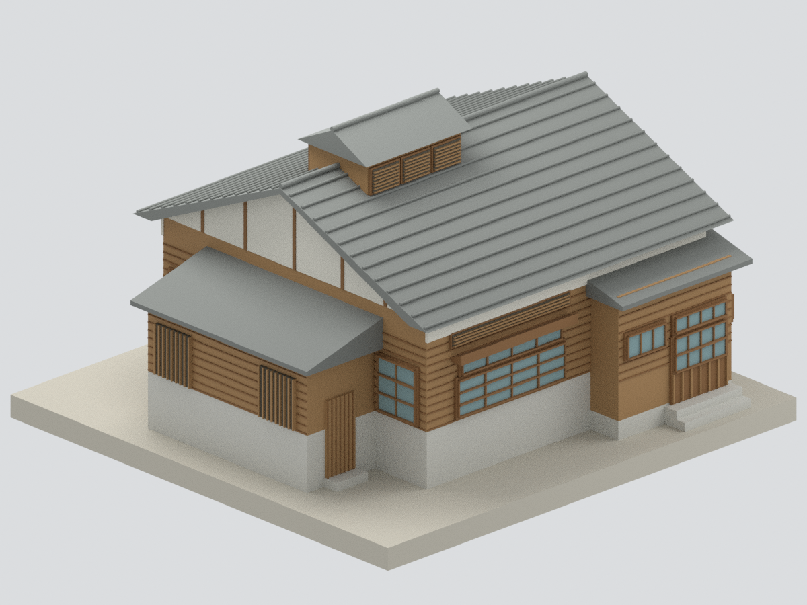
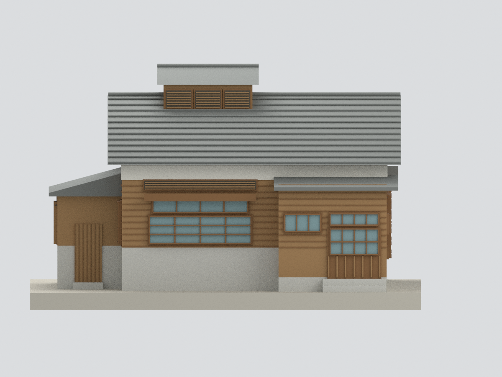
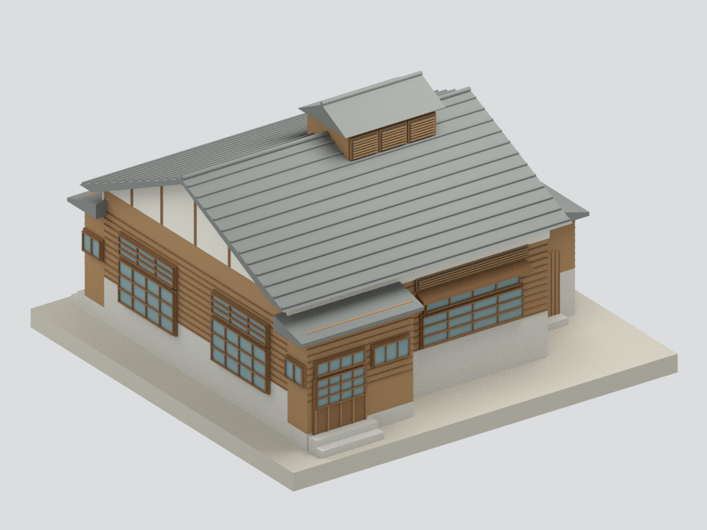
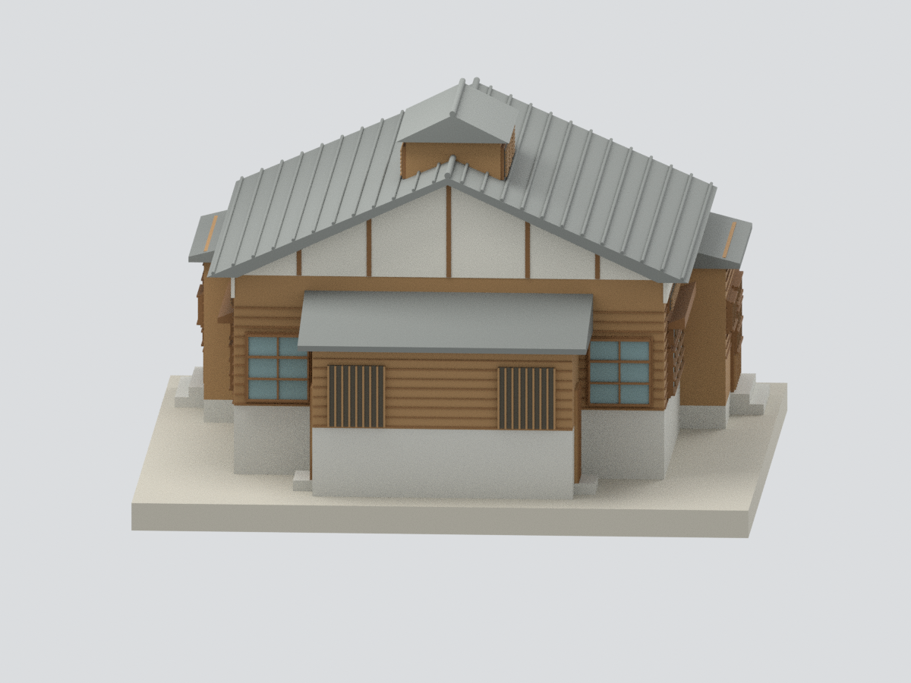
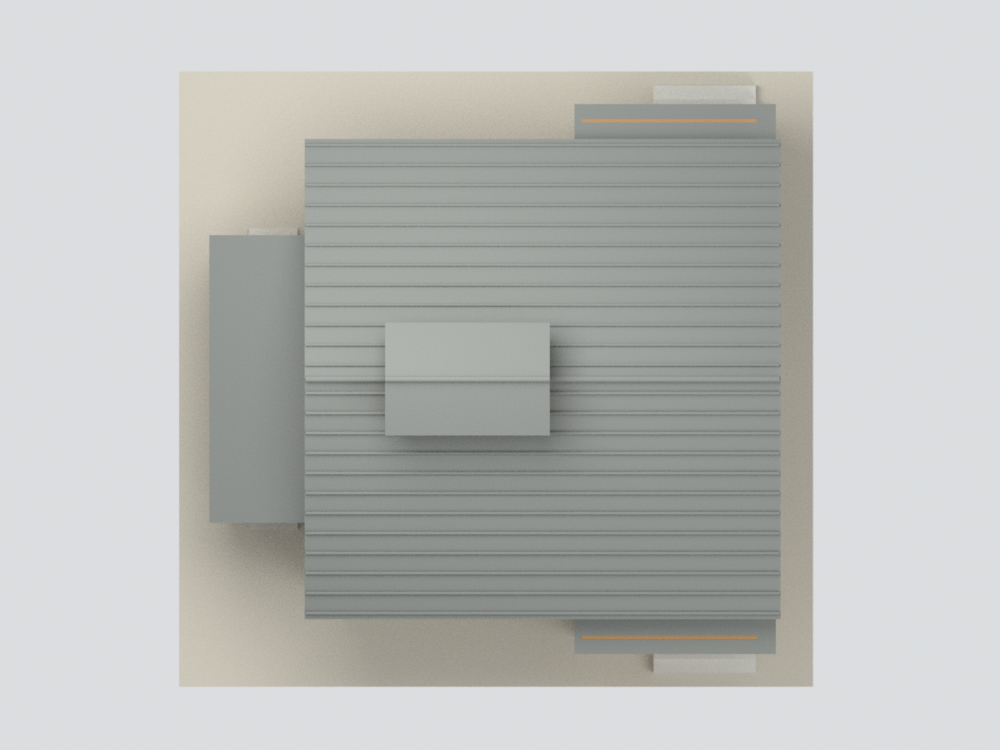
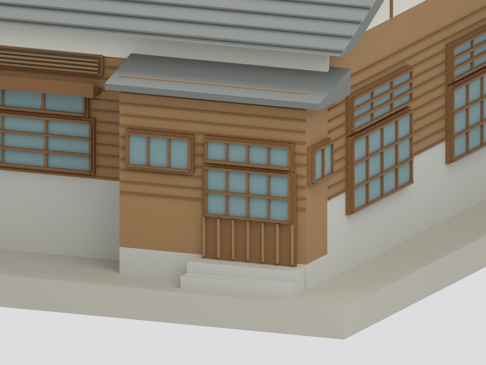

# 臺中刑務所浴場｜修後主體外觀近似研究模型

## 模型預覽

| 南面主體 | 南立面 | 北面（圖表推定） |
|---|---|---|
|  |  |  |
| 西側鍋爐間 | 屋頂與氣樓 | 南入口局部 |
|  |  |  |

## 2. 模型範圍與證據

本包是浴場修後主體的外觀近似研究，**北面缺完整修後實照，門窗依官方「推測復原平面」與門窗表推定**；不是四面現況精確復原或竣工測繪。以2014官方調查報告配合修復完成後官方實照，保留主浴場、南北入口突出部、西側鍋爐間、雙坡頂及屋脊通氣樓。

不含典獄官舍、其他刑務所建築、花園樹木、圍牆、室內浴池／設備或後來居住用途的附加廚衛。2019官方新聞混列典獄官舍與浴場照片，僅採可確認的浴場圖。

## 3. 尺度與簡化限制

- 名義比例1:100。平面控制尺度為546.2+377cm、922.6cm；鍋爐間224.8×558.2cm。這些是復原圖的基準線尺度，**不是確證外牆外包**；牆厚、檐口、入口偏移與外部階高另作估讀。
- 屋架907cm跨距、224cm脊升與121cm氣樓柱高僅用於比例校估，不直接當總屋寬／總屋高／氣樓外包。屋頂總高度、氣樓位置與細比例另由照片近似。
- D1與D2單扇高寬依表使用，南北門玻璃及下板分格不同；W5整組下窗四扇、上窗三扇，非一扇就是一組。W5 上氣窗表圖為橫長形；123×61 的整組／單扇量測參照不清，模型採約 .61m 高、整組約 2.732m 寬的比例代理，不把 123cm 誤當窗高。男更衣室 W4 上窗採報告「可仿女更衣室」的修復建議作近似，不代表兩處修後實際窗型均經實照核對。內窗W6／W7不當外牆窗。
- 木雨淋板作粗分條；屋瓦僅較粗瓦列與屋脊，未逐塊精製瓦片、鬼瓦、雨樋、五金與木榫。
- 氣樓及鍋爐間格柵使用實心背板，不是通風或透明模型。玻璃不透明、室內實心，無室內透視與結構用途。
- 文字牌匾、人物、周圍樹木與風化表面省略；木材顏色未作現場校色。
- **未試印**。細窗框、瓦列與氣樓格柵需依印表機再評估，不保證直接可量產。

## 4. 交付檔

`model.stl`、材質分區`model.3mf`、含隱藏原始構件的`scene.blend`、可重建`build_model.py`、六視圖及來源／QA紀錄。幾何檢查不等於建物完整度保證。

## 下載與導覽

[STL](model.stl) · [3MF](model.3mf) · [Blender](scene.blend) · [重建](REBUILD.md) · [返回臺灣地標](../README.md)
