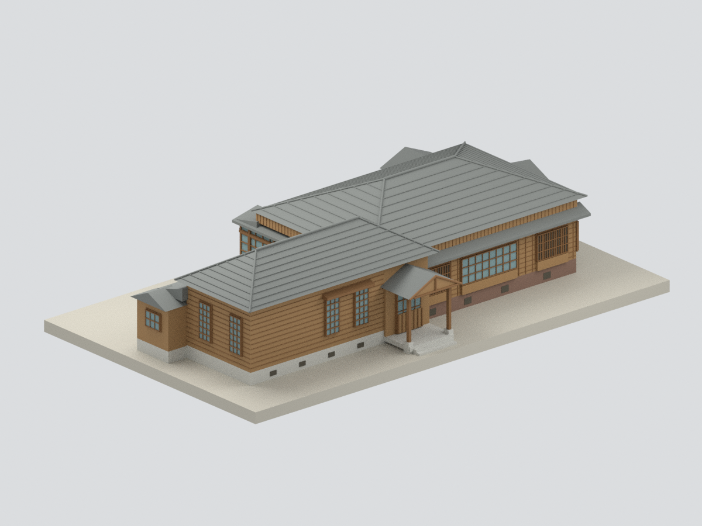
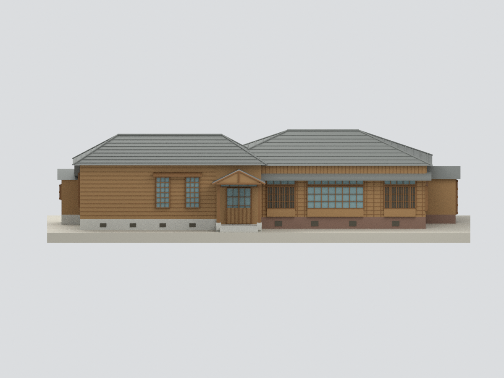
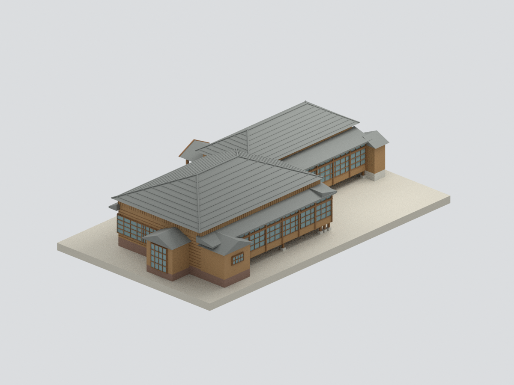
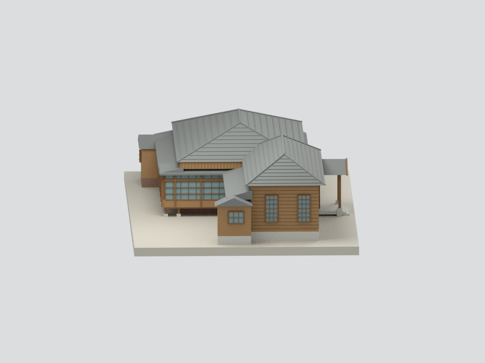
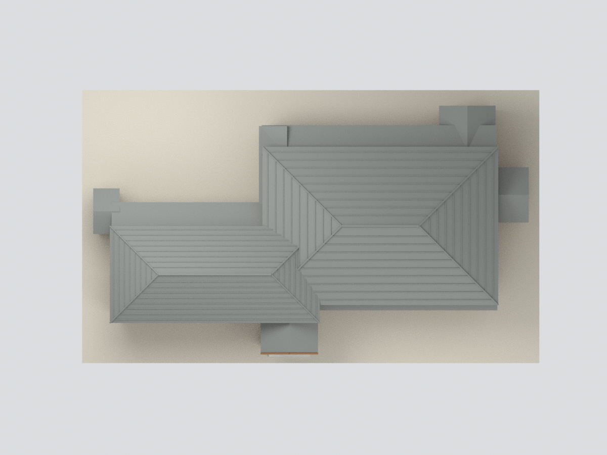
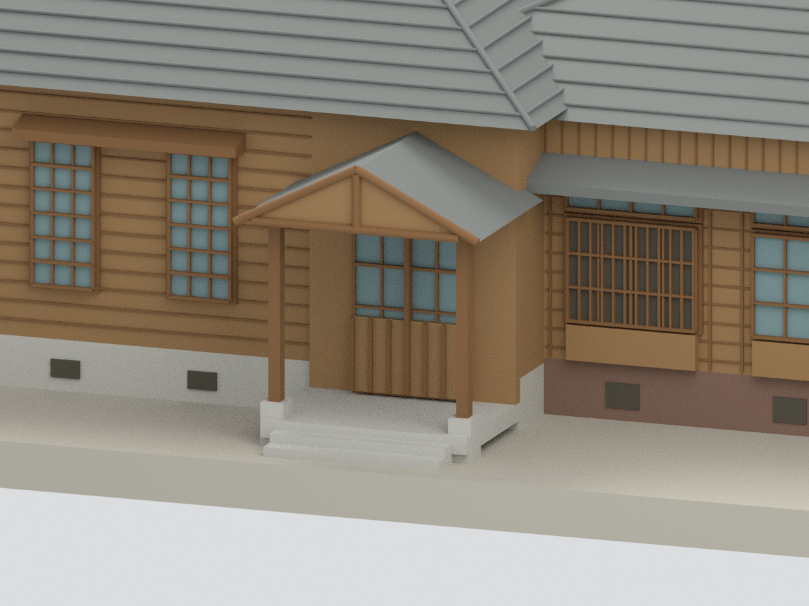

# 原臺中刑務所典獄官舍｜修後主體外觀近似研究模型

## 模型預覽

| 前側主體 | 主立面 | 後側（部分依圖推定） |
|---|---|---|
|  |  |  |
| 洋館端側 | 兩館屋頂與緣廊 | 主玄關局部 |
|  |  |  |

## 2. 範圍與證據界線

本包是**修後主體外觀近似研究**：以臺中市文化資產處2014調查報告的復原平面、屋頂圖、門窗表，交叉修後官方照片。**缺完整修後背立面照片，未拍到的後側與端側開口依圖表推定**，不是四面現況精確復原、竣工測繪或完整室內模型。

保留和館、洋館、兩個相接四坡頂、主玄關小切妻雨棚、低簷、側小突出部及架空緣廊。不含室內格間、家具、庭園樹木、圍牆或整個刑務所；亦不把另棟浴場合入。2014「現況」指調查時相，不等同今日現況；復原建議不一律視為已施作的證明。

## 3. 尺度與簡化

- 名義比例1:100。1940–1941歷史平面主立面基準總長讀作「拾壹間參尺」＝69尺，分段27＋9＋33尺；以日本尺10/33m換算約20.909m，作後來復原平面的**近似控制尺度**。此長度不含側後突出部、檐口或基地；不是修後外包實測值。
- 第三章屋架總寬和館767cm／洋館546cm，第四章結構跨度728cm／457cm，量測端點未證完全相同；僅交叉檢核比例，不直接當整棟外包。牆高、屋脊高度、檐口、柱腳及各窗位置仍有估讀。
- W1洋館長窗及W2和館格子窗參照門窗表與可見照片；未拍到的端面窗組及服務小屋細節屬圖表推定，不能當逐窗現場核對。
- 後側緣廊保留可見的架空木柱、石腳與低簷；玻璃採不透明薄背板，室內不重建，不能透視。薄窗框、格柵及瓦列作製造尺度粗化。
- 主屋頂為較粗瓦列與脊線；沒有逐片精製瓦片、鬼瓦、脊端飾、滴水瓦、雨樋或榫接。附屋屋面更簡化，不聲稱完整屋面細部。
- 木板接縫、磚縫、風化、文字與五金省略或粗化；木色／玻璃色未現場校色。模型底板是展示支撐，不是實際地形。
- **未試印**；數位水密不代表細柱、窗框與架空廊下已通過實體列印測試。

## 4. 檔案與重建

包含STL、材質3MF、帶隱藏可編輯構件的Blender場景、建模／渲染腳本、六視圖、來源與QA。參考原圖／PDF不隨公開模型包發布。幾何QA與外觀來源審核分開記錄。

## 下載與導覽

[STL](model.stl) · [3MF](model.3mf) · [Blender](scene.blend) · [重建](REBUILD.md) · [返回臺灣地標](../README.md)
