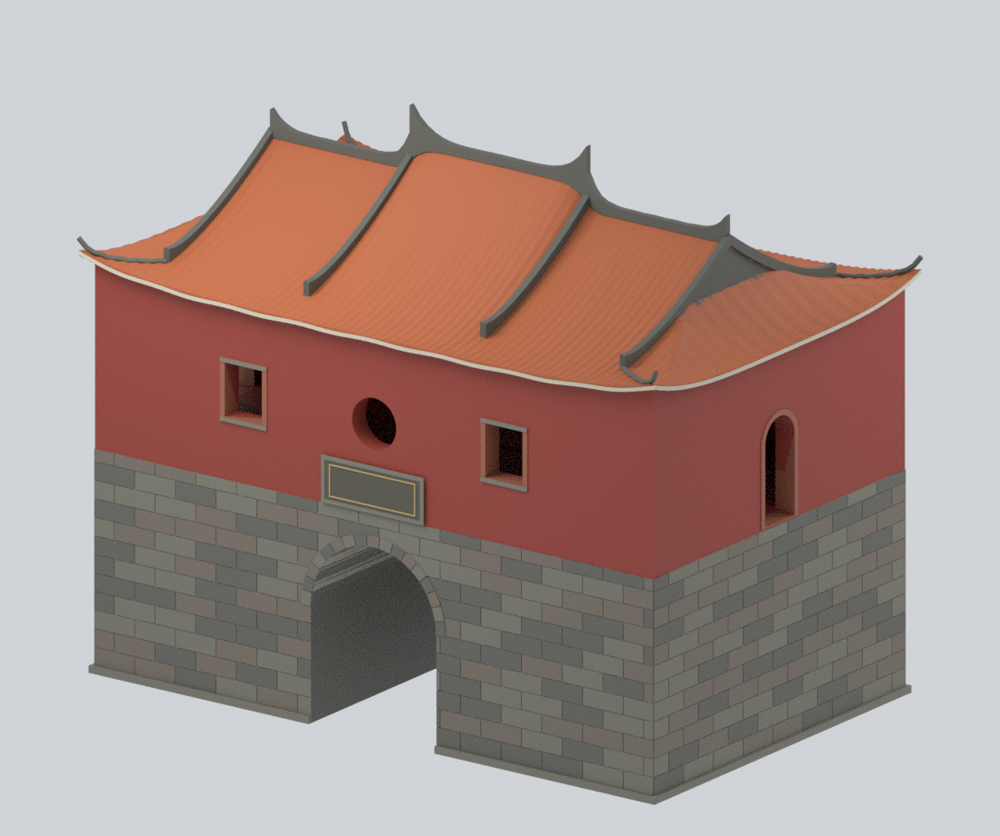
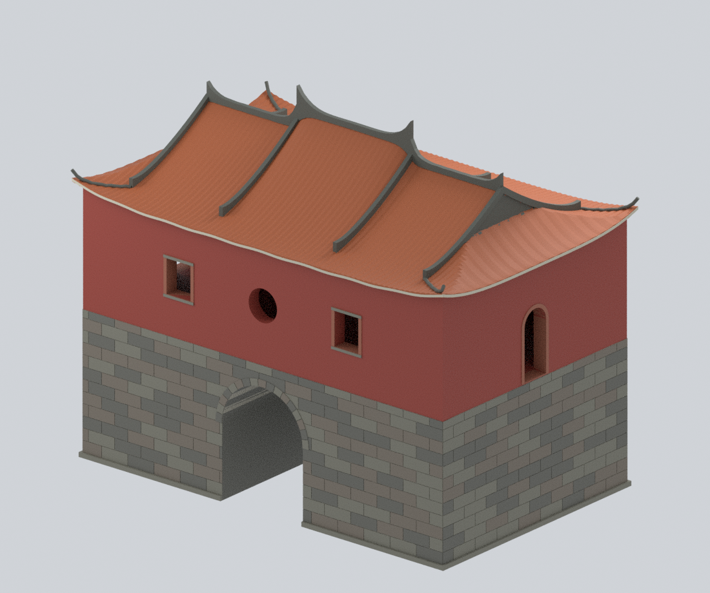
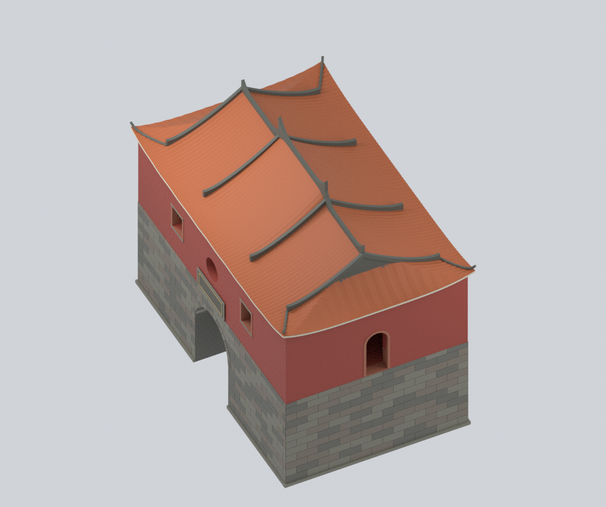
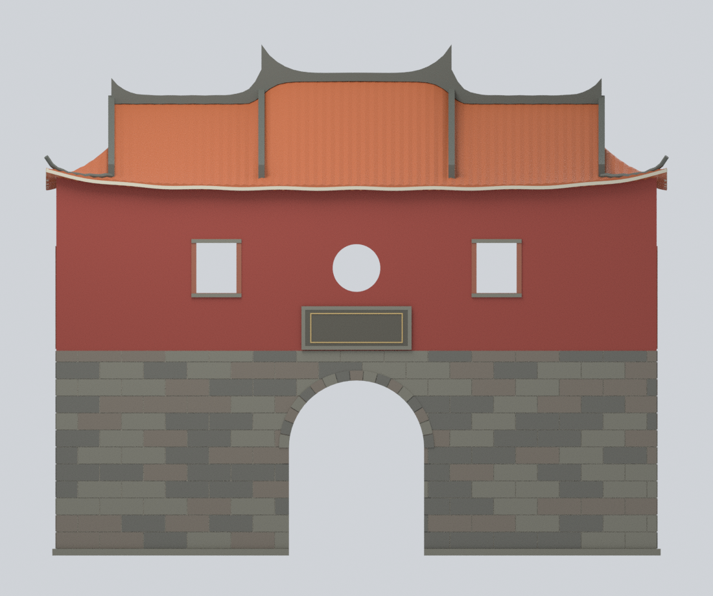
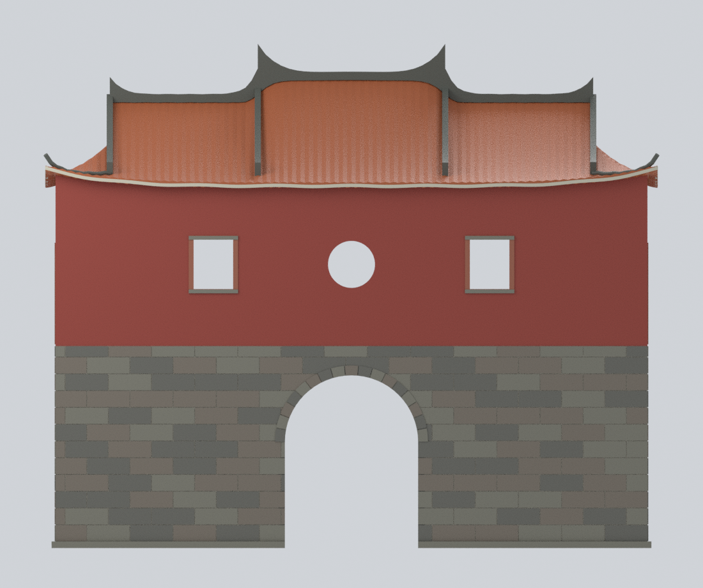
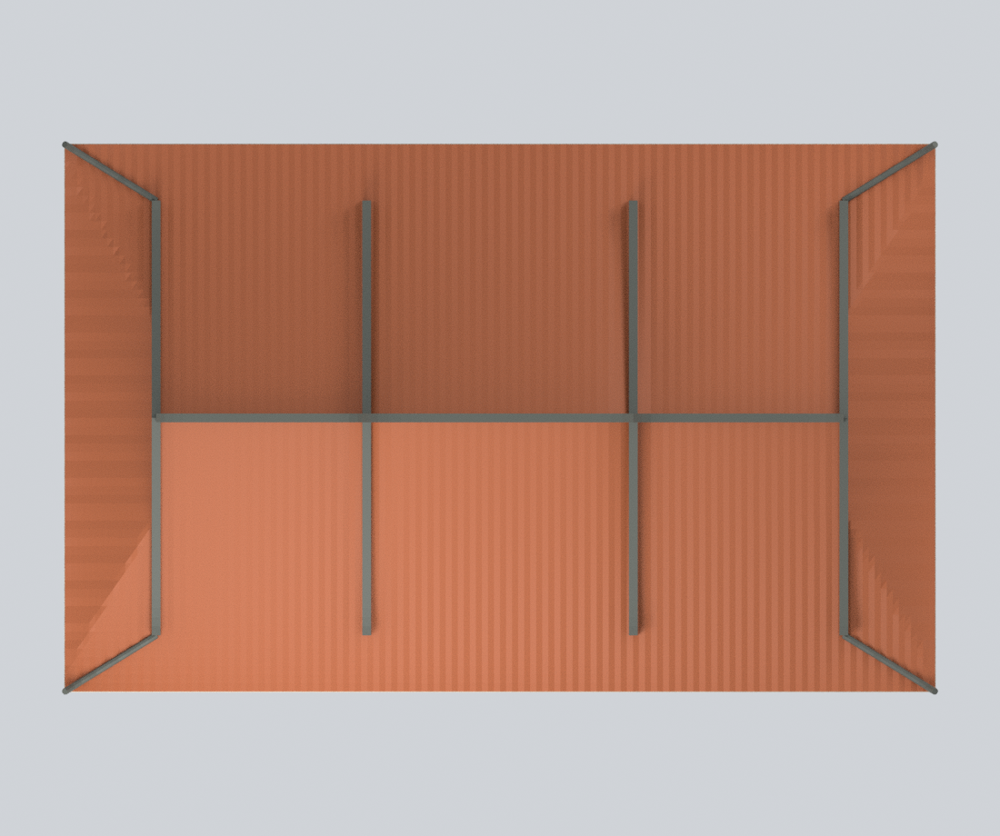
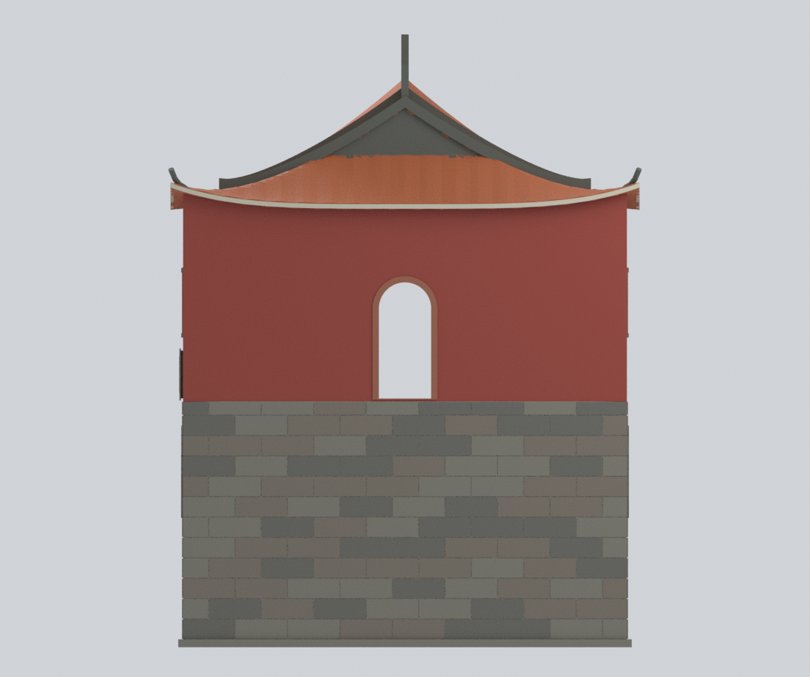
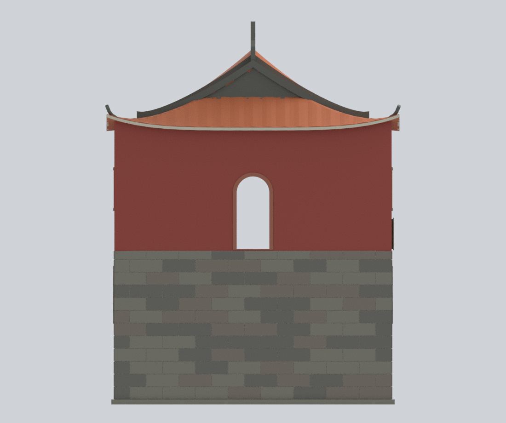
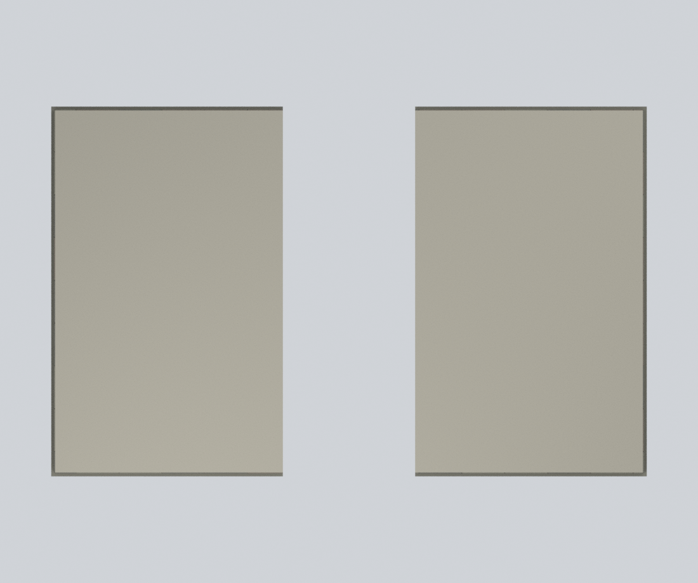

# 臺北府城北門／承恩門 — 完整外觀近似模型

**One complete Taipei North Gate, not a roof fragment or a city-wall reconstruction.** This is a source-bounded historical exterior associated with the published 2017–2022 source family, **not a measured capture-year reconstruction or 2026 as-built**. Photo dates are uncertain: the PTS article was published in 2017 but modified in 2025; image insertion dates and the portal photo date are unknown.

## Nine actual mesh views / 九張實際模型預覽

| Front oblique / 正面斜視 | Reverse oblique / 背面斜視 | Roof joins / 屋頂斜視 |
|---|---|---|
|  |  |  |
| Plaque face / 匾額面 | Reverse face / 無匾額面 | Roof plan / 屋頂平面 |
|  |  |  |
| F02/F04 same end / 同一短向面 | P01/G04 other end / 另一短向面 | Actual passage section / 門洞水平剖面 |
|  |  |  |

All views are rendered from the actual delivered geometry. The last image is an explicitly labelled exact Boolean cut at model Z=30 mm, revealing the real passage; it is not a substitute building or a surveyed plan. Other views show the complete model. No source-photo pixels appear here.

## What is preserved

- Whole rectangular stone lower body, low plinth, four upper faces and all roof-to-wall joins.
- A genuinely open arched barrel passage, not a dark patch or blocked opening.
- Square–round–square openings on both long sides; tall arched openings on both short sides. **F02 and F04 show the same short end**. P01 page 8, G04 and A01 ground the other end.
- **One continuous tiled roof envelope**, with three longitudinal ridge-height spans, two intermediate descending bands on both slopes, terminal upper gables, lower hipped returns and diagonal joins. No detached miniature roofs or invented hidden roof framing.
- Distinct stone, plaster, brick reveals, terracotta, grey roof bands, pale eave trim and front-only plaque field. Colors and masonry/tile rhythm are authored approximations, not calibrated samples. The plaque inscription and fine carving are not reconstructed.

## Files and editing

- `taipei-north-gate-whole-2017-2022.blend`: native editable Blender scene. The visible unified colored mesh is the exact exported model. The hidden **EDITABLE authored components** collection retains individually named pre-union components and evidence tags. Enable the collection and disable the final mesh for component edits. Components intentionally overlap before union; re-exporting edits requires a fresh union/QA pass.
- `.stl`: single connected oriented watertight printable-surface mesh, **without color**.
- `.3mf`: the same geometry, millimetre units, eleven per-triangle base-material colors; strict native-library read and roundtrip verified.
- `build_model.py`, `parameters.json`, construction arrays and QA scripts: public-only reproducible inputs, with no photographs or network dependency.
- `sources.json`, `evidence-map.json`, `RIGHTS-AND-RESPONSIBILITY.md`: provenance, source-relative faces and limitations.

Units are **normalized model millimetres**, not an architectural scale. Overall size is approximately 249.73 × 157.78 × 204.45 mm. Wall/roof thickness and the empty upper cavity are technical display-model construction, not an interior/structural survey. Exact dimensions, small occluded seams, tile count, ornamental carving and hidden joinery are unresolved.

## Rebuild without private sources

Requires Python 3.11+, dependencies in `requirements-model.txt`, and Blender 4.3.2. The geometry environment needs NumPy, trimesh, manifold3d, shapely, rtree and Pillow. The exporter also needs lib3mf 2.5.0; it may use a separate Python interpreter.

```sh
python -m venv .venv
.venv/bin/pip install -r requirements-model.txt
.venv/bin/python reproduce.py --out rebuilt --blender blender
# If lib3mf lives in a separate runtime:
.venv/bin/python reproduce.py --out rebuilt --blender blender --export-python /path/to/lib3mf/python
.venv/bin/python verify_reproducibility.py --out . --blender blender --export-python /path/to/lib3mf/python
```

The complete path executes actual geometry, strict colored export, topology/orientation, full triangle-intersection scan and negative controls, passage/window rays, roof coverage/profiles, nine renders, saved-scene render, native component edit/save/reopen, full recursive SDNA buffer privacy audit and PNG metadata audit. `--skip-slow-checks` is a development convenience only, not equivalent to the complete QA run. The clean public-only rebuild compares geometry arrays/STL and all nine PNG bytes/pixels; `.blend` and ZIP timestamps are not claimed byte-deterministic.

No broad welding or tolerance loosening hides failures: a possible zero-area float32 sliver is removed only by collapsing its shortest edge within 0.004 mm, followed by the unchanged strict topology and full intersection checks. Model-specific QA reports record the actual result.

## Manufacturing and rights limits

Watertight geometry does **not** certify physical printability. Fine tile ribs, eave/ridge tips, plaque trim, overhangs and upper window reveals require printer-specific support, scale, orientation and material decisions. Slice screens are geometry checks, not toolpaths or a global minimum-thickness proof. No physical print was tested.

Reference media remain privately held and separately credited; their availability is **not an open-image license**. This package does not grant third-party architectural/design rights, commercial permissions or publication clearance. No source-photo textures, copied calligraphy, temporary DORTS shoring, reconstructed city walls, plaza landscaping or current-condition claim is included. See the rights document before reuse.
