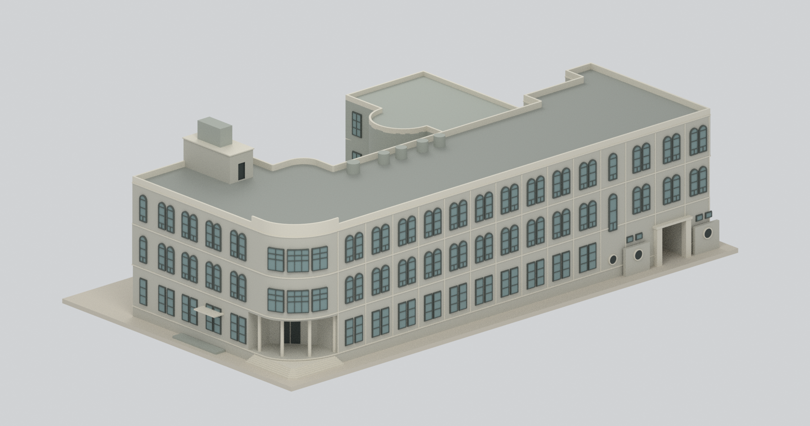
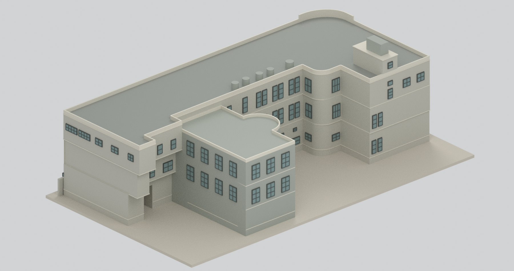
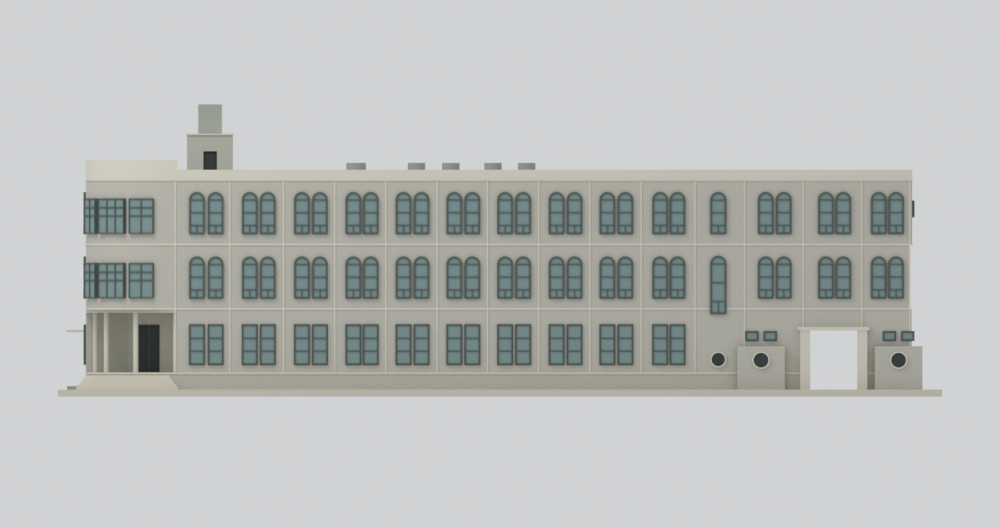
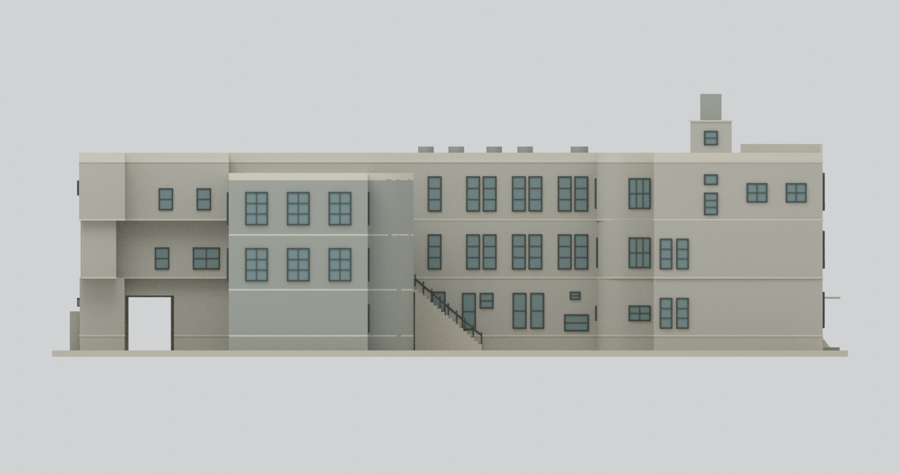
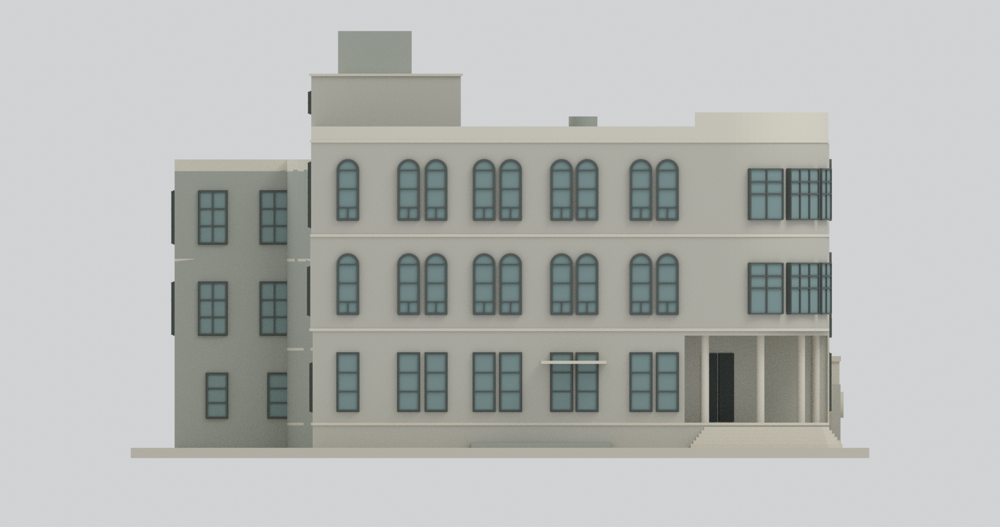
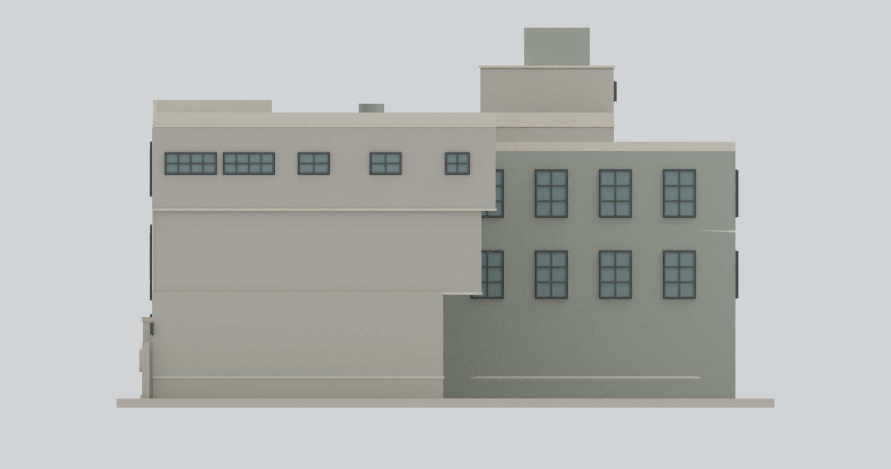
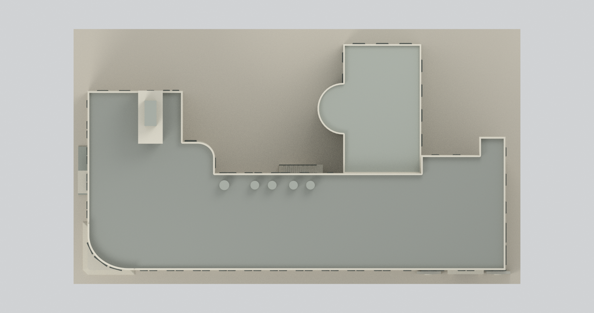
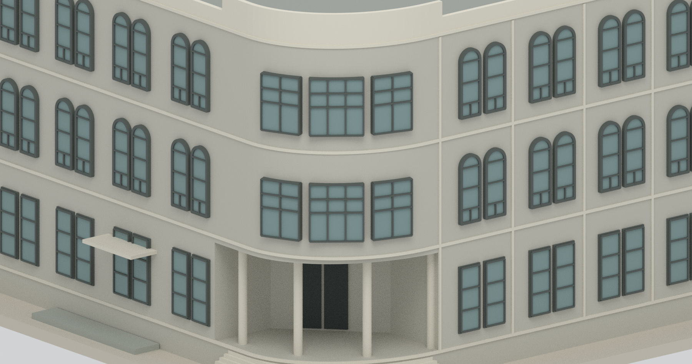
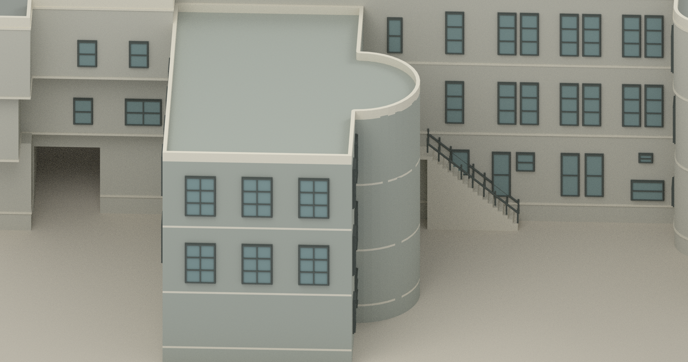

# 原臺北北警察署｜2001年調查三層外觀研究

## 模型預覽

| 正前整體斜視 | 後方整體斜視 | 正立面 |
|---|---|---|
|  |  |  |
| 背立面 | 左側立面 | 右側立面 |
|  |  |  |
| 全屋頂俯視 | 圓角入口局部（刻意裁切） | 後翼局部（刻意裁切） |
|  |  |  |

## 時期、範圍與重要排除

依臺北市官方《原臺北北警察署調查研究》**2001年7月 B 系列現況平面與四外立面**，表現調查時三層主館、後方三層矩形／半圓翼、永久樓梯屋突及水箱。不是1933年原建二層復原，也不是今日修復後外觀。第三層增建確切年份未在本次獨立確認，不另捏造。

**本包是「主要永久外觀」研究，不包含完整調查附物：屋頂臨時堆物棚的平面雖有記錄，但222頁剖面層位與三層外立面不一致，棚高與殼體未能可靠對應，故明確排除。** 未把棚直接疊到14.98m屋頂造出假第四層，亦未採後續A修復提案補齊。旁側屋頂小附房高度未明，沒有全部拉到樓梯屋突高度。

包含兩面不同的成對拱窗、圓角共享窗帶、入口柱廊與盲背門面、末端開放車道、後翼不同高程和半圓外殼，另保留主樓背面可見外露梯與平台。外梯18階、1.30m寬及欄杆為圖面輪廓代理，不是逐階實測。不是完整室內、拘留室扇形隔間、樓梯或承重結構模型；後翼一樓大部分盲牆不等於所有方向無窗，西側兩個外窗另保留。

## 尺寸與不一致資料

- 各樓層平面以其自身 **6028cm軸鏈**校正；描出的主體長約58.86m。正立面另標5905cm，端點與軸鏈不同，約0.19m差異保留為掃描／描線及投影外緣差，不強拉各面造成閉合矛盾。
- 主館 GL→1FL=1.18m，三段層高各4.60m，主RFL=14.98m。一般女兒牆+0.71m；圓角局部+1.40m，並非全屋頂都加高。
- 永久樓梯屋突約3.27×7.29m、頂18.27m；頂部水箱約1.69×3.59m，最高20.35m。屋突位置按屋頂圖估讀後對齊主左翼後緣25.20m：模型y17.91–25.20m、水箱中心y22.10m；相對另一屋頂圖粗讀約前移0.8m，位置約±1m代理，非印字座標。附加五小水箱的高度1.20m只是展示代理。
- **後翼採216頁：2FL=4.83m、3FL=9.18m、屋頂13.58m；217頁另有4.38／8.98／13.38m異文。** 屋頂約±0.20m、二樓約0.45m差異沒有被平均或抹除；不宣稱精密測繪復原。
- 後半圓投影3.65m、跨度7.36m；外牆描線與結構軸尺寸分開。平面曲線、框線、窄回折及屋頂配置約±3%或更高不確定度。
- 內部車道描線寬約3.85m；街門另為3.35m淨寬、兩側各0.72m墩，兩者不是同一端點。未將圖中的X門扇線當玻璃窗。

名義**1:250**，2mm作者展示底座，非測繪地形。總模型外框及數位體積見[幾何摘要](build-summary.json)。實心外觀模型有細框、懸挑與柱廊；**未物理試印，不保證可直接列印，也不表示結構安全。**

## 細部簡化與未知

- 正面十組成對窗＋單樓梯窗＋末三組上層成對窗；左側是自己的四組＋單窗，不鏡像正面。右側主體低兩層大致盲牆、頂層五窗。
- 圓角W11只建立一組跨曲面的2／3／2欄窗帶，不把正、側投影重複建成兩份；總高2.46m，下格較高。拱窗為兩個獨立窗孔代理，中央牆柱保留。
- 窗、圓孔及門為不透明／盲背展示面；框格、深度和曲面切線分段有加粗簡化。不能據此聲稱原裝木框；調查註有鋁框替換及冷氣遮擋。
- 後立面分到不同深度的實際牆面，不壓成一片平牆。窄回折的遮擋面沒有憑空補獨立建物。
- 屋頂暫棚、未知高度附房、管線、冷氣機、雜物、細部病害、招牌文字與完整材料紋理未重建。配色為未校色中性展示代理。
- 左側坡道只保留概略平台位置，未復原可用坡度，不是無障礙規範模型。

## 檔案與查核

[STL](model.stl) · [彩色3MF](model.3mf) · [Blender場景](scene.blend) · [可重建腳本](build_model.py) · [重建說明](REBUILD.md) · [來源與勘誤](SOURCES.md)

驗證狀態以[網格QA](QA.json)、[場景QA](BLEND-QA.json)、[獨立審查](review/)及[乾淨重建](REBUILD-QA.json)為準。封閉連通僅是數位模型條件，不是史實全復原或可印認證。公開包不含原PDF、原照片、裁圖、私人資料或外部貼圖。
