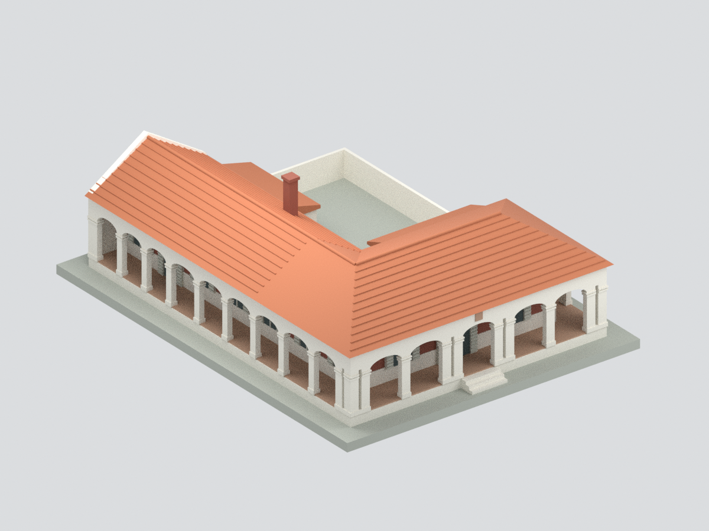
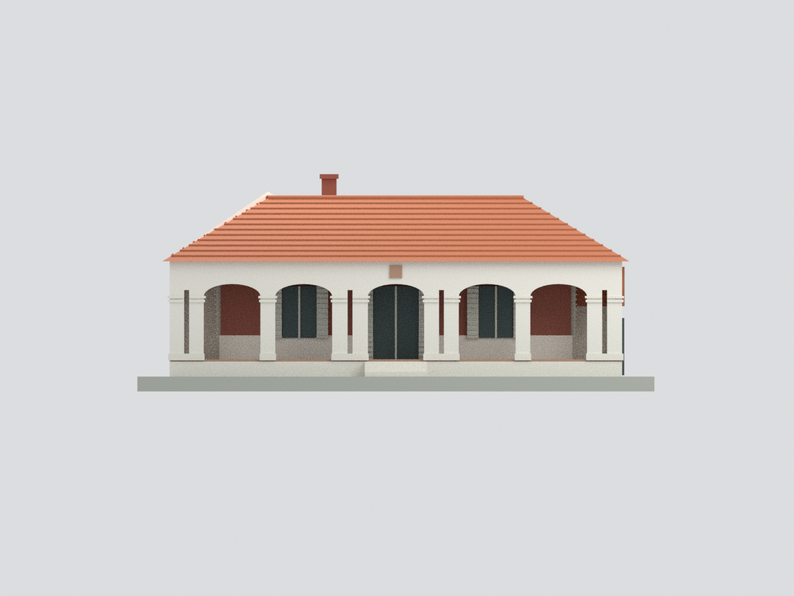
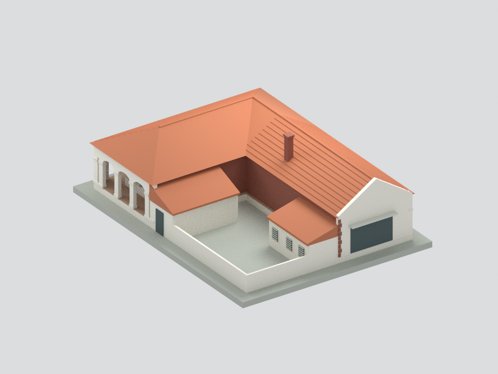
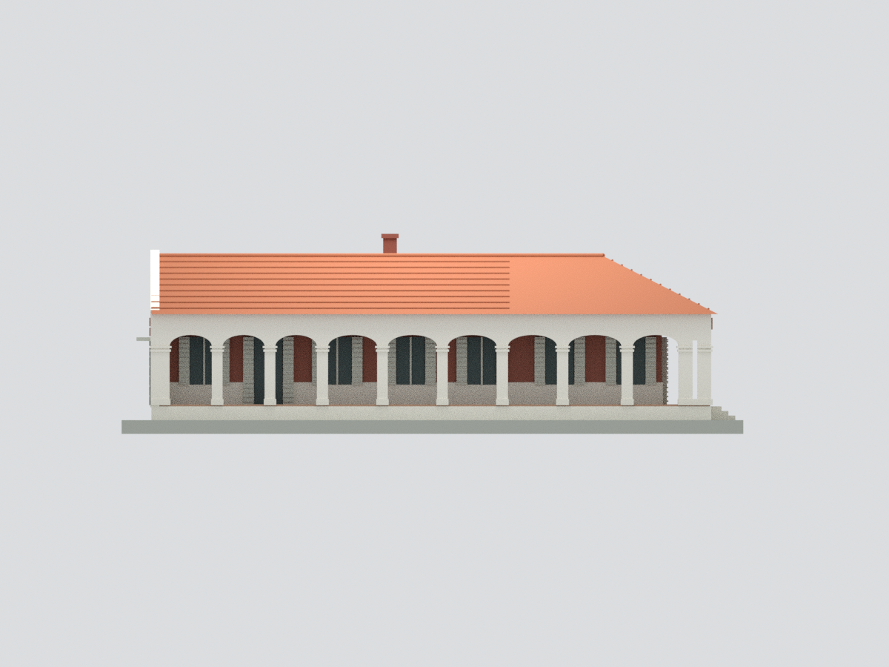
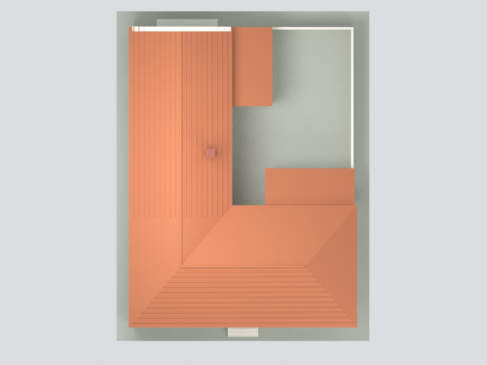
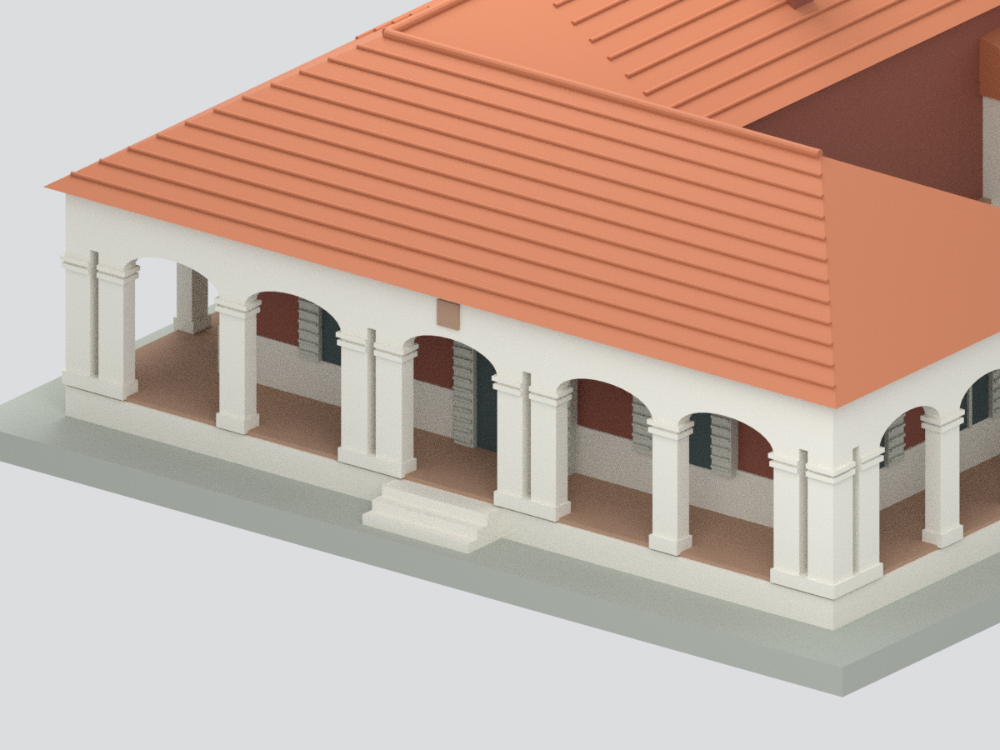

# 打狗英國領事館山下辦公室｜現存本體外觀研究模型

## 模型預覽

| 斜前方 | 正面 | 斜後方 |
|---|---|---|
|  |  |  |
| 長側面 | 俯視 | 入口細節 |
|  |  |  |

以上均為實際模型網格渲染，非建築照片。入口圖刻意局部取景。

## 模型對象與範圍

高雄哨船頭海濱的**打狗英國領事館山下辦公室**（歷史上亦作高雄州水產試驗場），**不是山上紅磚官邸，也不是淡水領事官邸**。以2008年高雄市政府委託調查報告、官方修復後照片及2019年訪客實照交叉核對。

保留現存L形辦公本體、三面可穿透拱廊、雙柱狹縫及雙道柱頭線腳、屋頂交接、白色百葉窗、院內低服務房、煙囪與北端殘留山牆。未把2008復原提案中已拆除的北側牢房重新蓋回；亦不包括黑玻璃考古展示平台、完整基地圍牆/庭園、人物展品、山上官邸、登山古道。

## 尺度與忠實度限制

- 正面分段按報告圖4-16讀值，合計約18.16m；長側約24.4m、短側約9.617m。柱高參照報告2.564m。正面首柱136.7cm及中央右柱138.7cm已用高解析原圖複核。這是**來源尺寸校準的簡化模型，不是竣工實測BIM**。
- 圖4-16分段尺寸和p34正文的字母表有不一致，採圖面實際數字，保留讀圖/四捨五入誤差，不將不一致隱藏為精確測量。
- 低服務房、院牆及屋頂交接由平面/立面估讀；屋頂高度、煙囪位置/尺寸、山牆缺損邊界、北端入口寬度/雨遮投影、服務房窗位、百葉窗開啟角度皆有近似。室內隔間、家具與地下遺構未建。
- 瓦面僅作粗瓦列/屋脊提示，未逐片還原瓦片；紅磚縫、石材肌理、百葉細槽、精細柱角斜切未逐一建出；正面徽章以素色小牌代替，未虛構紋章圖樣。
- 2008報告是修復前調查及多方案建議，不是2013竣工圖。模型採修復後照片所支持的輪廓，不宣稱完整代表2026最新現況。

## 檔案與列印

`model.stl`、含7色材料的`model.3mf`、`scene.blend`、完整作者重建腳本與六視圖。Blender另保留隱藏可編輯作者元件，不含外部照片材質。模型約1:125（8mm/來源公尺），含作者展示底座約166.08×216.8×69.76mm；底座不是真實地形。

拱廊為真實開孔，窗玻璃是實體不透明色塊。屋檐、弧拱、窗百葉可能需支撐，細節已部分加粗，但**未試印、未做完整切片器/最薄壁厚驗證**。水密/單連通/格式QA通過不等於所有機器可直接列印或史料復原無誤。

來源見`SOURCES.md`、`sources.json`；檢查見`QA.json`、`BLEND-QA.json`及重建/視覺審核檔。第三方參考原圖與原始PDF不隨公開包重發。

## 下載與導覽

[STL](model.stl) · [3MF](model.3mf) · [Blender](scene.blend) · [重建](REBUILD.md) · [返回臺灣地標](../README.md)
