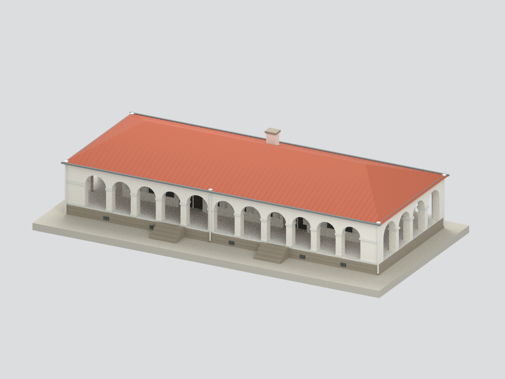
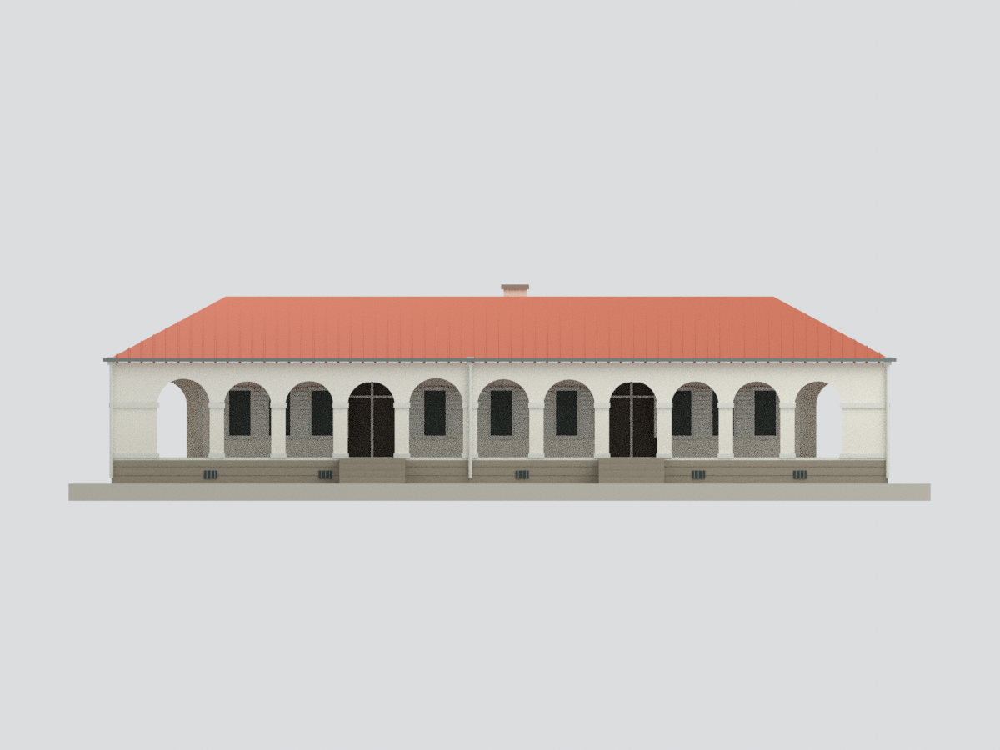
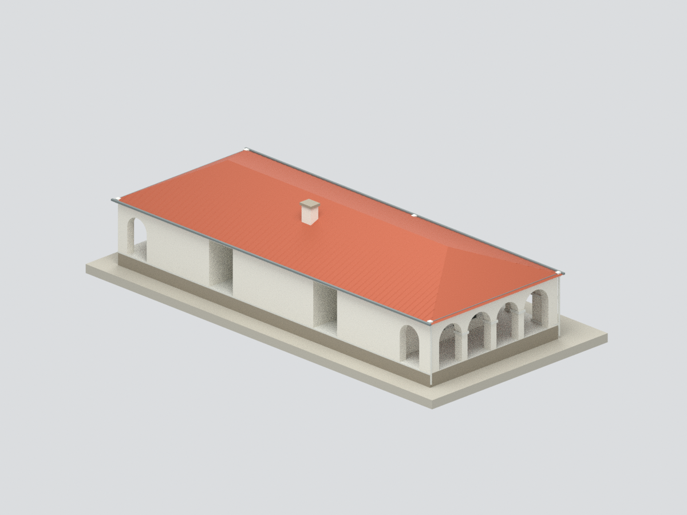
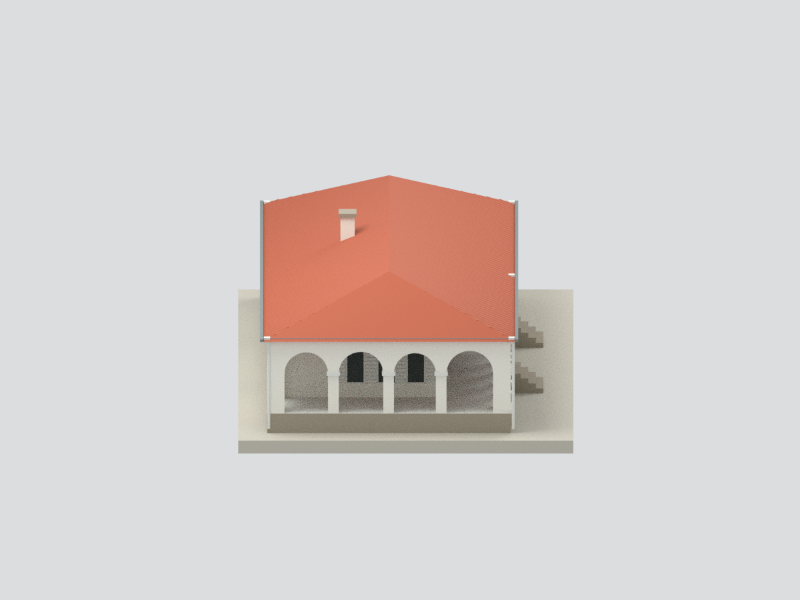
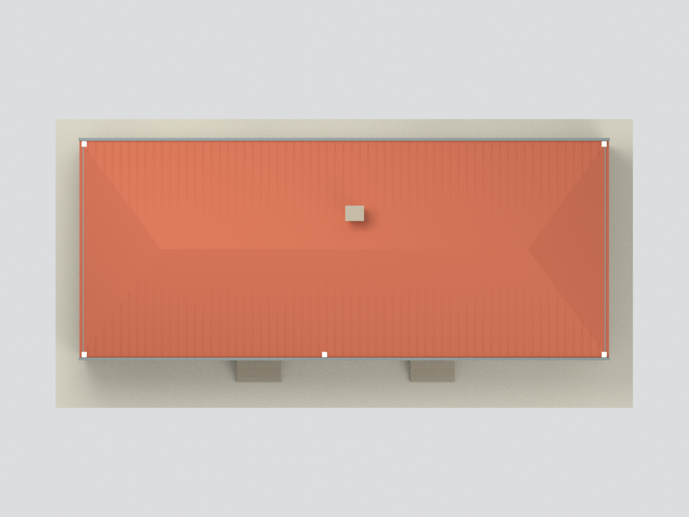
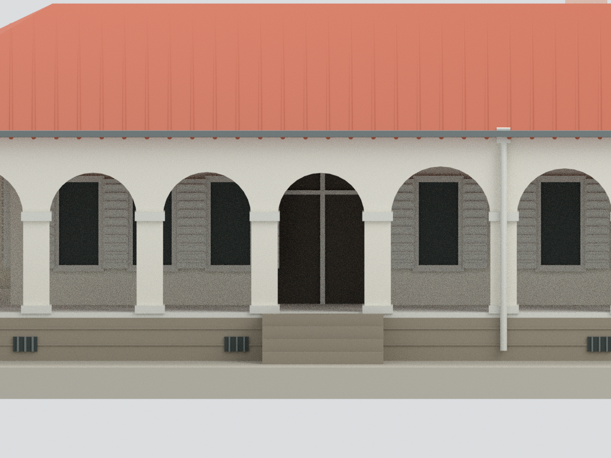

# 淡水小白宮（前清淡水關稅務司官邸）｜主體與三面拱廊研究模型

## 模型預覽

| 主體正側 | 正立面 | 後側與附屋截界 |
|---|---|---|
|  |  |  |
| 側廊 | 屋頂俯視 | 正面入口細節 |
|  |  |  |

## 範圍與依據

只包含小白宮主要長方形本體、正面11拱及東西各4拱的三面迴廊、來源可見背端拱口與主屋頂。**後方低屋頂附屬空間確實存在，但本包不重建；主體後方中段是模型截止面，不代表現場完整獨立外牆。** 不是全棟、全園區或歷史原貌復原，沒有內部展場、花園、另一座附屬小屋。

以博物館官方展間平面、文化部文資實照及市府觀光實照校核。平面中附屋輪廓與不同年代照片不能直接拼成今日全棟。沒有把插畫當實景或測繪圖。

## 尺度與交付

官方明標的是三展間室內寬4.40／7.00／4.40m、深6.72m與室內天花3.35m。原圖各區像素比例不完全一致，x方向分段校正、y方向依6.72m校估；主體外包約27.17×10.98m、牆厚與廊寬仍為圖面估讀，不是外包實測尺寸。

基座高約0.90m、拱起拱點距地板約1.85m、主屋脊距展示地面約6.55m與煙囪高度／位置是照片比例估值。天花3.35m從室內地板算起，**不是整棟或屋脊高度**。

約1:200（估讀1m→5mm）；一體STL、含材質3MF、Blender場景與Python可重建腳本。自訂底座僅為展示支承，非現地地形或基地。原始照片和PDF不公開附入。

## 明確簡化與未知

本體房間採不透明外觀代理，兩條入口通道與退入門扇僅為展示，不重建實際室內空間。玻璃不透明；白百葉窗以粗框與加粗橫片近似，未逐片還原葉片角度／五金。窗門高度、開啟姿態、窗距與背面被附屋遮蔽處不是完整測量。

四坡橘瓦屋頂有粗化縱向瓦壟，不是逐片真瓦。屋脊、屋角瓦、端部坡面細壟、排水彎管、煙道與內部木屋架未完整重建；煙囪按照片可見量體估位，不聲稱歷史精確位置。柱頭腳座模線改用粗方帶，拱厚與曲線分段近似。石基只以少量橫縫與通風格示意，未逐塊複製。告示、監視設備、燈具、植物、銹蝕、風化、電線及文字省略，顏色未校色。

## QA 與列印

六張圖使用同一交付網格；幾何／格式、Blender重開、隔離重建與獨立審核另列QA文件。水密／單連通不等於可直接列印成功。細瓦壟、拱頂懸空、百葉窗及雨管需依設備材料檢查支撐、壁厚與方向。**未實際試印。**

## 下載與導覽

[STL](model.stl) · [3MF](model.3mf) · [Blender](scene.blend) · [重建](REBUILD.md) · [返回臺灣地標](../README.md)
