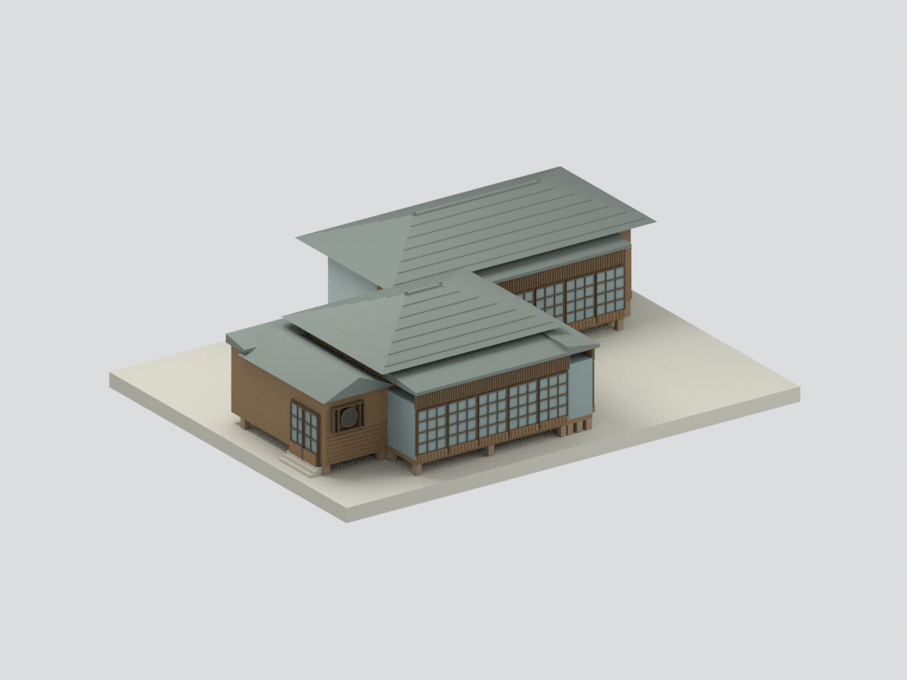
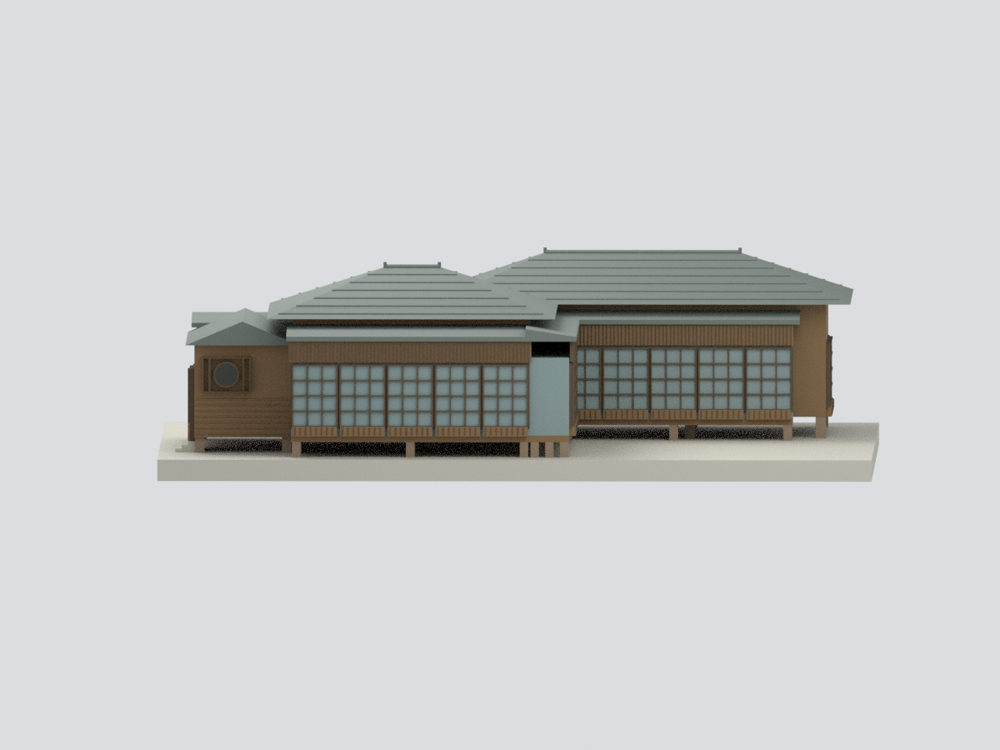
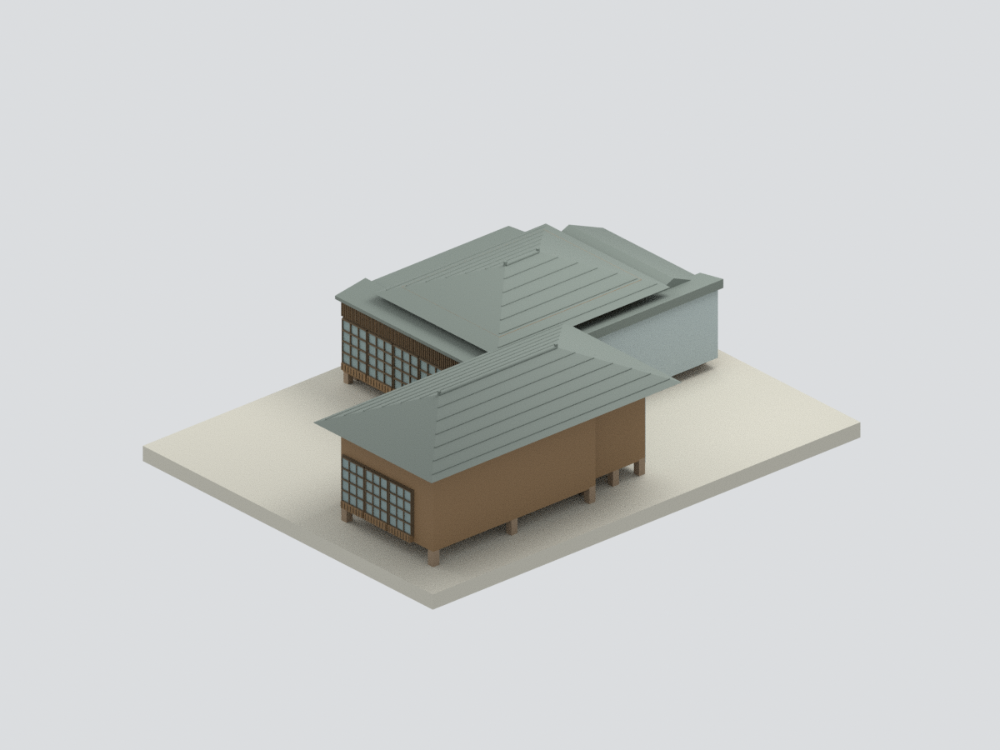
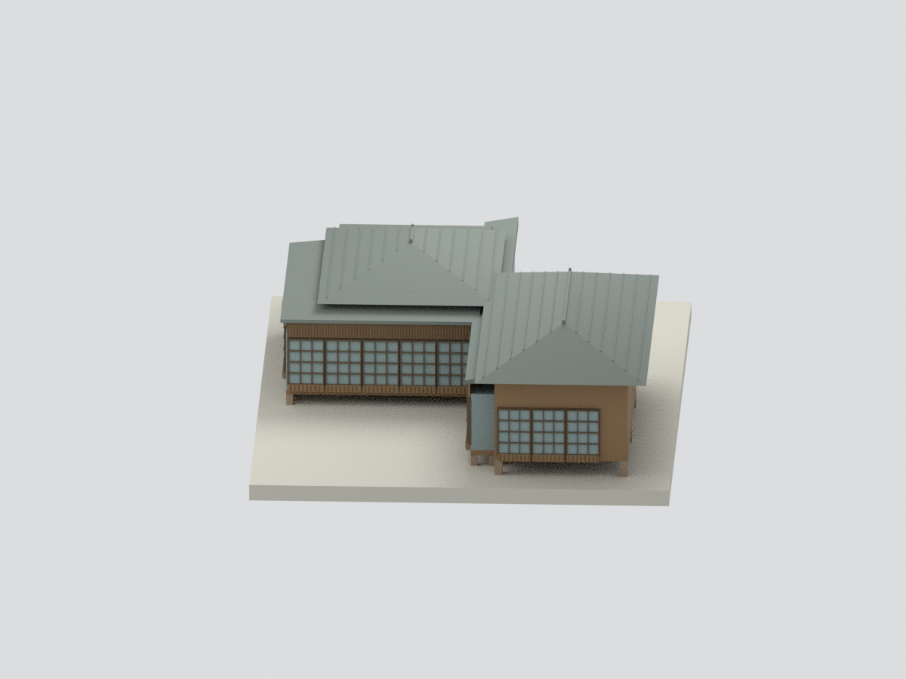
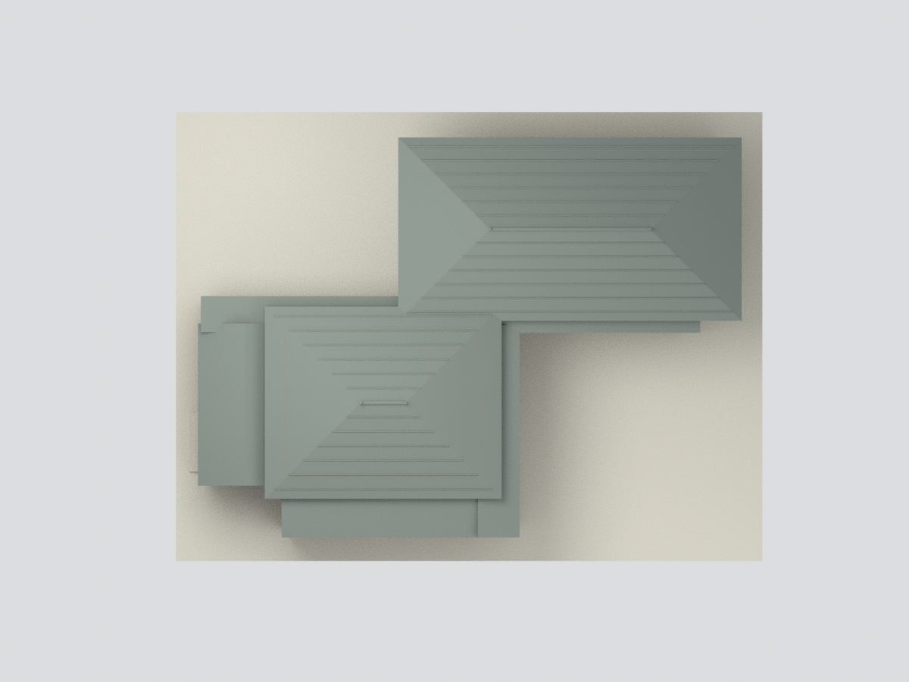
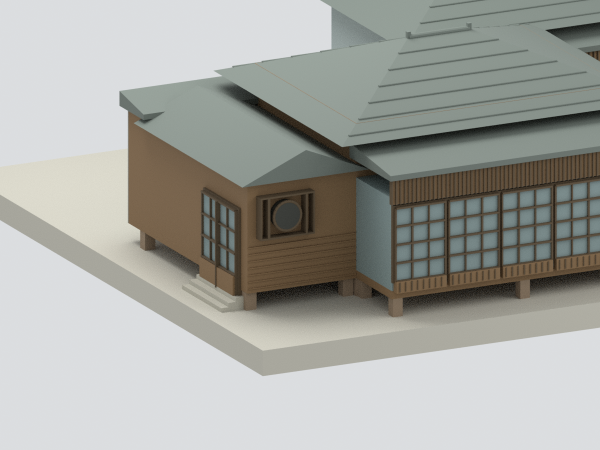
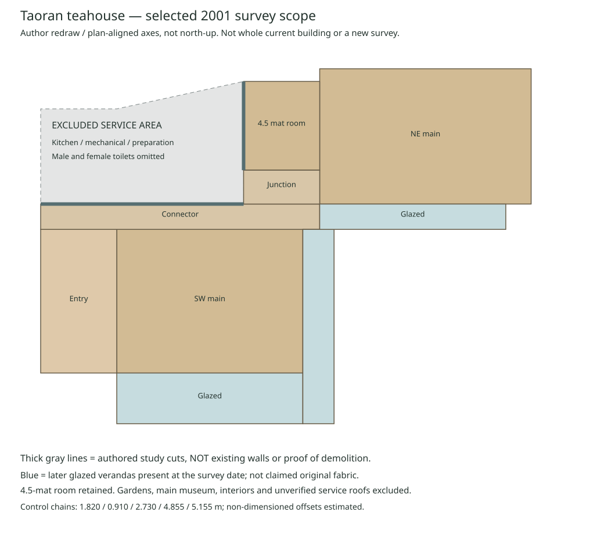

# 陶然居茶藝館｜2001調查雙翼與玄關截取外觀研究

## 模型預覽

**本包只呈現2001調查期的陶然居雙翼、玄關、4.5疊房與當時已存在的玻璃加廊。西北廚房、機械室、準備室、男女廁及庭園不在模型範圍；不是修復後全棟現況，也不是北投文物館主館。** 灰色截面是人工研究封口，不能視為歷史外牆或證明附屋已拆。

| 斜前全景（限定範圍） | 南側全景（限定範圍） | 後側／灰截界（限定範圍） |
|---|---|---|
|  |  |  |
| 東側全景（限定範圍） | 頂視／雙翼錯位（限定範圍） | 入口細節（刻意局部） |
|  |  |  |

## 2. 研究邊界

- 雙翼四坡主屋、玄關、4.5疊房及調查時玻璃加廊保留；加廊不冒稱創建原貌。
- 西北廚房、機械室、準備室、男廁、女廁外殼與屋頂證據不足，排除並於接口使用灰色研究截面；不是認定它們不存在或已拆。
- 圖與場景採平面對齊座標；原北箭頭與紙面垂直軸有夾角，不能用畫面上下等同正北正南。

## 3. 來源與尺寸

主要依據臺北市文化局2001年調查報告的PDF191–197測繪圖與108–109外牆實照／位置圖。191有毫米尺寸鏈與0–5m比例尺；193、194為南／東立面，195為剖面；196是玄關展開，197是空調機房區展開，不能一概視為正門外觀。詳見 [來源](SOURCES.md) 和 [參數證據](parameters-evidence.json)。

名義比例1:100（1m→10mm），4855mm深度、5155mm主體深度與常見910/1820/2730mm模矩用於控制。5045.14mm為剖面標示主脊參考高，不含脊端裝飾頂；975.14mm只是指定屋架節點差，沒有直接當成屋頂總升高。未標尺寸的錯位、接屋與屋坡仍屬掃描估讀。

## 4. 明確簡化與未知

- 單一調查時期，不把2008後修復照片、現代門窗或園區改造混入。
- 屋面使用粗瓦列與簡化脊飾；瓦片凹凸、細脊紋、雨樋、構架接頭未逐一還原。入口小屋頂與低加廊坡及端部接合為圖面估配。
- 木窗以粗格網、下木板與直條遮帶表現；無透明內部、家具或完整牆內構造。原圖黑白，色彩為示意，不能當歷史配色證據。
- 4.5疊房保留，但面向排除服務區的一側是灰色研究封口；未有充分證據的背面門窗不虛構鏡射。
- 地形庭園、池水與獨立主館均未建；平底展示座為作者支撐。部分窗框與屋瓦加粗，未實際試印。

## 5. 檔案與重建

- `model.stl`：統一實體幾何，毫米；`model.3mf`：同點面與材料。
- `scene.blend`：可見統一mesh與隱藏可編輯作者構件，不含第三方參考原圖。
- `build_model.py`、`render_model.py`、`validate_model.py`、`verify_scene.py`；`mesh-data.npz`、兩份parts JSON及QA記錄。
- [重建方式](REBUILD.md)、[數位幾何QA](QA.json)。幾何通過不等於歷史全貌或實體列印通過。

低加廊外／內棚緣約3.40／3.62m、遮帶2.68–3.28m是依立面比例估配；入口圓窗保留矩形周格，木板僅作粗水平線，不逐片還原板寬與接縫。

## 下載與導覽

[STL](model.stl) · [3MF](model.3mf) · [Blender](scene.blend) · [重建](REBUILD.md) · [返回臺灣地標](../README.md)
