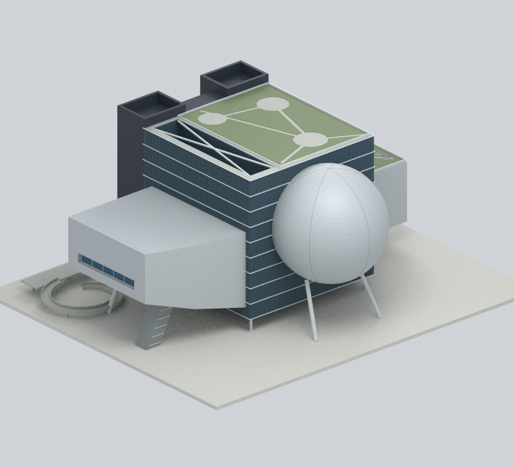
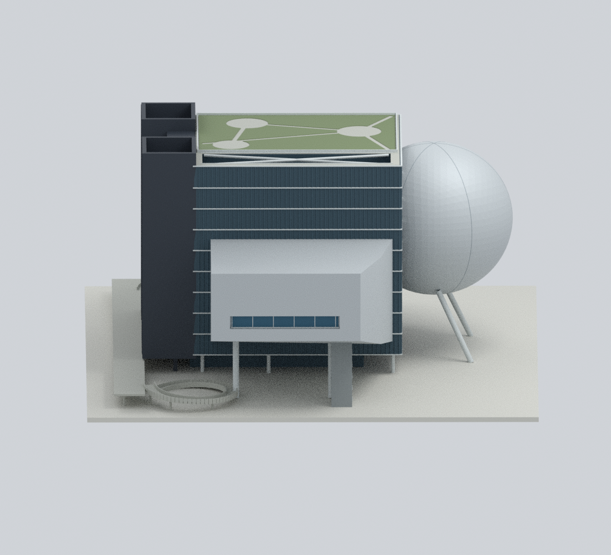
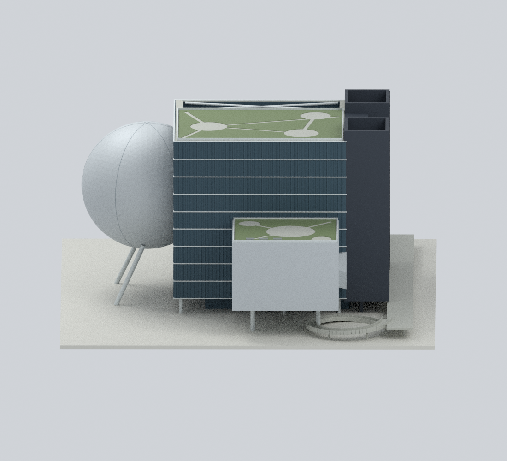
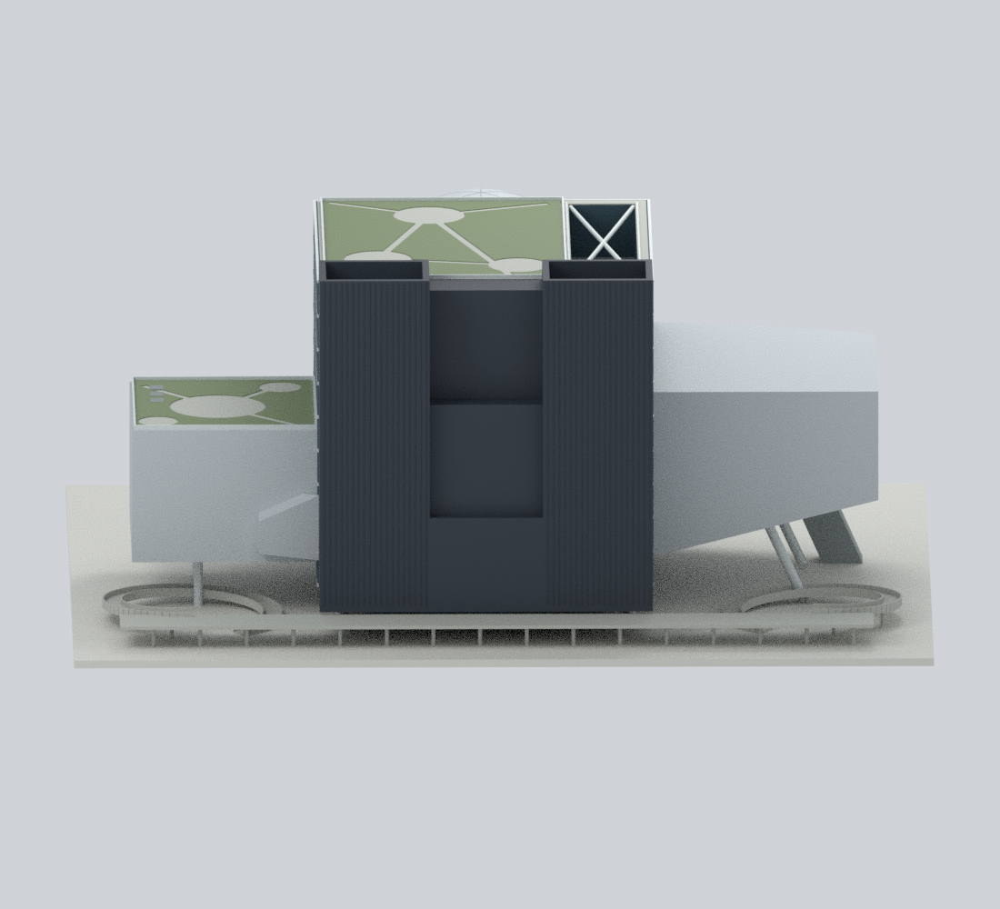
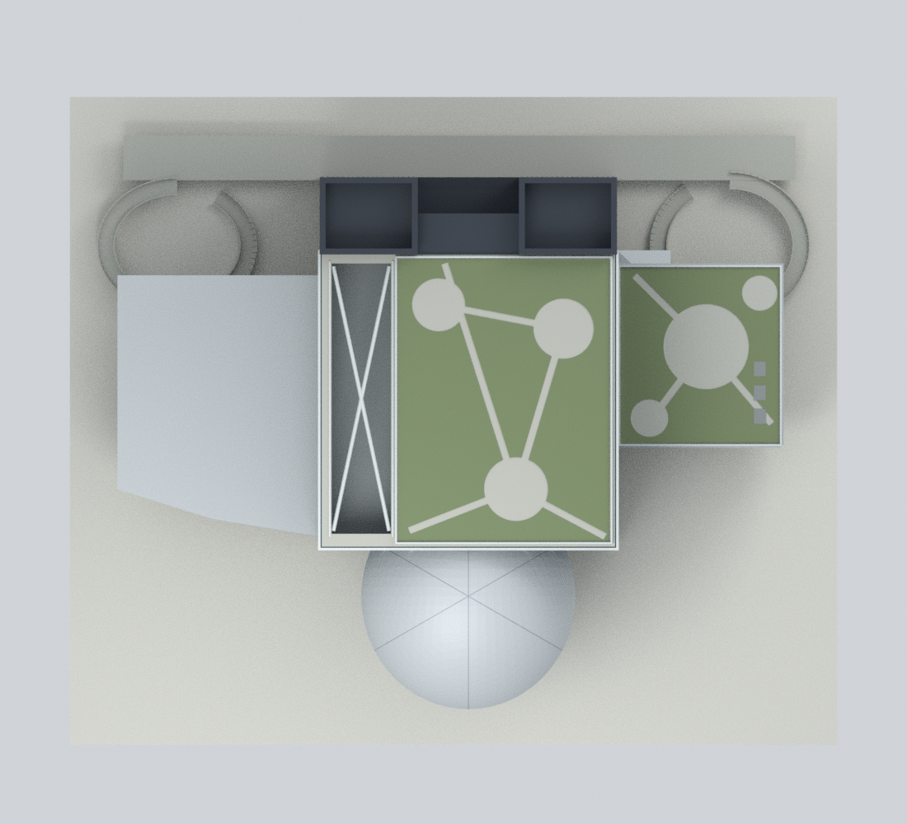
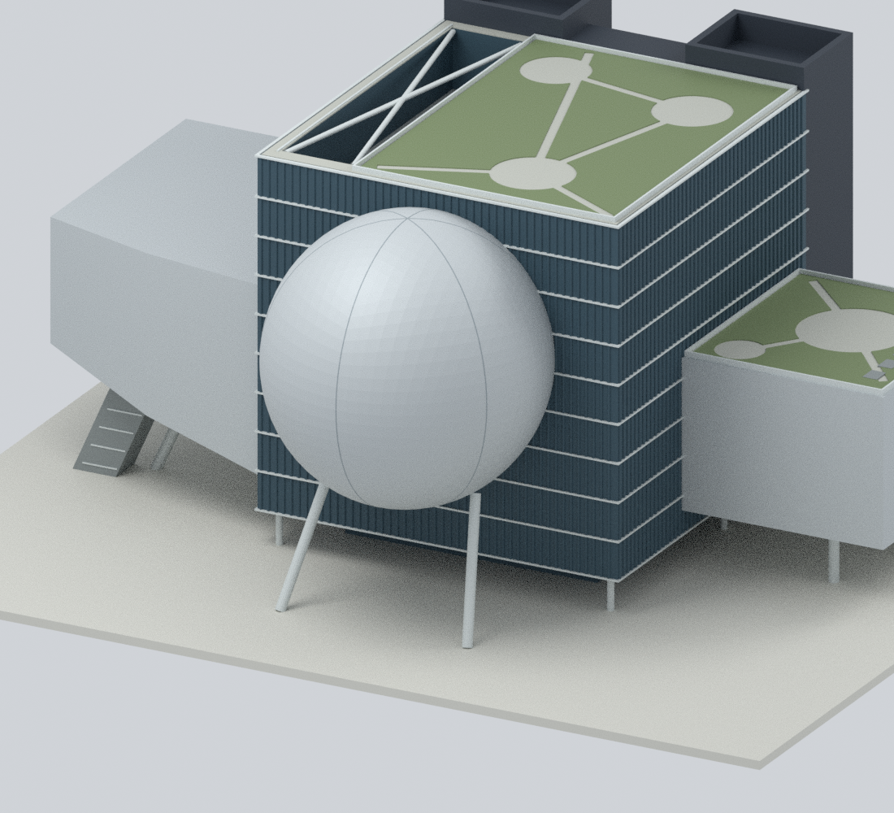
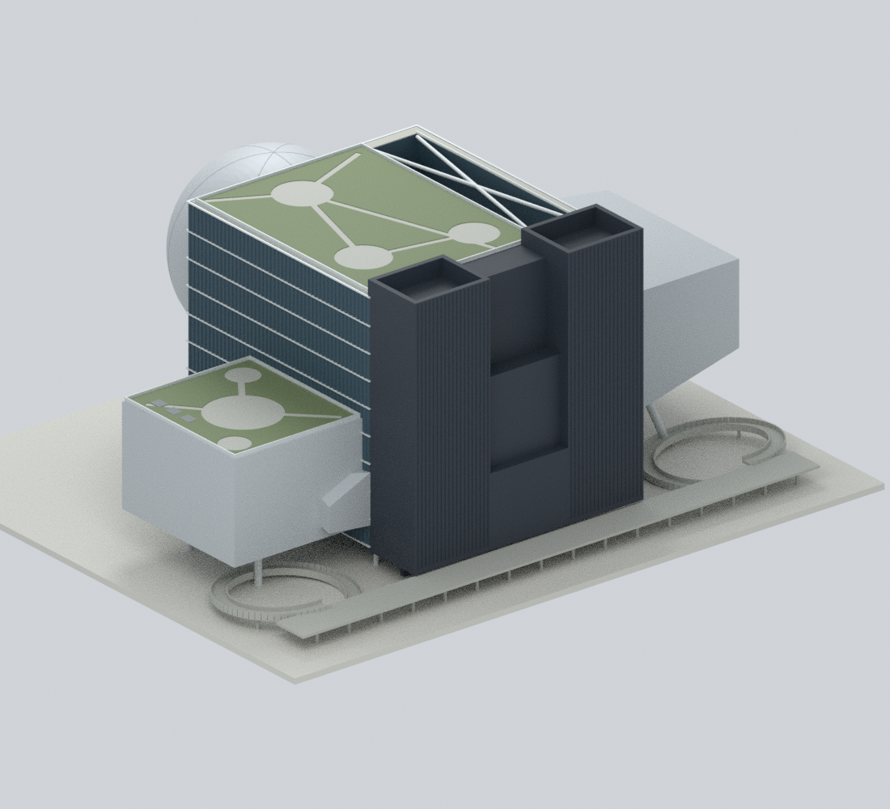
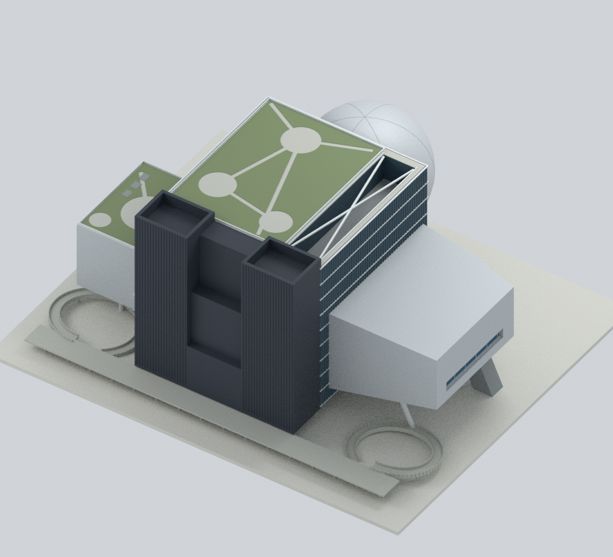

# 臺北表演藝術中心｜完整主建築外觀

**2022 完成建築設計的微縮詮釋，不是現況測繪。** 以官方 2022 年報告平面及建築師圖庫交叉核對；個別照片拍攝日期不明，不能稱為精確 2022 照片或已確認的 2026 現況。建築設計：OMA 與 KRIS YAO | ARTECH。

## 模型預覽

以下九張均由本包實際幾何與材質渲染，**不是建築原照**。

| 球劇場正面 | 大劇院側前斜視 | 大劇院側 |
|---|---|---|
|  |  |  |
| 藍盒子側 | 後方服務屏體 | 俯視 |
|  |  |  |
| 球劇場細部 | 後側平台與坡道 | 屋頂斜視 |
|  |  |  |

## 下載與編輯

- [`tpac-whole-2022.stl`](tpac-whole-2022.stl)：單一封閉外觀模型，不含色彩。
- [`tpac-whole-2022.3mf`](tpac-whole-2022.3mf)：同一幾何的逐三角面基礎色材質，非印表機／擠出機設定檔。
- [`tpac-whole-2022.blend`](tpac-whole-2022.blend)：Blender 原生檔；顯示合併模型，另有預設隱藏的 `EDITABLE authored components (hidden; overlaps pre-union)` 元件集合。開啟集合後可個別移動或改色；原始元件會重疊，**不可直接當作已布林完成的列印檔**。
- [`parameters.json`](parameters.json) 與 [`build_model.py`](build_model.py)：可重建的數值參數及原創幾何程式。`construction-parts.json` 保留獨立元件；`mesh-data.npz` 是合併網格及面材質資料。

## 保留的整體形貌

中央波紋玻璃立方體連接三個**不相同**的劇場：前方相交球劇場、較大的不對稱大劇院（斜底與深藍凹窗）、較低且帶屋頂花園的矩形藍盒子。後面保留兩個高遮屏端部及階梯式後退面；主屋頂、低層花園、開放支撐槽、架空底部、斜柱／樓梯與後方平台的兩個曲線坡道皆納入。不是「球加方盒」或只做正面。

數值採**歸一化比例**：中央立方體寬度設定為 50 比例單位，再換算為模型毫米。程式部分 API 的 `m` 後綴只是比例單位，**不是量得 50 公尺，也不提供精確建築比例尺**。展示底板約 258 × 218 mm，總高約 112.8 mm；底板僅為自製支撐，不是實際道路、基地、地形或地下室。

銀灰金屬、深藍灰玻璃、淡色橫帶、炭灰遮屏與低飽和植栽色取自可見材質家族；**未校色、無 RAL／RGB 實測、未把陽光金色或陰影烘焙成外牆顏色**。沒有原照貼圖。

## 證據、限制與權利

- [OMA 專案頁](https://www.oma.com/projects/taipei-performing-arts-center)：八張外觀照片與兩張剖面示意；示意不是實測竣工剖面。
- [臺北市 2022 年官方報告](https://www-ws.gov.taipei/001/Upload/845/relfile/-1/845/62206e85-c090-4add-aeaf-9272234a4b8d.pdf)：實際第 6–11 頁平面關係，未把小字尺寸當成可靠測量。
- [`sources.json`](sources.json) 保存來源連結、雜湊及署名；[`evidence-map.json`](evidence-map.json) 說明各部位證據與簡化。
- **圖庫 06 署名衝突未解決**：資產檔名為 OMA／Chris Stowers，圖庫欄位為 Shephotoerd Co. Photography；兩項均保留，不任選其一。
- 公開包不含來源照片、PDF、HTML、原圖裁切、描圖向量或原照材質。來源權利與建築設計權利仍屬各權利人；署名或可公開瀏覽不等於授權。詳見 [`RIGHTS-AND-RESPONSIBILITY.md`](RIGHTS-AND-RESPONSIBILITY.md)。

精確尺寸、玻璃波紋／接縫數量、樓梯內部、遮屏孔洞、植栽分區與坡度皆簡化。看不見的服務設備、室內、座位、地下室、基礎、鄰棟、捷運、道路、標誌及後續維修變更不在範圍。

## 重建

Python 3.12，依 [`requirements-model.txt`](requirements-model.txt) 安裝依賴，另需 Blender 4.3.2。`lib3mf` 可裝在相同環境或由 `--export-python` 指定另一個已安裝環境。

```bash
python reproduce.py --out rebuilt --blender blender --export-python python
python verify_reproducibility.py --out . --blender blender --export-python python
```

重建只讀公開數值及程式，不需要網路、私有來源照片、PDF、外部材質或 Blender 外掛。Blender 渲染使用固定種子及 CPU 執行緒；不同 Blender／Cycles 或硬體版本不保證逐位元相同。

## 驗證與列印注意

`qa/` 保存匯出網格拓樸、交叉／接觸檢查及負例、3MF 嚴格讀回、切片截面、開放通道射線、坡道高度、原生檔編輯後重開、PNG 中繼資料與 Blender 路徑緩衝清查。另做僅公開輸入的乾淨重建，核對 STL、網格陣列及九張 PNG 位元組／像素。

**以上不是實際列印或切片器認證。** 大劇院斜底、球體下緣、兩側懸挑、屋頂支撐槽與坡道需要支撐／橋接評估；不可為避免支撐而填掉建築架空空間。細框、接縫、矮牆與波紋可能低於特定噴嘴可辨尺寸，縮小會更脆弱。請核對平台尺寸、縮放、材料與支撐；3MF 色彩不代表自動多料列印配置。
