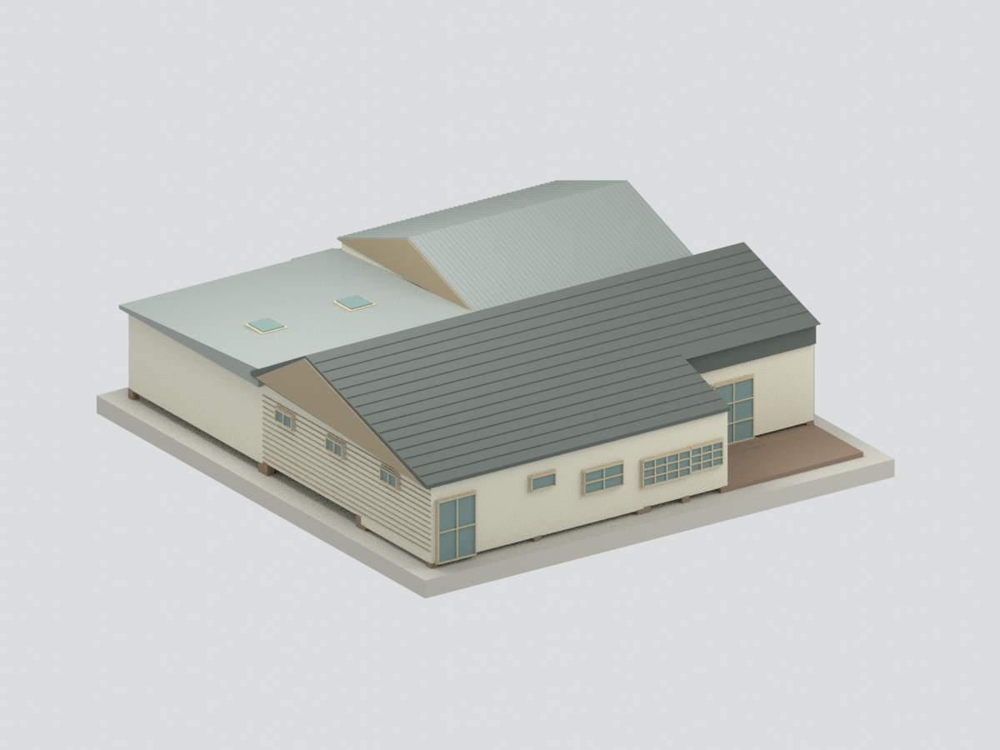
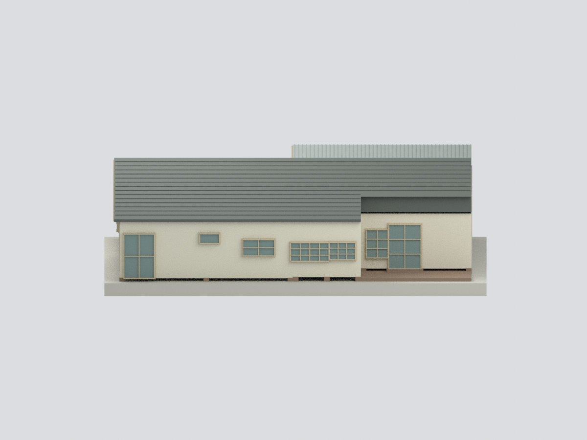
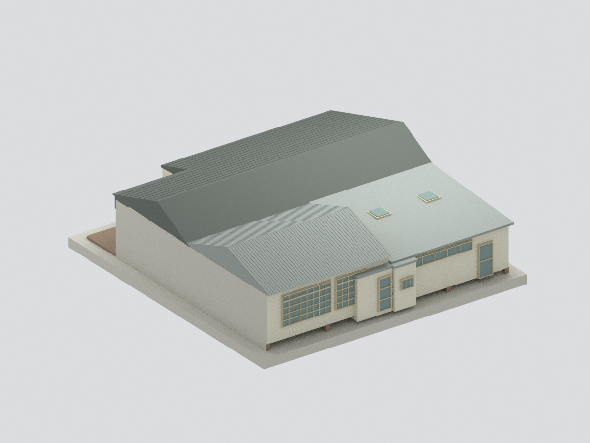
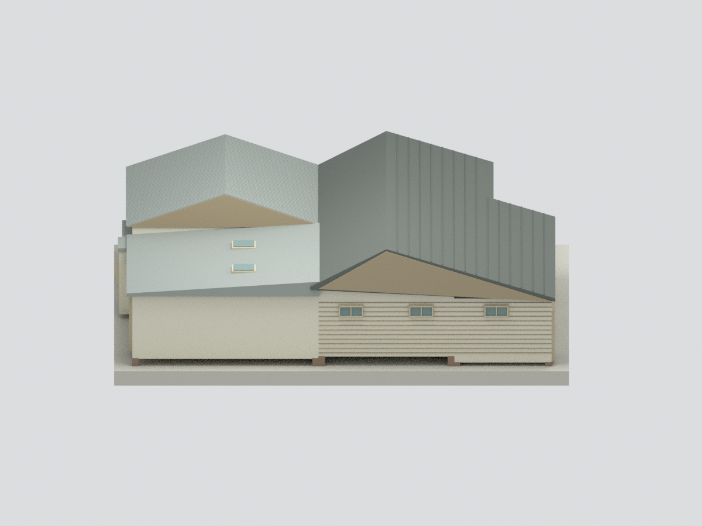
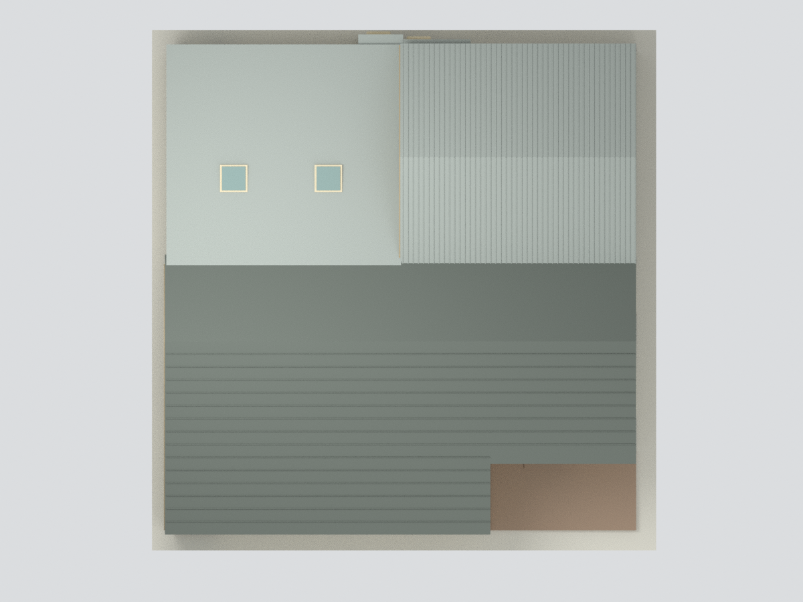
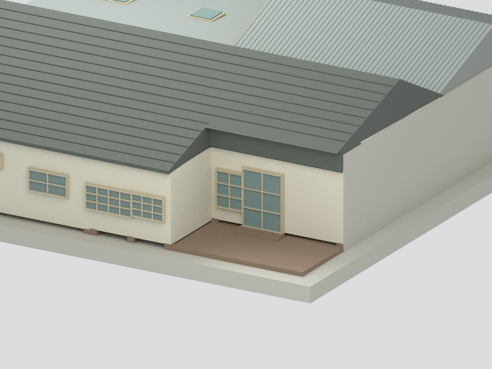

# 蔡瑞月舞蹈研究社｜2000調查形制推定外觀研究

## 模型預覽

| 8／10號前方 | 來源北向街面 | 來源南向後側 |
|---|---|---|
|  |  |  |
| 8號側面 | 推定屋頂 | 10號退入入口局部 |
|  |  |  |

本包依官方調查報告的2000年4月30日附圖，研究**8／10號古蹟本體（1–5軸）**之外觀形制；相連12號、園景、圍牆、室內與家具不建。**完整屋頂含原報告以殘瓦及相鄰12號推知的形制，並非火災後完整實存證明；本包不是1999災後廢墟模型，也不是2007修後或2026現況。** 右端灰色封口是人為研究截界，不是現場東立面。[範圍圖](scope-plan.svg)

## 來源與時相

臺北市文化局官方資料集《蔡瑞月舞蹈研究社調查研究與修復計畫期末報告》，PDF212頁。附錄189–212圖題日期89/04/30，單位cm。報告正文記1999年火災，PDF94明說屋面構成與排列由殘存瓦片及12號推知，因此採『調查形制推定』而不以圖名『現況測繪』冒稱完整屋頂實測。

PDF77、94分辨原屋／1953第一教室／1980第二教室；108限古蹟8／10號；109屬另外的修護建議（全部瓦面、舞蹈大窗改木格），本模型**不混入這些建議**。保留調查附圖舊W2/W3窗格與A–B浪板屋頂差異。報告災後照片只交叉殘存構件與材料，不當作未受損四面照片。現營運方照片沒有用來拼貼2000形制。[來源](SOURCES.md)

## 尺度與推定

名義1:100，1m建築＝10mm模型。1–5軸350+448+460+360＝1618cm為本體長度控制；2611cm是全排屋1–8軸，**不套成本體長**。A–C1283cm、C–D275cm及外延114cm分開使用，牆外皮、檐口和局部凹入仍按掃描估配，不是逐點測繪。主脊4.95m依立剖面，前後附屋高度與坡角近似；不同地坪以共用平展示基準粗化。

## 具體限制

- 屋頂完整形體屬報告推定；主長雙坡、前段延坡、後方獨立雙坡浪板屋（圖194脊高480cm）及相鄰低坡的交界作粗化，不模擬火災破損或每個殘存木件。
- 報告77與照片78支持第二教室低單坡及兩個天窗；未得可清楚逐個定位尺寸，本模型在相應後側低坡、連續上亮窗區屋頂放兩個**位置／尺寸估配的封閉採光代理**，不宣稱歷史原位精確。
- 舊窗依212窗表與190平面配準，窗格、門框深度為可見性加厚。W2/W3為舊多格窗而不是修護建議W2′木格。小開口定位、門階踏深和部分側面高窗為粗估。
- 12號接界不移植194圖的整排東端立面；灰色封口不是實際牆面。園地圍牆排除，因而露出部分圖面受遮蔽牆段，只作實心支撐，不補造未知窗。
- 瓦面僅稀疏粗列，無逐片瓦弧、屋脊端飾細雕、金屬接縫、五金、白蟻/火燒/剝落紋理。浪板是數位表面代理，非任何實體石綿材料建議。
- 色彩主要依黑白圖與材料文字示意，未色卡校正；玻璃不透明、室內未建。可列印性僅數位檢查，**沒有試印**，細框仍可能需切片調整。

## 檔案與驗證

model.stl／model.3mf為融合網格；scene.blend含唯一可見融合模型與隱藏可編輯構件；build_model.py與REBUILD.md可重建。六視圖為實際模型渲染，不是參考照片。QA.json檢幾何與格式，來源外觀審核另列review檔；所有允許公開檔案以manifest及SHA核對。參考原PDF／照片不發布。

## 下載與導覽

[STL](model.stl) · [3MF](model.3mf) · [Blender](scene.blend) · [重建](REBUILD.md) · [返回臺灣地標](../README.md)
