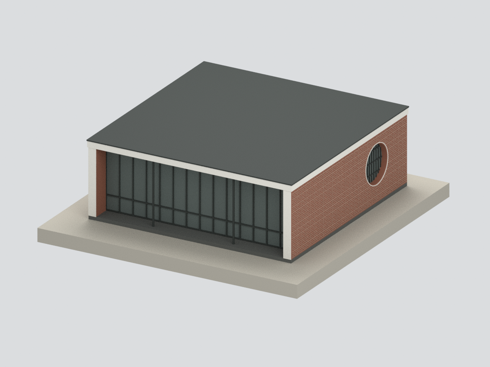
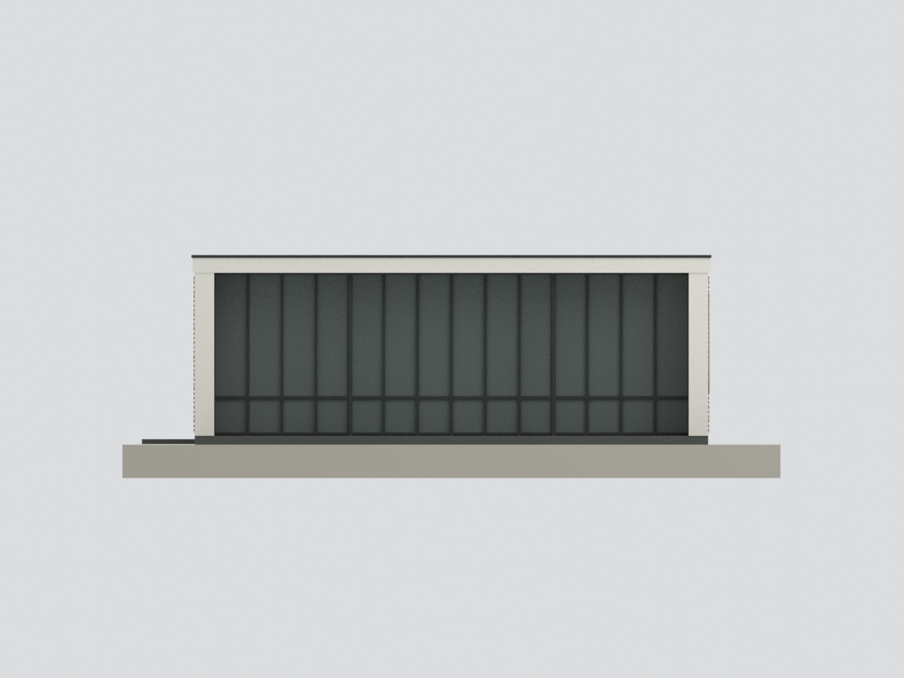
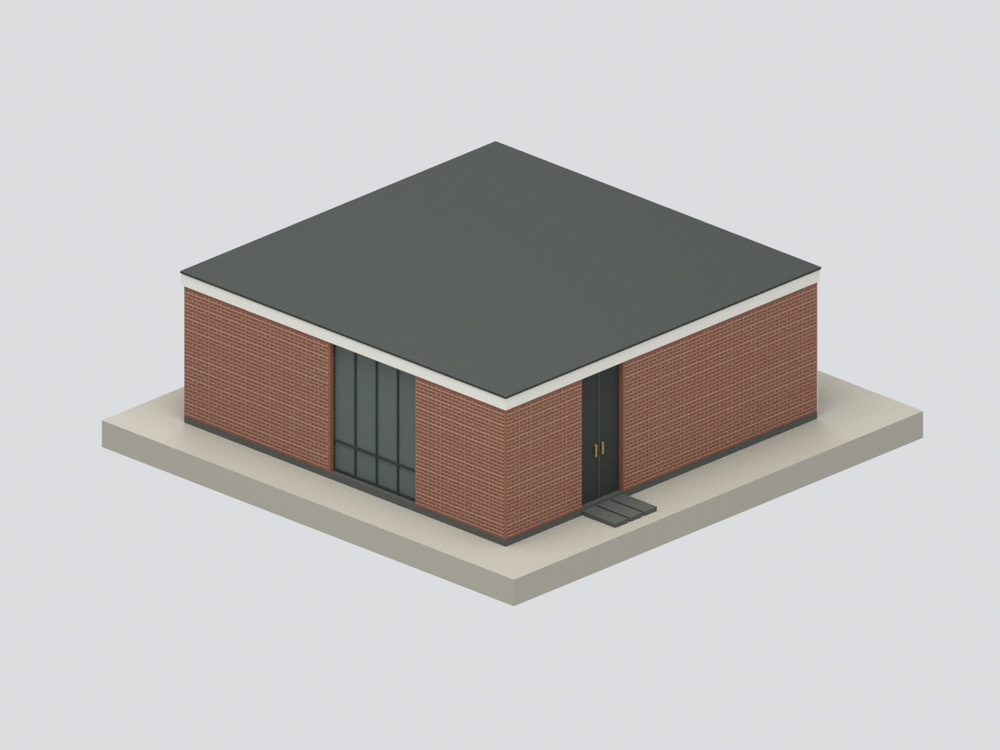
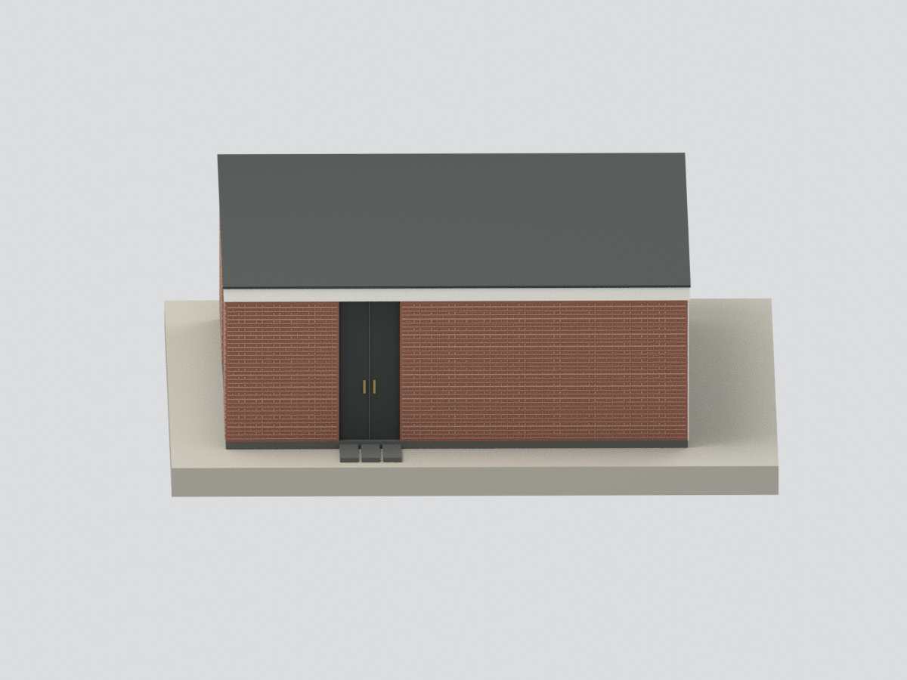
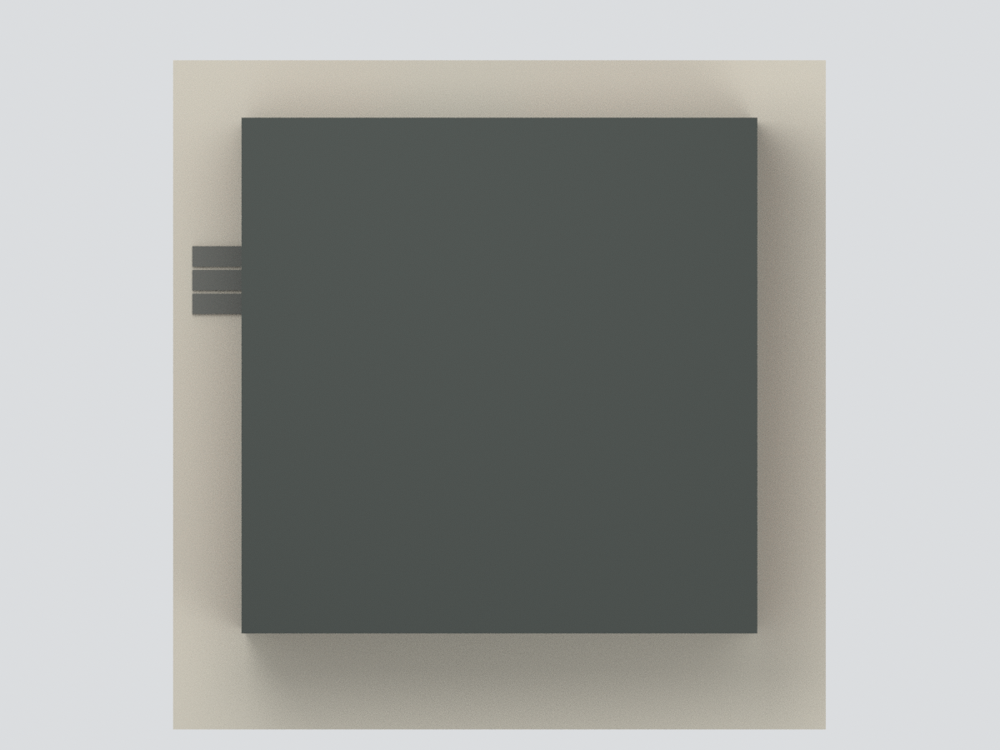
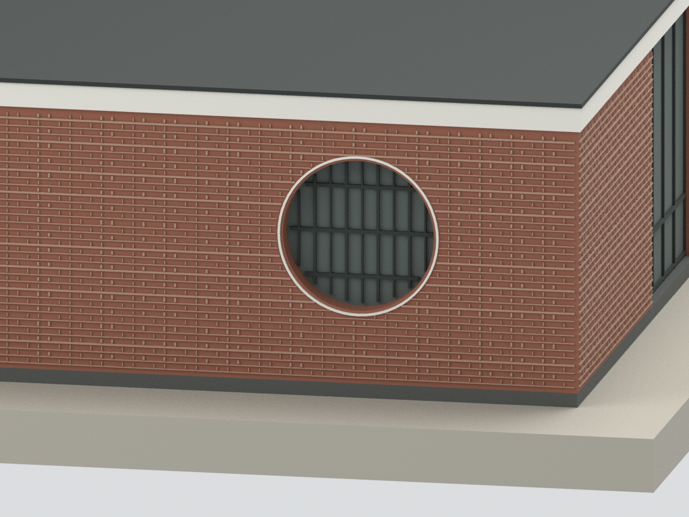

# 王大閎建築劇場｜2017復建主體外觀研究模型

## 模型預覽

本包呈現北美館園區 **2017異地復建住宅主體的簡化外觀**，不是1953已拆原宅的精確復原，也不含旁邊書軒或完整庭園。北側四扇窗的位置依原平面及官方復建文章推定，**沒有北側完整復建實照驗證**。

| 南側與東月窗 | 南側正面 | 北側與西入口 |
|---|---|---|
|  |  |  |
| 西側入口 | 屋頂與外包 | 東月窗細節 |
|  |  |  |

## 範圍與證據

- 原建築師王大閎；本模型對象為2017於北美館旁異地重建、2018啟用的建築劇場。重建團隊本身即明言許多細節屬文獻查證及詮釋，不能視作原宅原物。
- 官方復建文章述落地窗共18扇及南側14扇模矩；北側4扇由原平面與18−14相互核對，不是正文直接逐面列出。每扇2英尺，門窗寬高比約1:4.8。原平面及牆剖提供開口位置與長寬高關係；2018官方照片核前簷、磚牆、月窗格、黑門及白色邊帶。
- 主體外包約9.23×9.23m：用14×0.6096m模矩加兩側估計0.35m牆厚校估後取整。**不是現場測量或竣工尺寸**。室內高度以舊牆剖9英尺7.5吋約2.934m作研究值，復建實際尺寸未測。
- 南窗退縮約0.82m、地坪抬高0.16m、屋頂帶0.27m、門窗標高/外側定位/柱徑皆估讀。北側窗採原平面位置，官方復建文章僅確認扇數與模矩；未以鏡射南立面補造。
- 東月窗約1.676m直徑；模型以**關閉格窗＋不透明退底**表達，官方照片有開啟狀態，滑動機構與室內透視未還原。

## 簡化與未知

不含書軒、完整基地外牆、歷史庭園、水池、植栽、室內格局/家具或隱蔽構造。周圍底板與短入口踏板只是展示支撐，不是完整地景。屋頂上表面使用平滑封面，未還原排水坡、隱蔽木格柵與管線。

所有玻璃為不透明代理，室內為實體填充；窗扇固定關閉。門窗細框、把手、柱徑與月窗格適度加粗，無法活動。磚縫是放大的交替長短節奏代理，開口旁留清理間隙，**不是逐磚法式砌法復原**；前牆端刷白用單色，不含真實斑駁刷痕與磚面質感。顏色未經色卡校準。

## 檔案與尺度

`model.stl`單材質、`model.3mf`多材質、`scene.blend`統一網格及隱藏可編輯構件；`build_model.py`與`render_model.py`可重建。模型約1:125（8mm對應估算1m），含支撐約94.64×97.04×32.08mm。`previews`為實際交付網格的六視圖，不是原建築照片。

幾何及交換格式檢查見`QA.json`，獨立視覺/來源審核狀態見對應JSON。**尚未實體試印**；細柱、窗框與凸起磚縫可能需要依機台/材料放大或調整。水密不等於所有設備可直接列印。

## 下載與導覽

[STL](model.stl) · [3MF](model.3mf) · [Blender](scene.blend) · [重建](REBUILD.md) · [返回臺灣地標](../README.md)
