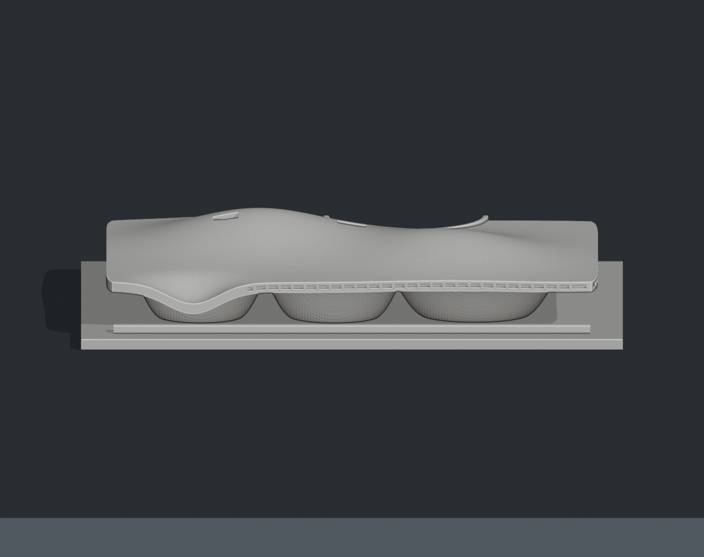
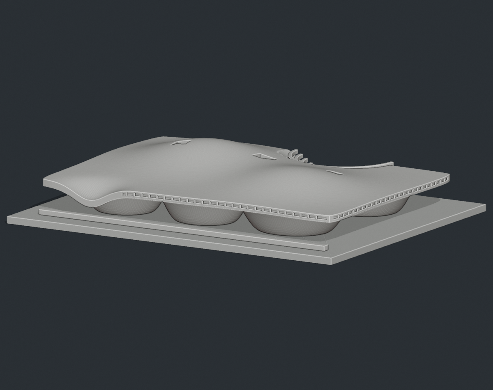

# 衛武營國家藝術文化中心｜可列印外觀微縮模型

## 模型預覽

| 模型預覽 | 模型預覽 | 模型預覽 |
| :---: | :---: | :---: |
| 正面  | 背面  | 正立面  |
| 低角度斜視  |  |  |

## 模型內容
- 成品尺寸：150 × 118 × 26.04 mm，含底座。
- 連續起伏屋頂、五個下垂至地面的曲面核心、開放底部、前／右側窗帶、屋頂採光淺凹及公園側露天劇場。
- 核心布局和曲面高程是照片近似，沒有測繪級外殼。預覽的 low-oblique.png 補充顯示窗帶與落地曲面。
- 一體式、單一連通封閉實體，最長邊 150 mm。

## 列印起始建議（尚未切片實測或試印）
- FDM 可由 0.4 mm 噴嘴、0.16–0.20 mm 層高、3 道外牆、12–18% 填充與 PLA 起步。
- 原方向直立、平底貼平台；必要時增加 3–5 mm brim。
- 屋頂大面積跨越開放底部，必須檢查支撐可達性與拆除路徑，通常需要局部樹狀或有界支撐。不要將封閉網格當作免支撐保證。屋面外殼厚化約 2.8 mm；窗帶為 0.68 mm 深的淺凹，上下保留約 0.65 mm 與 1 mm 的邊，需查看切片薄壁。小型座席和窗梃皆有厚化。
- 請先檢查全高度切片路徑、懸空、薄壁與支撐拆除空間，再試印。不要直接縮小，縮放後應重新檢查所有細節。

## 檔案與重建
- model.stl：唯一列印實體，單位 mm。
- build_model.py：參數化原始碼，可重新產生 STL。
- scene.blend：由同一 STL 匯入的 Blender 場景，包含相機、燈光及非列印地板。編輯建模參數後應先重建 STL，再執行預覽腳本。
- previews/front.png、rear.png、elevation.png：實際 STL 的前斜視、後斜視與正向視角。沒有照片貼圖，也沒有添加只在預覽中存在的建築細節。
- render_preview.py：Blender 預覽腳本；使用無雜訊的工作室顯示。場景材質只是預覽色，STL 本身不含材質。
- validate_model.py、validation.json：數位檢查程式及結果。
- rebuild_check.json：重建前後 STL SHA-256 一致性結果。
- requirements.txt：Python 套件版本。sources.md：公開參考來源及不確定性。

安裝 requirements.txt 後執行 python build_model.py。執行 python validate_model.py model.stl --output validation.json 檢查；以 Blender 4.x 執行 blender -b -P render_preview.py 產生場景和預覽。單張預覽可設定環境變數 VIEW=front 或 VIEW=rear。Blender 場景以 mm 顯示單位，匯出時只選 Printable_STL_mm，勿把地板、相機和燈光一起匯出。

## 檢驗範圍
已檢查：單一連通邊界面、封閉網格、面向一致、每條邊恰有兩面、頂點鄰域為單一環、無退化三角面、正體積、平底接觸、尺寸與可重建雜湊。單一連通封閉邊界面沒有獨立的內部空腔殼。以上不是完整幾何自相交證明，也不等同切片測試或實體試印；未聲稱已試印成功。

本包是重新建立幾何的外觀微縮模型，非官方模型、測繪模型或結構模型。每座均以獨立成品大小設計，彼此不是共同比例，不能從模型反推真實尺寸。參考照片不隨包分發；若需商業散布或使用，請自行確認建築、雕塑、商標及其他適用權利。
