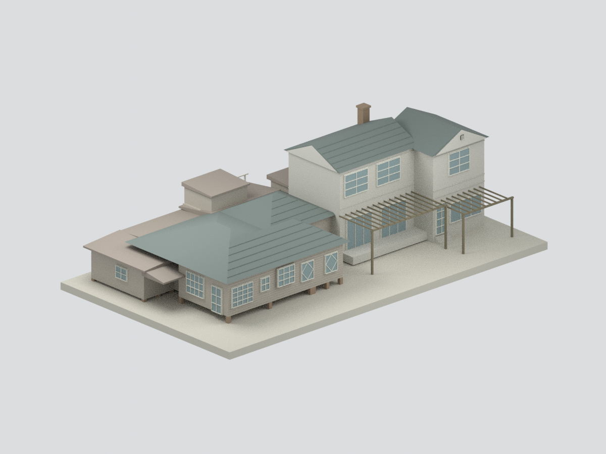
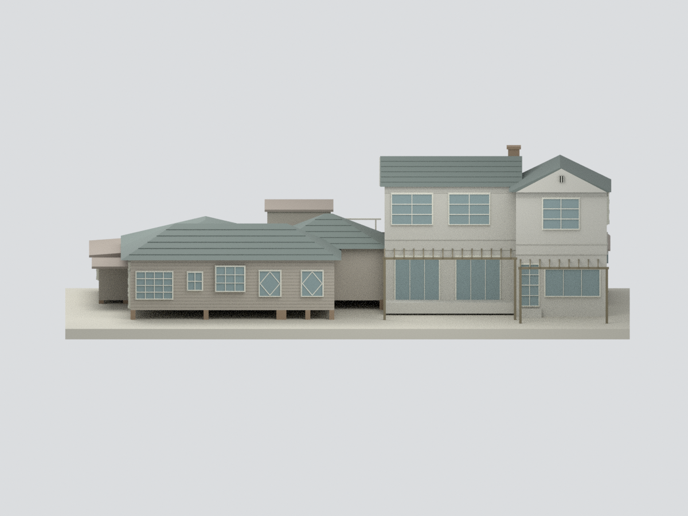
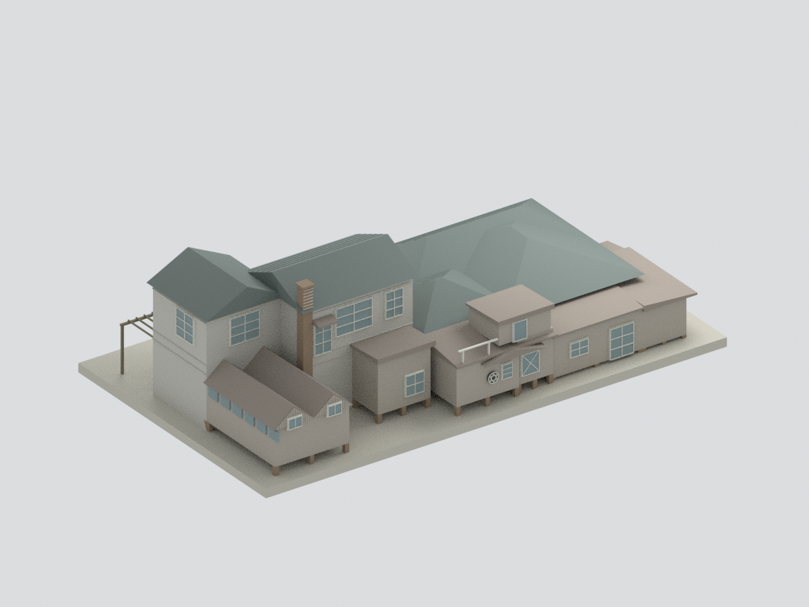
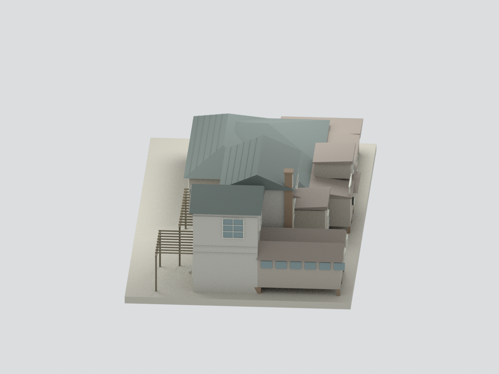
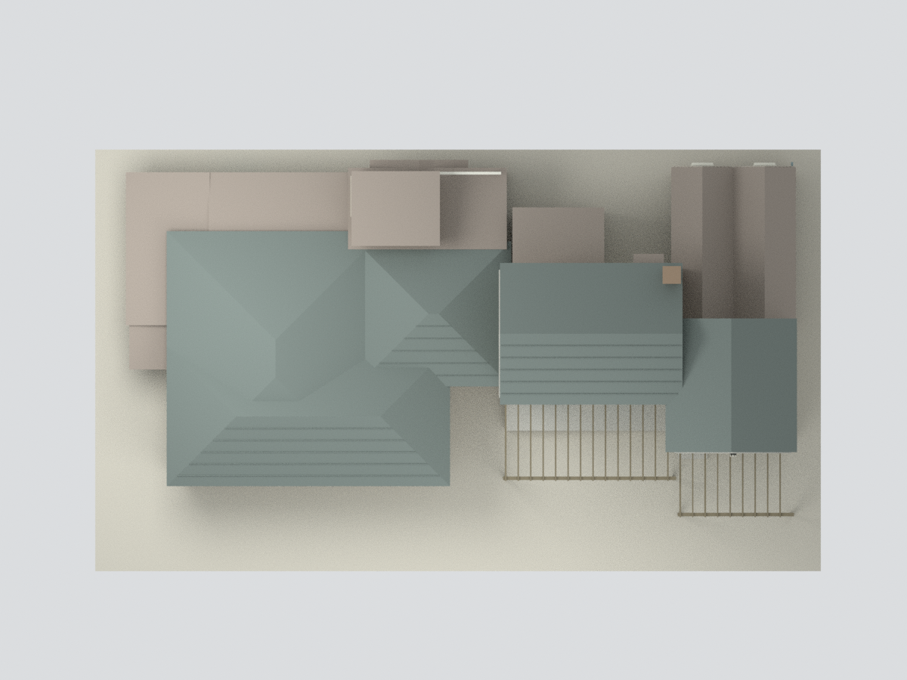
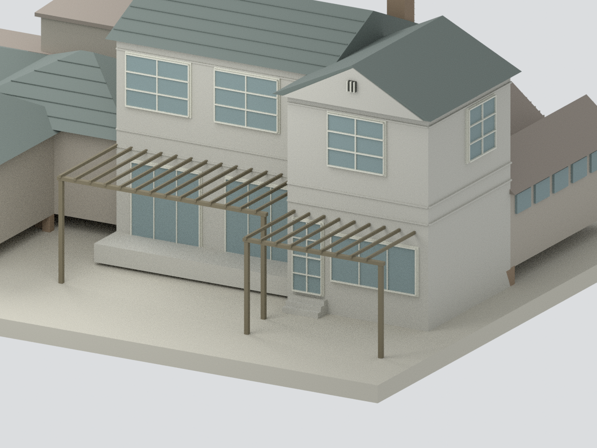

# 紫藤廬｜修復前調查圖建築外觀研究

## 模型預覽

| 前方整體 | 南立面 | 北後側 |
|---|---|---|
|  |  |  |
| 東端 | 屋頂 | 入口局部 |
|  |  |  |

本包依官方調查報告所附2001/06、2003/03圖面，製作**修復前調查建築外殼**的簡化研究模型，包括西側木造低屋、東側二層增築及低服務屋／花廳屋頂。**不是2008年整修後、2024年底封館修繕後的現況，也不是1920年代原始住宅復原。** 不含庭園植物、基地圍牆、室內與家具；兩處貼屋棚架粗略保留。[範圍示意](scope-plan.svg)

## 來源與時期

臺北市文化局委託臺灣大學建築與城鄉研究所的《市定古蹟紫藤廬調查研究計畫》，封面標民國91年5月，正文記2002年現況；官方資料目錄年度92，附錄測繪圖另有2001/06、2003/03日期。本模型採**該份報告附錄測繪外觀**，不把不同日期假裝為單日竣工實測。

PDF263–265為一層平面、天花尺寸、二層；266東西、267北、268南、269–271剖面、272屋頂材料圖。另實看75–92的同報告空間與建築照片核對低木屋、上層增築、門窗及材料。營運方後來照片僅用於辨認時期差異，不移植2007玻璃改建等細節。[來源明細](SOURCES.md)

## 尺度與近似

名義1:100，1m建築尺度轉10mm模型。圖面標數如839、739.5與門牆厚CM註記共同作公分解讀；平面3001.6是整體控制邊界，不直接稱主屋長。以264尺寸鏈配合263平面註記配準各屋段，掃描像素位置與不平行原牆作直角粗化。南側低脊約5.17m、上層主脊約8.56m參考立面；各面GL與地坪有差，模型共用展示基準、部分踏階與附屋標高估配，非逐點測量重建。

## 重要簡化與未完成的精確度

- 西部相交四坡與東部交叉雙坡依屋頂圖重建主要關係；屋谷收邊、局部小折坡與屋檐厚度近似。屋瓦僅稀疏粗列，無逐片波弧瓦、密集鋼浪板波紋。北側花廳保留雙折坡、主高屋旁煙囪與北側六芒格圓窗/小山棚；這些小構件尺度與配準仍屬估讀。
- 北側服務段、花廳與樓梯間依圖保留輪廓，但部分微小開口、排水管、冷氣、燃氣設備與內部梯段省略，不是設備完整模型。
- 木窗、菱形窗、落地門與北側窗按立面粗分格；位置與分扇經掃描估配。玻璃不透明實心背板，非透明室內重建，門窗沒有實際貫通室內。
- 洗石子立面以平色與水平帶代理，無骨材；木板僅粗水平線。黑白來源不能確定精準歷史色彩，材料色為示意。
- 基座是作者製作展示支撐；架空磚腳、門階數量與位置為製造簡化，不可用作修復施工資料。
- 圖上灰／米色構件為洗石子或板材示意，**不是上一套模型的人工服務區截界**；本案不使用灰截面替代未建服務區。
- 未做實體試印。數位水密與單連通僅是模型檔完整性，不能保證細棚架或細框在所有印表機成功。

## 檔案與重建

提供 STL、彩色3MF、Blender可開檔、隱藏可編輯構件、Python建構／渲染／驗證腳本、六圖、來源與範圍JSON、manifest與SHA256。參考原PDF及照片不放入公開包；scene.blend1不納入發布。

請先閱讀 [可重建程序](REBUILD.md)、[QA](QA.md) 與各review JSON，獨立來源／外觀審核與純幾何檢查分開判定。

## 下載與導覽

[STL](model.stl) · [3MF](model.3mf) · [Blender](scene.blend) · [重建](REBUILD.md) · [返回臺灣地標](../README.md)
