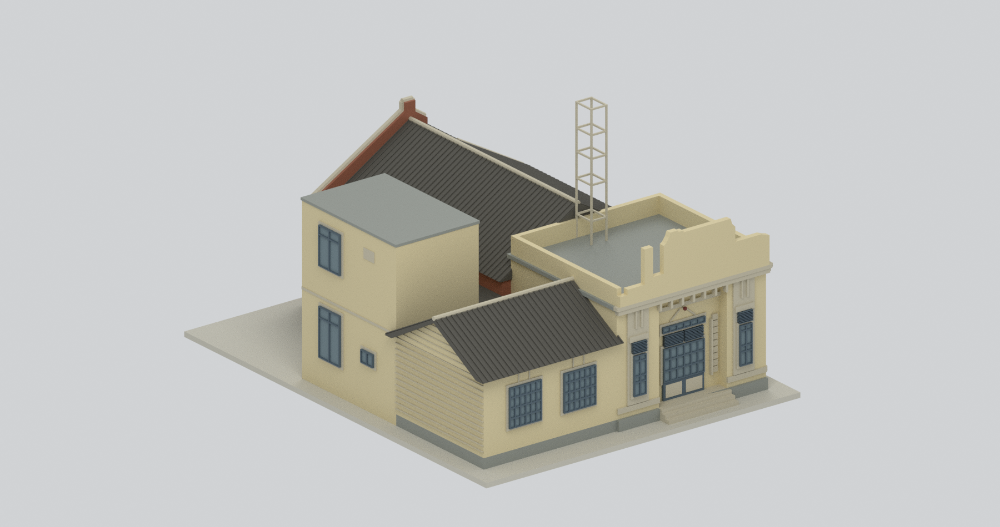
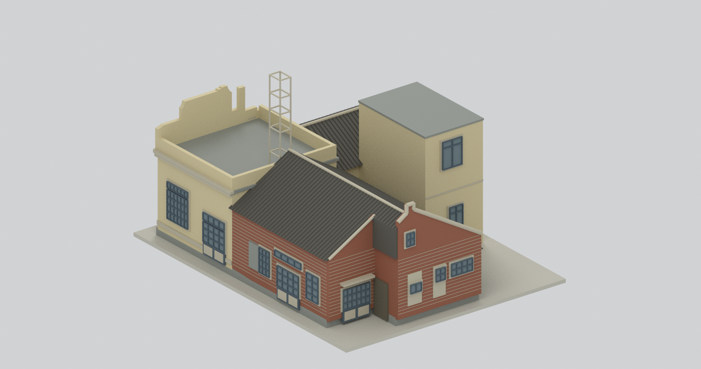
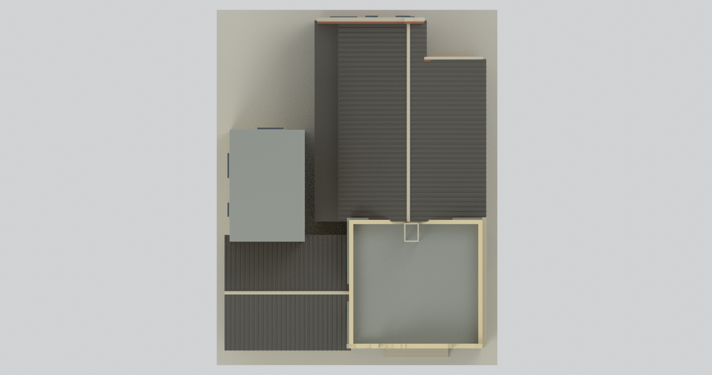
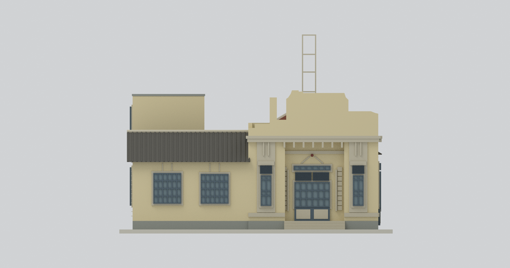
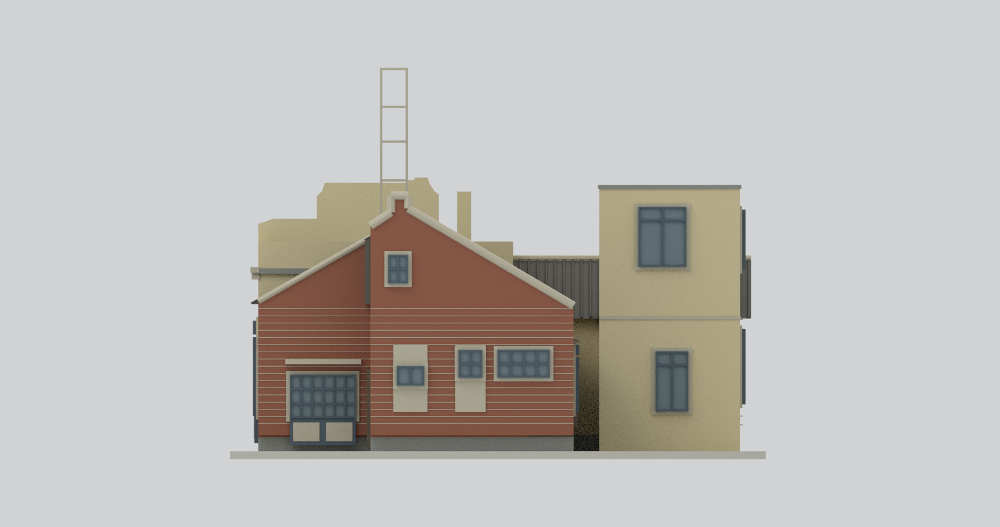
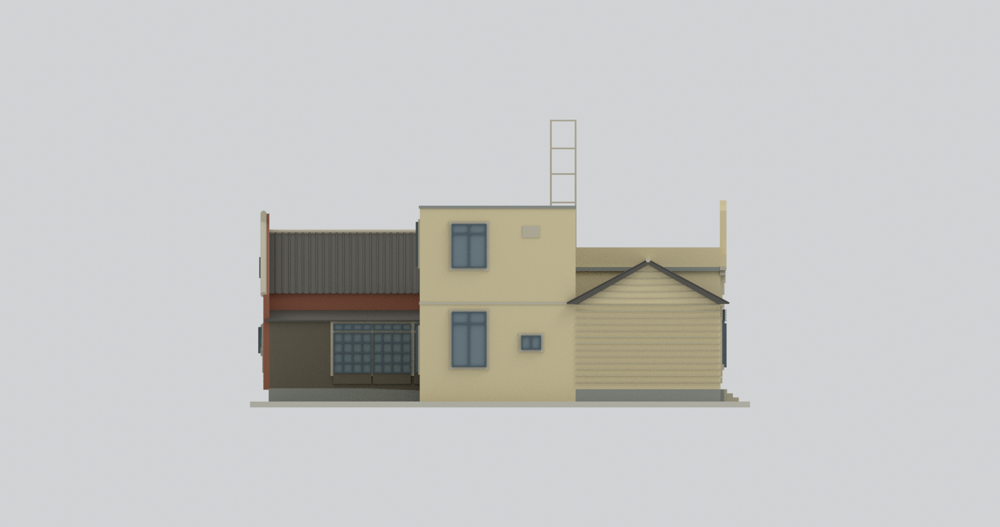
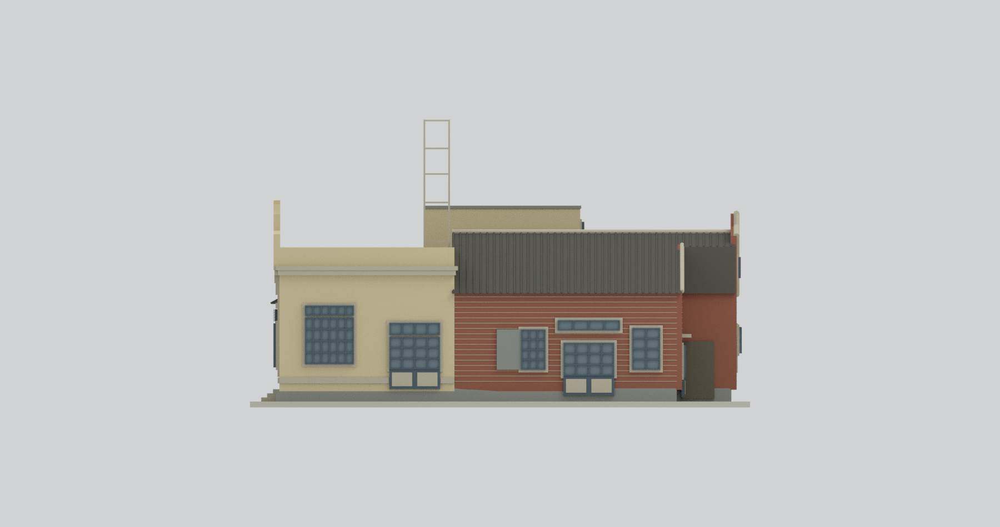
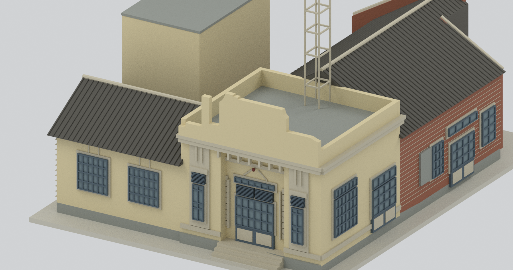
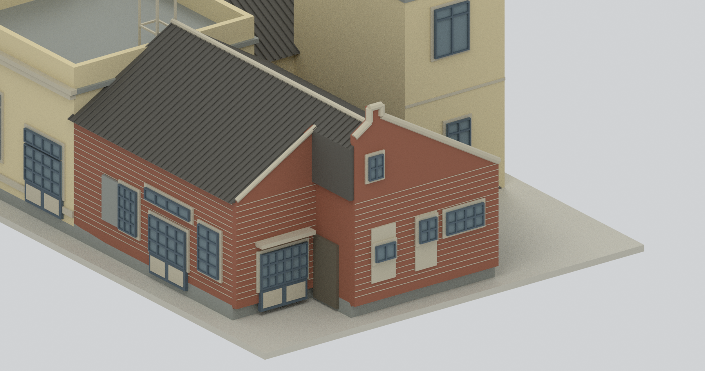

# 原梧棲警察官吏派出所廳舍併宿舍 A

## 模型預覽

| 正面斜視 | 背面斜視 | 俯視 |
|---|---|---|
|  |  |  |
| 正立面 | 背立面 | 左側（局部座標 −x） |
|  |  |  |
| 右側（局部座標 +x） | 前入口局部 | 宿舍背面局部 |
|  |  |  |

最後兩張為刻意裁切的細節圖；其餘七張為完整模型。方位是模型座標，不是測量地理方位。

## 2. 範圍與年代

臺中梧棲，**2014 年 10 月現況測繪／2015 年 6 月報告**的連接 A 棟外觀：1931 原廳舍、後增木造辦公翼、戰後兩層 RC 增建與宿舍 A。1899 是設置沿革，不是現存廳舍建造年。不含分離 B／C／D 宿舍與防空洞，也不是修復後或 1931 復原模型。

## 3. 檔案與比例

- `scene.blend`：最終合併網格、材質、燈光與相機；另保留隱藏的可編輯建構零件及來源註記。
- `model.stl`：單一連通外殼與展示底座。
- `model.3mf`：毫米單位及分面材質。
- `build_model.py`／`render_model.py`：可重建腳本；`REBUILD.md` 記環境與命令。
- `sources.json`、`SOURCES.md`、`parameters-evidence.json`、`opening-positions.json`：來源、尺寸、修正與未知範圍。

名義 **1:100**（來源 1 m →模型10 mm），含底座約 **134 ×170 ×98 mm**；底座厚2 mm為作者設計，不是史實地形。尺寸／網格最終值以 `build-summary.json` 為準。

## 4. 忠實度與限制

保留不對稱前飾牆、後屋緣高矩框、凹入入口、木造／RC 不同屋頂、宿舍主雙坡與低廊、階形後端、北廊四組不同格數、已填補的後門窗及 A103 上下不同窗寬。高矩框用途未定，不稱煙囪；中央缺失徽飾不重建。局部遮蔽由窗表、照片與剖面核對，未知小牌不假設成窗。

主要高度／輪廓量圖約 ±3%，局部高度 ±0.2 m；色彩未校色，砌磚、瓦紋、門窗框粗化。玻璃不透明、無完整室內。模型沒有夾帶官方 PDF、來源照片或圖面。詳見 [來源與限制](SOURCES.md)。

## 5. 驗證與製造注意

`QA.json` 是網格與格式檢查；`review/` 為獨立來源、幾何與九視圖審查；`REBUILD-QA.json` 是乾淨重建比對。製造風險見 `manufacturing-review.json`。網格封閉或連通不表示已試印：細框、檐口及高矩框可能需支撐、改方向、調整比例，請自行切片評估。本包無試印、無結構安全承諾。
