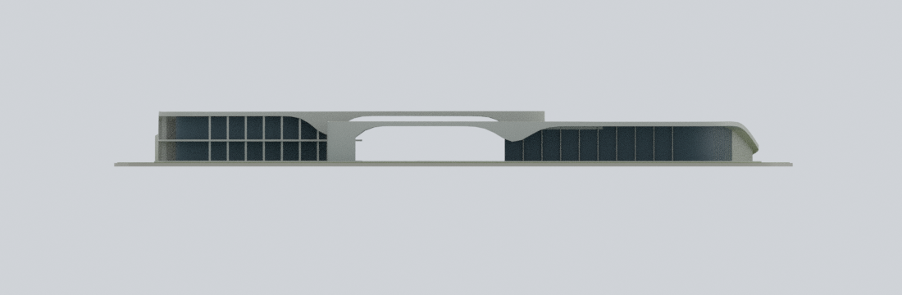
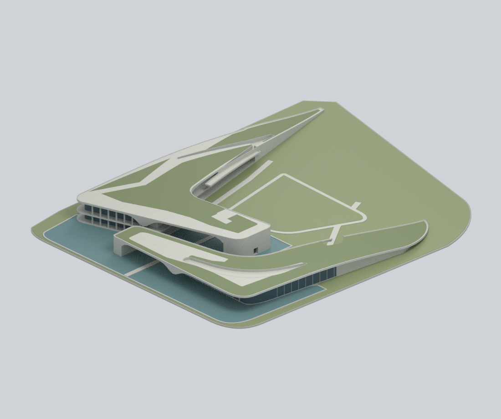
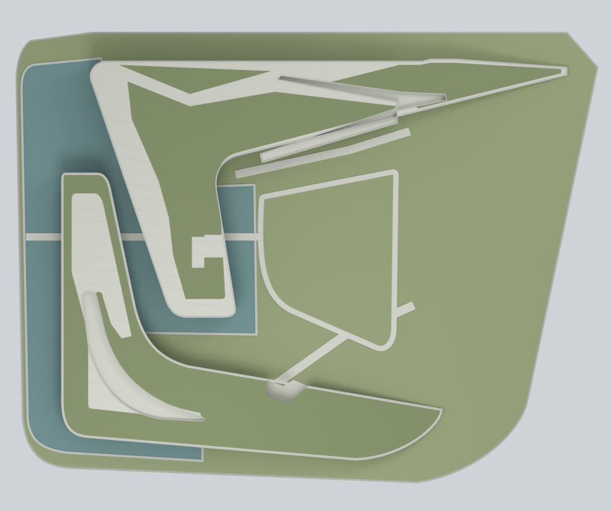
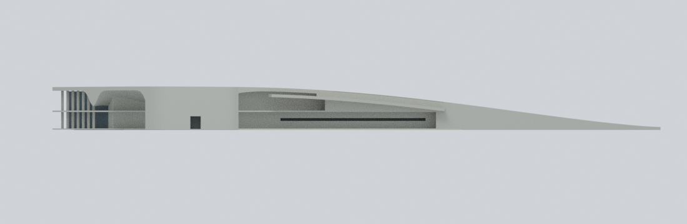
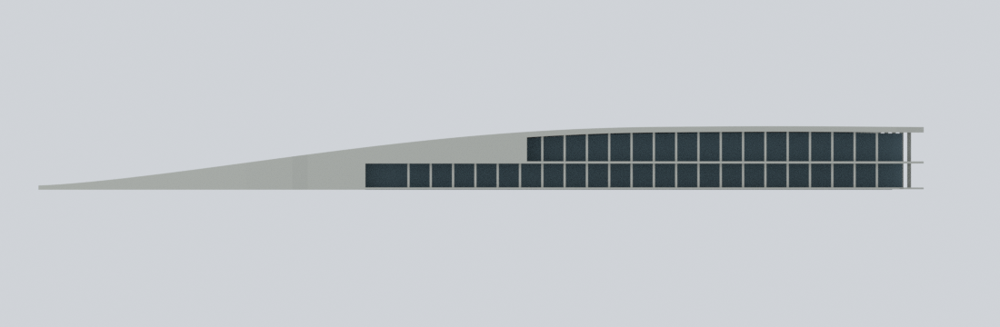
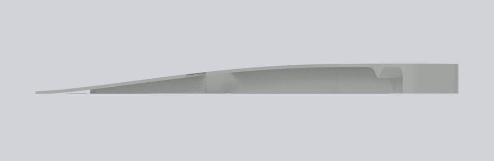
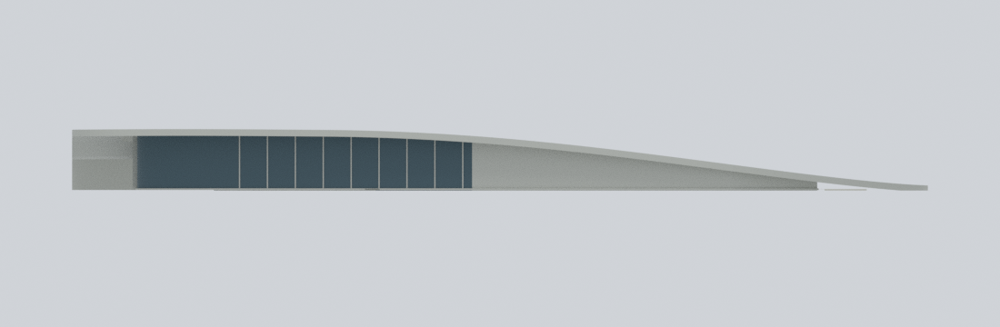
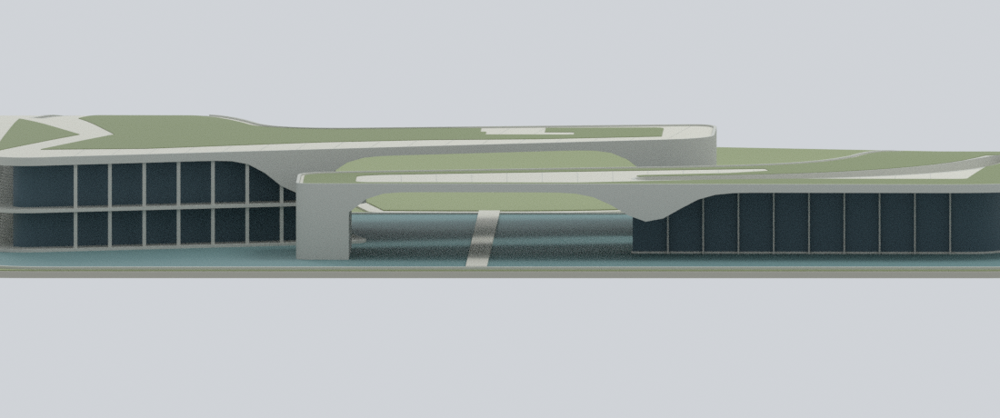
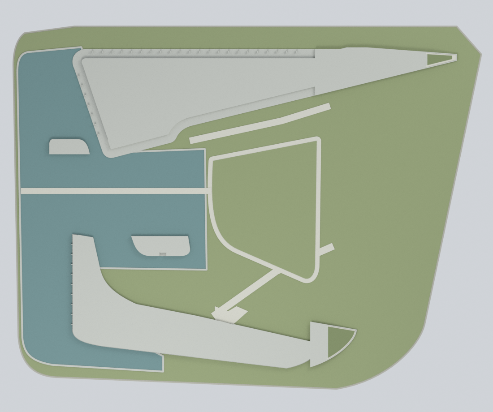

# 日月潭向山行政暨遊客中心｜完整雙翼建築

**2010 完成設計的微縮外觀詮釋，不是現況測繪。** 以建築師完整 1F／2F／RF 圖、五個立面及完成建築照片交叉核對；個別照片拍攝日期未確認，不能稱為已測量的 2026 現況。設計：**Norihiko Dan and Associates**；專案頁攝影署名：**Anew Chen**（頁面層級）。

## 模型預覽

以下九張皆來自本包的實際模型幾何與材質，**不是建築原照**。四張單翼立面暫時隱藏另一翼與地面，以實際合併網格的三角面檢視；地面關係圖是模型高度 2.5 mm 的水平剖切，不是室內平面設計。

| 湖側完整北立面 | 雙翼斜視 | 完整屋頂俯視 |
|---|---|---|
|  |  |  |
| 行政翼西立面對照 | 行政翼東立面對照 | 遊客翼東立面對照 |
|  |  |  |
| 遊客翼西立面對照 | 雙層次開放雨棚 | 地面與開口關係剖切 |
|  |  |  |

## 下載與編輯

- [`xiangshan-whole-2010.stl`](xiangshan-whole-2010.stl)：單一封閉外觀網格，不含色彩。
- [`xiangshan-whole-2010.3mf`](xiangshan-whole-2010.3mf)：同一網格的逐三角面基礎色材質，不是列印機／擠出機設定檔。
- [`xiangshan-whole-2010.blend`](xiangshan-whole-2010.blend)：Blender 原生檔；顯示合併列印網格，另附預設隱藏的 `EDITABLE authored components (hidden; overlaps pre-union)` 集合。元件可獨立移動與改色；它們仍有布林合併前的重疊，**不能直接當成完成列印檔**。
- [`parameters.json`](parameters.json) 與 [`build_model.py`](build_model.py)：可重建的屋頂高度、坡度、厚度及原創幾何程式。`construction-parts.json` 保存元件；`mesh-data.npz` 保存合併網格、材質及診斷分組。

## 保留的整體形貌

這是**同一處地標的完整兩翼**，不分開計數。行政翼較長、內陸端尖收；遊客翼較寬、外肘與內陸端圓轉。兩翼分別保留綠屋頂、鋪面帶、長形凹入屋頂路徑與回折；屋頂連續下降接近內陸地面，不是平頂帽蓋或鏡像迴力鏢。

兩道湖向雨棚真的透空，支撐端形狀不同；行政翼具有兩層玻璃帶，遊客翼以較低單層立面為主，**未把 2F 圖上的屋頂幾何當成完整第二層使用空間**。同時納入水池、低矮擋邊、中央植栽庭院、穿越水面的步道及內陸接地段。

模型約 **281 × 218 × 17.8 mm**。這是桌面展示的歸一化尺寸，**不是實測比例尺**；圖上的 1:1500 未被當成公尺校正。底層僅約 1.1 mm 的模型封底，不是建築的大型高台、地下室或完整基地地形。

混凝土、藍灰玻璃、植栽、鋪面與池水以照片可辨的材質家族設定；**沒有校色或真實 RGB／RAL 測量，沒有原照貼圖，也沒有把陰影或夜間燈色烘焙成外牆顏色**。

## 來源、限制與權利

- [Norihiko Dan and Associates 專案頁](https://www.dan-n.co.jp/%E6%97%A5%E6%9C%88%E6%BD%AD%E9%A2%A8%E6%99%AF%E7%AE%A1%E7%90%86%E5%87%A6)：完成建築照片、完整平面及五個立面；© Norihiko Dan and Associates。攝影署名 Anew Chen 為頁面層級，不另猜測各張攝影者。
- [`sources.json`](sources.json) 保存來源網址與署名；[`evidence-map.json`](evidence-map.json) 列明各部位的證據與簡化。
- 沒有公開原圖、圖說、HTML、裁切、描圖向量、照片背景或照片材質。來源沒有已確認的開放授權；可瀏覽與署名不等於授權。詳見 [`RIGHTS-AND-RESPONSIBILITY.md`](RIGHTS-AND-RESPONSIBILITY.md)。

屋頂與曲面底部的精確曲率、牆厚、局部階差、扶手、排水、門五金、玻璃分格與鋪面分縫均有簡化；小型混凝土裂縫、未定位的狹縫或照片近景細節不任意補造。室內、個別商店、招牌、車輛、人物、遠山、停車場與其他設施不在範圍。沒有施工剖面或測繪資料，因此不提供工程、結構、無障礙或安全合規保證。

## 重建

需 Python 3.12、[`requirements-model.txt`](requirements-model.txt) 內套件，另裝 Blender 4.3.2。`lib3mf` 可置於同一環境，或由 `--export-python` 指定另一個環境。

```bash
python reproduce.py --out rebuilt --blender blender --export-python python
python verify_reproducibility.py --out . --blender blender --export-python python
```

只讀本包程式與數值，不需要網路、來源照片、圖說、外部材質或 Blender 外掛。固定種子與 CPU 執行緒可在已驗證環境重現九張 PNG；不同 Blender／Cycles 或硬體版本不保證逐位元相同。

## 驗證與列印注意

`qa/` 保存重載 STL 的邊／頂點拓樸、完整三角面交叉檢查與負例、3MF 嚴格讀回、水平截面、十二條開放／阻擋射線、兩翼接地高度趨勢與端點實體接觸、屋頂回折凹深與填平負例、原生檔編輯並重開、PNG 中繼資料及原生檔固定字元緩衝清查。另從公開輸入乾淨重建，核對幾何與九張 PNG 的位元組和實際像素。

**這不是實體列印或切片器認證。** 長跨雨棚與行政翼外側的薄片通道需要支撐／橋接評估，不能為省支撐而填實透空空間。細框、鋪面線與矮牆可能小於特定噴嘴可辨尺寸；縮小會更脆弱。請自行核對平台、比例、材料、支撐與機台能力；3MF 色彩不代表已配置多料列印。
