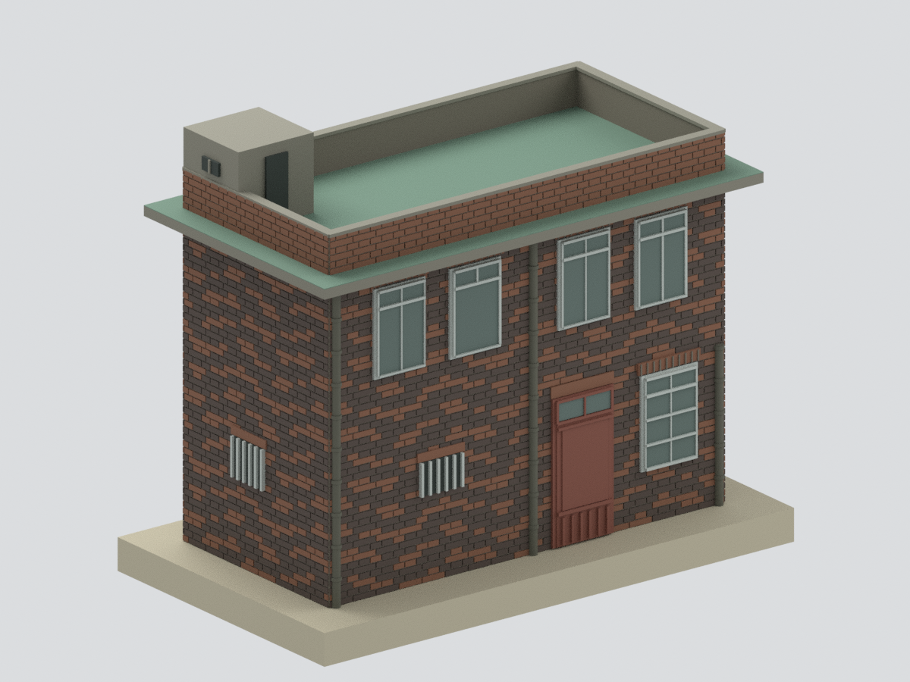
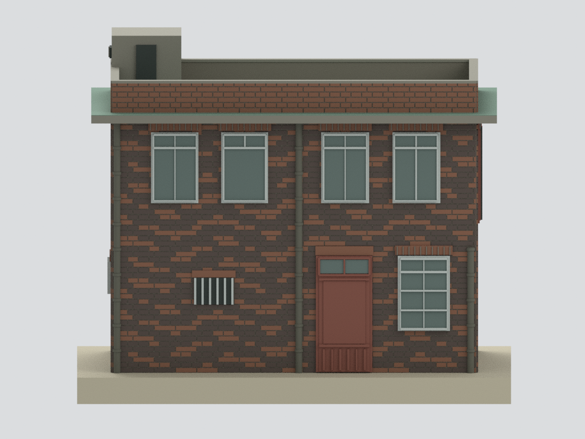
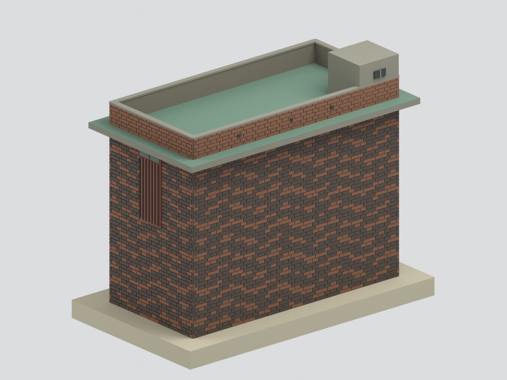
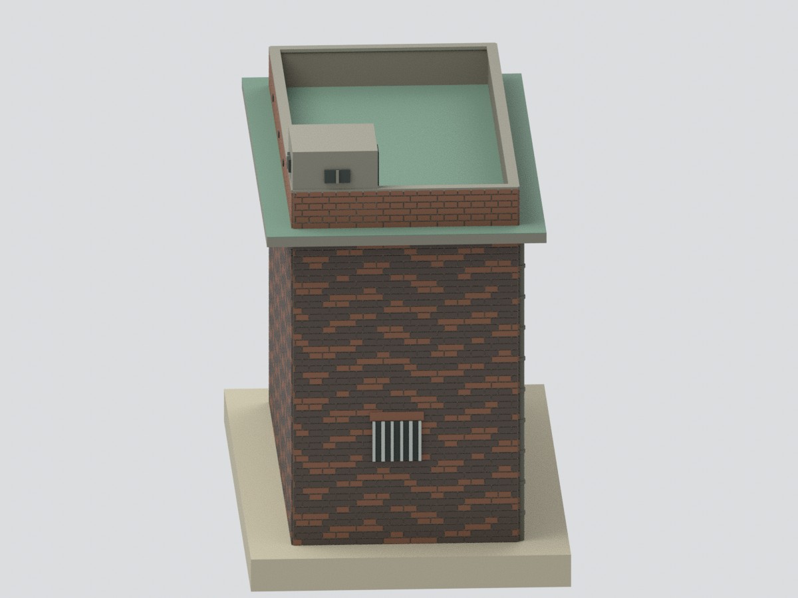
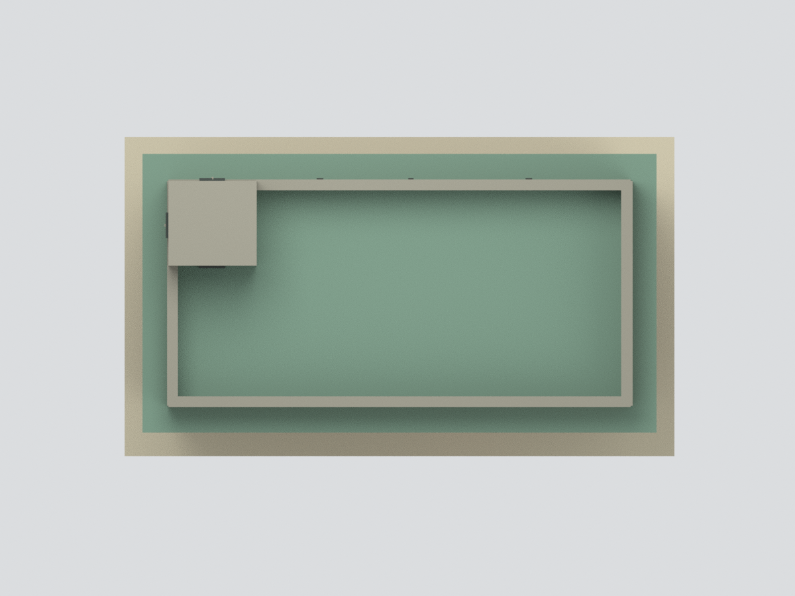
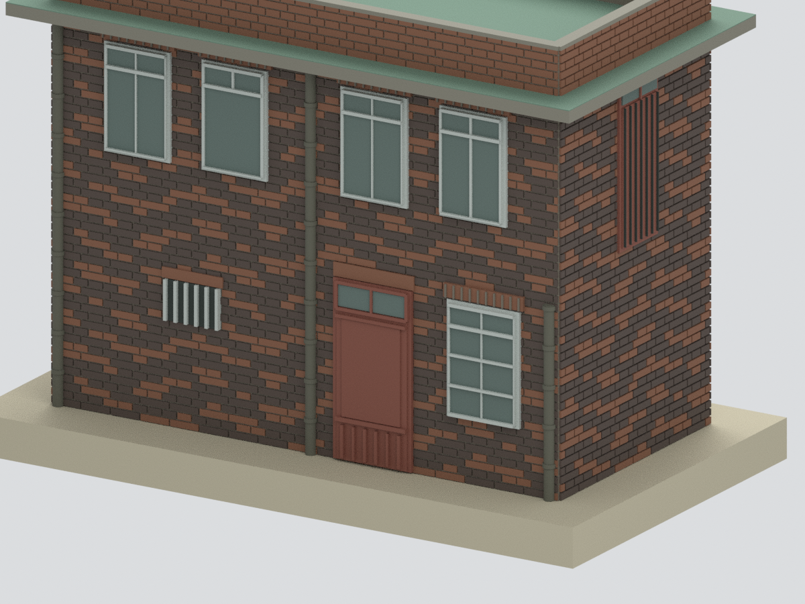

# 閻錫山故居・紅磚屋｜2006年度調查期外觀研究

## 模型預覽

| 西南正面斜視 | 西南低角正視 | 東北後側／東南端 |
|---|---|---|
|  |  |  |
| 西北端面 | 屋頂俯視 | 入口與上層端門局部 |
|  |  |  |

本包依官方95年度（2006）《臺北市市定古蹟閻錫山故居修復及再利用計畫》調查圖與同期照片，研究**紅磚屋兩層主體、平屋頂女兒牆及屋頂小型警備室／衛哨**。**不包含另棟種能洞石造屋、旁接低廚房、山坡或室內；不是2022修復後或2026現況。** 六張圖皆由同一融合網格實際渲染。[範圍圖](scope-plan.svg)

## 圖面與時相

A20／21一、二樓平面、A22屋頂、A25–28四面及A29–32剖面提供控制。報告3-38／39記錄**紅磚牆已塗黑瀝青**，3-39／40照片確認四扇上窗（左起第二扇下部為單大片）、灰粉刷屋頂衛哨及背面女兒牆小孔；3-23／45確認陶製落水管及右管上半破損。3-49現存入口是更換後**單扇木門、上方左右推拉氣窗**，不是原始雙扇門。[來源](SOURCES.md)

報告3-23說二樓當時沒有樓梯可走，連接上層東南門的棧橋是**修復建議**，本模型沒有把它或2022整修後外階補成舊況。附屬低廚房與地形不建，東南原受相鄰設施／地形遮蔽的牆段因此露出，只作中性磚牆支撐，不補造未知開口。報告照片屬調查脈絡，不宣稱每張都在同一天拍攝。

## 尺寸與端點

名義1:100，建築1m＝模型10mm，輸出毫米。主體採A21／25的686cm寬、A21的334cm深；A20的608cm另一測線、端立面的342cm和屋頂763×414cm外緣**不是同一組端點，不強行平均**。

屋頂長總註763cm，另鏈40＋686＋40＝766cm有3cm差，本模型採763cm總寬並對稱分配38.5cm端檐；深向採334＋40＋40＝414cm。267＋225＝492cm屋頂、58cm女兒牆至550cm、120cm衛哨至612cm；薄壓頂以估配3cm加在女兒牆磚頂，未冒稱為額外實測。整包含展示底座約81.6×47.4×66.2mm，次要門窗／屋面細節仍為掃描估配。

## 簡化與未建項

- 黑褐／紅磚依報告2-59／60以一皮長磚、一皮短磚的粗化丁順節奏及確定性配色呈現材質差異；**不是原位破損、瀝青分布或每一塊磚的描摹**。轉角七五磚未逐一還原；灰縫、窗楣磚列、陶管接頭及小窗欄片為可見性加厚，色彩沒有色卡校正。
- 門、玻璃、衛哨開口及背面小孔均是**實心背板的外觀代理**，不是穿通孔、可進入室內或任何防禦性能模型。屋頂衛哨保留有頂量體，未模擬內部梯洞／通道。
- 右陶管保留上段缺失的概略外形，其餘管身與頂蓋整平；沒有精細剝落、植物、電線、鏽斑、磚面刻字或裂損紋理。
- 低廚房、前門臨時小棚、相鄰建物、外部梯橋、擋土牆、庭園、室內木樓板、家具與古物全部排除。平展示底座不是場址測量地形。
- **未試印**。封閉網格及格式PASS不等於任意印表機都可直接列印；微小窗格、灰縫、薄懸檐與陶管接頭需先切片檢查，必要時調整尺寸／支撐。

## 檔案與驗證

`model.stl`、`model.3mf`為單一融合網格；`scene.blend`含唯一可見融合模型及隱藏可編輯構件，保留逐構件來源說明。可用[重建說明](REBUILD.md)從腳本重建；不依賴原始PDF或照片。數位完整性見`QA.json`／`BLEND-QA.json`，來源外觀及獨立重建見review檔。正式包以`manifest.json`與`SHA256SUMS`界定；**來源原圖／PDF不公開**。
