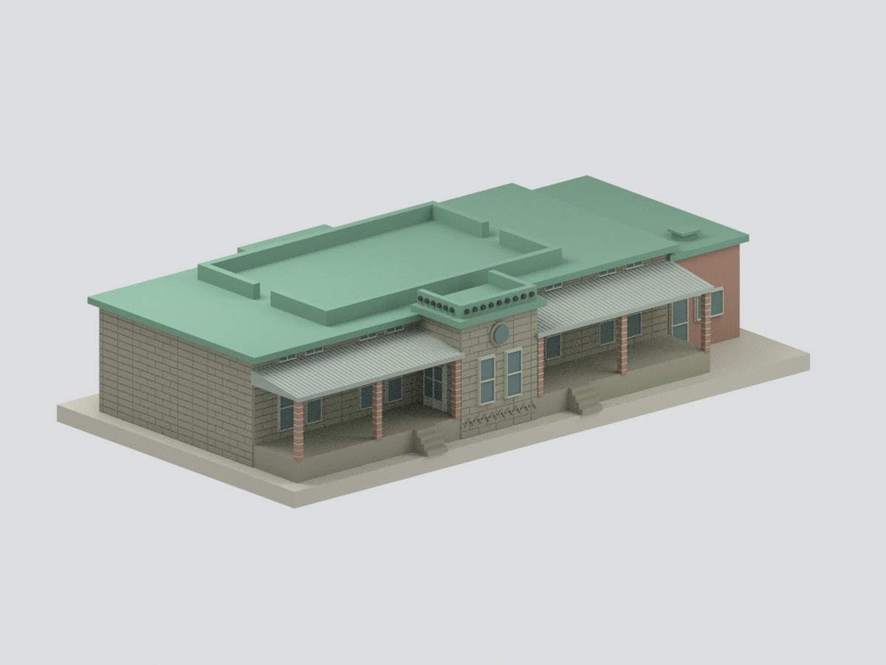
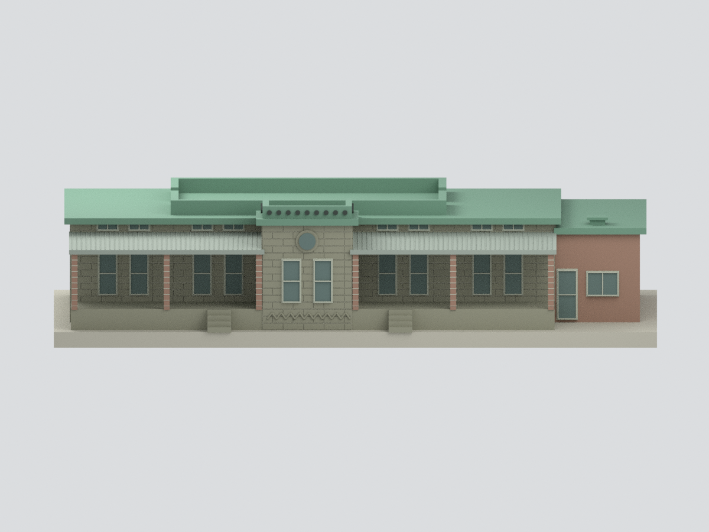
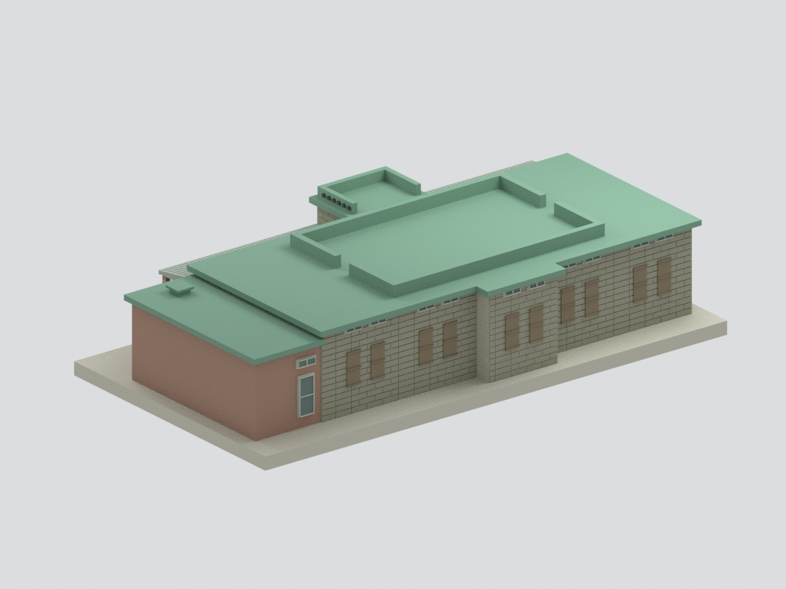
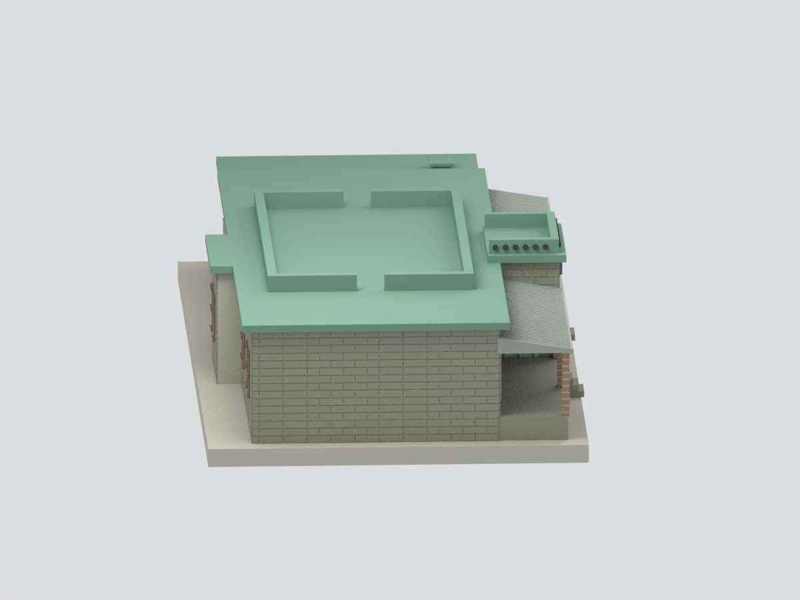
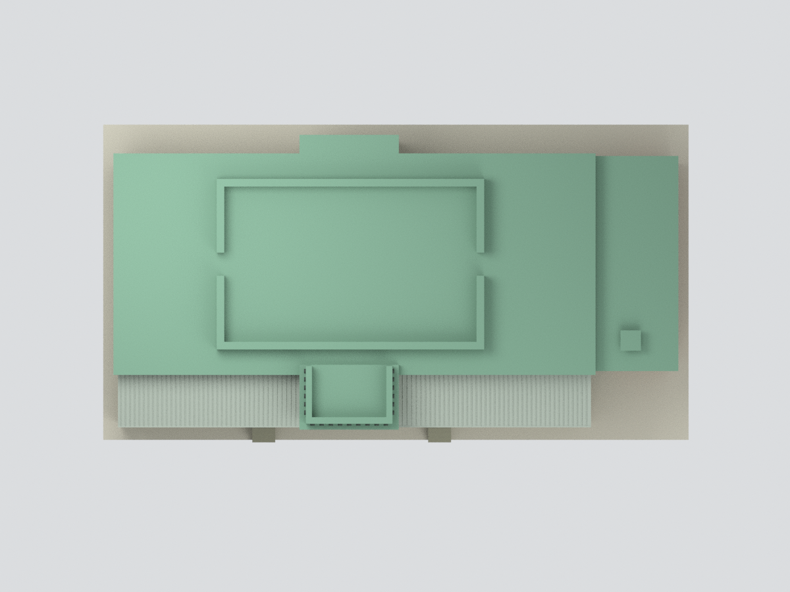
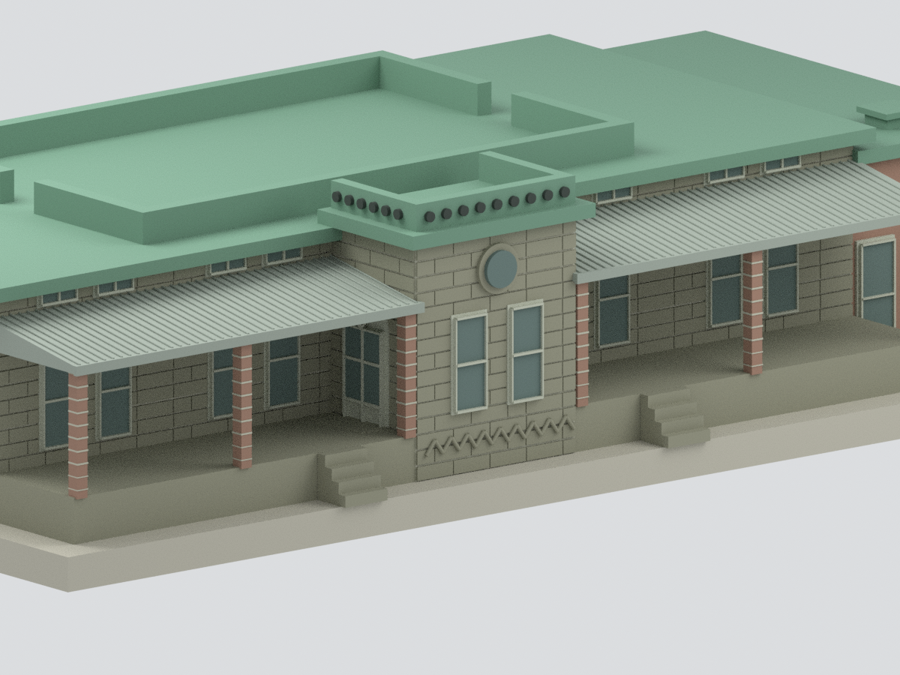

# 閻錫山故居・種能洞石造屋｜2006調查期外觀研究

## 模型預覽

| 西南正面斜視 | 西南低角正視 | 東北後側 |
|---|---|---|
|  |  |  |
| 西北端面 | 屋頂俯視 | 玄關局部 |
|  |  |  |

本包依官方95年度（2006）《臺北市市定古蹟閻錫山故居修復及再利用計畫》調查圖及同期照片，研究**種能洞石造主體、前廊、中央突出玄關、後方廁所突出部與右端低服務附屋**。**不含後方山坡上另棟紅磚屋，也不是2022修復後或2026現況。** 所有預覽均是本模型實際渲染。[範圍圖](scope-plan.svg)

## 依據與尺度

A11一樓平面、A12屋頂、A14–17四向立面、A18–19兩剖面控制量體，正文3-32／3-34／3-42照片交叉石砌、舊金屬窗、背面封板及綠色RC屋面。2022重新開放新聞只用來分辨兩棟及修復時相，**不移植修後竹棚／木窗**。[來源](SOURCES.md)

名義1:100，建築1m＝模型10mm，輸出毫米。正／背立面A14／15的**2167cm**＝730＋340＋772＋325為主要橫向控制；A11平面的2127cm、A12另一端點的2237cm、A18剖面2250cm採不同測線／外緣，不視為同一棟寬，也不強行平均。主體平面深度、前廊225cm、後方突出83cm及屋頂870cm測線分開配準。次要定位仍是掃描估配，不能當施工測繪。

## 建模取捨與限制

- 保留RC平屋頂、兩側各留90cm斷口的內矮牆、玄關前排九個及兩側各六個圓孔形式、中央圓窗、成對窄窗、舊浪板雨棚與低附屋。圓孔／門窗皆是**實心背板上的外觀代理**，不是穿通孔或透明室內。
- 屋頂24cm板厚依正文；內矮牆1050×670cm平面與約55cm高度依A12／19。高度需跨立面與剖面地坪基準估配，未重建每處高差。
- 平展示底座取代真實陡坡、駁坎與擋土牆；因此部分原受地形遮蔽的牆段會顯露。沒有山坡階梯、圍牆、院落、植栽、家具和內部分間。
- 15層交丁石砌、玄關人字砌與磚柱縫為粗化紋理，非逐塊原石描摹；不保證各石塊數量、表面風化與裂縫原位。門窗格、板條、階踏、檐口及通風帽次要尺寸為可見性／製造取向估配。
- 背側全排封板依報告3-22「皆以木版封住」及3-34照片，板條與橫檔為粗估；舊棚整平處理，沒有局部破損／塌垂；牆頂兩皮內縮牆肩、左側鐵鎖件、暗埋落水管、字牌／「中」字及小五金未建。色彩依同期材料照片示意，沒有色卡校正。
- **未試印**。通過數位封閉網格檢查不代表任意設備皆可列印；細框、石縫及雨棚懸挑需自行切片、確認最小特徵與支撐。

## 檔案與驗證

`model.stl`／`model.3mf`為單一融合網格；`scene.blend`含唯一可見融合模型及隱藏可編輯構件，帶逐構件來源說明。`build_model.py`、`render_model.py`及[重建說明](REBUILD.md)不依賴原始照片／PDF。`QA.json`及`BLEND-QA.json`僅證明格式和數位一致性；獨立外觀審核另列`independent-review.json`。`manifest.json`和`SHA256SUMS`列正式包；原PDF／來源照片不放入公開包。
