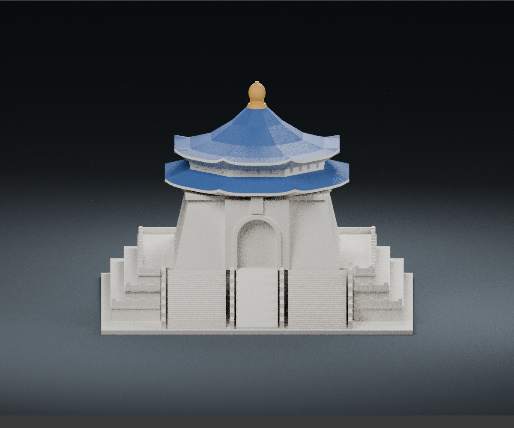

# 中正紀念堂主堂・150 mm 列印模型

以官方正面照片與官方建築說明為依據的近似外觀模型。範圍為主堂、三層臺基、雙側階梯與中央石坡；不含自由廣場牌樓、兩廳院、園區、人物或肖像。

## 模型預覽

| 模型預覽 | 模型預覽 | 模型預覽 |
| :---: | :---: | :---: |
| 正面  | 背面  | 正立面  |

## 檔案

- `model.stl`：可匯入切片軟體的單一封閉實體。單位 mm，ASCII STL。
- `scene.blend`：Blender 場景，內含由同一 STL 匯入的模型、可調整材質、攝影機與燈光。地面與燈光不屬於列印模型。
- `build_model.py`：參數化建模原始碼。
- `render_preview.py`：從 STL 重新產生三視角及 Blender 場景。
- `previews/`：實際 STL 網格的正前斜視、後斜視及正面預覽。
- `validation.json`、`validate_model.py`：網格檢查結果與驗證程式。
- `requirements.txt`、`參考來源.md`：重建相依套件與來源網址。

## 尺寸與列印

模型外框 150 × 142 × 107.3 mm，底面位於 Z=0。以 0.4 mm 噴嘴、0.16–0.20 mm 層高、至少 3 圈外殼及 10–15% 填充作為初始切片設定。平底朝下；底板厚 2 mm。寬底可視材料加 brim。

- 屋簷最外緣約 1.3 mm 厚，主要欄牆 1.6–1.8 mm，寶頂末端直徑 2 mm。
- 屋簷、斗栱與拱門上緣有懸垂，需要在切片軟體檢查支撐；建議使用局部／樹狀支撐並檢查拆除空間。不是免支撐保證。
- 階梯每側以 30 段可見踏步合併表示原建築正面的 89 階；單階升高約 0.7 mm、踏面約 1.34 mm。
- STL 不含顏色。藍瓦、白牆與金色寶頂為 Blender 預覽材質，可列印後上色。
- 尚未進行指定機型切片、耗材估算或實體試印。縮小尺寸會降低欄杆、屋簷與拱門的可靠度。

## 還原範圍與限制

保留白色斜收堂體、中央拱形入口、八角重簷、翹角、寶頂、臺基與雙側階梯的辨識特徵。參考官方高度關係，但為縮尺辨識與列印穩定調整部分比例；非固定比例、非測量、非施工或文資修復資料。

僅精讀正面官方照片。側面與背面未獲足夠影像／圖面驗證，以簡化連續外殼表示，不宣稱完整還原。拱門是有封閉背牆的淺凹槽；未重建室內。斗栱、屋脊、欄杆、石刻、瓦片、題字與雕飾均簡化，中央石坡不重製浮雕；未在題牌加入不清楚的文字。

## 檢查

最終 STL 通過：有限座標、無退化三角形、封閉、面方向一致、單一連通實體、每邊兩面、各頂點鄰域為單一環、正體積、平底 Z=0、最長邊 150 mm。ASCII STL 保留座標精度；請勿以未驗證的低精度轉檔覆蓋原件。

網格檢查不能取代切片檢查或實體試印，也不是所有自交情況的獨立證明。

## 重建

使用 Python 3.12 與 `requirements.txt` 所列套件，執行 `python build_model.py`。驗證：`python validate_model.py model.stl --longest-edge 150 --output validation.json`。預覽：`blender -b -t 4 -P render_preview.py`。Blender 4.x 的 STL 匯入介面為預覽程式所需。

來源照片僅供研究，未包含於交付包。模型未宣稱官方授權，亦未代第三方建築、影像或商標授予權利；公開使用前請依用途確認適用權利。
