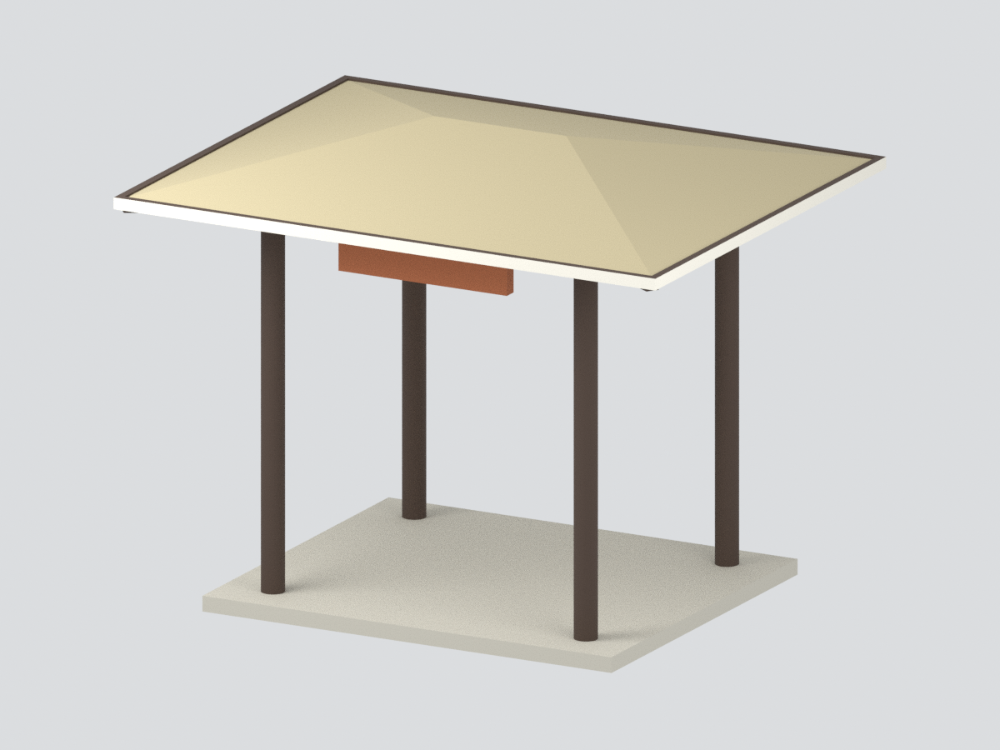

# 華梵學校財團法人華梵大學

現行收錄 **2 套模型包**；套件數不等於完整建築棟數，亦非全校／校區完成。未實體試印，來源年代、估計尺寸與未知範圍請閱各模型頁。

### 既有批次來源與列印限制（原批數量非現行總數）

通稱華梵大學。本批僅完成2009圖書資訊大樓的來源限定外觀近似；樓內廣欽老和尚紀念圖書館不另計一棟。不是全校完成，其他校舍待逐棟續作。

| 建築模型 | 建築模型 | 建築模型 |
| :---: | :---: | :---: |
|  **[圖資大樓東南主要面](校本部/buildings/hfu-library-2009/README.md)** |  **[華梵大學 雲山亭｜主要亭體彩色模型](校本部/buildings/hfu-yunshan-pavilion/README.md)** |  |

[模型完整說明](校本部/buildings/hfu-library-2009/README.md) · [STL](校本部/buildings/hfu-library-2009/model.stl) · [Blend](校本部/buildings/hfu-library-2009/scene.blend) · [屋頂](校本部/buildings/hfu-library-2009/previews/top.png) · [來源](校本部/buildings/hfu-library-2009/sources.json) · [QA](校本部/buildings/hfu-library-2009/qa-summary.json)

含底座150×140×53.5毫米。四開放柱亭、北高南低平台、東兩高柱入口及南雙層深廊依照片／正射建模。北道路名義15.2m、北平台19.2m等都是有界影像推估，未取得測繪標高；北西背窗保守省略，坡台非真實地形測繪。原來源照片／PDF不隨包散布。

2053筆高loss跨層樣本不是柱數，原面厚度／根與矩形數值對照詳見建物說明。該具體警告待統一獨審裁定，不宣稱零警告或保證可印；尚未實體試印。

## 續作範圍
其他教學、行政、宿舍及校園建築尚未在本批完成；不將研究條目或地圖設施當作已建模數量。後續應先查官方最新校圖與建物範圍，再逐棟建立來源。
