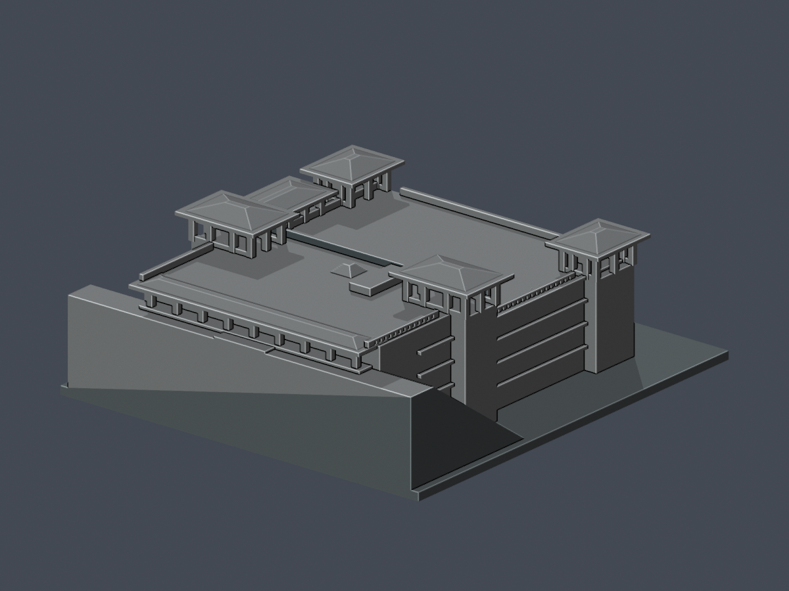
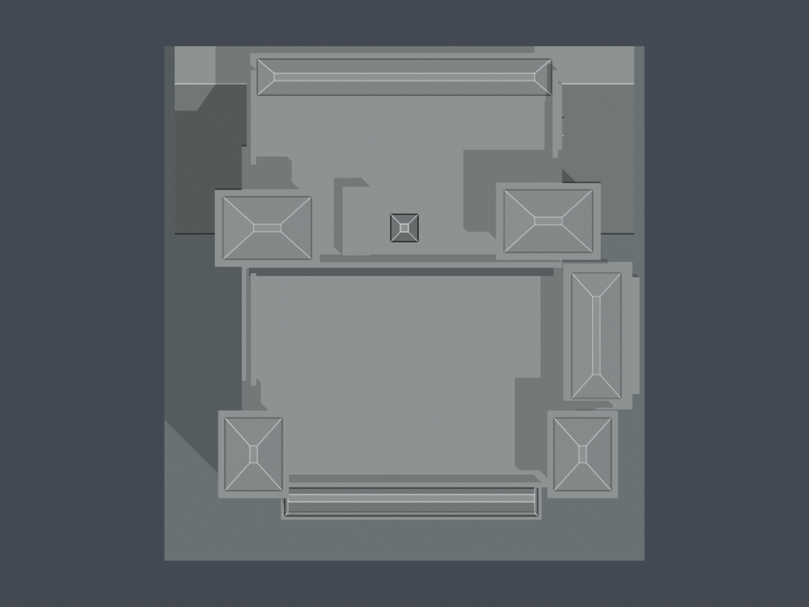
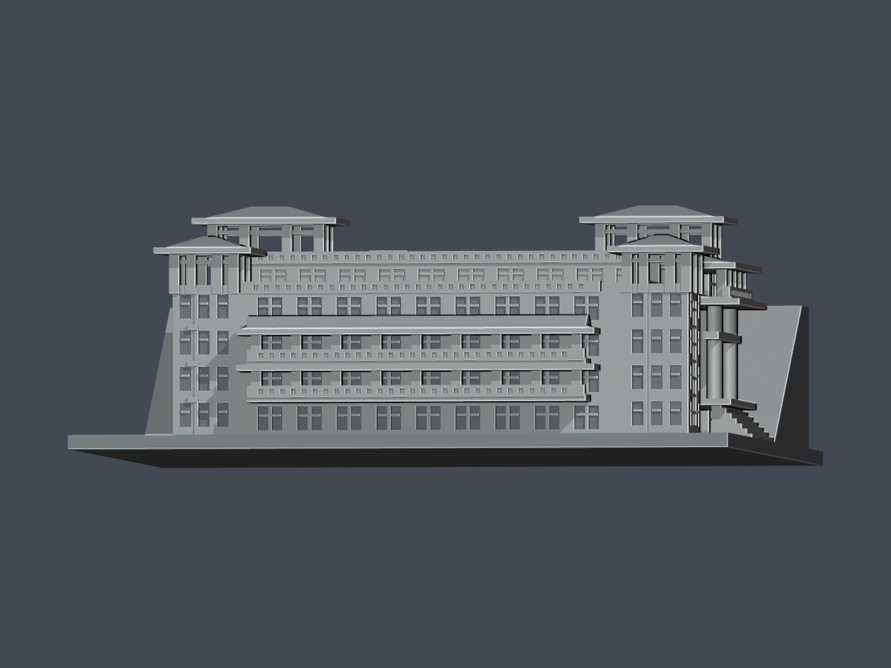
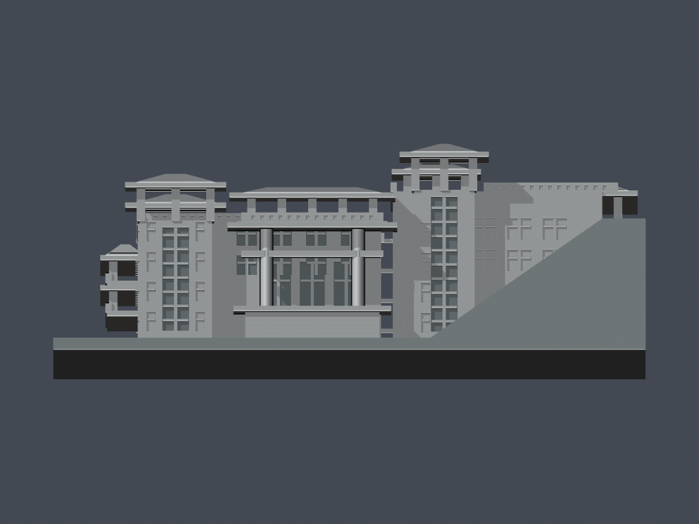
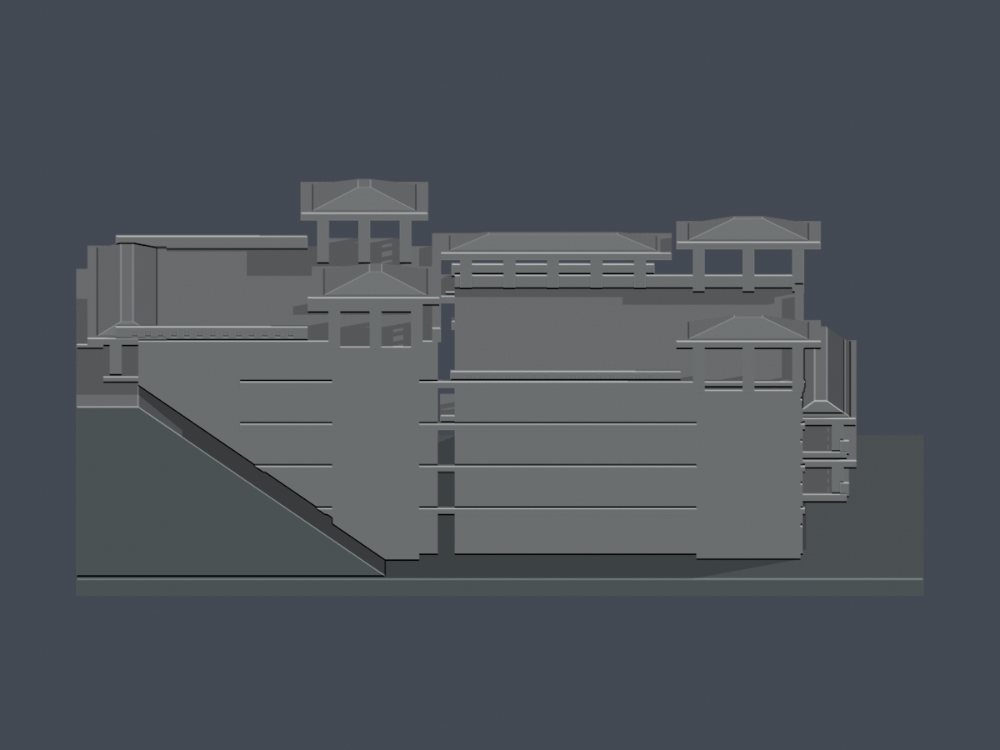
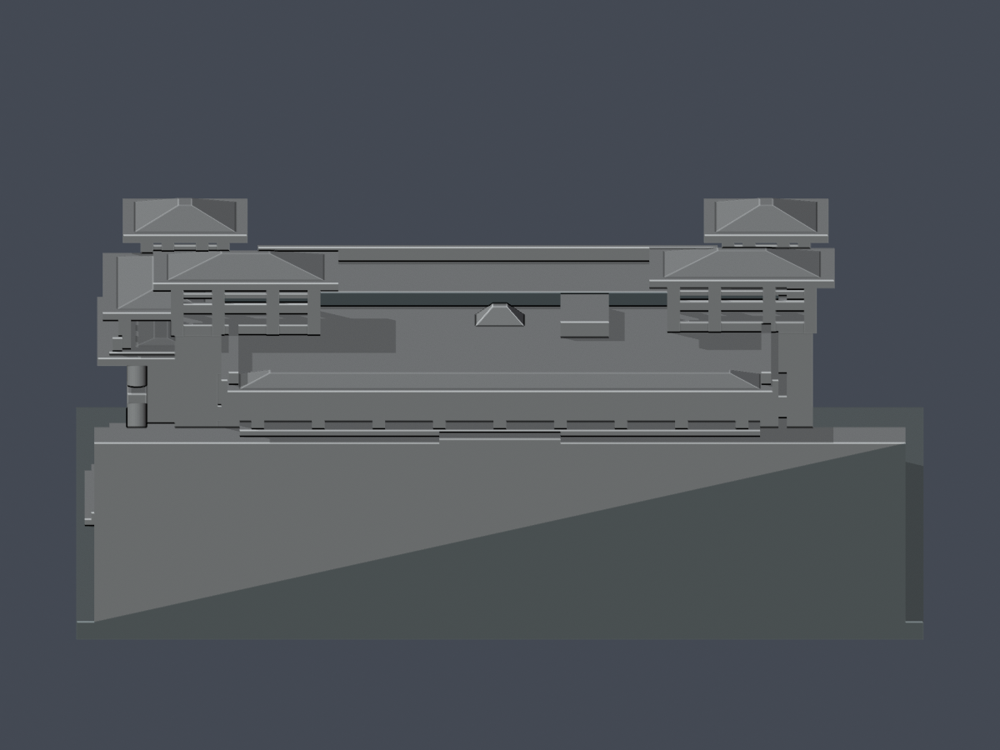

# 華梵大學圖書資訊大樓（2009）

來源限定的原創外觀近似模型。圖資大樓內「廣欽老和尚紀念圖書館」是使用單位，並非另計一棟。本件只涵蓋這棟大樓與辨識坡上／坡下入口所需的簡化坡台，不代表華梵全校完成，也不是建築或地形測繪。

| 模型預覽 | 模型預覽 | 模型預覽 |
| :---: | :---: | :---: |
| 東南主要外觀  | 西北／坡上外觀  |  |

## 模型與使用
- [STL](model.stl)、[可編輯Blender網格](scene.blend)、[重建Python源](build_model.py)、[環境需求](requirements.txt)。模型採最終毫米，含底座150×140×53.5mm；底座厚3mm。名義每推估實景米對2mm，約1:500，各尺寸仍有影像估值限制。
- 底座朝下。四亭、東雙高柱入口與南兩層長廊是真開放空間，屋簷／跨梁可能需要支撐。無實體試印，亦未驗Cura／Prusa工具路徑，不能保證免支撐或任何特定機器可印。
- [屋頂](previews/top.png)、[南面](previews/elevation.png)、[東入口](previews/east.png)、[西面](previews/west.png)、[北面](previews/rear-elevation.png)。全部PNG由交付STL本身匯入渲染；凹面顏色只協助閱讀，不是額外代理幾何。

| 模型預覽 | 模型預覽 | 模型預覽 |
| :---: | :---: | :---: |
| 屋頂  | 南面  | 東入口  |
| 西面  | 北面  |  |

## 依據與近似界線
來源索引：[sources.json](sources.json)；尺度／高程口徑：[dimensional-evidence.json](dimensional-evidence.json)。2009-10-30校方記啟用，主要外觀綜合校方實照、2023/2024公開照片及2017/2024正射。不同年來源不等於同年測繪。

- 北高南低兩片封閉平台、四座開放柱亭、東入口兩高圓柱／後退玻璃／上開廊、南兩層深廊和上部歇山端屋檐，均有圖像支持。沒有把平台挖成無據大天井，沒有把亭封成窗盒。
- 校方說北大學之道入口為5F，湖旁入口為1F；側視示意支持北路約與南平台／南亭底共高，北上平台再高一段。施工簡報層號略有差別，不能硬作整棟等高五層。
- 本模型南最低露層暫設0m並暫對B1，東1F入口試配3.8m；北道路／南平台15.2m，北上平台19.2m；南亭頂21.25m，北亭頂25.25m。這些是實景推估米，與最終模型毫米不同。最低露層地腳受樹遮，不能確證B1與地坪高差。低地到北路13–17m、總高24–30m是試配界，沒有官方分段標高。
- 屋頂以正射逐片描點，而非將OSM粗框整塊拉高。PHOTO2020服務當地影像實際水印為2017，不稱2020新照；另一影像水印2024。屋面高程視差不可當牆基地籍。
- 北、西背面窗細節被遮或未知，保守省略／淺分層。坡台只表達有界高差，不含全場地、道路、湖或精確坡度。紅外攝影僅參照形體，不採其顏色。
- 列印調整：77段方柱的最窄名義寬為最終2.1mm；欄杆改為有實背的淺刻分格，四座主要柱亭及大廊仍通空。亭四坡自簷至脊升最終3.3mm，短脊局部平頂寬2.2mm；小採光頂局部截尖。這些厚度／截尖是模型調整，不聲稱建物原件實測尺寸。

## 原始網格QA與具體警告
- [validation.json](validation.json)：原STL精確座標去重，不修補輸入；邊兩面、vertex link單環、法向繞序、單一連通表面、正體積及150mm檢查。獨立Python重建STL SHA、saved Blend幾何及7PNG完整位元組重現。
- [逐層](layer-opening-check.json)、[逐原Polygon](layer-component-check.json)、[canonical薄件輔助](thin-feature-check.json)：0.2mm層距、起始0.071mm、0.8mm參考opening，268層2804個原Polygon；每個原Polygon erosion及opening均不消失、不分裂。不是全方向最小壁厚檢測；未更動的canonical v3另以1.0mm層距作54層輔助對照。
- [全部局部loss](feature-loss-locations.json)保留各原Polygon、分組及高loss原輪廓；[原STL法向／根／通空ray](architectural-ray-check.json)逐量77段方柱、2根圓柱、四亭及門廊。方柱原面X/Y最小2.099998mm；欄刻槽實背最小1.159999mm。117非矩形警告截面的3634個原邊中點法向最小1.099998mm，仍非全面壁厚保證。
- 2053筆超1%loss是跨層樣本，絕不是2053支柱：1936筆矩形截面含柱及少量截尖／脊；117筆為欄、橫框等非矩形截面。實際方柱77段＝南兩廊18段、北入口9段、東上廊10段、四亭40段；另有2高圓柱。
- 原構件最大loss3.251605705027986%、保留96.74839429497201%；非矩形最大2.2491238349787%，loss都在原頂點0.41mm鄰域。少數原矩形輪廓含共線分段點，原opening在角外仍有最多0.0030853459mm²殘差，不能寫成零警告。[矩形診斷對照](rectangle-control-check.json)比較原輪廓與獨立理想矩形，原輪廓檢查與loss沒有被替換或修補。
- 這些具體轉角／數值現象已由統一獨立審核重現並獲主審特例接受；不以低整層比例放行薄皮，不改canonical閾值。完整匯總：[qa-summary.json](qa-summary.json)。

## 可重現檢查
執行build_model.py產生STL，Blender背景執行render_preview.py，再執行run_all_checks.py。檢查會重建及重渲染，耗時數分鐘。canonical check_thin_features.py採已核v3 SHA，原輪廓無invalid fallback；任何失敗均非零退出。所有實驗未經實體試印。

來源照片／PDF只用於私人核對，未隨本包散布。此模型與程式為依公開圖像自建的近似成果，未擷取第三方3D模型。

## 獨立原面補充
268層2804原Polygon保持原WKT正式開運算，零侵蝕／opening消失或分裂，不以理想矩形結果取代正式原輪廓。2053跨層警告分1936矩形及117非矩形，非2053根柱；矩形最大3.251605705028%、保留96.748394294972%，非矩形最大2.249123834979%。25整層超過1%，整層最大3.157475829520%。
77方柱原面法線最小2.0999984mm，3634非矩形原邊探點實際三角面法線最小1.0999985mm，5槽背最小1.1599998mm，共3716起點皆在實體內；上下根重現，四亭和東上廊保持真通空。這些為指定部位量測，不是全方向最小壁厚。
矩形原頂點0.41mm區外最大0.0030853459156mm²，去除共線細分點辨識真角後，同0.41mm區外最大0.00319574819093mm²／原構件0.07246599662%，皆在原邊0.005mm內；不能說純角零損，正式原WKT開運算數值仍完整保留。117非矩形的真角區外最高6.9944162e−17mm²，屬數值殘差，不冒稱絕對零。這是指定根接與厚度證據支持的個案，沒有全域壁厚、免支撐或實體印製保證；欄、框、亭簷與懸挑需評估支撐和拆除，不得任意縮小，尚未試印。
